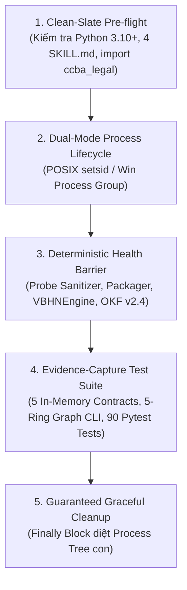

# Kỹ Năng Kiểm Định Tự Động Chu Trình Nạp, Hợp Nhất & Tư Vấn Pháp Lý (ccba-verify-legal-ingest)

Bộ kỹ năng kiểm định tự động chuyên biệt cho chu trình nạp văn bản [`/ccba-legal-ingest`](../ccba-legal-ingest/SKILL.md) cùng các kỹ năng liên đới trực tiếp trong dây chuyền: [`/ccba-tvpl-vip-crawler`](../ccba-tvpl-vip-crawler/SKILL.md), [`/ccba-legal-document-tracker`](../ccba-legal-document-tracker/SKILL.md) và [`/ccba-legal-advisor`](../ccba-legal-advisor/SKILL.md). Toàn bộ kịch bản harness được cô lập tại `.agents/skills/ccba-verify-legal-ingest/harness/verify_legal_ingest_harness.py` theo chuẩn Pstack Upstream (v0.15.36), ADR-0009, ADR-0044 và ADR-0061.

## 🏛️ Platform-Aware Architecture Posture

- **Seam Capability Posture**: `seam-exempt`. Kỹ năng này là bộ kiểm định tự động (`verify-<app>`) bảo vệ các hợp đồng thực thi của dây chuyền Ingest $\to$ Sanitize $\to$ Convert $\to$ Consolidate $\to$ Graph/Advise theo 5 khối kiến trúc Pstack.
- **Provenance & Sync Anchor (`COND-01`, `COND-02`)**: Neo phiên bản tại `sync_commit: 688c6a09ab8304be80d3d076cd936055320b8684`, bảo vệ trực tiếp danh mục `covered_paths`.

---

## 5 Khối Chức Năng Cốt Lõi (Architecture Blocks)



### 1. Clean-Slate Pre-flight (Tiền Kiểm Sạch Sẽ)
- Kiểm tra phiên bản Python runtime ($\ge 3.10$).
- Kiểm tra sự tồn tại của 4 kỹ năng liên đới (`ccba-legal-ingest`, `ccba-tvpl-vip-crawler`, `ccba-legal-document-tracker`, `ccba-legal-advisor`) và khả năng nạp package `ccba_legal`.

### 2. Dual-Mode Process Lifecycle (Quản Trị Tiến Trình Đa Nền Tảng)
- Khởi chạy các tiến trình kiểm thử CLI/Pytest trong nhóm tiến trình độc lập:
  - **POSIX (Linux/macOS):** `kwargs["preexec_fn"] = os.setsid`.
  - **Windows:** `kwargs["creationflags"] = subprocess.CREATE_NEW_PROCESS_GROUP`.

### 3. Deterministic Health Barrier (Rào Chắn Sẵn Sàng Xác Định)
- Tuyệt đối CẤM dùng `time.sleep(N)`.
- Xác thực in-memory các class cốt lõi (`DocxCanonicalSanitizer`, `OKFBundlePackager`, `LegislativeConsolidator`, `VBHNEngine`, `TVPLSessionMutex`, `VisualParityAuditor`, `DynamicStatutoryResolver`) và kiểm tra hằng số `CURRENT_OKF_VERSION == "2.4"`.

### 4. Evidence-Capture Test Suite (Thực Thi Kiểm Thử & Thu Thập Bằng Chứng)
- Hỗ trợ 4 chế độ vận hành:
  - `--mode smoke`: Kiểm định nhanh in-memory 5 hợp đồng cốt lõi (`FEAT-ING-001` đến `FEAT-ING-005`).
  - `--mode graph`: Kiểm định CLI điều hướng đồ thị pháp lý 5 vành đai (`python scripts/spoke_cli.py graph --doc Luat-Xay-dung-2025-135-2025-QH15 --json`).
  - `--mode unit`: Chạy 90 bài kiểm thử đơn vị & tích hợp (`test_docx_sanitizer.py`, `test_okf_bundle_v2.py`, `test_consolidator.py`, `test_vbhn_engine.py`, `test_crawler_seam.py`, `test_currency_resolver.py`, `test_table_grid_engine.py`, `test_visual_parity.py` và `tests/integration/`).
  - `--mode full`: Thực thi đầy đủ `smoke` + `graph` + `unit`.
- Xuất báo cáo chứng cứ JSON tại `.md/reports/evidence_verify_legal_ingest.json`.

### 5. Guaranteed Graceful Cleanup (Dọn Dẹp Đảm Bảo Tuyệt Đối)
- Toàn bộ tiến trình con được thu dọn trong khối `finally:` bằng `os.killpg(..., signal.SIGTERM)` (POSIX) hoặc `taskkill /F /T /PID` (Windows).

---

## Bảng Ánh Xạ Tính Năng (Features Map Reference)

Các mã tính năng của chu trình Ingest/Consolidate/Advise được đăng ký tại [`features/INDEX.md`](file:///home/vvc/ccba/ccba-legal-knowledge/features/INDEX.md):
- `FEAT-ING-001`: TVPL VIP Acquisition & Session Mutex (`/ccba-tvpl-vip-crawler` & `/ccba-legal-ingest` Bước 0)
- `FEAT-ING-002`: Canonical OpenXML Sanitizer & OKF v2.4 Packager (`/ccba-legal-ingest` Bước 1)
- `FEAT-ING-003`: Multimodal 2D Table Grid, KaTeX & Visual Parity (`/ccba-legal-ingest` Bước 1.5 & Gate 9/13/14)
- `FEAT-ING-004`: Legislative AST Consolidation & VBHN Matrix (`/ccba-legal-document-tracker` & `/ccba-legal-ingest` Bước 2)
- `FEAT-ING-005`: 5-Ring Legal Graph Routing & Hard-Floor Currency Guard (`/ccba-legal-advisor` & `/ccba-legal-ingest` Mục 5)

---

## Hướng Dẫn Sử Dụng & Quy Trình Vận Hành

### Bước 1: Kiểm Tra Nhanh 5 Hợp Đồng In-Memory (Smoke Mode)
```bash
python .agents/skills/ccba-verify-legal-ingest/harness/verify_legal_ingest_harness.py --mode smoke
```
**Tiêu chí hoàn thành:** Pre-flight, Health Barrier và 5 hợp đồng in-memory vượt qua $< 0.5\text{s}$, exit code 0.

### Bước 2: Kiểm Định Đồ Thị 5 Vành Đai Pháp Lý (Graph Mode)
```bash
python .agents/skills/ccba-verify-legal-ingest/harness/verify_legal_ingest_harness.py --mode graph
```
**Tiêu chí hoàn thành:** Lệnh `spoke_cli.py graph` trích xuất đúng cấu trúc JSON 5 vành đai của Luật Xây dựng 2025 (`135/2025/QH15`), exit code 0.

### Bước 3: Nghiệm Thu Toàn Diện 90 Bài Kiểm Thử Chu Trình Ingest (Full Mode)
```bash
python .agents/skills/ccba-verify-legal-ingest/harness/verify_legal_ingest_harness.py --mode full
```
**Tiêu chí hoàn thành:** Toàn bộ 5 hợp đồng in-memory, CLI đồ thị 5 vành đai và 90 bài test Pytest vượt qua 100%, xuất tệp `.md/reports/evidence_verify_legal_ingest.json` với `overall_status: "PASSED"`.

### Bước 4: Khắc Phục Sai Lệch & Semantic Mutation Proof (`COND-01`, `COND-02`)
1. **Phân loại nguồn gốc (`in_sync`, `updated`, `bug`, `blocked`):** Nếu lỗi phát sinh do hồi quy trong bộ chuyển đổi/hợp nhất (`bug`), **tuyệt đối không làm yếu bài test trong `harness/`** mà phải sửa mã nguồn ứng dụng.
2. **Semantic Mutation Proof (`COND-01`, `COND-02`):** Khi cập nhật `harness/` (`updated`), bắt buộc tiêm đột biến ngữ nghĩa tạm thời trên mã nguồn thuộc `covered_paths`, xác nhận harness bắt được lỗi (lưu counterexample log), hoàn nguyên sạch và xác nhận exit code 0 trước khi nâng `sync_commit`.
**Tiêu chí hoàn thành:** Phân loại đúng trạng thái drift, vượt qua Semantic Mutation Proof và thoát sạch với exit code 0.

---

*Tạo bởi CCBA — Trung tâm Tư vấn và Ứng dụng BIM trong Xây dựng.*
*Tuân thủ Hiến pháp Nền tảng CCBA (ADR-0009, ADR-0044, ADR-0061).*
