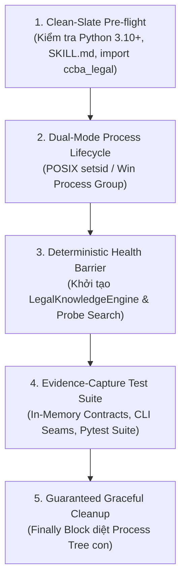

# Kỹ Năng Kiểm Định Tự Động Động Cơ Trí Tuệ Pháp Lý (ccba-verify-legal-intel)

Bộ kỹ năng kiểm định tự động chuyên biệt cho kỹ năng [`/ccba-legal-intel`](../ccba-legal-intel/SKILL.md) và động cơ **`LegalKnowledgeEngine`** (`packages/ccba-legal-intel`), tuân thủ chuẩn mực kiến trúc kiểm định Pstack Upstream (v0.15.36), ADR-0009, ADR-0044 và ADR-0061. Toàn bộ kịch bản harness được cô lập trong `.agents/skills/ccba-verify-legal-intel/harness/verify_legal_intel_harness.py`, giữ nguyên ngân sách 15 kịch bản tại thư mục gốc `scripts/`.

## 🏛️ Platform-Aware Architecture Posture

- **Seam Capability Posture**: `seam-exempt`. Kỹ năng này là bộ kiểm định tự động (`verify-<app>`) xác thực các hợp đồng Deep Seam của `/ccba-legal-intel` (`LegalKnowledgeEngine`, `query`, `get-clause`, `get-table`, `parse_national_construction_id`, `pptx`, `sync`) theo 5 khối kiến trúc Pstack.
- **Provenance & Sync Anchor (`COND-01`, `COND-02`)**: Neo phiên bản tại `sync_commit: 688c6a09ab8304be80d3d076cd936055320b8684`, bảo vệ trực tiếp các đường dẫn trong `covered_paths`.

---

## 5 Khối Chức Năng Cốt Lõi (Architecture Blocks)



### 1. Clean-Slate Pre-flight (Tiền Kiểm Sạch Sẽ)
- Kiểm tra phiên bản Python runtime ($\ge 3.10$).
- Kiểm tra sự tồn tại của `legal_registry.yaml`, `.agents/skills/ccba-legal-intel/SKILL.md` và khả năng import package `ccba_legal`.

### 2. Dual-Mode Process Lifecycle (Quản Trị Tiến Trình Đa Nền Tảng)
- Khởi chạy các tiến trình kiểm thử CLI/Pytest trong nhóm tiến trình độc lập:
  - **POSIX (Linux/macOS):** `kwargs["preexec_fn"] = os.setsid`.
  - **Windows:** `kwargs["creationflags"] = subprocess.CREATE_NEW_PROCESS_GROUP`.

### 3. Deterministic Health Barrier (Rào Chắn Sẵn Sàng Xác Định)
- Tuyệt đối CẤM dùng `time.sleep(N)`.
- Khởi tạo trực tiếp `LegalKnowledgeEngine` trên `legal_registry.yaml` và thực hiện truy vấn thăm dò (`engine.search("Luật Xây dựng", top_k=3)`) xác nhận phản hồi tức thì ($< 0.05\text{s}$).

### 4. Evidence-Capture Test Suite (Thực Thi Kiểm Thử & Thu Thập Bằng Chứng)
- Hỗ trợ 4 chế độ vận hành:
  - `--mode smoke`: Kiểm định nhanh in-memory 4 hợp đồng Deep Seam cốt lõi (`FEAT-INT-001` đến `FEAT-INT-004`, bao gồm rào chắn bảo mật CWE-22 Path Traversal).
  - `--mode cli`: Kiểm định các lệnh CLI thực tế (`python -m ccba_legal query`, `get-clause`, `get-table`).
  - `--mode unit`: Chạy bộ pytest chuyên biệt của `packages/ccba-legal-intel/tests` (`test_legal_knowledge_engine.py`, `test_cli_doc_parity.py`, `test_lexicon_harvester.py`, `test_legal_to_pptx_seam.py`, `test_sync_spoke.py`).
  - `--mode full`: Thực thi đầy đủ `smoke` + `cli` + `unit`.
- Xuất báo cáo chứng cứ JSON tại `.md/reports/evidence_verify_legal_intel.json`.

### 5. Guaranteed Graceful Cleanup (Dọn Dẹp Đảm Bảo Tuyệt Đối)
- Toàn bộ tiến trình con được thu dọn trong khối `finally:` bằng `os.killpg(..., signal.SIGTERM)` (POSIX) hoặc `taskkill /F /T /PID` (Windows).

---

## Bảng Ánh Xạ Tính Năng (Features Map Reference)

Các mã tính năng của `/ccba-legal-intel` được đăng ký tại [`features/INDEX.md`](file:///home/vvc/ccba/ccba-legal-knowledge/features/INDEX.md):
- `FEAT-INT-001`: Registry Search & Lifecycle Warning (`query` / `LegalKnowledgeEngine.search`)
- `FEAT-INT-002`: Tier-Aware Clause Extraction & CWE-22 Containment (`get-clause` / `LegalKnowledgeEngine.get_clause`)
- `FEAT-INT-003`: 2D Table Matrix Extraction (`get-table` / `LegalKnowledgeEngine.get_table`)
- `FEAT-INT-004`: Canonical Lexicon & QD 1812/QD-BXD ID Parser (`parse_national_construction_id`)
- `FEAT-INT-005`: Legal-to-PPTX & Spoke Sync Seams (`ccba_legal pptx`, `ccba_legal sync`)

---

## Hướng Dẫn Sử Dụng & Quy Trình Vận Hành

### Bước 1: Kiểm Tra Nhanh Hợp Đồng Deep Seam (Smoke Mode)
```bash
python .agents/skills/ccba-verify-legal-intel/harness/verify_legal_intel_harness.py --mode smoke
```
**Tiêu chí hoàn thành:** Pre-flight, Health Barrier và 4 hợp đồng in-memory vượt qua $< 0.5\text{s}$, exit code 0.

### Bước 2: Kiểm Định Giao Diện Dòng Lệnh CLI (CLI Mode)
```bash
python .agents/skills/ccba-verify-legal-intel/harness/verify_legal_intel_harness.py --mode cli
```
**Tiêu chí hoàn thành:** Cả 3 subcommands (`query`, `get-clause`, `get-table`) phản hồi đúng định dạng chuẩn và thoát với exit code 0.

### Bước 3: Nghiệm Thu Toàn Diện Động Cơ `/ccba-legal-intel` (Full Mode)
```bash
python .agents/skills/ccba-verify-legal-intel/harness/verify_legal_intel_harness.py --mode full
```
**Tiêu chí hoàn thành:** Toàn bộ các bài kiểm thử in-memory, CLI và bộ unit test của `packages/ccba-legal-intel` vượt qua 100%, xuất tệp `.md/reports/evidence_verify_legal_intel.json` với `overall_status: "PASSED"`.

### Bước 4: Khắc Phục Sai Lệch & Semantic Mutation Proof (`COND-01`, `COND-02`)
1. **Phân loại nguồn gốc (`in_sync`, `updated`, `bug`, `blocked`):** Nếu lỗi phát sinh do hồi quy trong `ccba_legal` (`bug`), **tuyệt đối không làm yếu bài test trong `harness/`** mà phải sửa mã nguồn trong `packages/ccba-legal-intel`.
2. **Semantic Mutation Proof (`COND-01`, `COND-02`):** Khi cập nhật `harness/` (`updated`), bắt buộc tiêm đột biến ngữ nghĩa tạm thời trên mã nguồn `ccba_legal`, xác nhận harness bắt được lỗi (lưu counterexample log), hoàn nguyên sạch và xác nhận exit code 0 trước khi nâng `sync_commit`.
**Tiêu chí hoàn thành:** Phân loại đúng trạng thái drift, vượt qua Semantic Mutation Proof và thoát sạch với exit code 0.

---

*Tạo bởi CCBA — Trung tâm Tư vấn và Ứng dụng BIM trong Xây dựng.*
*Tuân thủ Hiến pháp Nền tảng CCBA (ADR-0009, ADR-0044, ADR-0061).*
