# 🎯 Yêu Cầu Thẩm Định Kế Hoạch Triển Khai: Nâng Cấp Hệ Sinh Thái Mạng Tri Thức 5 Vành Đai Luật Xây Dựng 135/2025/QH15

> ⚠️ **Chỉ Dẫn Cho Grok**:
> 1. Vui lòng xuất báo cáo với khối **`PeerVerdictBlock` (YAML frontmatter) nằm ngay tại dòng 1 của tệp** (được bao quanh bởi hai hàng `---`), **TUYỆT ĐỐI KHÔNG** bọc khối YAML này trong cặp dấu markdown code blocks ````yaml ... ````.
> 2. Toàn bộ nội dung Kế hoạch Triển khai chi tiết của Antigravity đã được nhúng đầy đủ dưới đây. Bạn thực hiện Direct Reasoning Audit mà không cần quét đĩa.
> 3. Hãy tập trung đánh giá xem kế hoạch này đã giải quyết trọn vẹn và chuẩn xác 4 điều kiện (COND-01 đến COND-04) mà Grok đã nêu tại phiên trước hay chưa, và đưa ra phán quyết (`APPROVE`, `APPROVE_WITH_CONDITIONS`, hoặc `REJECT`).

Chào Grok,

Dựa trên phán quyết `APPROVE_WITH_CONDITIONS` và 4 điều kiện kỹ thuật mà bạn đã đưa ra tại phiên thẩm định trước (`req-spoke-law135-knowledge-graph-001`), Antigravity đã xây dựng một **Kế hoạch Triển khai Chi tiết (Implementation Plan)**.

User đã yêu cầu: *"Chuyển grok review kế hoạch này"*.

Dưới đây là toàn văn Kế hoạch Triển khai để Grok tiến hành thẩm tra đối kháng:

---

# Kế Hoạch Triển Khai: Nâng Cấp Hệ Sinh Thái Mạng Tri Thức 5 Vành Đai Luật Xây Dựng 135/2025/QH15

> **Trạng thái**: Chờ duyệt (Pending Approval)  
> **Tiêu chuẩn tham chiếu**: ADR-0007 (Semantic Metadata), ADR-0059 (Knowledge Graph Ingestion), ADR-0061 (KISS v2.0 & Platform-Aware Seams)  
> **Phán quyết độc lập của Grok**: `APPROVE_WITH_CONDITIONS` ([`.md/peer_exchange/grok_review_law135_knowledge_graph.md`](file:///home/vvc/ccba/ccba-legal-knowledge/.md/peer_exchange/grok_review_law135_knowledge_graph.md))  

---

## 1. Mục Tiêu Kỹ Thuật (Goal Description)

Sau khi rà soát toàn bộ 21 văn bản thi hành trực tiếp của [Luật Xây dựng 2025 số 135/2025/QH15](file:///home/vvc/ccba/ccba-legal-knowledge/legal_docs/01_vbpl/luat_xay_dung_2025_135_2025_qh15/) và bổ sung Sub-Gate 5.4 kiểm định toàn vẹn tham chiếu, kế hoạch này hiện thực hóa **4 trụ cột nâng cấp hệ sinh thái tri thức** đã được Grok thẩm định và người dùng phê duyệt:

1. **Trụ cột 1 (Vành đai 5 - Mở rộng cấp Địa phương)**: Liên kết [Quyết định 38/2026/QĐ-UBND của TP. Hà Nội](file:///home/vvc/ccba/ccba-legal-knowledge/legal_docs/01_vbpl/vn_hn_qd_38_2026_qd_ubnd/) (quy định phân cấp quản lý quy hoạch - kiến trúc và cấp phép xây dựng) vào trường `local_delegations` của Luật 135, đồng thời mở rộng Sub-Gate 5.4 trong `validate_legal_spoke.py` để bảo đảm tính toàn vẹn 100%.
2. **Trụ cột 2 (Dynamic Graph Inversion - Grok Phase 2)**: Hiện thực hóa nguyên tắc *Single Source of Truth* bằng cách xây dựng hàm `build_bidirectional_legal_graph()` và CLI subcommand `spoke_cli.py graph --doc ...`. Cạnh ngược được suy diễn tự động trên RAM khi chạy runtime (ví dụ: NĐ 339 tự động có `sanctions: [135/2025/QH15]`, NĐ 105 tự động có `interlocks_with: [135/2025/QH15]`), loại bỏ hoàn toàn việc chỉnh sửa thủ công phân tán các file YAML tĩnh.
3. **Trụ cột 3 (Agent Skills Enhancement)**: Tích hợp cơ chế **Two-Stage Semantic Routing** vào [`ccba-legal-advisor/SKILL.md`](file:///home/vvc/ccba/ccba-legal-knowledge/.agents/skills/ccba-legal-advisor/SKILL.md) và [`ccba-hybrid-rag-search/SKILL.md`](file:///home/vvc/ccba/ccba-legal-knowledge/.agents/skills/ccba-hybrid-rag-search/SKILL.md), giúp AI Agent tự động định tuyến qua 5 Vành đai tri thức trước khi trích xuất chunk điều khoản từ `clauses.json`.
4. **Trụ cột 4 (Git Hygiene & Versioning)**: Đóng gói toàn bộ các thay đổi thành các Git Commit chuẩn mực theo quy ước Conventional Commits.

---

## 2. Điểm Cần Người Dùng Xác Nhận (User Review Required)

> [!IMPORTANT]
> **Nguyên tắc Bất biến Single Source of Truth (KISS v2.0 - ADR-0061)**:
> - Dữ liệu tĩnh trên đĩa (`metadata.yaml`, `legal_registry.yaml`) **CHỈ khai báo 1 chiều hướng tâm** tại [Luật 135/2025/QH15](file:///home/vvc/ccba/ccba-legal-knowledge/legal_docs/01_vbpl/luat_xay_dung_2025_135_2025_qh15/).
> - Toàn bộ các cạnh ngược (Reverse Edges) từ NĐ 339, NĐ 105, Luật PCCC 55, các QCVN quay trở lại Luật 135 sẽ được **suy diễn động 100% trong bộ nhớ (In-Memory)** bởi engine `build_bidirectional_legal_graph()`.
> - Không tạo script wrapper mới tại `scripts/` nhằm bảo vệ cứng ngân sách tối đa 15 kịch bản theo ADR-0044. Hàm đồ thị được tích hợp trực tiếp vào Seam Facade có sẵn [`scripts/spoke_cli.py`](file:///home/vvc/ccba/ccba-legal-knowledge/scripts/spoke_cli.py).

---

## 3. Kiến Trúc Mạng Tri Thức 5 Vành Đai

```mermaid
graph TD
    subgraph V1["Vành đai 1: Khung Thi hành Trực tiếp"]
        L135["Luật Xây dựng 135/2025/QH15"] -->|enacted_by| ND193["NĐ 193/2026/NĐ-CP (QLDA)"]
        L135 -->|enacted_by| ND206["NĐ 206/2026/NĐ-CP (Chất lượng)"]
        L135 -->|enacted_by| ND207["NĐ 207/2026/NĐ-CP (Chi phí)"]
        L135 -->|enacted_by| ND209["NĐ 209/2026/NĐ-CP (Hợp đồng)"]
        L135 -->|enacted_by| ND210["NĐ 210/2026/NĐ-CP (Năng lực)"]
        L135 -->|enacted_by| ND212["NĐ 212/2026/NĐ-CP (BIM)"]
        L135 -->|enacted_by| ND217["NĐ 217/2026/NĐ-CP (Phá dỡ)"]
    end

    subgraph V2["Vành đai 2: Chế tài Xử phạt VPHC"]
        L135 -->|sanctioned_by| ND339["NĐ 339/2026/NĐ-CP (Xử phạt VPHC XD)"]
    end

    subgraph V3["Vành đai 3: Liên thông 1 Cửa & Luật Chuyên Ngành"]
        L135 -->|interlocks_with| L55["Luật PCCC 55/2024/QH15"]
        L135 -->|interlocks_with| ND105["NĐ 105/2025/NĐ-CP (Liên thông PCCC)"]
        L135 -->|related_statutes| L47["Luật Quy hoạch 47/2024/QH15"]
        L135 -->|related_statutes| L22["Luật Đấu thầu 22/2023/QH15"]
        L135 -->|related_statutes| L31["Luật Đất đai 31/2024/QH15"]
        L135 -->|related_statutes| L27["Luật Nhà ở 27/2023/QH15"]
        L135 -->|related_statutes| L40["Luật Kiến trúc 40/2019/QH14"]
    end

    subgraph V4["Vành đai 4: Quy chuẩn Kỹ thuật Bắt buộc"]
        L135 -->|mandatory_codes| QC06["QCVN 06:2022/BXD (An toàn cháy)"]
        L135 -->|mandatory_codes| QC04["QCVN 04:2021/BXD (Chung cư)"]
        L135 -->|mandatory_codes| QC18["QCVN 18:2021/BXD (An toàn thi công)"]
        L135 -->|mandatory_codes| QC16["QCVN 16:2023/BXD (VLXD)"]
        L135 -->|mandatory_codes| QC03["QCVN 03:2022/BXD (Phân cấp)"]
        L135 -->|mandatory_codes| QC01["QCVN 01:2021/BXD (Quy hoạch)"]
    end

    subgraph V5["Vành đai 5: Phân cấp Địa phương"]
        L135 -->|local_delegations| QD38["QĐ 38/2026/QĐ-UBND Hà Nội"]
    end
```



---

## 4. Chi Tiết Thay Đổi Kỹ Thuật (Proposed Changes)

### Component 1: Mở rộng Vành đai 5 & Kiểm định Toàn vẹn CI

#### [MODIFY] `scripts/validate_legal_spoke.py`
- Mở rộng danh sách `semantic_relation_keys` trong `_validate_semantic_relations_integrity()`:
  ```python
  semantic_relation_keys = [
      "enacted_by",
      "sanctioned_by",
      "interlocks_with",
      "related_statutes",
      "mandatory_codes",
      "local_delegations",  # Bổ sung Vành đai 5
  ]
  ```

#### [MODIFY] `legal_docs/01_vbpl/luat_xay_dung_2025_135_2025_qh15/metadata.yaml`
- Bổ sung trường `local_delegations`:
  ```yaml
  relations:
    replaces: 50/2014/QH13
    enacted_by: [...]
    sanctioned_by: [...]
    interlocks_with: [...]
    related_statutes: [...]
    mandatory_codes: [...]
    local_delegations:
      - 38/2026/QĐ-UBND
  ```

#### [MODIFY] `legal_registry.yaml`
- Bổ sung `local_delegations: ['38/2026/QĐ-UBND']` vào mục `Luat-Xay-dung-2025-135-2025-QH15`.

---

### Component 2: Tự Động Hóa Suy Diễn Cạnh Ngược (Dynamic Graph Inversion)

#### [MODIFY] `scripts/spoke_cli.py`
Tích hợp Seam xử lý đồ thị pháp lý hai chiều vào [`scripts/spoke_cli.py`](file:///home/vvc/ccba/ccba-legal-knowledge/scripts/spoke_cli.py):
1. **Hàm `build_bidirectional_legal_graph(registry_data: Dict[str, Any]) -> Dict[str, Any]`**:
   - Quét toàn bộ `relations` của mọi văn bản trong registry.
   - Xây dựng ma trận cạnh xuôi (Forward Edges) và tự động tính toán các cạnh đối ngẫu hoán vị (Transpose Reverse Edges):
     * `enacted_by` $\longleftrightarrow$ `enacts` (Ví dụ: NĐ 193 suy diễn ngược `enacts: [135/2025/QH15]`).
     * `sanctioned_by` $\longleftrightarrow$ `sanctions` (Ví dụ: NĐ 339 suy diễn ngược `sanctions: [135/2025/QH15]`).
     * `interlocks_with` $\longleftrightarrow$ `interlocks_with` (Cạnh đối xứng hai chiều).
     * `related_statutes` $\longleftrightarrow$ `related_statutes` (Cạnh đối xứng hai chiều).
     * `mandatory_codes` $\longleftrightarrow$ `governs` (Ví dụ: QCVN 06 suy diễn ngược `governs: [135/2025/QH15]`).
     * `local_delegations` $\longleftrightarrow$ `delegated_from` (Ví dụ: QĐ 38 Hà Nội suy diễn ngược `delegated_from: [135/2025/QH15]`).
2. **Subcommand CLI `graph`**:
   - Hỗ trợ câu lệnh:
     ```bash
     python scripts/spoke_cli.py graph --doc 135/2025/QH15
     python scripts/spoke_cli.py graph --doc 339/2026/NĐ-CP --json
     python scripts/spoke_cli.py graph --doc QCVN 06:2022/BXD
     ```
   - Xuất cây quan hệ 5 Vành đai dạng văn bản trực quan hoặc JSON có cấu trúc phục vụ RAG.

---

### Component 3: Nâng Cấp Agent Skills & Hybrid RAG

#### [MODIFY] `.agents/skills/ccba-legal-advisor/SKILL.md`
- Bổ sung quy trình **Two-Stage Semantic Routing**:
  1. *Giai đoạn 1 (Graph Ring Pruning)*: Khi nhận câu hỏi tư vấn (ví dụ: thẩm duyệt PCCC, xử phạt vi phạm thi công, nghiệm thu nhà chung cư), Agent dùng bảng ánh xạ 5 Vành đai để xác định các văn bản mục tiêu liên quan.
  2. *Giai đoạn 2 (Clause Chunk Retrieval)*: Sử dụng bộ lọc metadata `doc_id` khoanh vùng trước khi truy vấn AST `clauses.json` nhằm loại bỏ hoàn toàn nguy cơ Semantic Drift.

#### [MODIFY] `.agents/skills/ccba-hybrid-rag-search/SKILL.md`
- Bổ sung chỉ dẫn tích hợp Graph Metadata Filtering vào thuật toán kết hợp BM25 + Vector Embedding.

---

### Component 4: Đóng Gói Git Commit Logic

Thực hiện 2 commit logic theo Git Conventions:
1. `feat(ontology): establish 5-ring legal knowledge graph and referential integrity gate for law 135`
   - Bao gồm: Sub-Gate 5.4 trong `validate_legal_spoke.py`, các file `metadata.yaml` và `legal_registry.yaml`.
2. `feat(cli): implement in-memory bidirectional legal graph and two-stage semantic routing`
   - Bao gồm: Hàm `build_bidirectional_legal_graph` và subcommand `graph` trong `spoke_cli.py`, cập nhật SKILL.md của `ccba-legal-advisor` và `ccba-hybrid-rag-search`.

---

## 5. Kế Hoạch Kiểm Định (Verification Plan)

### Automated Tests
1. **Kiểm tra truy xuất đồ thị động (Dynamic Inversion)**:
   ```bash
   # Kiểm tra xuất cây quan hệ 5 Vành đai của Luật 135
   python3 scripts/spoke_cli.py graph --doc 135/2025/QH15

   # Kiểm tra suy diễn cạnh ngược tự động của Nghị định xử phạt 339
   python3 scripts/spoke_cli.py graph --doc 339/2026/NĐ-CP

   # Kiểm tra suy diễn cạnh ngược của Nghị định liên thông PCCC 105
   python3 scripts/spoke_cli.py graph --doc 105/2025/NĐ-CP

   # Kiểm tra suy diễn cạnh ngược của QCVN 06
   python3 scripts/spoke_cli.py graph --doc "QCVN 06:2022/BXD"
   ```
2. **Kiểm định toàn bộ 15 Cổng Master CI Gates**:
   ```bash
   python3 scripts/validate_legal_spoke.py
   ```
   *Tiêu chuẩn nghiệm thu:* `0 Errors, 1 Warning` (Warning dự kiến của QCVN 06).

### Manual Verification
- Kiểm tra tính nhất quán giữa đầu ra CLI `graph` và biểu đồ Mermaid kiến trúc 5 Vành đai.
- Kiểm tra `git diff` sạch sẽ, không rò rỉ file rác.


---

## ❓ Câu Hỏi Thẩm Tra Trọng Tâm Dành Cho Grok

1. **Về Tính Chuẩn Mực của Dynamic Graph Inversion (Trụ cột 2)**:
   - Thiết kế tích hợp `build_bidirectional_legal_graph()` và subcommand `graph` trực tiếp vào `scripts/spoke_cli.py` đã thỏa mãn tối ưu nguyên tắc KISS v2.0 (ADR-0061) và bảo vệ Script Budget 15 kịch bản (ADR-0044) chưa?
   - Cặp quan hệ đối ngẫu (`enacted_by` ↔ `enacts`, `sanctioned_by` ↔ `sanctions`, `mandatory_codes` ↔ `governs`, `local_delegations` ↔ `delegated_from`) đã chuẩn xác về mặt ngữ nghĩa pháp lý chưa?

2. **Về Mở Rộng Vành đai 5 & Sub-Gate 5.4 (Trụ cột 1)**:
   - Việc bổ sung `local_delegations: ['38/2026/QĐ-UBND']` vào Luật 135 và cập nhật Sub-Gate 5.4 có tiềm ẩn rủi ro phá vỡ tính tất định của CI không?

3. **Về Two-Stage Semantic Routing (Trụ cột 3)**:
   - Việc đưa chỉ dẫn Graph Ring Pruning vào `ccba-legal-advisor/SKILL.md` và `ccba-hybrid-rag-search/SKILL.md` đã đủ chặt chẽ để hướng dẫn các AI Agent khi tư vấn hay chưa?

4. **Phán Quyết & Đánh Giá Rủi Ro**:
   - Grok đánh giá điểm rủi ro (Risk Score 1-10) của Kế hoạch này là bao nhiêu?
   - Kế hoạch đã đủ điều kiện để chuyển sang trạng thái sẵn sàng thực thi (Ready for Execution) chưa?

Trân trọng kính mời Grok đưa ra phán quyết (`PeerVerdictBlock`)!
