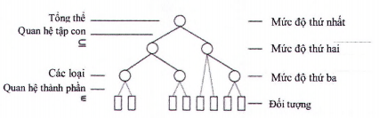

## PHỤ LỤC B (Tham khảo) — Các khái niệm về phân loại

### B.1  Các khái niệm và đối tượng

Khái niệm là những cấu trúc ý tưởng mà qua đó các đối tượng, cả trừu tượng và vật chất, có thể là chủ đề trong suy nghĩ. Khái niệm có thể được coi là cơ sở xây dựng của tư duy. Khái niệm đề cập đến một đối tượng, ngược lại, đối tượng là tham chiếu của khái niệm. Ví dụ, khái niệm “ngôi nhà” có thể đề cập tới ngôi nhà vật lý cụ thể và khái niệm “ngôi nhà mơ ước” đề cập tới một ý tưởng trừu tượng.

Một khái niệm cũng có thể đại diện cho một đặc tính của đối tượng. Ví dụ, “hệ số truyền nhiệt” đề cập tới khí hậu trong công trình và thể hiện khả năng cách nhiệt. Các khái niệm đề cập đến một đối tượng được gọi là các khái niệm của lớp, còn các khái niệm đề cập tới một hoặc một số ít khía cạnh hoặc đặc tính của một đối tượng được gọi là các thuộc tính.

### B.2  Phân loại

Mục đích của việc phân loại là để phân biệt giữa các đối tượng trong một tập hợp. Do đó, để phân loại một tập hợp các đối tượng, trước hết cần xác định mục đích của việc phân loại. Thứ hai, các đặc tính liên quan đến việc phân loại có thể phân biệt được.

Mục đích của một hệ thống phân loại là tổ chức các khái niệm và thuật ngữ trong một lĩnh vực, từ đó cung cấp một nền tảng để phân biệt các đối tượng.

Trong hệ thống phân loại, các đối tượng được nhóm thành các loại khác nhau dựa trên các đặc tính có liên quan. Các đặc tính được dùng để phân loại các loại được sử dụng để định nghĩa mỗi loại. Các loại có thể được sắp xếp theo mức độ tăng dần từ cơ bản đến chuyên biệt. Các đặc tính của các loại ở mức độ cao hơn thường mang tính tổng quát hơn các đặc tính của các loại ở mức độ thấp hơn.

Một mức bao gồm một tập hợp các loại có cùng mức độ chi tiết. Hình B.1, quan hệ tập hợp con có nghĩa các thành viên của một loại hẹp hơn là một tập hợp con của các thành viên của một loại rộng hơn. Quan hệ thành phần có nghĩa là một đối tượng nằm trong một loại.

Để việc phân loại được toàn diện, mỗi đối tượng trong tập hợp phải được gán vào trong một loại và các loại phải loại trừ lẫn nhau, nghĩa là mỗi đối tượng chỉ có thể thuộc về một loại duy nhất. Nếu không có các tiêu chí này, có thể có các đối tượng không được phân loại và có thể cùng lúc thuộc nhiều hơn một loại. Trong cả hai trường hợp trên, việc xác định loại là không chính xác.

<strong>Hình B.1 — Các khái niệm phản loại - các thành phần của một lớp con cũng nằm trong lớp bao gồm lớp con đó</strong>

### B.3  Cấu trúc của một hệ thống phân loại

Theo ISO 22274, các bảng phân loại có thể được liệt kê, phân loại theo các khía cạnh hoặc một sự kết hợp giữa liệt kê và các khía cạnh với một lớp đầu vào.

Các hệ thống phân loại cần phải cố gắng liệt kê tất cả các lớp có thể có trong phạm vi mà chúng được ứng dụng. Trong nhiều trường hợp, chúng được xây dựng dựa trên việc phân loại các đối tượng. Một hệ thống phân loại hoàn chỉnh thường rất phức tạp về bản chất và có thể rất khó xác định được các nguyên tắc xây dựng cơ bản của nó.

Các hệ thống phân loại đa chiều cho phép một đối tượng được phân loại trong nhiều lớp khác nhau. Khi đó, một đối tượng có thể được đặc trưng bởi bất kỳ khía cạnh nào của các lớp mà nó được phân loại hoặc sự kết hợp các khía cạnh của chúng. Bằng cách sử dụng kết hợp liệt kê và phân loại đa chiều, các mức cao hơn của hệ thống phân loại có thể sử dụng phương thức liệt kê để thu hẹp lĩnh vực áp dụng của các lớp riêng lẻ xuống quy mô có thể quản lý được. Ở mức độ thấp hơn, có thể áp dụng phương pháp phân loại đa chiều để có thể xác định rõ ràng bản chất của các đối tượng nằm trong đó.

### B.4  Phân loại và mô hình hóa

Các công cụ mô hình hóa có thể được sử dụng để phát triển thiết kế, ví dụ từ toàn bộ công trình đến các bộ phận công trình thành phần. Các bộ phận công trình cũng có thể được chi tiết hoá thêm theo đặc tính và thành phần. Ví dụ: một hệ thống tường có thể được xác định bởi các bộ phận của nó theo cấu tạo, ví dụ: kết cấu tường, lớp hoàn thiện, cửa ra vào và cửa sổ. Cấu tạo của tường có thể được xác định chi tiết hơn, đến một mức độ nào đó để phù hợp với yêu cầu của mô hình. Các thành phần ở mỗi mức độ cũng có thể được xác định với các đặc tính khác, chẳng hạn như vật liệu, cấu tạo, thiết kế...

VÍ DỤ: mô hình thông tin công trình, mô hình tỷ lệ, bản vẽ, sơ đồ, tính toán, thông số kỹ thuật.

Một đối tượng trong một công cụ mô hình hóa (được gọi là đối tượng thông tin) có thể đại diện cho một đối tượng khác, ví dụ: một bộ phận công trình hoặc một hệ thống. Đối tượng được đại diện có thể được phân loại trong sơ đồ phân loại được sử dụng độc lập với bất kỳ nền tảng mô hình hóa nào.

Khi áp dụng các hệ thống thông tin để xử lý thông tin trong một dự án, các thể hiện được tạo ra từ các lớp trong mô hình khái niệm. Việc chi tiết hóa các đối tượng trong mô hình có thể được thực hiện theo các cách khác nhau, không chỉ bằng cách thay thế một đối tượng bằng một đối tượng mới, ví dụ: thể hiện thêm một lớp nhỏ hơn hoặc thêm các đặc tính vào đối tượng ban đầu. Đây là điều kiện để có thể giữ lại đối tượng ban đầu trong suốt vòng đời của mô hình mà không cần phải thay đổi bằng đối tượng khác. Ví dụ, một bức tường chịu lực không cần phải được tạo ra bằng cách khởi tạo lớp “tường chịu lực” trong mô hình, nhưng thay vào đó có thể được thể hiện bởi đặc tính của nó trong mô hình.

Bất kỳ đối tượng thông tin nào thuộc về một lớp cơ bản, chẳng hạn như tường, có thể được thêm vào các đặc tính bổ sung để nó có thể được phân loại bổ sung, ví dụ: lớp chịu lửa hoặc lớp cách âm. Các đặc tính bổ sung có thể được phân loại trong sơ đồ phân loại riêng của chúng, ví dụ: bởi một hệ thống phân loại đa chiều.

Bức tường có thể được thiết kế với các đặc tính của công tác, ví dụ: bê tông đúc tại chỗ hoặc tường gạch. Từ đó, tường có thể được phân loại theo đặc tính của công tác.

Thư mục tài liệu tham khảo

[1 ] ISO/IEC/IEEE 15288:2023, Systems and software engineering - System life cycle processes (Các hệ thống và kỹ thuật phần mềm - Các quá trình vòng đời hệ thống)

[2] ISO 1087:2019, Terminology work and terminology science - Vocabulary (Công tác thuật ngữ và khoa học thuật ngữ - Từ vựng)

[3] ISO IEC 81346-1:2022, Industrial systems, installations and equipment and industrial products - Structuring principles and reference designations - Part 1: Basic rules (Hệ thống và thiết bị công nghiệp và sản phẩm công nghiệp - Nguyên tắc cấu trúc và ký hiệu tham chiếu)

[4] ISO 22263:2008, Organization of information about construction works - Framework for management of project information (Tổ chức thông tin về công trình xây dựng - Khung quản lý thông tin dự án)

MỤC LỤC

Lời nói đầu

0  Lời giới thiệu

## 1  PHẠM VI ÁP DỤNG

## 2  TÀI LIỆU VIỆN DẪN

## 3  THUẬT NGỮ VÀ ĐỊNH NGHĨA

### 3.1  Quy định chung (general)

### 3.2  Nguồn lực xây dựng (construction resource)

### 3.3  Quá trình xây dựng (construction process)

### 3.4  Kết quả xây dựng (construction result)

### 3.5  Đặc tính xây dựng (construction property)

## 4  NGUYÊN TẮC CƠ BẢN

### 4.1  Đối tượng và mô hình quá trình

### 4.2  Phân loại và thành phần

### 4.3  Phân loại theo loại

### 4.4  Hệ thống và cấu trúc thành phần

### 4.5  Các bảng phân loại khác

### 4.6  Đặc tính

## 5  KHUYẾN NGHỊ MỘT SỐ BẢNG PHÂN LOẠI