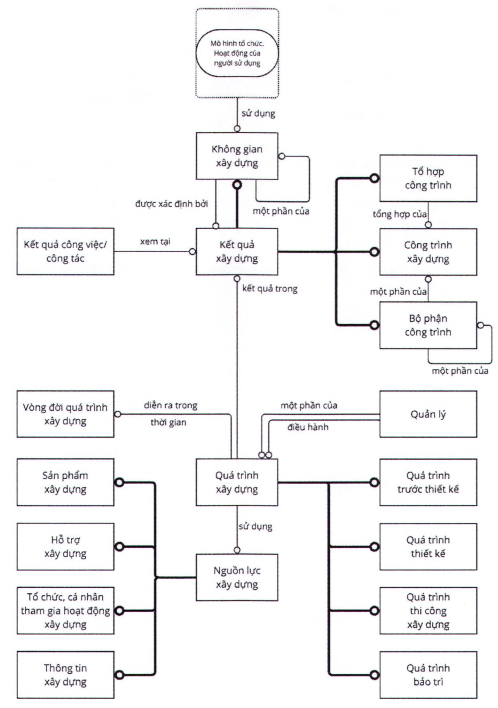
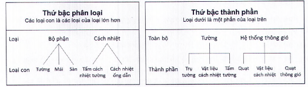
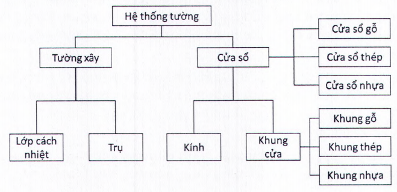

# TIÊU CHUẨN QUỐC GIA

**TCVN 14176-2:2024**

CÔNG TRÌNH XÂY DỰNG - TỔ CHỨC THÔNG TIN VỀ CÔNG TRÌNH XÂY DỰNG - PHẦN 2: KHUNG PHÂN LOẠI

Building construction - Organization of information about construction works - Part 2: Framework for classification

## Lời nói đầu

**TCVN 14176-2:2024 được xây dựng trên cơ sở tham khảo ISO 12006-2:2015.**

**TCVN 14176-2:2024 do Viện Kinh tế xây dựng (Bộ Xây dựng) biên soạn, Bộ Xây dựng đề nghị, Ủy ban Tiêu chuẩn Đo lường Chất lượng Quốc gia thẩm định, Bộ Khoa học và Công nghệ công bố.**

0  Lời giới thiệu

0.1  Bối cảnh

**TCVN 14176-2:2024 được biên soạn lần đầu trên cơ sở tham khảo ISO 12006-2:2015, phiên bản đã được sửa đổi từ phiên bản được ban hành năm 2001, để tính đến sự phát triển của công nghệ thông tin (đặc biệt là mô hình hóa thông tin công trình - BIM) và các hình thức hợp đồng mới (ví dụ: thiết kế và thi công xây dựng công trình và Hợp đồng chìa khóa trao tay). Nội dung được mở rộng hơn và các thuật ngữ, định nghĩa đã được hoàn thiện để phục vụ tốt hơn cho tất cả các lĩnh vực của ngành xây dựng. Tuy nhiên, tiêu chuẩn vẫn tiếp tục hỗ trợ các công nghệ thông tin và phương thức thực hiện truyền thống.**

0.2  Sự cần thiết tiêu chuẩn hóa

Mô hình thông tin công trình và các hình thức hợp đồng mới yêu cầu phải sử dụng nhiều loại thông tin khác nhau. Đặc biệt, mô hình thông tin công trình là việc trao đổi thông tin trong suốt các giai đoạn của dự án, giữa các bên liên quan và các ứng dụng của dự án. Điều này cũng đúng với các loại hợp đồng hợp tác. Để việc trao đổi này thành công, cần có một cách tiếp cận đầy đủ và nhất quán để phân loại đối tượng xây dựng trong dự án và giữa các dự án. TCVN 14176-2:2024 được xây dựng nhằm mục đích tạo thuận lợi cho việc trao đổi thông tin xuyên suốt.

Các loại thông tin bao gồm dữ liệu hình học, dữ liệu chức năng và kỹ thuật, dữ liệu chi phí và dữ liệu bảo trì. Thời gian thực hiện từ khi chuẩn bị dự án đến khi phá dỡ công trình. Các bên tham gia bao gồm chủ đầu tư, nhà thầu tư vấn, cơ quan quản lý nhà nước, nhà thầu thi công, người sử dụng và đơn vị quản lý vận hành. Các ứng dụng bao gồm mô hình thông tin công trình, chỉ dẫn kỹ thuật, thông tin sản phẩm và hệ thống thông tin về chi phí. Ngay cả hiện nay, mỗi ứng dụng trên vẫn cần phải duy trì hoặc thậm chí phát triển bảng phân loại của riêng mình để đáp ứng nhu cầu của riêng ứng dụng đó. Tuy nhiên, sự phát triển riêng này không bền vững.

Mặc dù các quốc gia trên thế giới thực hiện theo ISO 12006-2:2015 có thể có những sự khác biệt nhất định về chi tiết (ví dụ: do sự khác biệt về văn hóa, pháp luật xây dựng, v.v.), nhưng việc lập các biểu đồ ánh xạ giữa chúng sẽ vẫn đơn giản do các quốc gia sử dụng cùng một khung phân loại tổng thể và các định nghĩa loại đối tượng xây dựng. Điều này sẽ giúp ích cho các dự án xây dựng có tính chất quốc tế (với sự tham gia từ nhiều quốc gia) và phát triển các ứng dụng nhằm mục đích sử dụng trên phạm vi quốc tế.

0.3  Nội dung của TCVN 14176-2:2024

**TCVN 14176-2:2024 đưa ra khuôn khổ cho hệ thống phân loại ngành xây dựng, khuyến nghị một tập hợp các bảng phân loại và tiêu đề của chúng cho các lớp đối tượng xây dựng theo những quan điểm cụ thể.**

CÔNG TRÌNH XÂY DỰNG - TỔ CHỨC THÔNG TIN VỀ CÔNG TRÌNH XÂY DỰNG - PHẦN 2: KHUNG PHÂN LOẠI

Building construction - Organization of information about construction works - Part 2: Framework for classification

---

## 1  PHẠM VI ÁP DỤNG

Tiêu chuẩn này đưa ra nguyên tắc cơ bản để phát triển hệ thống phân loại trong môi trường xây dựng. Hệ thống phân loại xác định tập hợp các tiêu đề bảng phân loại được khuyến nghị cho các loại đối tượng thông tin theo các quan điểm cụ thể, ví dụ: theo hình thức hoặc công năng, được hỗ trợ bởi các định nghĩa. Tiêu chuẩn này thể hiện nguyên tắc các đối tượng được phân loại trong mỗi bảng liên quan đến nhau, như một chuỗi các hệ thống hoặc hệ thống con, ví dụ đối tượng được phân loại trong mô hình thông tin công trình.

Tiêu chuẩn này không đưa ra một hệ thống phân loại đầy đủ có thể sử dụng ngay, cũng như không cung cấp nội dung các bảng phân loại mà chỉ đưa ra các ví dụ. Tiêu chuẩn này được xây dựng để sử dụng bởi các tổ chức phát triển, xuất bản các hệ thống và bảng phân loại trong xây dựng. Các hệ thống và bảng phân loại có thể được thay đổi chi tiết để phù hợp với nhu cầu thực tế. Tuy nhiên, nếu tiêu chuẩn này được áp dụng để xây dựng các hệ thống và bảng phân loại sẽ tạo điều kiện thuận lợi để chúng phù hợp và thống nhất với nhau.

Tiêu chuẩn này áp dụng cho toàn bộ vòng đời của các công trình dân dụng, công nghiệp và hạ tầng kỹ thuật từ chuẩn bị dự án, thực hiện dự án, kết thúc xây dựng, khai thác, sử dụng và phá dỡ công trình.

## 2  TÀI LIỆU VIỆN DẪN

Các tài liệu viện dẫn sau là cần thiết khi áp dụng tiêu chuẩn này. Đối với các tài liệu viện dẫn ghi năm công bố thì áp dụng phiên bản được nêu. Đối với các tài liệu viện dẫn không ghi năm công bố thì áp dụng phiên bản mới nhất, bao gồm cả các sửa đổi, bổ sung (nếu có).

ISO 22274, Systems to manage terminology, knowledge and content - Concept-related aspects for developing and internationalizing classification systems (Hệ thống quản lý thuật ngữ, kiến thức và nội dung - Các khía cạnh liên quan đến khái niệm phát triển và quốc tế hóa các hệ thống phân loại).

## 3  THUẬT NGỮ VÀ ĐỊNH NGHĨA

3.1

Quy định chung (general)

Trong tiêu chuẩn này áp dụng các thuật ngữ và định nghĩa sau.

**CHÚ THÍCH 1:** Các định nghĩa được sắp xếp theo thứ tự sau: nguồn lực xây dựng, quá trình xây dựng, kết quả xây dựng và đặc tính xây dựng.

**CHÚ THÍCH 2:** Trong điều “Thuật ngữ và định nghĩa”, các thuật ngữ được định nghĩa ở chỗ khác trong điều khác được thể hiện bằng chữ in nghiêng.

**CHÚ THÍCH 3:** Các ví dụ được nêu trong Phụ lục A.

3.1.1

Đối tượng (object)

Bất kỳ sự vật nào có thể nhận biết hoặc có thể hiểu được.

**CHÚ THÍCH:** Một đối tượng là một cái gì đó trừu tượng hoặc vật thể vật lý có thể nhận biết, cảm giác hoặc tác động vào được.

3.1.2

Đối tượng xây dựng (construction object)

Đối tượng (3.1.1) trong bối cảnh của một quá trình xây dựng (3.3.2).

3.1.3

Hệ thống xây dựng (construction system)

Các đối tượng xây dựng (3.1.2) có tương tác lẫn nhau được tổ chức để đạt được một hoặc nhiều mục đích.

**CHÚ THÍCH:** Hệ thống xây dựng có thể được phân loại theo tiêu chuẩn này.

[Nguồn: ISO/IEC/IEEE 15288:2023, được sửa đổi]

3.1.4

Mối quan hệ theo loại (type-of relation)

Mối quan hệ giữa hai khái niệm trong đó một khái niệm bao gồm khái niệm kia và có ít nhất một đặc điểm để phân biệt.

**CHÚ THÍCH:** Mối quan hệ theo loại còn được gọi là mối quan hệ chung.

[Nguồn: ISO 1087:2019, 3.2.13]

3.1.5

Mối quan hệ thành phần (part-of relation)

Mối quan hệ giữa hai đối tượng xây dựng mà một đối tượng cấu thành toàn bộ và đối tượng kia là một phần của tổng thể đó.

**CHÚ THÍCH 1:** Quan hệ thành phần còn được gọi là quan hệ bộ phận, quan hệ từng phần hoặc quan hệ toàn bộ.

**CHÚ THÍCH 2:** Xem thêm ISO/IEC 81346-1.

[Nguồn: ISO 1087:2019, 3.2.14]

3.1.6

Môi trường tự nhiên (natural environment)

Môi trường không phải là nhân tạo của bất kỳ đối tượng xây dựng nào (3.1.2).

3.1.7

Môi trường xây dựng (built environment)

Kết quả xây dựng (3.4.6) dự định phục vụ một chức năng cụ thể hoặc các hoạt động của người sử dụng.

**CHÚ THÍCH:** Môi trường xây dựng có thể được xem như là một hệ thống các không gian hoặc kết cấu xây dựng.

3.1.8

Không gian (space)

Phạm vi không gian ba chiều được xác định bởi các bề mặt vật lý hoặc một quy ước, định nghĩa.

3.1.9

Không gian hoạt động (activity space)

Không gian (3.1.8) được xác định bởi phần mở rộng không gian cho các hoạt động.

**CHÚ THÍCH:** Một phần mở rộng không gian của một hoạt động, ví dụ, một cái bàn hoặc một chiếc giường, cùng với phần không gian cho hoạt động liên quan xung quanh chúng.

3.2

Nguồn lực xây dựng (construction resource)

3.2.1

Tổ chức, cá nhân tham gia hoạt động xây dựng (construction agent)

Nguồn lực xây dựng (3.2.5) về con người thực hiện quá trình xây dựng (3.3.2).

3.2.2

Hỗ trợ xây dựng (construction aid)

Nguồn lực xây dựng (3.2.5) hỗ trợ khi thực hiện một quá trình xây dựng (3.3.2).

**CHÚ THÍCH:** Một hỗ trợ xây dựng nói chung thường không phải là một bộ phận cố định của công trình xây dựng.

3.2.3

Thông tin xây dựng (construction information)

Thông tin được quan tâm trong quá trình xây dựng (3.3.2).

**CHÚ THÍCH:** Thông tin xây dựng có thể được thể hiện như là một nguồn lực xây dựng hoặc kết quả xây dựng.

3.2.4

Sản phẩm xây dựng (construction product)

Sản phẩm được dự định sử dụng như một nguồn lực xây dựng (3.2.5).

**CHÚ THÍCH 1:** Sản phẩm xây dựng là các thành phần hoặc tổ hợp các thành phần được lắp đặt vĩnh viễn vào công trình.

**CHÚ THÍCH 2:** Sản phẩm xây dựng có độ phức tạp khác nhau và có thể tự bản thân sản phẩm xây dựng hoặc kết hợp với các sản phẩm xây dựng khác tạo thành các bộ phận ở bất kỳ cấp độ cấu thành công trình xây dựng.

3.2.5

Nguồn lực xây dựng (construction resource)

Đối tượng xây dựng (3.1.2) được sử dụng trong một quá trình xây dựng (3.3.2) để đạt được kết quả xây dựng (3.4.6).

3.3

Quá trình xây dựng (construction process)

3.3.1

Hoạt động xây dựng (construction activity)

Hoạt động xây dựng gồm lập quy hoạch xây dựng, lập dự án đầu tư xây dựng công trình, khảo sát xây dựng, thiết kế xây dựng, thi công xây dựng, giám sát xây dựng, quản lý dự án, lựa chọn nhà thầu, nghiệm thu, bàn giao đưa công trình vào khai thác sử dụng, bảo hành, bảo trì công trình xây dựng và hoạt động khác có liên quan đến công trình xây dựng.

3.3.2

Quá trình xây dựng (construction process)

Quá trình sử dụng nguồn lực xây dựng (3.2.5) để đạt được kết quả xây dựng (3.4.6).

**CHÚ THÍCH 1:** Mỗi quá trình xây dựng có thể được chia thành các quá trình thành phần nhỏ hơn.

**CHÚ THÍCH 2:** Xem thêm ISO 22263:2008.

3.3.3

Vòng đời quá trình xây dựng (construction process lifecycle)

Chuỗi các giai đoạn từ đầu đến cuối của một quá trình xây dựng (3.3.2).

3.3.4

Quá trình trước thiết kế (pre-design process)

Quá trình xây dựng (3.3.2) xác định đặc tính xây dựng (3.5) cho môi trường xây dựng (3.1.7) trước khi nó được thiết kế.

3.3.5

Quá trình thiết kế (design process)

Quá trình xây dựng (3.3.2) xác định đặc tính xây dựng (3.5) cho môi trường xây dựng (3.1.7) trước khi nó được xây dựng.

3.3.6

Quá trình thi công xây dựng (production process)

Quá trình thi công xây dựng (3.3.2) tạo ra môi trường xây dựng (3.1.7).

**CHÚ THÍCH:** Quá trình thi công xây dựng bao gồm cả quá trình phá dỡ và tái chế.

3.3.7

Quá trình bảo trì (maintenance process)

Quá trình xây dựng (3.3.2) để giữ vững chức năng, hoặc hoạt động, môi trường xây dựng (3.1.7).

3.3.8

Quản lý (management)

Hoạt động kiểm soát trong một quá trình xây dựng (3.3.2) của các tổ chức, cá nhân tham gia hoạt động xây dựng.

3.4

Kết quả xây dựng (construction result)

3.4.1

Tổ hợp công trình (construction complex)

Tổ hợp của một hoặc nhiều công trình (3.4.2) nhằm phục vụ ít nhất một chức năng hoặc hoạt động của người dùng.

**CHÚ THÍCH:** Một tổ hợp công trình có thể được xem xét và xác định được các công trình tạo nên tổ hợp công trình; ví dụ: sân bay thường bao gồm các công trình như đường băng; tháp điều khiển, nhà ga, nhà chứa máy bay... Một khu kinh doanh thường bao gồm một số tòa nhà, đường vào và cảnh quan (mỗi công trình có sở hữu riêng của mình). Một đường cao tốc từ A đến B thường bao gồm các trạm dịch vụ dừng nghỉ, vỉa hè đường cao tốc, cầu, kè, cảnh quan, v.v.

3.4.2

Công trình (construction entity)

Đơn vị độc lập của môi trường xây dựng (3.1.7) với hình thức đặc trưng và cấu trúc không gian, nhằm phục vụ ít nhất một chức năng hoặc hoạt động của người sử dụng.

**CHÚ THÍCH:** Một công trình là đơn vị cơ bản của môi trường xây dựng. Nó có thể được công nhận là một công trình độc lập (mặc dù một số công trình có thể được coi là một phần hay một phần riêng của tổ hợp công trình). Các công trình phụ trợ như đường vào, cảnh quan, kết nối dịch vụ, có thể được coi là một phần của công trình. Ngược lại, khi các công trình phụ trợ có quy mô đủ lớn, chúng có thể được coi là các công trình xây dựng riêng.

3.4.3

Bộ phận công trình (construction element)

Thành phần của một công trình (3.4.2) với một chức năng, hình thức, hoặc vị trí đặc trưng.

**CHÚ THÍCH:** 

Tùy mục đích cụ thể, ví dụ khi thực hiện phân tích chi phí của công trình xây dựng, thì các bộ phận công trình phải tách riêng biệt để đảm bảo rằng mỗi bộ phận được tính một lần duy nhất

3.4.4

Không gian xây dựng (built space)

Không gian (3.1.8) được xác định bởi môi trường xây dựng (3.1.7) hoặc môi trường tự nhiên (3.1.6) hoặc cả hai, dành cho hoạt động của người hoặc thiết bị.

**CHÚ THÍCH 1:** Một không gian xây dựng, ví dụ: một căn phòng được xác định bởi sàn, trần và tường; hoặc lối đi bộ, hoặc hành lang đường dây được xác định bởi rừng tự nhiên.

**CHÚ THÍCH 2:** Các không gian chiếm bởi các bộ phận công trình được gọi là không gian xây dựng và được coi như một trong các đặc tính của bộ phận công trình.

3.4.5

Vùng (zone)

Không gian (3.1.8) hoặc các không gian với một chức năng cụ thể.

**CHÚ THÍCH:** Các không gian có thể được xác định bởi các đặc tính vật lý hoặc danh nghĩa, ví dụ: vùng chống cháy, vùng khí hậu, khu vực hút thuốc, và khu vực yêu cầu yên tĩnh.

3.4.6

Kết quả xây dựng (construction result)

Đối tượng xây dựng (3.1.2) được hình thành hoặc thay đổi trạng thái do kết quả của một hoặc nhiều quá trình xây dựng (3.3.2) sử dụng một hoặc nhiều nguồn lực xây dựng (3.2.5).

3.4.7

Vòng đời kết quả xây dựng (construction result lifecycle)

Khoảng thời gian từ khi bắt đầu đến khi phá dỡ kết quả xây dựng (3.4.6).

3.4.8

Kết quả công việc/ công tác (work result)

Phân loại kết quả xây dựng (3.4.6) theo loại công việc và nguồn lực được sử dụng.

**CHÚ THÍCH:** Một công việc xây dựng có thể tạo ra nguồn lực xây dựng.

3.5

Đặc tính xây dựng (construction property)

Đặc tính của một đối tượng xây dựng (3.1.2).

## 4  NGUYÊN TẮC CƠ BẢN

### 4.1  Đối tượng và mô hình quá trình

Xem thêm Hình 1 để hiểu rõ về nội dung này.

Yêu cầu về các hoạt động của người sử dụng và các yêu cầu công năng là một phần quan trọng của thông tin cần thiết trong quá trình xây dựng được sử dụng để bắt đầu cho việc thiết kế các tổ hợp công trình và các công trình xây dựng. Thông tin về hoạt động của người sử dụng công trình và yêu cầu về công năng công trình đóng vai trò quan trọng trong quá trình xây dựng. Tuy nhiên, việc phân loại hoạt động của người sử dụng công trình không nằm trong phạm vi của tiêu chuẩn này.

Các loại khác nhau trong tiêu chuẩn có liên quan đến một mô hình quá trình cơ bản, trong đó mô hình quá trình cơ bản thể hiện quá trình xây dựng. Điều này tạo ra một khung phân loại cốt lõi. Quá trình xây dựng được đặc trưng bởi các giai đoạn trong vòng đời quá trình xây dựng đó. Có bốn loại quá trình xây dựng chính: quá trình trước thiết kế, quá trình thiết kế, quá trình thi công xây dựng và quá trình bảo trì.

Công trình xây dựng cần đảm bảo đáp ứng các mục đích sử dụng và yêu cầu về công năng. Các công trình xây dựng khác nhau có thể được kết hợp thành một tổ hợp công trình. Các công trình xây dựng được tạo ra từ các bộ phận công trình khác nhau với mức độ phức tạp khác nhau.

Không gian là không gian hoạt động, không gian xây dựng hoặc không gian công trình. Một không gian xây dựng được xác định bởi kết quả xây dựng. Các không gian có thể có các mối quan hệ với nhau, ví dụ: theo vị trí tương đối, một không gian có thể bao trùm một không gian khác hoặc hai không gian nằm liền kề nhau.

Nguồn lực xây dựng bao gồm các vật liệu, sản phẩm xây dựng, thiết bị công trình, hỗ trợ xây dựng, các tổ chức, cá nhân hoạt động xây dựng và thông tin xây dựng. Sự khác biệt giữa nguồn lực xây dựng và kết quả xây dựng nằm ở mối quan hệ của chúng với quá trình xây dựng. Ví dụ, thông tin xây dựng có thể được sử dụng như một nguồn lực để thông báo và kiểm soát quá trình xây dựng, hoặc có thể là kết quả của chính quá trình đó.

Đối tượng xây dựng có đặc tính xây dựng. Các đặc tính được thể hiện dưới dạng thuộc tính trong thông tin xây dựng.

<strong>Hình 1 — Các loại và mối quan hệ chung giữa chúng</strong>

Ký hiệu biểu đồ ở dạng đơn giản hóa theo hệ thống EXPRESS-G (là một ký hiệu đồ họa tiêu chuẩn cho các mô hình thông tin).

Đường in đậm với một vòng tròn mô tả mối quan hệ phân loại có nhiều cấp độ và đường không in đậm thể hiện mối quan hệ phụ thuộc hoặc tương tác giữa 2 đối tượng.

Hình 1 đã được đơn giản hóa và phải được xem xét cùng với các điều khác của tiêu chuẩn này.

### 4.2  Phân loại và thành phần

Các hệ thống phân loại, ngoài cách thức phân loại theo loại (các loại và các loại con), còn có thể phân loại theo thành phần, được gọi là cấu trúc thành phần (xem Hình 2).

<strong>Hình 2 — Minh họa của một thứ bậc phân loại và thứ bậc thành phần</strong>

Để minh hoạ, Hình 2 thể hiện tấm cách nhiệt tường và cách nhiệt ống dẫn là các loại con của cách nhiệt và có thể tạo thành một phần của hệ thống tường và hệ thống thông gió tương ứng.

**CHÚ THÍCH 1:** Hình 2 minh hoạ nguyên tắc của mỗi loại phân loại (theo loại và theo thành phần). Hình này được minh họa dựa trên A.1 của ISO 1087:2019. Hình 2 chỉ minh hoạ nguyên tắc chứ không tiêu chuẩn hóa bất kỳ lớp, lớp con, toàn bộ hoặc các bộ phận nào.

Hình 3 thể hiện sự kết hợp của phân loại theo loại và theo thành phần.

<strong>Hình 3 — Minh họa sự kết hợp của thành phần và phân loại</strong>

**CHÚ THÍCH 2:** Hình 3 chỉ minh hoạ nguyên tắc mà không tiêu chuẩn hóa bất kỳ loại, loại phụ, toàn bộ hoặc các bộ phận nào.

### 4.3  Phân loại theo loại

Mục đích của việc phân loại theo loại là phân biệt giữa các đối tượng trong một tập hợp các đối tượng dựa trên các đặc tính nhất định. Các loại được xác định bởi các đặc tính đại diện cho loại đó.

Trước hết cần xác định các đặc tính chung của tất cả đối tượng trong một tập hợp, từ đó xác định được loại chung nhất. Sau đó, loại chung này có thể được chia thành các loại chuyên biệt hơn dựa trên sự khác biệt về các đặc tính cần quan tâm.

Các loại được chia từ chung đến chuyên biệt, được sắp xếp theo các mức độ khác nhau xác định bởi mối quan hệ giữa chúng, trong đó các loại cụ thể là thành phần của các loại tổng quát hơn. Các đối tượng được phân loại là thành phần của các loại.

### 4.4  Hệ thống và cấu trúc thành phần

Khái niệm hệ thống trong phần này sẽ được sử dụng theo nghĩa rộng và không được liên kết với bất kỳ một đối tượng cụ thể nào.

Trong tiêu chuẩn này, mỗi đối tượng đều có thể được xem là một hệ thống.

Cách tiếp cận theo hệ thống cho phép người thiết kế có thể xử lý các vấn đề một cách tổng thể (khác biệt với cách tiếp cận theo các bộ phận). Bằng cách xác định các hệ thống có liên quan, mối quan hệ giữa chúng có thể được làm rõ và giám sát, ví dụ như trong việc đảm bảo rằng tất cả các hệ thống hoạt động một cách chính xác. Một ví dụ về mối quan hệ có thể kể đến là đầu vào hoặc đầu ra của một hệ thống với môi trường của nó.

VÍ DỤ: Hệ thống chịu lực, hệ thống mái, hệ thống tường, hệ thống HVAC, hệ thống thoát nước, hệ thống điện, hệ thống thông tin liên lạc, hệ thống giao thông, hệ thống cây xanh, hệ thống sơn, hệ thống bệnh viện, hệ sinh thái, hệ thống cảnh quan, hệ thống sửa chữa, hệ thống quản lý, hệ thống giáo dục, hệ thống cửa sổ, hệ thống treo, hệ thống bản lề, hệ thống quạt, hệ thống tiền chế, hệ thống mua sắm.

Mỗi hệ thống có thể bao gồm nhiều hệ thống con ở các mức độ khác nhau. Bằng cách chia nhỏ hoặc cấu trúc một hệ thống thành nhiều hệ thống con, sử dụng mối quan hệ thành phần, các tập hợp thông tin lớn trong một thiết kế phức tạp có thể được xử lý thành các phần nhỏ hơn. Do đó, cấu trúc thành phần của một hệ thống có thể cung cấp thông tin tổng quan về hệ thống đó. Trong trường hợp một hệ thống không thể thực hiện một công việc cụ thể thì có thể tập hợp nhiều hệ thống riêng biệt để thực hiện nhiệm vụ đó.

Một đối tượng được coi là một thành phần của tổng thể nếu khi đối tượng đó được thêm vào thì tổng thể đó vẫn là chính nó, ví dụ: nếu một viên gạch được thêm vào hoặc bỏ đi từ một bức tường, thì tổng thể vẫn là một bức tường hoặc nếu một bức tường được thêm vào một công trình xây dựng, tổng thể đó vẫn là một công trình xây dựng.

Các thành phần có thể được xác định thông qua các khía cạnh khác nhau. Tùy thuộc vào khía cạnh được quan tâm, có thể có các mối quan hệ khác nhau giữa thành phần và tổng thể, ví dụ như:

&nbsp;&nbsp;\- sử dụng khía cạnh chức năng, chức năng của thành phần là cơ sở cho chức năng của toàn bộ tổng thể;

&nbsp;&nbsp;\- sử dụng khía cạnh không gian, không gian của thành phần được bao phủ bởi không gian của toàn bộ tổng thể;

&nbsp;&nbsp;\- sử dụng khía cạnh lắp ráp, quan hệ giữa thành phần và tổng thể là sự tồn tại của thành phần trước khi có sự tồn tại của tổng thể.

Các nguyên tắc cấu trúc nhận dạng các giai đoạn trong vòng đời có tầm quan trọng như nhau khi áp dụng các cấu trúc khác nhau dựa trên các khía cạnh của một hệ thống.

### 4.5  Các bảng phân loại khác

Tiêu chuẩn này đưa ra các hướng dẫn cho việc xây dựng các bảng phân loại liên quan đến các thành phần trong mô hình quá trình cơ bản mô tả trong 4.1. Các bảng tương ứng sẽ được đề xuất trong Điều 5. Bên cạnh đó, mô tả chung về các khái niệm phân loại được đưa ra trong Phụ lục B.

Đôi khi có thể sử dụng các tiêu chí phân loại hoặc sơ đồ phân loại khác so với mô tả trong tiêu chuẩn này. Tuy nhiên, việc so sánh hoặc đối chiếu sau đó giữa các bảng phân loại có thể sẽ gặp khó khăn.

Để phù hợp với tiêu chuẩn này, các bảng phân loại khác phải được xây dựng dựa trên các hướng dẫn trong ISO 22274, với tài liệu kèm theo nêu rõ các tiêu chí và sơ đồ phân loại trong hệ thống phân loại được xây dựng.

### 4.6  Đặc tính

Các đối tượng của loại đều có các đặc tính. Các đặc tính này có thể được sử dụng để xác định và chia nhỏ các loại đến các mức độ chi tiết hơn.

Thuộc tính là các đối tượng theo đúng nghĩa của chúng và do đó cần được coi như một loại đặc biệt hiện diện trong các kết quả, quá trình và nguồn lực.

## 5  KHUYẾN NGHỊ MỘT SỐ BẢNG PHÂN LOẠI

Các loại có thể được chia thành các loại con theo nguyên tắc chuyên môn, từ đó tạo ra một bảng phân loại. Nếu nguyên tắc chuyên môn hóa thứ hai quan trọng đối với một lớp cụ thể thì nguyên tắc này có thể được áp dụng riêng và tạo ra một cấu trúc phân loại khác.

Có nhiều cách để phân loại các loại theo mức độ chuyên môn, xem 4.5.

Một đối tượng sẽ chỉ có thể nằm trong một loại duy nhất. Ví dụ, nếu một đối tượng được phân loại là một công trình xây dựng, thì nó không thể được phân loại là một tổ hợp công trình. Trong một bảng, một đối tượng sẽ chỉ xuất hiện một lần duy nhất. Các lựa chọn phân loại cho nhiều loại được khuyến nghị trong Bảng 1 nhằm mục đích cho phép linh hoạt trong việc phân loại.

Bảng 1 dưới đây đưa ra các nguyên tắc phân loại theo mức độ chuyên môn được áp dụng cho một số loại quan trọng để đưa ra các bảng phân loại. Xem Phụ lục A để tham khảo các ví dụ mang tính thông tin được đưa ra của mỗi bảng phân loại.

Các bảng có thể được sử dụng theo cách kết hợp hoặc độc lập tùy theo nhu cầu.

### Bảng 1 - Nguyên tắc chuyên môn hoá áp dụng cho các loại đối tượng

| Loại | Phân loại theo | Điều trong Phụ lục A |
| :--- | :--- | :--- |
| **CÁC LOẠI LIÊN QUAN ĐẾN NGUỒN LỰC** |  |  |
| Thông tin xây dựng | Nội dung | A.2 |
| Sản phẩm xây dựng | Chức năng hoặc hình thức hoặc vật liệu hoặc bất kỳ sự kết hợp nào của chúng | A.3 |
| Tổ chức, cá nhân tham gia hoạt động xây dựng | Chuyên môn hoặc vai trò hoặc bất kỳ sự kết hợp của chúng | A.4 |
| Hỗ trợ xây dựng | Chức năng hoặc hình thức hoặc vật liệu hoặc bất kỳ sự kết hợp của chúng | A.5 |
| **CÁC LOẠI LIÊN QUAN ĐẾN QUÁ TRÌNH** |  |  |
| Quản lý | Hoạt động quản lý | A.6 |
| Quá trình xây dựng | Hoạt động xây dựng hoặc giai đoạn trong vòng đời quá trình xây dựng hoặc bất kỳ sự kết hợp nào của chúng | A.7 |
| **CÁC LOẠI LIÊN QUAN ĐẾN KẾT QUẢ** |  |  |
| Tổ hợp công trình | Hình thức hoặc chức năng hoặc hoạt động của người sử dụng hoặc bất kỳ sự kết hợp nào của chúng | A.8 |
| Công trình | Hình thức hoặc chức năng hoặc hoạt động của người sử dụng hoặc bất kỳ sự kết hợp nào của chúng | A.9 |
| Không gian xây dựng | Hình thức hoặc chức năng hoặc hoạt động của người sử dụng hoặc bất kỳ sự kết hợp nào của chúng | A.10 |
| Bộ phận công trình | Chức năng hoặc hình thức hoặc vị trí hoặc bất kỳ sự kết hợp của chúng | A.11 |
| Kết quả công việc/ công tác | Hoạt động và nguồn lực được sử dụng | A.12 |
| **CÁC LOẠI LIÊN QUAN ĐẾN ĐẶC TÍNH XÂY DỰNG** |  |  |
| Đặc tính xây dựng | Loại đặc tính | A.13 |

Thư mục tài liệu tham khảo

---

## 📑 DANH MỤC PHỤ LỤC KỸ THUẬT CHUYÊN ĐỀ (MODULAR ANNEXES)

Toàn bộ 3 Phụ lục kỹ thuật chuyên đề đã được module hóa thành các tệp độc lập nhằm tối ưu hóa tra cứu và thẩm tra thiết kế (ADR 0021 & ADR 0030):

| Ký hiệu | Tên Phụ Lục | Tính chất | Liên kết Tập tin |
| :---: | :--- | :---: | :---: |
| **Phụ lục A** | Tiêu đề bảng phân loại và ví dụ | Tham khảo | [📑 **Xem Phụ lục**](annexes/phu_luc_a_tieu_de_bang_phan_loai_va_vi_du.md#phu-luc-a) |
| **Phụ lục 1** | này đưa ra đề xuất cho tiêu đề của các bảng phân loại, nhưng các ví dụ này và trình tự của chúng không đầy đủ và chỉ dùng để tham khảo. | Quy định | [📑 **Xem Phụ lục**](annexes/phu_luc_1_nay_dua_ra_de_xuat_cho_tieu_de_cua_cac_bang_p.md#phu-luc-1) |
| **Phụ lục B** | Các khái niệm về phân loại | Tham khảo | [📑 **Xem Phụ lục**](annexes/phu_luc_b_cac_khai_niem_ve_phan_loai.md#phu-luc-b) |

---

## 📊 HỆ THỐNG TRA CỨU BẢNG & SƠ ĐỒ KỸ THUẬT

- **Tra cứu 1 Bảng Số Liệu:** Tra cứu chi tiết dạng CSV/JSON tại [Thư mục Bảng Số Liệu](tables/README.md).
- **Tra cứu Sơ Đồ Hình Vẽ:** Tra cứu ảnh nét cao và đặc tả phân vùng tại [Danh Mục Sơ Đồ Khí Động](figures/figures_catalog.yaml).