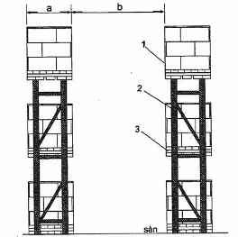
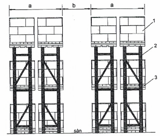
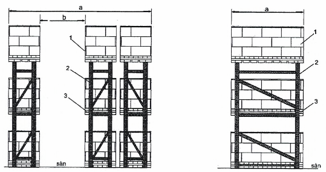
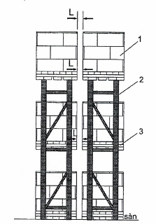
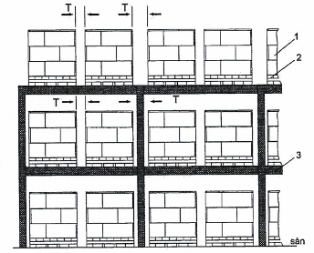
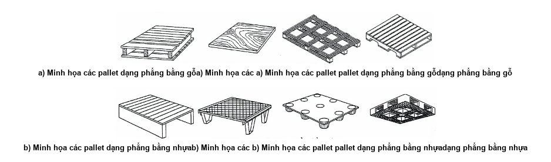
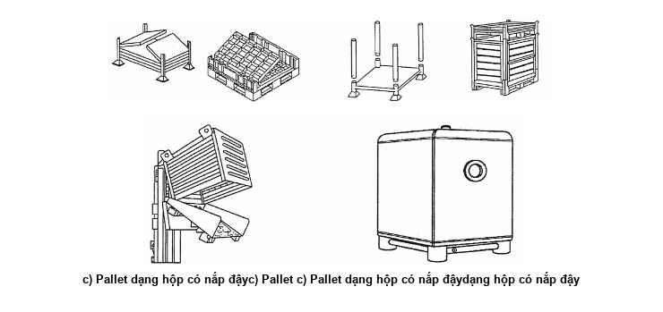

## PHỤ LỤC A (Tham khảo) — Các hình minh họa

### A.1  Kệ hàng một dãy (xem 3.11)

<!-- DIAGRAM: word/media/image6.png -->

**CHÚ DẪN: 1 - hàng hóa; 2 - kệ hàng (giá đỡ); 3 - pallet**

a) \- chiều rộng kệ hàng ≤ 1,8 m;

b) \- chiều rộng lối đi ≥ 1,1 m.

<strong>Hình A.1 — Minh họa phương án bố trí các kệ hàng một dãy</strong>

### A.2  Kệ hàng hai dãy (xem 3.12)

<!-- DIAGRAM: word/media/image7.png -->

**CHÚ DẪN: 1 - hàng hóa; 2 - kệ hàng (giá đỡ); 3 - pallet**

a) \- chiều rộng kệ hàng ≤ 3,7 m;

b) \- chiều rộng lối đi ≥ 1,1 m.

<strong>Hình A.2 — Minh họa phương án bố trí các kệ hàng hai dãy</strong>

### A.3  Kệ hàng nhiều dãy (xem 3.13)

<!-- DIAGRAM: word/media/image8.png -->

**CHÚ DẪN: 1 - hàng hóa; 2 - kệ hàng (giá đỡ); 3 - pallet**

a) \- chiều rộng kệ hàng > 3,7 m;

b) \- chiều rộng lối đi < 1,1 m.

<strong>Hình A.3 — Minh họa phương án bố trí các kệ hàng nhiều dãy</strong>

### A.4  Khe khói dọc (xem 3.14)

<!-- DIAGRAM: word/media/image9.png -->

**CHÚ DẪN:1 - hàng hóa; 2 - kệ hàng (giá đỡ); 3 - pallet**

L chiều rộng khe khói ≥ 150 mm và ≤ 600 mm;

<strong>Hình A.4 — Minh họa phương án bố trí khe khói dọc</strong>

### A.5  Khe khói ngang (xem 3.14)

<!-- DIAGRAM: word/media/image10.png -->

**CHÚ DẪN: 1 - hàng hóa; 2 - kệ hàng (giá đỡ); 3 - pallet**

T chiều rộng khe khói ≥ 150 mm

<strong>Hình A.5 — Minh họa phương án bố trí khe khói ngang</strong>

### A.6  Pallet dạng phẳng (xem 3.15)

$$Hình ảnh bạn cung cấp là hình vẽ minh họa các loại pallet gỗ, không chứa công thức toán học. Do đó, không có nội dung để chuyển đổi sang mã LaTeX.$$
<!-- formula_id: "F_TCVN_14496_2025_RID12" -->

a) \- Minh họa các pallet dạng phẳng bằng gỗ

$$Hình ảnh bạn cung cấp là hình vẽ minh họa các loại pallet, không chứa công thức toán học. Do đó, không có nội dung để chuyển đổi sang mã LaTeX.$$
<!-- formula_id: "F_TCVN_14496_2025_RID13" -->

b) \- Minh họa các pallet dạng phẳng bằng nhựa

<strong>Hình A.6 — Minh họa các pallet dạng phẳng</strong>

### A.7  Pallet dạng hộp (xem 3.15)

$$Hình ảnh bạn cung cấp là các hình vẽ minh họa kỹ thuật về pallet và hệ thống lưu trữ, không chứa bất kỳ công thức toán học nào để chuyển đổi sang LaTeX.$$
<!-- formula_id: "F_TCVN_14496_2025_RID14" -->

a) \- Pallet dạng hộp gập                                           b) Pallet dạng hộp tháo rời

<!-- DIAGRAM: word/media/image14.png -->

c) \- Pallet dạng hộp có nắp đậy

<strong>Hình A.7 — Minh họa các pallet dạng hộp</strong>

Thư mục tài liệu tham khảo

[1] TCVN 3890:2023: Phòng cháy chữa cháy - Phương tiện phòng cháy và chữa cháy cho nhà và công trình - Trang bị, bố trí.

[2] TCVN 6305-2:2007 (ISO 6182-2:2005): Phòng cháy chữa cháy - Hệ thống Sprinkler tự động - Phần 2: Yêu cầu và phương pháp thử đối với van báo động kiểu ướt, bình làm trễ và chuông nước.

[3] TCVN 6305-3:2007 (ISO 6182-3:2005): Phòng cháy chữa cháy - Hệ thống Sprinkler tự động - Phần 3: Yêu cầu và phương pháp thử đối với van đường ống khô.

[4] TCVN 6305-4:1997 (ISO 6182-4:1993): Phòng cháy chữa cháy - Hệ thống Sprinkler tự động - Phần 4: Yêu cầu và phương pháp thử đối với cơ cấu mở nhanh.

[5] TCVN 6305-5:2009 (ISO 6182-5:2006): Phòng cháy chữa cháy - Hệ thống Sprinkler tự động - Phần 5: Yêu cầu và phương pháp thử đối với van tràn.

[6] TCVN 6305-10:2013 (ISO 6182-10:2006): Phòng cháy chữa cháy - Hệ thống Sprinkler tự động - Phần 10: Yêu cầu và phương pháp thử đối với Sprinkler trong nhà.

[7] TCVN 7336:2021: Phòng cháy chữa cháy - Hệ thống chữa cháy tự động bằng nước, bọt - Yêu cầu thiết kế và lắp đặt.

[8] TCVN 7568-14:2025: Hệ thống báo cháy - Phần 14: Thiết kế, lắp đặt các hệ thống báo cháy cho nhà và công trình.

[9] QCVN 06:/BXD: Quy chuẩn kỹ thuật quốc gia về an toàn cháy cho nhà và công trình.

$$Hình ảnh bạn cung cấp là một đoạn văn bản tiếng Nga, không chứa công thức toán học. Do đó, không có mã LaTeX để chuyển đổi.$$
<!-- formula_id: "F_TCVN_14496_2025_RID16" -->

(Hệ thống phòng cháy chữa cháy - Hệ thống chữa cháy tự động bằng nước cho nhà kho có chiều cao sắp xếp hàng hóa trên giá đỡ cao trên 5,5 m đến 25 m - Tiêu chuẩn và quy định thiết kế).

[11] Standard for the Installation of Sprinkler Systems (Tiêu chuẩn NFPA 13 phiên bản 2022 Tiêu chuẩn lắp đặt hệ thống Sprinkler).