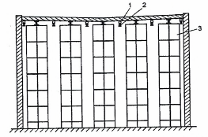
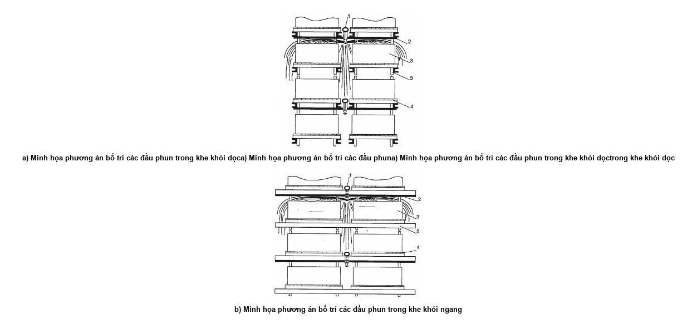
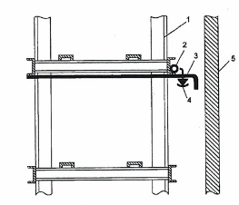

# TIÊU CHUẨN QUỐC GIA

**TCVN 14496:2025**

PHÒNG CHÁY CHỮA CHÁY - HỆ THỐNG CHỮA CHÁY TỰ ĐỘNG BẰNG NƯỚC CHO NHÀ KHO CÓ CHIỀU CAO SẮP XẾP HÀNG HÓA TRÊN GIÁ ĐỠ CAO TRÊN 5,5 M ĐẾN 25 M -YÊU CẦU THIẾT KẾ

Fire protection - Automatic water fire-extinguishing systems for warehouses with goods stacked on supporting racks over 5,5 m and up to 25 m- Designing requirements

## Lời nói đầu

**TCVN 14496:2025 được xây dựng căn cứ trên cơ sở tham khảo tiêu chuẩn SP 241.1311500.2015 của Liên Bang Nga.**

**TCVN 14496:2025 do Cục Cảnh sát Phòng cháy, chữa cháy và Cứu nạn, cứu hộ biên soạn, Bộ Công an đề nghị, Ủy ban Tiêu chuẩn Đo lường chất lượng quốc gia thẩm định, Bộ khoa học và Công nghệ công bố.**

PHÒNG CHÁY CHỮA CHÁY - HỆ THỐNG CHỮA CHÁY TỰ ĐỘNG BẰNG NƯỚC CHO NHÀ KHO CÓ CHIỀU CAO SẮP XẾP HÀNG HÓA TRÊN GIÁ ĐỠ CAO TRÊN 5,5 M ĐẾN 25 M -YÊU CẦU THIẾT KẾ

Fire protection - Automatic water fire-extinguishing systems for warehouses with goods stacked on supporting racks over 5,5 m and up to 25 m- Designing requirements

---

## 1  PHẠM VI ÁP DỤNG

### 1.1  Tiêu chuẩn này quy định về việc thiết hệ thống chữa cháy tự động bằng nước cho nhà kho có chiều cao sắp xếp hàng hóa trên giá đỡ cao trên 5,5 m đến 25 m sử dụng giải pháp bố trí một tầng hoặc nhiều tầng đầu phun, áp dụng cho các nhà kho và nhà thuộc nhóm nguy hiểm cháy theo công năng F 5.2 nhằm mục đích lưu trữ các sản phẩm, chất, vật liệu và nguyên liệu. Thiết kế của các giá đỡ phải duy trì khả năng chịu tải khi xảy ra cháy.

### 1.2  Tiêu chuẩn này không áp dụng đối với việc thiết kế hệ thống chữa cháy tự động bằng nước cho các nhà kho có chiều cao sắp xếp hàng hóa trên giá đỡ cao trên 5,5 m đến 25 m được thiết kế để lưu trữ vecni, sơn, chất lỏng cháy và dễ cháy, vật liệu cháy âm ỉ (bông, thuốc lá), phân bón khoáng khô và hóa chất bảo vệ thực vật, chất nổ, phóng xạ và chất có tính độc cao, khí dễ cháy, các sản phẩm aerosol đựng trong bình dạng xịt, khí không cháy trong các bình chứa ở áp suất trên 70 kPa, dầu mỏ và các sản phẩm dầu mỏ, cao su nguyên liệu, nhựa dễ cháy, bột mì, thức ăn chăn nuôi, lông thú và các sản phẩm lông thú, các chất và vật liệu có hoạt tính hóa học, bao gồm:

&nbsp;&nbsp;\- Các chất phản ứng với chất chữa cháy gây nổ (hợp chất hữu cơ nhôm, kim loại kiềm,...);

&nbsp;&nbsp;\- Các chất phân hủy khi tương tác với chất chữa cháy và giải phóng các khí dễ cháy (hợp chất hữu cơ lithi, azide chì, hydrua nhôm, kẽm, magiê);

&nbsp;&nbsp;\- Các chất tương tác với chất chữa cháy có tác dụng tỏa nhiệt mạnh (axit sulfuric, titan clorua, Thermite...);

&nbsp;&nbsp;\- Các chất tự cháy khi tiếp xúc với nước (natri hydrosulfite, v.v.).

**CHÚ THÍCH:** Đối với nhà kho có chiều cao sắp xếp hàng hóa trên giá đỡ đến 5,5 m áp dụng các quy định về việc thiết kế, lắp đặt hệ thống chữa cháy tự động bằng nước theo TCVN 7336.

## 2  TÀI LIỆU VIỆN DẪN

Các tài liệu viện dẫn sau đây rất cần thiết cho việc áp dụng tiêu chuẩn này. Đối với các tài liệu viện dẫn ghi năm công bố thì áp dụng phiên bản được nêu. Đối với các tài liệu viện dẫn không ghi năm công bố thì áp dụng phiên bản mới nhất, bao gồm cả các sửa đổi (nếu có)

TCVN 7336: Phòng cháy chữa cháy - Hệ thống chữa cháy tự động bằng nước, bọt - Yêu cầu thiết kế và lắp đặt.

## 3  THUẬT NGỮ VÀ ĐỊNH NGHĨA

Trong tiêu chuẩn này áp dụng các thuật ngữ và định nghĩa sau

3.1

Hệ thống chữa cháy tự động bằng nước (Automatic water fire-extinguishing system)

Hệ thống chữa cháy bằng nước được tự động kích hoạt khi các yếu tố của đám cháy trong khu vực bảo vệ đạt ngưỡng tác động.

3.2

Hệ thống chữa cháy tự động bằng nước cho nhà kho lưu trữ hàng hóa trên giá đỡ cao tầng (Automatic water fire-extinguishing systems for warehouses with high-rack storage)

Hệ thống chữa cháy tự động bằng nước được lắp đặt trong nhà kho có chiều cao sắp xếp hàng hóa trên giá đỡ cao trên 5,5 m đến 25 m.

3.3

Hệ thống chữa cháy tự động bằng nước nhiều tầng đầu phun (Automatic water fire-extinguishing system with multiple layers of nozzles/nozzles at multiple heights)

Hệ thống chữa cháy tự động bằng nước có các đầu phun được bố trí, lắp đặt dưới mái của nhà, gian phòng và trong các giá đỡ ở các tầng khác nhau.

**CHÚ THÍCH:** - Mái được đề cập trong định nghĩa bao hàm cả tấm che, trần và mái của gian phòng.

&nbsp;&nbsp;\- Giá đỡ dưới đây có thể còn được gọi là kệ hàng.

3.4

Hệ thống chữa cháy tự động bằng nước một tầng đầu phun (Automatic water fire-extinguishing system with single-layer nozzle)

Hệ thống chữa cháy tự động bằng nước có các đầu phun chỉ được bố trí, lắp đặt dưới mái của nhà, gian phòng.

3.5

Họng nước chữa cháy (Fire hose cabinet)

Tổng hợp các thiết bị chuyên dùng gồm van khóa, vòi, lăng phun được lắp đặt sẵn để triển khai đưa nước đến đám cháy.

3.6

Chiều cao gian phòng (Room height)

Khoảng cách từ sàn đến mái, với chiều cao mái thay đổi thì chiều cao gian phòng là khoảng cách từ sàn đến điểm cao nhất của mái.

3.7

Chiều cao sắp xếp hàng hóa (Storage height)

Chiều cao từ sàn tính tới đỉnh của các sản phẩm được lưu trữ trên giá đỡ.

3.8

Kho lưu trữ hàng hóa trên giá đỡ cao tầng (Warehouses with high-rack storage)

Nhà kho có hàng hóa lưu trữ trên giá đỡ với chiều cao sắp xếp hàng hóa cao trên 5,5 m đến 25 m.

3.9

Diện tích tính toán (Calculated area)

Khu vực được sử dụng để xác định mức tiêu thụ nước và áp suất cho hệ thống chữa cháy tự động bằng nước theo số lượng đầu phun làm việc đồng thời trong khu vực đó.

3.10

Khu vực chủ đạo (Dictating area)

Khu vực có tổn thất thủy lực trong mạng lưới đường ống cấp nước là lớn nhất.

3.11

Kệ hàng một dãy (Single-row racks)

Kệ hàng không có khe khói dọc, có chiều rộng lên tới 1,8 m và chiều rộng lối đi giữa các kệ hàng tối thiểu là 1,1 m (tham khảo Hình A.1, Phụ lục A).

3.12

Kệ hàng hai dãy (Double-row racks)

Kệ hàng hai dãy là các kệ hàng một dãy đặt cạnh nhau với tổng chiều rộng không lớn hơn 3,7 m và chiều rộng lối đi giữa kệ hàng hai dãy với các kệ hàng khác (kệ hàng một dãy, kệ hàng hai dãy, kệ hàng nhiều dãy) tối thiểu là 1,1 m (tham khảo Hình A.2, Phụ lục A).

3.13

Kệ hàng nhiều dãy (Multiple-row racks)

Kệ hàng có chiều rộng lớn hơn 3,7 m hoặc một nhóm các kệ hàng một dãy, kệ hàng hai dãy mà có lối đi giữa chúng nhỏ hơn 1,1 m và có tổng chiều rộng lớn hơn 3,7 m (tham khảo Hình A.3, Phụ lục A).

3.14

Khe khói (Flue space)

&nbsp;&nbsp;\- Khe khói dọc (Longitudinal flue space): là khoảng không giữa các hàng hóa được lưu trữ trên giá đỡ theo chiều dài của kệ hàng (khoảng không ở giữa dãy hàng hóa, vuông góc với hướng xếp hàng hóa) với chiều rộng khe khói nằm trong khoảng từ 150 mm đến 600 mm (tham khảo Hình A.4, Phụ lục A).

&nbsp;&nbsp;\- Khe khói ngang (Transverse flue space): là khoảng không giữa các hàng hóa, song song với hướng xếp hàng tạo ra khoảng không thẳng đứng từ sàn lên trần, được lưu trữ trên giá đỡ theo chiều rộng của kệ hàng với chiều rộng khe khói tối thiểu 150 mm (tham khảo Hình A.5, Phụ lục A).

3.15

Pallet dạng phẳng (Flat pallet), pallet dạng hộp (Box pallet) và pallet dạng hộp bằng kim loại (Metal box pallet)

&nbsp;&nbsp;\- Pallet dạng phẳng: Pallet có mặt trên cùng là mặt phẳng và không có bộ phận mở rộng (tham khảo Hình A.6, Phụ lục A).

&nbsp;&nbsp;\- Pallet dạng hộp: Pallet có các thanh thẳng đứng cho phép xếp chồng lên nhau có thể được trang bị các thanh ngang hoặc nắp có thể tháo rời (tham khảo Hình A.7, Phụ lục A).

&nbsp;&nbsp;\- Pallet dạng hộp bằng kim loại: là pallet dạng hộp được làm từ vật liệu bằng kim loại.

## 4  QUY ĐỊNH CHUNG

### 4.1  Hệ thống chữa cháy tự động bằng nước cho nhà kho lưu trữ hàng hóa trên giá đỡ cao tầng được sử dụng để thực hiện chức năng dập tắt đám cháy hoặc ngăn chặn cháy lan trong các nhà kho có chiều cao sắp xếp hàng hóa trên giá đỡ cao trên 5,5 m đến 25 m.

### 4.2  Khi thiết kế hệ thống chữa cháy tự động bằng nước cho nhà kho lưu trữ hàng hóa trên giá đỡ cao tầng, ngoài các yêu cầu của tiêu chuẩn này, cần tuân thủ các yêu cầu về an toàn cháy nổ quy định trong TCVN 7336.

### 4.3  Nếu có sự khác biệt giữa các yêu cầu của tiêu chuẩn này và các tiêu chuẩn hiện hành, thì các yêu cầu của tiêu chuẩn này nên được tuân thủ.

### 4.4  Thiết bị kỹ thuật của hệ thống chữa cháy tự động bằng của nước cho nhà kho lưu trữ hàng hóa trên giá đỡ cao tầng phải đáp ứng các yêu cầu của TCVN 7336.

### 4.5  Việc thiết kế, lắp đặt hệ thống chữa cháy tự động cho các khu vực tiếp nhận, đóng gói, tập kết và vận chuyển hàng hóa phải được thực hiện theo TCVN 7336.

### 4.6  Lưu lượng nước chữa cháy của hệ thống chữa cháy tự động bằng nước cho nhà kho lưu trữ hàng hóa trên giá đỡ cao tầng được xác định bằng lưu lượng nước lớn nhất trong khu vực lưu trữ bằng giá đỡ.

### 4.7  Tổng lưu lượng nước cần thiết để chữa cháy cho khu vực lưu trữ hàng hóa trên giá đỡ cao tầng được tính theo công thức:

Q = $Q_{S}$ + $Q_{D}$ + $Q_{TN}$

$$\dots \qquad (1)$$
<!-- formula_id: "F_TCVN_14496_2025_FORMULA_1" -->

Trong đó:

&nbsp;&nbsp;&nbsp;&nbsp;\- Q là tổng lưu lượng nước cần thiết để chữa cháy cho khu vực lưu trữ hàng hóa trên giá đỡ cao tầng, l/s;

&nbsp;&nbsp;&nbsp;&nbsp;\- $Q_{S}$ là lưu lượng của hệ thống chữa cháy tự động bằng nước một tầng đầu phun hoặc hệ thống chữa cháy tự động bằng nước nhiều tầng đầu phun, l/s;

&nbsp;&nbsp;&nbsp;&nbsp;\- $Q_{D}$ là lưu lượng của màn nước, l/s;

&nbsp;&nbsp;&nbsp;&nbsp;\- $Q_{TN}$ là lưu lượng của họng nước chữa cháy trong nhà, l/s;

### 4.8  Thời gian cấp nước để chữa cháy cho nhà kho lưu trữ hàng hóa trên giá đỡ cao tầng được lấy theo tiêu chuẩn áp dụng nếu có yêu cầu cao hơn nhưng cần đảm bảo tối thiểu 1 h bất kể bố trí hoặc không bố trí hệ thống màn nước và họng nước chữa cháy trong nhà. Với mạng đường ống của hệ thống chữa cháy tự động bằng nước cho kho lưu trữ hàng hóa trên giá đỡ cao tầng và hệ thống họng nước chữa cháy trong nhà riêng biệt, thời gian hoạt động của hệ thống họng nước chữa cháy trong nhà lấy bằng thời gian làm việc của hệ thống chữa cháy tự động bằng nước cho kho lưu trữ hàng hóa trên giá đỡ cao tầng.

### 4.9  Tính toán thủy lực đối với hệ thống chữa cháy tự động bằng nước trong khu vực lưu trữ hàng hóa trên giá đỡ cao tầng, khu vực tiếp nhận, đóng gói, tập kết và vận chuyển hàng hóa, cũng như hệ thống màn nước, phải được thực hiện theo Phụ lục B TCVN 7336, có tính đến đặc tính kỹ thuật của đầu phun được sử dụng.

### 4.10  Thiết kế hệ thống chữa cháy tự động bằng nước cho kho lưu trữ hàng hóa trên giá đỡ cao tầng kết hợp với hệ thống họng nước chữa cháy trong nhà được thực hiện theo TCVN 7336.

### 4.11  Lượng nước cần thiết của hệ thống họng nước chữa cháy trong nhà đối với nhà kho lưu trữ hàng hóa trên giá đỡ cao tầng được xác định theo Bảng 1.

### Bảng 1 - Số tia phun chữa cháy và lưu lượng nước tối thiểu cho chữa cháy trong nhà đối với nhà kho lưu trữ hàng hóa trên giá đỡ cao tầng

| Bậc chịu lửa của nhà | Hạng nguy hiểm cháy và cháy nổ của nhà | Cấp nguy hiểm cháy của kết cấu | Số tia phun chữa cháy và lưu lượng nước tối thiểu, L/s, đối với 1 tia phun, cho chữa cháy trong nhà đối với nhà kho lưu trữ hàng hóa trên giá đỡ cao tầng có chiều cao PCCC đến 50 m và theo khối tích, 1 000 $m^{3}$ — ≤ 150 | Số tia phun chữa cháy và lưu lượng nước tối thiểu, L/s, đối với 1 tia phun, cho chữa cháy trong nhà đối với nhà kho lưu trữ hàng hóa trên giá đỡ cao tầng có chiều cao PCCC đến 50 m và theo khối tích, 1 000 $m^{3}$ — > 150 |
| :--- | :--- | :--- | :--- | :--- |
| I, II | A, B, C | S0, S1 | 2 x 2,5 | 3 x 2,5 |
| I, II | D, E | Không quy định | 1 x 2,5 | 1 x 2,5 |
| III | A, B, C | S0 | 2 x 2,5 | 3 x 2,5 |
| III | D, E | S0,S1 | 1 x 2,5 | 2 x 2,5 |
| IV | A, B | S0 | 2 x 2,5 | 3 x 2,5 |
| IV | C | S0,S1 | 2 x 2,5 | 2 x 5 |
| IV | C | S2, S3 | 3 x 2,5 | 4 x 2,5 |
| IV | D, E | SO, S1,S2, S3 | 1 x 2,5 | 2 x 2,5 |
| V | C | Không quy định | 2 x 2,5 | 2 x 5 |
| V | D, E | Không quy định | 1 x 2,5 | 2 x 2,5 |

### 4.12  Đối với màn nước, được phép sử dụng đầu phun ngăn cháy có các đặc tính kỹ thuật khác với đầu phun sử dụng để chữa cháy, nhưng tất cả các đầu phun sử dụng trong màn ngăn cháy phải có thông số kỹ thuật giống nhau.

### 4.13  Không giới hạn số lượng đầu phun trên một nhánh của đường ống phân phối.

### 4.14  Việc cấp nước cho hệ thống chữa cháy tự động bằng nước đối với kho lưu trữ hàng hóa trên giá đỡ cao tầng và hệ thống họng nước chữa cháy trong nhà được phép thực hiện từ một cụm bơm chữa cháy chung hoặc các cụm bơm riêng biệt.

### 4.15  Trạm bơm và thiết bị trong trạm bơm phải được thiết kế phù hợp với TCVN 7336 và tiêu chuẩn, quy chuẩn kỹ thuật khác có liên quan.

### 4.16  Thiết bị cấp nước tự động và phụ trợ phải tuân thủ các yêu cầu của TCVN 7336. Các thiết bị cấp nước tự động và phụ trợ sẽ ngừng hoạt động khi máy bơm chữa cháy chính được bật.

### 4.17  Các bộ điều khiển phải được bố trí riêng biệt đối với các khu vực sau:

&nbsp;&nbsp;\- Khu vực kho lưu trữ hàng hóa;

&nbsp;&nbsp;\- Khu vực tiếp nhận, đóng gói, phân loại và gửi hàng hóa;

&nbsp;&nbsp;\- Khu vực hành chính và kỹ thuật.

### 4.18  Vị trí và cách lắp đặt các bộ điều khiển phải tuân thủ các yêu cầu của TCVN 7336.

### 4.19  Trong trường hợp không bố trí được các khoang đệm ngăn cháy hoặc cửa ngăn cháy có giới hạn chịu lửa tối thiểu El 60 tự động đóng, phải bố trí màn nước trên các lối đi từ nhà kho đến các khoang cháy khác. Khi chiều rộng lối đi từ nhà kho đến các khoang cháy khác đến 5 m, đường ống phân phối của màn nước cho phép là 01 dải, với lưu lượng tối thiểu là 1 l/s cho 1 m chiều dài màn nước; khi chiều rộng lối đi từ nhà kho đến các khoang cháy khác trên 5 m, đường ống phân phối của màn nước là 02 dải (một dải ở bên nhà kho và một dải ở khoang cháy liền kề) với lưu lượng tối thiểu cho mỗi dải là 0,5 l/s cho 1 m chiều dài, khoảng cách giữa 02 dải từ 0,4 đến 0,6 m.

### 4.20  Đầu phun của màn nước được lắp đặt đảm bảo các vị trí sát mái phía trên lối đi, lối đi phải được che chắn hoàn toàn bởi dòng nước và hướng phun của mỗi màn nước nằm trên ranh giới của các lối đi đó. Đầu phun nằm gần tường được lắp đặt cách tường không quá 0,5 m. Đầu phun trên 02 dải màn ngăn phải được bố trí so le.

### 4.21  Các giải pháp để kích hoạt màn nước (tất cả màn nước hoặc lựa chọn một số màn nước) được lựa chọn phụ thuộc vào điều kiện sản xuất cụ thể. Nếu màn nước bao gồm hai dải thì cả hai màn nước được kích hoạt đồng thời.

### 4.22  Các thiết bị kích hoạt màn nước bằng tay được bố trí trên các lối ra thoát nạn và (hoặc) trên tường, ngay phía bên ngoài cửa thoát nạn của gian phòng được bảo vệ bởi màn nước.

### 4.23  Để xác định vị trí đám cháy, có thể sử dụng các công tắc dòng chảy lắp đặt theo thứ tự nhất định trên mạng đường ống phân phối hoặc các đầu báo cháy tự động.

### 4.24  Việc sử dụng các chất phụ gia chống đông trong hệ thống chữa cháy tự động phải bảo đảm không cháy và không ảnh hưởng tới sức khỏe con người.

## 5  THIẾT KẾ HỆ THỐNG CHỮA CHÁY TỰ ĐỘNG BẰNG NƯỚC MỘT TẦNG ĐẦU PHUN

### 5.1  Các yêu cầu của phần này chỉ áp dụng cho việc thiết kế hệ thống chữa cháy tự động bằng nước một tầng đầu phun lắp đặt dưới mái của nhà kho lưu trữ hàng hóa trên giá đỡ cao tầng thuộc nhóm nguy cơ cháy nhóm 5 hoặc nhóm 6 theo Phụ lục B TCVN 7336 với chiều cao gian phòng không quá 14 m và chiều cao xếp hàng hóa đến 12,5 m.

### 5.2  Khoảng cách giữa tán của đầu phun và đỉnh của hàng hóa tối thiểu là 0,9 m.

### 5.3  Diện tích tính toán để xác định lưu lượng nước chữa cháy tối thiểu là 90 $m^{2}$.

### 5.4  Khoảng cách giữa các đầu phun:

&nbsp;&nbsp;\- Không lớn hơn 3,5 m - khi chiều cao gian phòng đến 9,1 m;

&nbsp;&nbsp;\- Không lớn hơn 3,0 m - khi chiều cao gian phòng lớn hơn 9,1 m;

&nbsp;&nbsp;\- Không nhỏ hơn 2,0 m.

### 5.5  Chỉ số thời gian phản ứng nhiệt của đầu phun theo TCVN 7336 và không lớn hơn 45 (m.s)$^{0,5}$.

### 5.6  Lưu lượng tối thiểu của đầu phun chủ đạo được tính theo công thức:

$q_{cđ}$= [$q_{5,5}$ + 0,19(h - 5,5)][1 + ψ(H - 10)]

$$\dots \qquad (2)$$
<!-- formula_id: "F_TCVN_14496_2025_FORMULA_2" -->

Trong đó:

&nbsp;&nbsp;&nbsp;&nbsp;\- $q_{cđ}$ là lưu lượng tối thiểu của đầu phun chủ đạo, l/s;

&nbsp;&nbsp;&nbsp;&nbsp;\- $q_{5,5}$ là lưu lượng yêu cầu của đầu phun chủ đạo ở chiều cao lưu trữ hàng hóa 5,5 m và chiều cao gian phòng không quá 6,4 m, l/s;

&nbsp;&nbsp;&nbsp;&nbsp;\- h là chiều cao lưu trữ hàng hóa, m;

&nbsp;&nbsp;&nbsp;&nbsp;\- $\psi$ là hệ số thay đổi chiều cao của gian phòng, $m^{-1}$;

&nbsp;&nbsp;&nbsp;&nbsp;\- H là chiều cao gian phòng, m.

Đối với gian phòng nhóm 5, lưu lượng của đầu phun $q_{5,5}$ bằng 5,3 l/s, đối với các gian phòng nhóm 6 bằng 6,5 l/s.

Công thức (2) áp dụng cho các nhà kho lưu trữ hàng hóa trên giá đỡ cao tầng có chiều cao lưu trữ hàng từ 5,5 m đến 12,5 m và chiều cao phòng từ 6,4 m đến 14,0 m.

### 5.7  Hệ số thay đổi chiều cao của gian phòng xác định theo Bảng 2.

### Bảng 2 - Hệ số thay đổi chiều cao của gian phòng

| Chiều cao gian phòng H, m | Hệ số thay đổi chiều cao của gian phòng, Ψ, $m^{-1}$ |
| :--- | :---: |
| Đến 6,4. | 0 |
| Trên 6,4 đến 14,0. | 0,06 |

### 5.8  Hệ số lưu lượng (hệ số K của đầu phun) sử dụng trong hệ thống chữa cháy tự động bằng nước một tầng đầu phun tối thiểu là 1,26 l/(s.$mcn^{0,5}$). Với đầu phun có hệ số K bằng 1,26 l/( s.$mcn^{0,5}$) phải đảm bảo cường độ phun theo Bảng 3, tại độ cao 2,5 m trong diện tích vòng tròn 9,6 $m^{2}$ (đường kính vòng tròn 3,5 m).

### Bảng 3 - Cường độ phun

| Áp suất, MPa | Cường độ phun $i_{cđ}$, l/(s.$m^{2}$), không nhỏ hơn |
| :---: | :---: |
| 0,1 | 0,27 |
| 0,3 | 0,46 |

**CHÚ THÍCH:** mcn là đơn vị mét cột nước.

### 5.9  Cường độ phun của đầu phun sử dụng trong hệ thống chữa cháy tự động một tầng đầu phun, với hệ số $K_{x}$ > 1,26 l/(s.$mcn^{0,5}$) được xác định:

$i_{cđ}$ = 0,27 + 0,22($K_{x}$ -1,26) tại áp suất 0,1 MPa

$$\dots \qquad (3)$$
<!-- formula_id: "F_TCVN_14496_2025_FORMULA_3" -->

$i_{cđ}$ = 0,46 + 0,36($K_{x}$ -1,26) tại áp suất 0,3 MPa

$$\dots \qquad (4)$$
<!-- formula_id: "F_TCVN_14496_2025_FORMULA_4" -->

Trong đó:

&nbsp;&nbsp;&nbsp;&nbsp;\- $i_{cđ}$ là cường độ phun của đầu phun sử dụng trong hệ thống chữa cháy tự động một tầng đầu phun, l/(s.$m^{2}$);

&nbsp;&nbsp;&nbsp;&nbsp;\- $K_{x}$ là hệ số lưu lượng của đầu phun được lựa chọn, l/(s.$mcn^{0,5}$).

### 5.10  Lượng tiêu thụ nước của hệ thống chữa cháy tự động bằng nước một tầng đầu phun được xác định bằng tất cả các đầu phun nằm trong diện tích tối thiểu 90 $m^{2}$ kích hoạt chữa cháy đồng thời.

### 5.11  Cho phép áp suất thiết kế trong mạng đường ống của hệ thống chữa cháy tự động bằng nước một tầng đầu phun lớn hơn 1 MPa với điều kiện sử dụng các thiết bị kỹ thuật phù hợp.

### 5.12  Giá đỡ của nhà kho lưu trữ hàng hóa trên giá đỡ cao tầng không được bố trí các thanh chắn ngang (trừ các thanh ngang là một phần kết cấu chịu lực của giá đỡ) hoặc sử dụng các giá đỡ có bề mặt đỡ ngang dạng đặc.

### 5.13  Việc sử dụng các pallet nhựa hoặc gỗ để đựng hàng hóa phải sử dụng các kết cấu giá đỡ chuyên dụng. Chiều cao lưu trữ hàng hóa trong trường hợp này không được vượt quá 7,5 m.

## 6  THIẾT KẾ HỆ THỐNG CHỮA CHÁY TỰ ĐỘNG BẰNG NƯỚC NHIỀU TẦNG ĐẦU PHUN

### 6.1  Các yêu cầu của phần này áp dụng cho thiết kế hệ thống chữa cháy tự động bằng nước nhiều tầng đầu phun cho các nhà kho có giá đỡ cao tầng với giá đỡ cố định có chiều cao lưu trữ hàng hóa lên đến 25 m và hệ thống chữa cháy tự động bằng nước gồm mạng đầu phun nằm dưới mái và các tầng đầu phun khác theo chiều cao của giá đỡ.

### 6.2  Trong trường hợp giá đỡ hàng hóa đồng thời là kết cấu chịu lực của công trình, các đầu phun dưới mái phải được bố trí theo các lối đi như Hình 1. Trong trường hợp này, khoảng cách giữa các đầu phun dọc theo các lối đi không được quá 2 m. Nếu giá đỡ không phải là kết cấu chịu lực, thì đầu phun được bố trí không phụ thuộc vào các lối đi.

**CHÚ DẪN: 1 - đường ống phân phối; 2 - đầu phun; 3 - giá đỡ (kệ hàng)**

<strong>Hình 1 — Minh họa phương án bố trí các đầu phun phía trên mái</strong>

### 6.3  Việc bố trí đầu phun dưới mái phải được thực hiện theo TCVN 7336.

### 6.4  Các kết cấu khung dạng ống của giá đỡ có thể được sử dụng làm ống để vận chuyển chất chữa cháy khi đảm bảo độ bền, lưu lượng và độ kín.

### 6.5  Trong nhà kho lưu trữ hàng hóa trên giá đỡ cao tầng có giá đỡ chịu lực cho mái, nên sử dụng đầu phun theo TCVN 7336 có các đặc tính thủy lực tương ứng với Điều 6.8 của tiêu chuẩn này.

### 6.6  Đối với hệ thống chữa cháy tự động bằng nước nhiều tầng đầu phun được đặt dưới mái, với chiều cao xếp hàng lên đến 16 m, cường độ phun tối thiểu phải là 0,12 l/(s.$m^{2}$) và chiều cao xếp hàng trên 16 m, cường độ phun tối thiểu phải là 0,18 l/(s.$m^{2}$). Diện tích tính toán, không phụ thuộc vào cách bố trí đầu phun, tối thiểu phải là 90 $m^{2}$.

### 6.7  Trong không gian giá đỡ, các đầu phun được lắp đặt dưới các tấm chắn. Khoảng cách giữa tán của đầu phun và đỉnh của hàng hóa lưu trữ không nhỏ hơn 0,05 m. Khoảng cách phần tử nhạy cảm về nhiệt của đầu phun và tấm chắn nằm trong khoảng từ 0,08 m đến 0,3 m.

### 6.8  Trong không gian giá đỡ phải sử dụng đầu phun đảm bảo các yêu cầu theo Bảng 4 hoặc các đầu phun khác có thông số kỹ thuật tương đương.

### Bảng 4 - Đặc điểm kỹ thuật của đầu phun lắp đặt bên trong giá đỡ

| Thông số kỹ thuật | Đường kính lỗ phun của đầu phun, mm — 12 | Đường kính lỗ phun của đầu phun, mm — 15 |
| :--- | :--- | :--- |
| Dải áp suất làm việc, MPa | Từ 0,1 đến 1,0. | Từ 0,1 đến 1,0. |
| Diện tích bảo vệ dự kiến với một đầu phun1), $m^{2}$ | 3,0 | 3,0 |
| Cường độ phun, l/(s.$m^{2}$), tại áp suất 0,1 MPa | 0,3 | 0,4 |

> **CHÚ THÍCH 1:** Ở độ cao lắp đặt đầu phun cách bề mặt chữa cháy 0,05 m và áp suất từ 0,1 đến 0,2 MPa.

### 6.9  Các phương án lắp đặt đầu phun trong không gian giá đỡ được thể hiện trong Hình 2 và Hình 3.

| a) Minh họa phương án bố trí các đầu phun trong khe khói dọc | b) Minh họa phương án bố trí các đầu phun trong khe khói ngang |
| :--- | :--- |

**CHÚ DẪN: 1- đường ống phân phối; 2 - tấm chắn; 3 - hàng hóa; 4 - pallet; 5 - giá đỡ (kệ hàng)**

<strong>Hình 2 — Minh họa phương án bố trí các đầu phun trong kệ hàng hai dãy</strong>

**CHÚ DẪN: 1 - giá đỡ (kệ hàng); 2 - đường ống phân phối; 3 - tấm chắn; 4 - đầu phun; 5 - tường**

<strong>Hình 3 — Minh họa phương án bố trí đầu phun trong kệ hàng một dãy</strong>

### 6.10  Lưu lượng nước tiêu thụ cho các đầu phun lắp đặt trong không gian kệ hàng được xác định bởi công thức:

$$Q_r = A \cdot B \sum_{i}^{n} i$$
<!-- formula_id: "F_TCVN_14496_2025_RID6" -->

$$\dots \qquad (5)$$
<!-- formula_id: "F_TCVN_14496_2025_FORMULA_5" -->

Trong đó:

&nbsp;&nbsp;&nbsp;&nbsp;\- $Q_{r}$ là lưu lượng nước tiêu thụ cho các đầu phun lắp đặt trong không gian kệ hàng, l/s;

&nbsp;&nbsp;&nbsp;&nbsp;\- A là chiều dài tính toán, m;

&nbsp;&nbsp;&nbsp;&nbsp;\- B là chiều rộng tối đa của kệ hàng, m;

&nbsp;&nbsp;&nbsp;&nbsp;\- n là số lượng tấm chắn theo chiều cao;

&nbsp;&nbsp;&nbsp;&nbsp;\- i là cường độ phun yêu cầu trong không gian kệ hàng, l/(s.$m^{2}$).

### 6.11  Chiều dài tính toán được xác định theo Bảng 5 phụ thuộc vào loại pallet sử dụng để làm khay đựng hàng.

### Bảng 5 - Chiều dài tính toán A, m

| Loại tấm pallet | Chiều dài tính toán A, m |
| :--- | :---: |
| Dạng phẳng | 15 |
| Dạng hộp | 12 |
| Dạng hộp bằng kim loại | 8 |

### 6.12  Cường độ phun yêu cầu trong không gian kệ hàng được xác định theo Bảng 6.

### Bảng 6 - Cường độ phun yêu cầu trong không gian kệ hàng

| Loại hàng hóa lưu trữ | Cường độ phun yêu cầu tối thiểu trong không gian kệ hàng tại mỗi tầng được phân chia bởi các tấm chắn, l/(s.$m^{2}$) — tối đa đến 2,0 m | Cường độ phun yêu cầu tối thiểu trong không gian kệ hàng tại mỗi tầng được phân chia bởi các tấm chắn, l/(s.$m^{2}$) — từ trên 2,0 m đến 3,0 m | Cường độ phun yêu cầu tối thiểu trong không gian kệ hàng tại mỗi tầng được phân chia bởi các tấm chắn, l/(s.$m^{2}$) — Từ trên 3,0 m đến 4,5 m |
| :--- | :---: | :---: | :---: |
| Vật liệu dễ cháy ở thể rắn | 0,24 | 0,36 | 0,5 |
| Vật liệu không cháy trong bao bì dễ cháy | 0,20 | 0,30 | 0,4 |
| Sản phẩm cao su | 0,40 | 0,60 | 0,8 |

### 6.13  Tổng lưu lượng nước chữa cháy trong nhà kho lưu trữ hàng hóa trên giá đỡ cao tầng được xác định theo công thức:

Q = $Q_{r}$ + $Q_{m}$

$$\dots \qquad (6)$$
<!-- formula_id: "F_TCVN_14496_2025_FORMULA_6" -->

Trong đó:

&nbsp;&nbsp;&nbsp;&nbsp;\- Q là tổng lưu lượng nước chữa cháy trong nhà kho lưu trữ hàng hóa trên giá đỡ cao tầng, l/s;

&nbsp;&nbsp;&nbsp;&nbsp;\- $Q_{r}$ là lưu lượng nước yêu cầu của hệ thống đầu phun trong không gian kệ hàng, l/s;

&nbsp;&nbsp;&nbsp;&nbsp;\- $Q_{m}$ là lưu lượng nước yêu cầu của hệ thống đầu phun dưới mái, l/s.

### 6.14  Cho phép sử dụng các đầu phun lắp đặt ở dưới mái để bảo vệ hàng hóa lưu trữ trên kệ hàng ở tầng trên cùng (trừ các giá đỡ chịu lực) phía trên các tấm chắn cao tới 1 m (trừ các sản phẩm cao su). Đồng thời, cường độ phun tối thiểu phải là 0,16 l/(s.$m^{2}$) và khoảng cách từ đỉnh hàng hóa lưu trữ đến mái không vượt quá 10 m.

### 6.15  Kệ hàng được bố trí các tấm chắn ngang dạng đặc (không có lỗ), nên được bố trí theo các bước cao độ không quá 4,5 m.

### 6.16  Tấm chắn phải bao phủ toàn bộ mặt cắt ngang của giá đỡ, bao gồm các khoảng trống giữa các kệ hàng hai hãy, kệ hàng nhiều dãy. Khoảng cách đến tấm chắn đầu tiên được xác định từ sàn.

### 6.17  Tấm chắn phải được làm bằng vật liệu không cháy. Danh mục các vật liệu sử dụng để chế tạo tấm chắn được trình bày trong Bảng 7.

### Bảng 7 - Vật liệu được sử dụng để chế tạo tấm chắn

| Loại vật liệu | Độ dày tối thiểu, mm |
| :--- | :---: |
| Tấm thép | 0,6 |
| Tấm vật liệu từ xi măng | 10 |

## 7  YÊU CẦU VỀ ĐƯỜNG ỐNG

Đường ống thép và đường ống phi kim loại phải tuân thủ các yêu cầu của TCVN 7336.

8  Yêu cầu đối với hệ thống điều khiển, báo động và cung cấp điện của hệ thống chữa cháy tự động bằng nước

### 8.1  Thiết bị điều khiển và báo động của hệ thống chữa cháy tự động bằng nước cho kho lưu trữ hàng hóa trên giá đỡ cao tầng phải đáp ứng các yêu cầu của TCVN 7336.

### 8.2  Hệ thống điều khiển của hệ thống chữa cháy tự động bằng nước cho kho lưu trữ hàng hóa trên giá đỡ cao tầng cần bảo đảm các quy định sau:

&nbsp;&nbsp;\- Tự động phát hiện cháy;

&nbsp;&nbsp;\- Báo động cháy tới trung tâm báo cháy;

&nbsp;&nbsp;\- Xác định nơi xảy ra cháy và (hoặc) khu vực hệ thống chữa cháy tự động bằng nước cho kho lưu trữ hàng hóa trên giá đỡ cao tầng được kích hoạt;

&nbsp;&nbsp;\- Tự động khởi động cụm bơm chữa cháy;

&nbsp;&nbsp;\- Tự động chuyển đổi từ nguồn điện chính sang nguồn điện dự phòng khi nguồn điện chính gặp sự cố;

&nbsp;&nbsp;\- Tự động kích hoạt van điện;

&nbsp;&nbsp;\- Dừng hệ thống thông gió, khởi động hệ thống hút xả khói;

&nbsp;&nbsp;\- Ngắt thiết bị, dây chuyền công nghệ trong trường hợp xảy ra cháy;

&nbsp;&nbsp;\- Báo động cho người làm việc trong cơ sở về đám cháy theo yêu cầu;

&nbsp;&nbsp;\- Báo trạng thái hoạt động của hệ thống chữa cháy tự động bằng nước cho kho lưu trữ hàng hóa trên giá đỡ cao tầng.

### 8.3  Hệ thống điều khiển các van của hệ thống chữa cháy tự động bằng nước cho kho lưu trữ hàng hóa trên giá đỡ cao tầng lắp đặt trên đường ống cấp và phân phối (van tín hiệu, van khởi động, van điện, van đĩa điện, v.v.) phải đảm bảo:

&nbsp;&nbsp;\- Mở thiết bị khóa và khởi động khi nhận được tin hiệu thích hợp từ các thiết bị kỹ thuật điều khiển tự động;

&nbsp;&nbsp;\- Điều khiển từ xa các thiết bị khóa và khởi động;

&nbsp;&nbsp;\- Có tín hiệu về trạng thái của các van ("Mở" - "Đóng");

&nbsp;&nbsp;\- Điều khiển nguồn cấp đối với các thiết bị kỹ thuật và mạch điều khiển của hệ thống chữa cháy tự động bằng nước cho kho lưu trữ hàng hóa trên giá đỡ cao tầng.

### 8.4  Khi thiết bị kích hoạt bằng tay (hoặc thiết bị khác) bao gồm cả màn nước được kích hoạt, các tín hiệu sau đây sẽ được tạo ra:

&nbsp;&nbsp;\- Khởi động cụm bơm chữa cháy;

&nbsp;&nbsp;\- Mở van điều khiển (nếu có);

&nbsp;&nbsp;\- Truyền tín hiệu về trạng thái hoạt động của hệ thống chữa cháy tự động bằng nước cho kho giá cao tầng tới phòng trực điều khiển chống cháy hoặc nơi có nhân viên thường trực.

### 8.5  Việc kiểm soát hoạt động các bơm phải đảm bảo:

&nbsp;&nbsp;\- Điều khiển tự động bộ truyền động điện của thiết bị đóng ngắt bơm;

&nbsp;&nbsp;\- Tự động chuyển đổi từ nguồn điện chính sang nguồn điện dự phòng khi nguồn điện chính bị sự cố.

### 8.6  Mạch điều khiển máy bơm chữa cháy của hệ thống chữa cháy tự động bằng nước cho kho lưu trữ hàng hóa trên giá đỡ cao tầng cần đảm bảo:

&nbsp;&nbsp;\- Tự động khởi động máy bơm chữa cháy - khi nhận được tín hiệu từ các thiết bị kỹ thuật điều khiển tự động;

&nbsp;&nbsp;\- Tự động khởi động máy bơm chữa cháy - khi áp suất trong đường ống cung cấp và phân phối giảm xuống đến giá trị cài đặt;

&nbsp;&nbsp;\- Khởi động từ xa máy bơm chữa cháy - từ phòng trực điều khiển chống cháy;

&nbsp;&nbsp;\- Khởi động cục bộ máy bơm chữa cháy - từ trạm bơm;

&nbsp;&nbsp;\- Tự động khởi động máy bơm chữa cháy dự phòng - trong trường máy bơm chính bị hỏng hóc hoặc không ở chế độ hoạt động sau một khoảng thời gian đã cài đặt, khi áp suất trong đường ống cung cấp và phân phối giảm đến giá trị cài đặt khởi động cho máy bơm chữa cháy dự phòng;

&nbsp;&nbsp;\- Báo động về việc khởi động máy bơm chữa cháy chính và dự phòng;

&nbsp;&nbsp;\- Báo động về việc mất nguồn điện của mạch điều khiển của máy bơm chữa cháy và máy bơm chữa cháy dự phòng cũng như sự tự động chuyển đổi nguồn điện chỉnh sang nguồn điện dự phòng.

### 8.7  Hệ thống hút xả khói và cấp không khí chống khói phải được hệ thống chữa cháy tự động bằng nước cho kho lưu trữ hàng hóa trên giá đỡ cao tầng kích hoạt với độ trễ thời gian là 4 min ± 1 min. Cho phép khởi động hệ thống bằng tay.

### 8.8  Các yêu cầu về an toàn điện phải tuân thủ TCVN 7336.

### 8.9  Thiết bị kỹ thuật của hệ thống chữa cháy tự động bằng nước với cấp điện áp trên 24 V, phải có nối đất bảo vệ.

---

## 📑 DANH MỤC PHỤ LỤC KỸ THUẬT CHUYÊN ĐỀ (MODULAR ANNEXES)

Toàn bộ 1 Phụ lục kỹ thuật chuyên đề đã được module hóa thành các tệp độc lập nhằm tối ưu hóa tra cứu và thẩm tra thiết kế (ADR 0021 & ADR 0030):

| Ký hiệu | Tên Phụ Lục | Tính chất | Liên kết Tập tin |
| :---: | :--- | :---: | :---: |
| **Phụ lục A** | Các hình minh họa | Tham khảo | [📑 **Xem Phụ lục**](annexes/phu_luc_a_cac_hinh_minh_hoa.md#phu-luc-a) |

---

## 📊 HỆ THỐNG TRA CỨU BẢNG & SƠ ĐỒ KỸ THUẬT

- **Tra cứu 7 Bảng Số Liệu:** Tra cứu chi tiết dạng CSV/JSON tại [Thư mục Bảng Số Liệu](tables/README.md).
- **Tra cứu Sơ Đồ Hình Vẽ:** Tra cứu ảnh nét cao và đặc tả phân vùng tại [Danh Mục Sơ Đồ Khí Động](figures/figures_catalog.yaml).