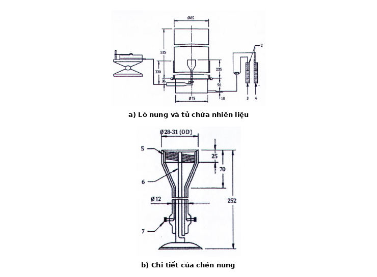

## PHỤ LỤC — này qui định các yêu cầu tối thiểu để xác định nồng độ dập tắt ngọn lửa của khí chữa cháy trong không khí đối với các chất lỏng và khí cháy khi sử dụng thiết bị chén nung.

### B.2  Nguyên lý

Ngọn lửa khuếch tán do sự đốt cháy nhiên liệu trong một chén nung tròn được bố trí ở tâm của một dòng không khí cháy đồng trục (với trục của bình) được dập tắt bằng cách bổ sung khí chữa cháy vào không khí.

### B.3  Yêu cầu đối với thiết bị

### B.3.1  Yêu cầu chung

Thiết bị chén nung dùng cho các phép đo này phải được bố trí và có kết cấu như Hình B.1 với các kích thước đã cho; dung sai của tất cả các kích thước phải là ± 5%, nếu không có qui định khác.

Kích thước tính bằng milimét

### Bảng Phụ lục 1

| a) Lò nung và tủ chứa nhiên liệu | b) Chi tiết của chén nung |
| :--- | :--- |

**CHÚ DẪN**

### Bảng Phụ lục 1 (Phần 2)

| 1  Giắc chỉnh cao độ 2  Thiết bị đo lưu lượng 3  Không khí 4  Chất chữa cháy | 5  Dây làm nóng giữa lớp vách bên trong và lớp vách bên ngoài 6  Cặp nhiệt điện 7  Đầu cấp nhiệt |
| :--- | :--- |

<strong>Hình B.1 — Thiết bị chén nung</strong>

### B.3.2  Chén nung

Chén nung phải tròn và phải có kết cấu bằng kính thủy tinh, thạch anh hoặc thép. Đường kính ngoài của chén nung phải ở trong phạm vi từ 28 mm đến 31 mm, với chiều dày thành từ 1 mm đến 2 mm. Chén nung có góc vát 45° ở (mép) đỉnh chén nung. Phải có phương tiện đo nhiệt độ nhiên liệu bên trong chén nung ở vị trí cách đỉnh chén nung 2 mm đến 5 mm. Chén nung phải có hình dạng tương tự như hình dạng cho trên ví dụ của Hình B.1. Chén nung dùng với các nhiên liệu khí phải có biện pháp để đạt được sự đồng đều của lưu lượng khí tại đỉnh chén nung (ví dụ, chén nung có thể được bọc trong vật liệu chịu lửa).

### B.3.3  Buồng đốt

Buồng đốt phải có kết cấu hình tròn bằng kính thủy tinh hoặc thạch anh. Đường kính trong của buồng đốt phải là 85 mm ± 2 mm và chiều dày thành 2 mm đến 5 mm với chiều cao 535mm ± 5 mm.

### B.3.4  Bộ khuếch tán

Bộ khuếch tán phải có kết cấu để lắp đặt với đầu mút dưới đáy của buồng đốt, thu nhận được dòng trộn sơ bộ của không khí và khí chữa cháy và phải có phương tiện để phân phối đồng đều lưu lượng không khí/khí chữa cháy qua tiết diện ngang của buồng tốt. Nhiệt độ hỗn hợp của không khí/khí chữa cháy trong bộ khuếch tán phải là 25°C ± 10°C, được đo bằng cảm biến nhiệt độ đã được hiệu chuẩn.

### B.3.5  Nguồn cung cấp nhiên liệu

Nguồn cung cấp nhiên liệu lỏng phải có khả năng cung cấp nhiên liệu lỏng cho chén nung và vẫn duy trì được mức chất lỏng cố định khi điều chỉnh bên trong chén nung.

Nguồn cung cấp nguyên liệu khí phải có khả năng cung cấp khí nhiên liệu cho chén nung ở mức được kiểm soát và cố định.

### B.3.6  Đường ống phân phối

Đường ống phân phối phải tiếp nhận không khí, khí chữa cháy và tạo thành một dòng hỗn hợp duy nhất tới bộ khuếch tán.

### B.3.7  Nguồn cung cấp không khí

Phương tiện cung cấp không khí cho ống góp phải điều chỉnh được lưu lượng của không khí. Phải có khí cụ đã được hiệu chuẩn để đo lưu lượng của không khí.

### B.3.8  Nguồn cung cấp khí chữa cháy

Phương tiện cung cấp khí chữa cháy cho ống góp phải điều chỉnh được lưu lượng của khí chữa cháy. Nếu sử dụng phương pháp theo B.7.2 để xác định nồng độ khí chữa cháy thì phải có khí cụ đã được hiệu chuẩn để đo lưu lượng của khí chữa cháy.

### B.3.9  Hệ thống lấy mẫu

Hệ thống lấy mẫu phải cung cấp mẫu thử ở thể khí tiêu biểu và đo được của khí chữa cháy cho chén nung.

### B.4  Yêu cầu đối với vật liệu

### B.4.1  Không khí

Không khí phải sạch, khô và không chứa dầu. Nồng độ oxy theo thể tích phải là (20,9 ± 0,5) %. Phải ghi lại nguồn và hàm lượng oxy của không khí được sử dụng.

**CHÚ THÍCH:** “không khí” được cung cấp trong các bình thương phẩm áp suất cao có thể có hàm lượng oxy khác biệt đáng kể so với 20,9 %.

### B.4.2  Nhiên liệu

Nhiện liệu phải là loại có chất lượng đã được chứng nhận.

### B.4.3  Khí chữa cháy

Khí chữa cháy phải là loại đã được chứng nhận và đáp ứng các thông số kỹ thuật của nhà cung cấp. Các khí chữa cháy có nhiều thành phần nên được cung cấp ở dạng hỗn hợp đã trộn trước. Các khí chữa cháy hóa lỏng phải được cung cấp như khí chữa cháy tinh khiết, nghĩa là không bị nén với nitơ. Trước khi bắt đầu các thử nghiệm phải phân tích thành phần của khí chữa cháy.

### B.5  Qui trình đối với các chất lỏng dễ cháy

### B.5.1  Cho chất lỏng dễ cháy vào bình cung cấp nhiên liệu.

### B.5.2  Cung cấp nhiên liệu cho chén nung, điều chỉnh mức chất lỏng cách miệng chén nung từ 5 mm đến 10 mm.

### B.5.3  Hiệu chỉnh nhiệt độ của chén nung chứa nhiên liệu ở mức 25°C ± 3°C hoặc ở mức cao hơn 5°C ± 3°C nhiệt độ chớp cháy của chén nung hở tùy theo thông số nào cao hơn. Trong thời gian này, phải duy trì mức nhiên liệu trong chén cao hơn vị trí của đầu đo nhiệt độ nhiên liệu.

**CHÚ THÍCH:** CHÚ THÍCH

Nhiệt độ nhiên liệu trong B.5.3 được coi là nhiệt độ ban đầu của thử nghiệm.

### B.5.4  Điều chỉnh lưu lượng không khí để đạt tới lưu lượng 40 l/min.

### B.5.5  Đốt cháy nhiên liệu.

### B.5.6  Cho phép nhiên liệu cháy trong khoảng thời gian 60 s (+10 s, -0 s) trước khi bắt đầu dòng khí chữa cháy. Trong khoảng thời gian này nên điều chỉnh mức chất lỏng trong chén nung sao cho mức nhiên liệu cách miệng chén nung 1 mm.

B.5.7

Bắt đầu cung cấp dòng khí chữa cháy. Từng bước tăng lưu lượng của khí chữa cháy cho tới khi ngọn lửa bị dập tắt. Nên có khoảng thời gian chờ (khoảng 10 s) giữa mỗi lần thay đổi lưu lượng.

Khi gần đến điểm dập tắt, việc tăng lưu lượng phải càng nhỏ càng tốt. Lưu lượng dập tắt cuối cùng phải có giá trị theo khoảng chia nhỏ nhất của thiết bị đo. Các thiết bị đo và điều chỉnh lưu lượng phải chỉnh được giá trị lưu lượng mà không làm tăng nồng độ chất chữa cháy quá 3 % so với giá trị trước đó.

Trong lần thử đầu tiên, có thể dùng các bước tăng lưu lượng lớn để xác định giá trị gần đúng của lưu lượng cần thiết để chữa cháy, các lần thử tiếp theo sẽ bắt đầu tại giá trị lưu lượng gần đúng đã xác định trước đó và tăng từng lượng nhỏ đến khi dập tắt. Không được phép lấy giá trị của lần thử đầu tiên để xác định nồng độ dập tắt.

### B.5.8  Xác định nồng độ dập tắt của khí chữa cháy theo Điều B.7.

### B.5.9  Trước khi thực hiện các lần thử tiếp sau, tháo nhiên liệu ra khỏi chén nung và loại bỏ các chất đóng cặn hoặc muội than có thể xuất hiện trên chén nung.

### B.5.10  Lặp lại các bước B.5.2 đến B.5.9 cho bốn lần thử tiếp sau (toàn bộ có 5 lần thử).

### B.5.11  Xác định nồng độ dập tắt của khí chữa cháy theo B.7 bằng cách xác lập giá trị trung bình của năm lần thử.

### B.6  Qui trình đối với các khí dễ cháy

### B.6.1  Chén nung được dùng với các nguyên liệu khí phải có biện pháp để đạt được lưu lượng khí đồng đều ở đỉnh chén nung. Ví dụ, chén nung được sử dụng với các nhiên liệu khí có thể được bọc trong vật liệu chịu lửa.

### B.6.2  Nhiên liệu khí phải từ một nguồn cung cấp có áp suất điều chỉnh được với phương tiện điều chỉnh và đo lưu lượng khí đã được hiệu chuẩn.

### B.6.3  Điều chỉnh lưu lượng không khí tới 40 l/min.

### B.6.4  Bắt đầu cho dòng nhiên liệu vào chén nung và điều chỉnh lưu lượng để đạt được chiều cao ngọn lửa xấp xỉ 80 mm. Nhiệt độ nhiên liệu phải là 25°C ± 10°C.

### B.6.5  Đốt cháy nhiên liệu.

### B.6.6  Cho phép nhiên liệu cháy trong khoảng thời gian 60 s trước khi bắt đầu cho dòng khí chữa cháy.

### B.6.7  Bắt đầu cho dòng khí chữa cháy hoạt động. Tăng lưu lượng khí chữa cháy tới khi ngọn lửa được dập tắt và ghi lại các lưu lượng của khí chữa cháy và không khí lúc ngọn lửa bị dập tắt. Sự tăng lưu lượng khí chữa cháy dẫn đến sự tăng nồng độ khí chữa cháy không lớn hơn 3% giá trị trước đó. Mỗi lần điều chỉnh lưu lượng khí chữa cháy phải có khoảng thời gian chờ khoảng 10s để cho phép các tỷ lệ mới giữa khí chữa cháy và không khí trong ống góp đi tới vị trí của chén nung.

**CHÚ THÍCH:** Lúc ban đầu nên sử dụng các số gia lưu lượng tương đối lớn để xác định lưu lượng khí chữa cháy xấp xỉ với yêu cầu để dập tắt ngọn lửa, và các bước sau đó dùng lưu lượng gần với lưu lượng tới hạn và tăng dần dần lưu lượng với lượng tăng nhỏ tới khi dập tắt được ngọn lửa.

### B.6.8  Vào lúc dập tắt ngọn lửa, ngắt dòng khí cháy được.

### B.6.9  Trước khi thực hiện các thử nghiệm tiếp theo tháo hết cặn hoặc muội than nếu có ra khỏi chén nung.

### B.6.10  Lặp lại các bước B.6.3 đến B.6.9 cho bốn lần thử tiếp sau (toàn bộ có 5 lần thử).

### B.6.11  Xác định nồng độ dập tắt của khí chữa cháy theo B.7 bằng cách xác lập giá trị trung bình của năm lần thử.

### B.7  Nồng độ dập tắt của khí chữa cháy

### B.7.1  Phương pháp ưu tiên

Phương pháp ưu tiên để xác định nồng độ của khí chữa cháy trong hỗn hợp khí chữa cháy và không khí để dập tắt ngọn lửa là sử dụng thiết bị phân tích khí được hiệu chuẩn đối với phạm vi nồng độ của các hỗn hợp khí chữa cháy - không khí được đo. Thiết bị có thể có khả năng lấy mẫu liên tục (ví dụ, máy phân tích khí trên đường ống dẫn) hoặc có thể là kiểu phân tích các mẫu riêng biệt (ví dụ, sắc ký khí). Kỹ thuật đo liên tục được ưu tiên sử dụng.

Theo cách khác, nồng độ còn lại của oxy trong hỗn hợp không khí/khí chữa cháy trong ống khói bên dưới chén nung có thể đo được bằng một thiết bị phân tích oxy liên tục. Giá trị nồng độ của oxy chịu ảnh hưởng của nồng độ khí chữa cháy. Nồng độ khí chữa cháy được tính như sau:

<!-- FORMULA_IMAGE_PLACEHOLDER: b11bc2b9 -->

$$\dots \qquad (B.1)$$
<!-- formula_id: "F_TCVN_7161_1_2022_FORMULA_B_1" -->

trong đó

&nbsp;&nbsp;&nbsp;&nbsp;\- $c_{E}$ là nồng độ khí chữa cháy theo thể tích tính bằng phần trăm;

&nbsp;&nbsp;&nbsp;&nbsp;\- $c_{O}$ là nồng độ oxy của hỗn hợp không khí/khí chữa cháy trong ống khói theo thể tích tính bằng phần trăm;

&nbsp;&nbsp;&nbsp;&nbsp;\- $c_{S}$ là nồng độ oxy trong không khí cung cấp theo thể tích tính bằng phần trăm.

### B.7.2  Phương pháp khác

Nồng độ khí chữa cháy trong hỗn hợp khí chữa cháy cộng với không khí có thể được tính từ các lưu lượng đo được của khí chữa cháy và không khí. Khi sử dụng các thiết bị đo lưu lượng theo khối lượng thì lưu lượng khối đo được cần được chuyển đổi thành lưu lượng theo thể tích theo công thức B2:

$$V_{1} = m_{1} / \rho_{1} \qquad (B.2)$$
<!-- formula_id: "F_TCVN_7161_1_2022_FORMULA_B_2" -->

trong đó

&nbsp;&nbsp;&nbsp;&nbsp;\- $V_{1}$ là lưu lượng thể tích của khí i, tính bằng lít trên phút (l/min);

&nbsp;&nbsp;&nbsp;&nbsp;\- $m_{1}$ là lưu lượng khối lượng của khí i, tính bằng gam trên phút (g/min);

&nbsp;&nbsp;&nbsp;&nbsp;\- $\rho_{1}$ là mật độ của khí i, tính bằng gam trên lít (g/l).

&nbsp;&nbsp;&nbsp;&nbsp;\- Cần thận trọng khi sử dụng mật độ của hơi. Mật độ hơi của nhiều chất hydrocacbon được halogen hóa ở nhiệt độ và áp suất môi trường xung quanh có thể sai khác nhiều phần trăm so với mật độ được tính theo định luật về khí lý tưởng.

&nbsp;&nbsp;&nbsp;&nbsp;\- VÍ DỤ: Mật độ của hơi HFC-227ea ở áp suất 101,3 kPa và nhiệt độ 295 K cao hơn khoảng 2,4 % so với mật độ được tính cho một khí lý tưởng. Tuy nhiên ở áp suất 6,7 kPa (6,6 %) độ chênh lệch giữa mật độ hơi thực và mật độ được tính theo một khí lý tưởng nhỏ hơn 0,2 %.

&nbsp;&nbsp;&nbsp;&nbsp;\- Nên sử dụng các số liệu về đặc tính được công bố nếu có thể. Có thể sử dụng các kỹ thuật đánh giá khi không có số liệu được công bố. Nguồn các giá trị về tính chất vật lý được sử dụng nên được ghi lại trong báo cáo thử nghiệm.

&nbsp;&nbsp;&nbsp;&nbsp;\- Nồng độ của khí chữa cháy theo thể tích tính bằng phần trăm, c, được tính theo công thức B.3 như sau:

<!-- FORMULA_IMAGE_PLACEHOLDER: b9cc7a4c -->

$$\dots \qquad (B.3)$$
<!-- formula_id: "F_TCVN_7161_1_2022_FORMULA_B_3" -->

trong đó

&nbsp;&nbsp;&nbsp;&nbsp;\- $c_{E}$ là nồng độ khí chữa cháy theo thể tích, tính bằng phần trăm (%);

&nbsp;&nbsp;&nbsp;&nbsp;\- $q_{air}$ là lưu lượng thể tích của không khí, tính bằng lít trên phút (l/min);

&nbsp;&nbsp;&nbsp;&nbsp;\- $q_{ext}$ là lưu lượng thể tích của khí chữa cháy, tính bằng lít trên phút (l/min).

### B.8  Báo cáo kết quả

Bản báo cáo kết quả phải phù hợp với ISO/IEC 17025 và trong báo cáo kết quả, tối thiểu phải có các thông tin sau đây:

a) \- Sơ đồ mạch của thiết bị, bao gồm cả các kích thước và mô tả về vật liệu được sử dụng;

b) \- Ngày của báo cáo;

c) \- Nguồn và phân tích khí chữa cháy, nhiên liệu và không khí;

d) \- Các điều kiện thử nghiệm phải bao gồm:

&nbsp;&nbsp;&nbsp;&nbsp;\- Áp suất khí quyển;

&nbsp;&nbsp;&nbsp;&nbsp;\- Nhiệt độ phòng thử hoặc nhiệt độ không khí vào ống khói nếu có sự khác nhau với nhiệt độ phòng thử;

&nbsp;&nbsp;&nbsp;&nbsp;\- Độ ẩm của không khí vào ống khói.

e) \- Đối với mỗi thử nghiệm, nhiệt độ nhiên liệu tại lúc bắt đầu thử, nhiệt độ nhiên liệu tại thời điểm ngọn lửa được dập tắt và nhiệt độ của hỗn hợp không khí/khí chữa cháy lúc dập tắt ngọn lửa;

f) \- Các lưu lượng khí chữa cháy, nhiên liệu khí và không khí lúc ngọn lửa được dập tắt; nếu sử dụng phương pháp B.7.1 thì nồng độ khí chữa cháy hoặc nồng độ oxy thay cho lưu lượng khí chữa cháy;

g) \- Phương pháp được sử dụng để xác định nồng độ dập tắt;

h) \- Nồng độ khí chữa cháy lúc ngọn lửa được dập tắt với mỗi thử nghiệm;

i) \- Phân tích về sai số đo.