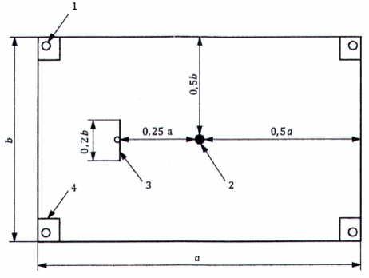
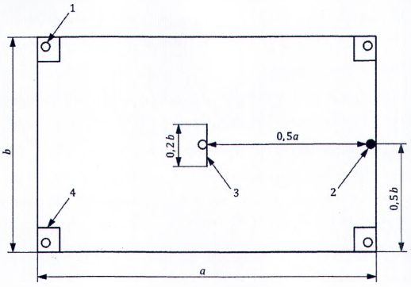
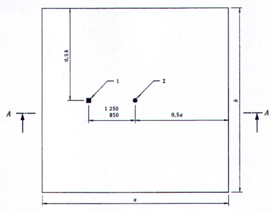
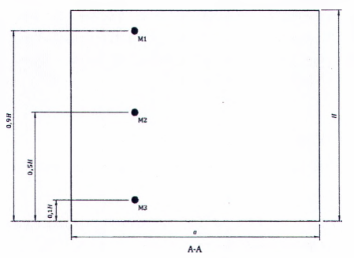
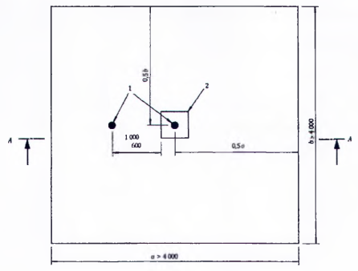
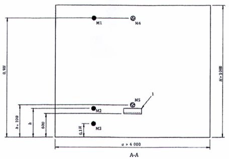
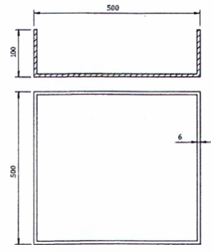
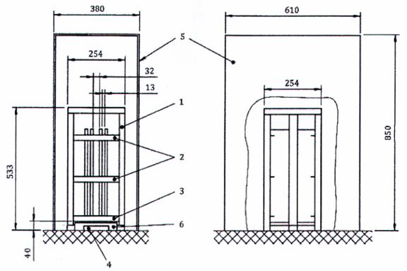
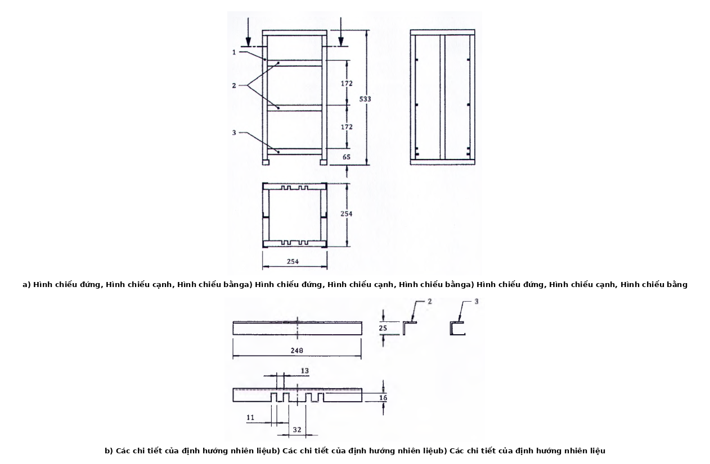
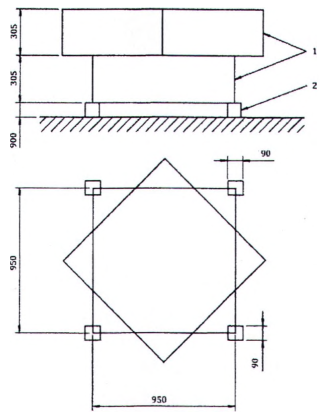

## PHỤ LỤC C (Qui định) — Qui trình thử khả năng dập tắt cháy/ diện tích bảo vệ của hệ thống thiết kế và hệ thống chế tạo sẵn

### C.1  Yêu cầu

### C.1.1  Hệ thống chữa cháy được thiết kế và hệ thống chữa cháy được chế tạo sẵn phải hòa trộn và phân phối khí chữa cháy và phải làm tràn ngập toàn bộ khu vực kín khi được thử theo phương pháp thử này trong các hạn chế thiết kế tối đa và theo hướng dẫn lắp đặt nghiêm ngặt nhất.

### C.1.2  Hiệu quả của việc phân bố đầu phun phải được xác định theo C.5

### C.1.3  Nồng độ dập tắt đối với nhiên liệu nhóm A phải được xác định theo C.6.1 và C.6.3.

### C.1.4  Nồng độ dập tắt đối với nhiên liệu nhóm B phải được xác định theo C.6.2.

### C.1.5  Dung sai áp dụng cho các kích thước được qui định trong phần mô tả các phương tiện phải là ± 5%, nếu không có qui định khác.

### C.2  Loại thử nghiệm và báo cáo kết quả

### C.2.1  Loại thử nghiệm

Các thử nghiệm được mô tả dưới đây để xem xét việc sử dụng và các hạn chế của thiết bị hệ thống chữa cháy với tham chiếu riêng kèm theo:

a) \- Độ bao phủ tối đa của mỗi loại đầu phun ở chiều cao thấp nhất của khu vực bảo vệ;

b) \- Chiều cao tối đa của khu vực bảo vệ cho mỗi loại đầu phun;

c) \- Phạm vi nhiệt độ làm việc của hệ thống;

d) \- Vị trí của các đầu phun trong khu vực được bảo vệ;

e) \- Chiều dài, kích thước lớn nhất của đường ống và số lượng các phụ tùng đường ống cho mỗi đầu phun hoặc áp suất nhỏ nhất của đầu phun;

f) \- Thời gian phun tối đa;

g) \- Tỷ trọng nạp tối đa;

h) \- Nồng độ dập tắt cho các nhiên liệu đặc biệt.

Các thử nghiệm được tiến hành theo Bảng C.1.

### Bảng C.1 - Các thử nghiệm được tiến hành

| Mục tiêu của thử nghiệm | Kích thước cấu kiện bao che | Đám cháy thử | Viện dẫn điều |
| :--- | :--- | :--- | :--- |
| Kiểm tra sự phân bố đầu phun |  |  | C.5 |
| Đầu phun có chiều cao nhỏ nhất/diện tích quét lớn nhất | thích hợp với đầu phun | Các van thử heptan | C.5.1 |
| Đầu phun có chiều cao lớn nhất | ≥ 100 $m^{3}$ |  | C.5.2 |
|  | không có cạnh nào nhỏ hơn 4m chiều cao: thích hợp với đầu phun | Các van thử heptan |  |
| Nồng độ dập tắt | ≥ 100 $m^{3}$ | (a) cũi gỗ | C.6.1 |
| Nồng độ dập tắt | không có cạnh nào nhỏ hơn 4m | (b) khay heptan | C.6.2 |
| Nồng độ dập tắt | chiều cao: tối thiểu là 3,5m | (c) tấm polime mỏng (i) Polymetylmetacrylat (PMMA) (ii) Polypropylen (PP) (iii) Acrylonitrin- Butadien- Styren Polime (ABS) | C.6.3 |

### C.2.2  Báo cáo kết quả

Bản báo cáo kết quả phải bảo đảm theo ISO/IEC 17025 bởi phòng thí nghiệm đạt tiêu chuẩn. Thông tin bổ sung được mô tả tại C.5.1.5, C.5.2.5, C.6.1.5, C.6.2.5 và C.6.3.5, bản báo cáo ít nhất phải có các nội dung sau:

a) \- Mô tả các thiết bị của hệ thống chữa cháy:

1) Sơ đồ hệ thống đường ống bao gồm các nội dung:

i) \- Bình chứa chất chữa cháy (mẫu mã, dung tích và mức nén tạo áp nếu được sử dụng);

ii) Các đường ống góp nếu được sử dụng;

iii) Đường ống (vật liệu, độ dày, chiều dài, đường kính, phần kết nối);

iv) Vị trí của thiết bị chuyển đổi áp suất trên đường ống;

v) \- Các đầu phun (vật liệu, hình thái phun, mô tả lỗ phun gồm số, kích thước và bố trí);

vi) Vị trí của thiết bị đo nhiệt độ bên ngoài đầu phun đối với khí chữa cháy hóa lỏng.

2) Xác định phần mềm tính toán lưu lượng được sử dụng đối với thiết bị của hệ thống thiết kế.

b) \- Mô tả phòng thử nghiệm (nên ở dạng sơ đồ) bao gồm nội dung:

1) Vật liệu của kết cấu bảo vệ;

2) Chiều dài, chiều rộng, chiều cao;

3) Tính toán diện tích và thể tích thực;

4) Vị trí và kích thước của các lỗ mở có thể đóng kín và lỗ van giảm áp.

5) Vị trí của các cảm biến bên trong kết cấu bao che;

c) \- Mô tả các thiết bị đo đạc bao gồm:

1) Phần mềm thu thập dữ liệu, bao gồm cả tốc độ lấy mẫu;

2) Mô tả thiết bị đo gồm:

i) \- Nhà sản xuất và mẫu mã;

ii) Độ chính xác và độ phân giải;

d) \- Xác định thành phần của chất chữa cháy bằng các chứng nhận phù hợp hoặc bằng thử nghiệm;

e) \- Ghi nhớ dữ liệu bao gồm:

1) Khối lượng bình chứa chất chữa cháy

i) \- Trước và sau khi nạp;

ii) Trước và sau khi phun;

2) Lượng chất chữa cháy bên trong bình chứa;

3) Áp suất chất chữa cháy sau khi nạp ở nhiệt độ 20 ± 2 °C;

4) Ngay trước khi đốt nhiên liệu thử nghiệm:

i) \- Nhiệt độ và thời gian mà bình chứa ở trong trạng thái điều hòa nhiệt độ;

ii) Áp suất bình chứa sau khi điều hòa;

iii) Áp suất môi trường;

iv) Nhiệt độ của kết cấu bao che;

v) \- Nồng độ ôxy trong kết cấu bao che;

5) Đồ thị theo thời gian của:

i) \- Nồng độ ôxy trong kết cấu bao che;

ii) Áp suất tại đầu phun;

iii) Nhiệt độ của kết cấu bao che;

iv) Nhiệt độ tại đầu phun đối với chất chữa cháy hóa lỏng;

v) \- Nồng độ chất chữa cháy trong kết cấu bao che suốt quá trình phun thử nghiệm nguội đối với chất chữa cháy hóa lỏng;

6) Thời gian phun;

7) Khối lượng chất chữa cháy phun vào kết cấu bao che thử nghiệm;

8) Thời gian dập tắt từ khi kết thúc quá trình phun;

9) Áp suất trung bình tại đầu phun lấy từ đồ thị theo thời gian;

10) Nồng độ dập tắt.

### C.3  Hệ thống chữa cháy

### C.3.1  Đối với các thử nghiệm xác định sự phân bổ chất chữa cháy của đầu phun được mô tả trong C.5.1 và C.5.2, trước khi tiến hành mỗi thử nghiệm, các bình chứa khí chữa cháy phải được duy trì trong điều kiện tới nhiệt độ vận hành nhỏ nhất ±2 °C cho một chu kì tối thiểu trong 1 h hoặc chất chữa cháy được xử lý đến nhiệt độ vận hành nhỏ nhất ±2 °C khi đo bằng một cặp nhiệt kế bên trong bình chứa. Nhiệt độ vận hành nhỏ nhất phải phù hợp với hướng dẫn lắp đặt của nhà sản xuất.

Hệ thống chữa cháy phải được lắp đặt như sau:

a) \- Thiết bị của hệ thống chữa cháy được chế tạo sẵn - sử dụng các giới hạn lớn nhất của đường ống về số lượng các phụ tùng đường ống và chiều dài ống cho các đầu phun và cấu hình của đầu phun như đã qui định trong hướng dẫn thiết kế và lắp đặt của nhà sản xuất;

b) \- Thiết bị của hệ thống chữa cháy được thiết kế - sử dụng sự bố trí đường ống dẫn đến áp suất thiết kế nhỏ nhất của đầu phun ở 20 °C ± 2 °C.

### C.3.2  Đối với các thử nghiệm nồng độ chữa cháy được mô tả trong C.6.2 và C.6.3, trước mỗi thử nghiệm các bình chữa cháy phải được xử lý thuần hóa ở 20 °C ± 2 °C trong khoảng thời gian tối thiểu là 16 h trước khi tiến hành thử nghiệm hoặc bình chứa chất chữa cháy được xử lý đến nhiệt độ ở 20 °C ± 2 °C khi đo bằng một cặp nhiệt kế bên trong bình chứa.

Các đầu phun phải là loại 360° tiêu biểu của nhà sản xuất. Phản lực từ các đầu phun phải không ảnh hưởng đến sự phát triển của đám cháy và không phun trực tiếp chất chữa cháy vào ngọn lửa thử. Các đầu phun phải được bố trí như sau:

a) \- Khi có một đầu phun loại 360° - đầu phun được lắp ở điểm trung tâm của trần và cách trần 30 cm;

b) \- Khi có nhiều hơn một đầu phun loại 360° - các đầu phun được lắp đối xứng với điểm trung tâm của trần và cách trần 30 cm.

### C.3.3  Đối với các thử nghiệm xác định sự phân bổ chất chữa cháy của đầu phun được mô tả trong C.5.1 và C.5.2 và các thử nghiệm nồng độ chữa cháy được mô tả trong C.6.2 và C.6.3, hệ thống chữa cháy phải được bố trí và xác định kích thước như sau:

a) \- Đối với chất chữa cháy hóa lỏng ở áp suất cao - hệ thống phải được bố trí sao cho khi nhiệt độ của chất chữa cháy ở 20 °C ± 2 °C, thời gian xả của pha khí tiền chất lỏng cộng với pha hai phải trong 8-10 s.

b) \- Đối với chất chữa cháy hóa lỏng ở áp suất không cao - hệ thống phải được bố trí sao cho khi nhiệt độ của chất chữa cháy ở 20°C ± 2°C, thời gian xả của pha khí tiền chất lỏng cộng với pha hai phải trong 8-10 s. Việc phun có thể được hạn chế bằng việc ngắt với phương tiện thích hợp được bố trí gần đầu phun để lượng khí chữa cháy phun vào khu vực thử nghiệm từ 65 % đến 90 % lượng chất chữa cháy trong bình chứa.

c) \- Đối với chất chữa cháy không hóa lỏng - hệ thống phải được bố trí sao cho khi nhiệt độ của chất chữa cháy ở 20 °C ± 2 °C, thời gian phun phải từ 50 s đến 60 s. Việc phun có thể được hạn chế bằng việc ngắt với phương tiện thích hợp được bố trí gần đầu phun để lượng khí chữa cháy phun vào khu vực thử nghiệm từ 65 % đến 90 % lượng chất chữa cháy trong bình chứa.

### C.4  Nồng độ dập tắt

### C.4.1  Nồng độ chất chữa cháy dập tắt

Các thử nghiệm nồng độ chất chữa cháy dập tắt trong C.5.1, C.5.2, C.6.1, C.6.2 và C.6.3 phải là 76,9 % (nghĩa là 100 chia cho hệ số an toàn 1,3) của nồng độ thiết kế nhỏ nhất được qui định trong hướng dẫn thiết kế và lắp đặt của nhà sản xuất ở nhiệt độ môi trường xung quanh 20°C ± 2°C bên trong cấu kiện bao che. Trong các thử nghiệm mô tả trong C.5.1 và C.5.2 phải sử dụng cùng một nồng độ dập tắt như trong các thử nghiệm mô tả trong C.6.2.

Số lượng để đạt tới nồng độ bên trong cấu kiện bao che có thể được xác lập khi sử dụng công thức (C1) cho khí hóa lỏng (xem 7.6.2) và công thức (2) cho khí không hóa lỏng (xem 7.6.3).

Công thức được trình bày lại ở đây để thuận tiện theo dõi:

Khí hóa lỏng

<!-- FORMULA_IMAGE_PLACEHOLDER: e315703a -->

$$\dots \qquad (C.1)$$
<!-- formula_id: "F_TCVN_7161_1_2022_FORMULA_C_1" -->

Khí không hóa lỏng

<!-- FORMULA_IMAGE_PLACEHOLDER: c2e17816 -->

$$\dots \qquad (C.2)$$
<!-- formula_id: "F_TCVN_7161_1_2022_FORMULA_C_2" -->

trong đó

&nbsp;&nbsp;&nbsp;&nbsp;\- Q là tổng khối lượng khí chữa cháy, tính bằng kilôgam;

&nbsp;&nbsp;&nbsp;&nbsp;\- C là nồng độ thiết kế, tính bằng phần trăm theo thể tích;

&nbsp;&nbsp;&nbsp;&nbsp;\- V là thể tích thực của vùng có sự cố cháy, tính bằng mét khối (nghĩa là thể tích được bao quanh trừ đi các cấu trúc cố định không thấm khí chữa cháy);

&nbsp;&nbsp;&nbsp;&nbsp;\- v là thể tích riêng, tính bằng mét khối trên kilôgam: v = $k_{1}$ + $k_{2}$ x T

&nbsp;&nbsp;&nbsp;&nbsp;\- $k_{1}$, $k_{2}$ là các hằng số riêng cho khí chữa cháy được sử dụng, được cung cấp bởi nhà sản xuất khí chữa cháy;

&nbsp;&nbsp;&nbsp;&nbsp;\- T là nhiệt độ môi trường nhỏ nhất được định trước của thể tích được bảo vệ, tính bằng độ C (độ bách phân).

&nbsp;&nbsp;&nbsp;&nbsp;\- Lưu ý quan trọng là thể tích riêng của chất chữa cháy, v, trong công thức trên là giá trị tương ứng với áp suất khí quyển ở mực nước biển. Khi áp suất khí quyển khác với điều kiện chuẩn, ví dụ như khu vực thử nghiệm cao hơn mực nước biển, thể tích riêng của khí chữa cháy lớn hơn giá trị ở mực nước biển theo công thức trên được lấy theo cột 2 của Bảng 3. Sử dụng giá trị thể tích riêng, v, ở khu vực cao hơn mực nước biển sẽ cho kết quả nồng độ chất chữa cháy cao hơn giá trị C.

&nbsp;&nbsp;&nbsp;&nbsp;\- Lượng chất chữa cháy tính toán đúng bằng cách nhân giá trị ở mực nước biển với hệ số:

$$101,3/patm \qquad (C.3)$$
<!-- formula_id: "F_TCVN_7161_1_2022_FORMULA_C_3" -->

&nbsp;&nbsp;&nbsp;&nbsp;\- Trong đó patm là áp suất khí quyển ở vị trí thử nghiệm trước khi thử nghiệm, đơn vị là kPa.

### C.4.2  Thử nghiệm phun nguội

Thử nghiệm phun nguội (không có đám cháy) sử dụng cùng lượng chất chữa cháy (±2 %) giống thử nghiệm khi có đám cháy để xác định nồng độ đập tắt thực phun vào khu vực thử nghiệm.

Phải tiến hành thử nghiệm phun nguội khi sử dụng cùng một số lượng khí chữa cháy (±2 %) để kiểm tra xác minh nồng độ thực của khí chữa cháy.

Đối với chất chữa cháy hóa lỏng phải đo nồng độ chất chữa cháy.

Đối với chất chữa cháy không hóa lỏng phải đo nồng độ chất chữa cháy hoặc nồng độ oxy.

Để xác định nồng độ chất chữa cháy thực hiện như sau:

Khối lượng chất chữa cháy phun ra trong quá trình thử nguội phải được dùng để tính toán nồng độ chất chữa cháy theo công thức (C.4) và (C.5), lấy tỉ trọng của chất chữa cháy ở 20 °C và 1.013 mbar:

<!-- FORMULA_IMAGE_PLACEHOLDER: 09ed33fb -->

$$\dots \qquad (C.4)$$
<!-- formula_id: "F_TCVN_7161_1_2022_FORMULA_C_4" -->

Đối với khí không hóa lỏng:

<!-- FORMULA_IMAGE_PLACEHOLDER: 6077d726 -->

$$\dots \qquad (C.5)$$
<!-- formula_id: "F_TCVN_7161_1_2022_FORMULA_C_5" -->

Trong đó

&nbsp;&nbsp;&nbsp;&nbsp;\- $C_{E}$ là nồng độ khí chữa cháy theo thể tích, tính bằng %;

<!-- FORMULA_IMAGE_PLACEHOLDER: 85af8eea -->

Q là khối lượng khí, tính bằng kg;

ρ là khối lượng riêng của khí ở 20 °C và 1.013 mbar;

V là thể tích khu vực thử nghiệm, tính bằng $m^{3}$.

Nồng độ chất chữa cháy xác định qua tính toán được so sánh với nồng độ được đo khi phun nguội. Sự khác nhau không được quá 1 %.

**CHÚ THÍCH:** 

Ở các điều kiện này, công thức được sử dụng để xác định ngay cả khi không có giá trị đo nhiệt độ phòng lúc bắt đầu thử nghiệm và áp suất khí quyển. Lí do là có thể các yếu tố đó có các giá trị khác, nhưng miễn là các yếu tố đó không thay đổi trong suốt quá trình thử nghiệm thì nó sẽ không ảnh hưởng đến kết quả của thử nghiệm.

Nếu như có sự khác nhau hơn 2 % nồng độ chất chữa cháy hoặc thiếu chính xác yêu cầu trong phép đo, hoặc các điều kiện (như nhiệt độ phòng thử) không giống nhau đối với phun nguội và phun có đám cháy, thì công thức phải được hiệu chỉnh để có tính tới sự khác nhau giữa lý thuyết và điều kiện thực của phòng thử.

Lí do có thể gây ra sự khác nhau giữa tính toán và việc phép đo phải được làm rõ và công thức tính toán phải được sửa đổi phù hợp:

a) \- Tỉ trọng khác nhau (do nhiệt độ và/hoặc áp suất khí quyển) thì dùng dữ liệu (nhiệt độ và áp suất khí quyển) ở điểm bắt đầu thử nghiệm phun nguội.

b) \- Lượng khí rò rỉ khỏi phòng thử không đúng 100 % so với giả định trong công thức thì sử dụng các hệ số hiệu chỉnh cho giá trị x (xem công thức C.4).

Kết quả là công thức tính toán đã được sửa đổi để áp dụng cho các thử nghiệm trên.

Trong trường hợp là khí trơ thì phải đo nồng độ oxy. Sau đó tính toán nồng độ oxy từ nồng độ chất chữa cháy và ngược lại, đo nồng độ oxy ban đầu thì sử dụng công thức (C.6):

<!-- FORMULA_IMAGE_PLACEHOLDER: 4a1c0ae8 -->

$$\dots \qquad (C.6)$$
<!-- formula_id: "F_TCVN_7161_1_2022_FORMULA_C_6" -->

Trong đó

&nbsp;&nbsp;&nbsp;&nbsp;\- $C_{E}$ là nồng độ dập tắt theo thể tích, tính bằng %;

&nbsp;&nbsp;&nbsp;&nbsp;\- $C_{0}$ là nồng độ oxy theo thể tích đo trong phòng thử, tính bằng %;

&nbsp;&nbsp;&nbsp;&nbsp;\- $C_{start}$ là nồng độ oxy theo thể tích trong phòng thử tại thời điểm bắt đầu thử nghiệm, tính bằng %.

&nbsp;&nbsp;&nbsp;&nbsp;\- Nồng độ dập tắt cho mỗi thử nghiệm cháy sau đó được tính toán từ khối lượng chất chữa cháy lớn nhất dùng trong 3 thử nghiệm. Để tính toán, sử dụng công thức xác định trên cơ sở của thử nghiệm phun nguội (nếu cần thiết có thể hiệu chỉnh).

Để đánh giá dữ liệu thử nghiệm trong trường hợp sử dụng công thức đã hiệu chỉnh mà nhiệt độ phòng và áp suất khí quyển ban đầu đã được chọn cho mỗi thử nghiệm thì hệ số hiệu chỉnh phải tương ứng.

### C.5  Thử nghiệm xác nhận sự phân bố đầu phun

### C.5.1  Thử nghiệm chiều cao nhỏ nhất của đầu phun/ diện tích quét lớn nhất của đầu phun

### C.5.1.1  Phương tiện thử

### C.5.1.1.1  Kết cấu

Không gian thử phải đáp ứng các yêu cầu sau:

a) \- Diện tích a x b (xem Hình C.1 và C.2) và chiều cao H, của cấu kiện bao che phải tương ứng với diện tích quét lớn nhất của đầu phun và chiều cao nhỏ nhất của đầu phun do nhà sản xuất qui định.

b) \- Phải có thiết bị giảm áp để giới hạn thay đổi áp suất đối với phun nguội là ±300 Pa .

c) \- Phải có các cửa đóng lại được ngay phía trên các can thử để cho phép thông gió trước khi khởi động hệ thống.

d) \- Phải lắp đặt một tấm chắn giữa sàn và trần có chiều cao bằng chiều cao của phòng thử. Khoảng cách từ tấm chắn đến đầu phun bằng một nửa khoảng cách từ đầu phun đến tường của cấu kiện bao che. Tấm chắn phải vuông góc với hướng giữa vị trí của đầu phun và tường của cấu kiện bao che và phải có chiều dài bằng 20 % chiều dài tường ngắn hơn của cấu kiện bao che (xem Hình C.1 đối với đầu phun 3600 và Hình C.2 đối với đầu phun 180°).

<!-- DIAGRAM: word/media/image15.png -->

**CHÚ DẪN:**

## 1  CÁC CAN THỬ

## 2  ĐẦU PHUN

## 3  TẤM CHẮN

## 4  CỬA THÔNG GIÓ

a x b = diện tích quét lớn nhất của một đầu phun.

<strong>Hình C.1 — Ví dụ sơ đồ để thử chiều cao nhỏ nhất/diện tích quét lớn nhất của đầu phun loại 360°</strong>

<!-- DIAGRAM: word/media/image16.png -->

**CHÚ DẪN:**

## 1  CÁC CAN THỬ

## 2  ĐẦU PHUN

## 3  TẤM CHẮN

## 4  CỬA THÔNG GIÓ

a x b = diện tích quét lớn nhất của một đầu phun.

<strong>Hình C.2 — Ví dụ sơ đồ để thử chiều cao nhỏ nhất/diện tích quét lớn nhất của đầu phun loại 180°</strong>

### C.5.1.1.2  Dụng cụ đo

Việc lấy số liệu và lưu trữ số liệu từ các cảm biến được mô tả dưới đây phải được thực hiện với tần số tối thiểu là 10 Hz.

GHI CHÚ: Các điểm dữ liệu đơn lẻ để xác định khối lượng chất chữa cháy và áp suất khí quyển không bắt buộc phải lấy ở tần số tối thiểu là 10 Hz.

### C.5.1.1.2.1  Cảm biến nồng độ oxy

Nồng độ oxy phải được đo bằng máy phân tích oxy đã được hiệu chuẩn có độ chính xác không thấp hơn 0,1%. Các thiết bị cảm biến phải có khả năng giám sát liên tục và ghi mức oxy bên trong cấu kiện bao che trong suốt quá trình thử. Độ chính xác của các dụng cụ đo không được bị ảnh hưởng của bất kỳ sản phẩm cháy nào.

Phải bố trí ít nhất ba cảm biến trong cấu kiện bao che (xem các Hình C.3 và C.4). Tất cả cảm biến phải được bố trí cách tâm của phòng thử từ 850 mm đến 1250 mm và ít nhất ba cảm biết ở các độ cao so với mặt sàn như sau: 0,1 H, 0,5 H và 0,9 H (H = độ cao của phòng thử).

### C.5.1.1.2.2  Cảm biến áp suất đầu phun

Áp suất đầu phun trong quá trình phun của hệ thống chữa cháy phải được ghi lại bởi một bộ chuyển đổi áp suất trong đường ống được bố trí cách đầu phun một khoảng không lớn hơn 1 m.

### C.5.1.1.2.3  Cảm biến nhiệt độ bên trong cấu kiện bao che

Phải đo và ghi lại nhiệt độ bên trong cấu kiện bao che. Ít nhất một cảm biến phải ở chiều cao bằng một nửa chiều cao của phòng và cách tâm của phòng 850 mm đến 1 250 mm theo phương nằm ngang và ở độ cao 0,5 H. Xem các Hình C.3 và C.4.

Nhiệt độ trong phòng thử phải ở 20 °C ± 5 °C tại thời điểm bắt đầu thử.

### C.5.1.1.2.4  Cảm biến nhiệt độ đầu phun

Đối với các khí chữa cháy hóa lỏng phải ghi lại nhiệt độ tia chất lỏng vừa ra khỏi đầu phun.

### C.5.1.1.2.5  Cảm biến nồng độ chất chữa cháy

Khi thử nghiệm phun nguội chất chữa cháy hóa lỏng phải đo và ghi lại nồng độ chất chữa cháy bằng thiết bị phân tích đã hiệu chuẩn với độ chính xác ít nhất 0,2 %.

Khi thử nghiệm phun nguội chất chữa cháy không hóa lỏng phải đo và ghi lại nồng độ chất chữa cháy hoặc nồng độ oxy. Để đo nồng độ chất chữa cháy phải theo cầu như đo với chất chữa cháy hóa lỏng. Để đo nồng độ oxy phải thực hiện theo C.5.1.1.2.1.

Các cảm biến để đo nồng độ chất chữa cháy hay nồng độ oxy phải đặt ở vị trí theo C.5.1.1.2.1. Thiết bị cảm biến phải đo và ghi nhận nồng độ bên trong phòng thử ít nhất cho đến khi có sự ổn định nồng độ.

### C.5.1.1.2.6  Khối lượng chất chữa cháy

Khối lượng chất chữa cháy phun ra phải xác định bằng phép tính từ khi đo khối lượng bình chứa trước và sau khi nạp vào bình và trước và sau khi phun. Khối lượng phải được đo và ghi lại bằng thiết bị cân khối lượng được hiệu chỉnh đến khoảng đo ít nhất là 0,1 kg.

### C.5.1.1.2.7  Áp suất khí quyển

Áp suất khí quyển phải được xác định trước mỗi lần thử nghiệm. Áp suất khí quyển phải được đo và ghi nhận bằng thiết bị được hiệu chỉnh với khoảng đo ít nhất 100 Pa.

Kích thước tính bằng mm

<!-- FORMULA_IMAGE_PLACEHOLDER: 35d220ef -->

Trong đó:

1 là điểm đo

2 là đầu phun

<strong>Hình C.3 — Sơ đồ bố trí đầu phun ở vị trí có độ cao tối thiểu/độ bao phủ lớn nhất</strong>

Kích thước tính bằng mm

<!-- DIAGRAM: word/media/image18.png -->

GHI CHÚ: điểm đo ở độ cao 0,9 H, 0,5 H và 0,1 H (M1 đến M3) được cho phép có khác nhau về khoảng cách theo phương ngang từ tâm của phòng thử từ 850 mm đến 1 250 mm.

<strong>Hình C.4 — Sơ đồ mặt đứng bố trí đầu phun có độ cao tối thiểu/độ bao phủ lớn nhất</strong>

### C.5.1.2  Đặc tính kỹ thuật của nhiên liệu

### C.5.1.2.1  Can thử

Các can thử phải có dạng hình trụ đường kính 80 mm ± 5 mm và chiều cao không nhỏ hơn 100 mm làm bằng thép cacbon hoặc thép không gỉ với chiều dày 5 mm đến 6 mm.

### C.5.1.2.2  Đặc tính kỹ thuật của heptan

Phải sử dụng heptan có các đặc tính sau:

a) \- Chưng cất;

1) Điểm sôi ban đầu: nhỏ nhất 90°C;

2) Điểm khô: lớn nhất 100°C;

b) \- Khối lượng riêng (ở 15,6°C): 700 ± 50 kg/$m^{3}$.

### C.5.1.2.3  Cấu hình can thử nhiên liệu

Các can thử có thể chứa heptan hoặc heptan trên nước. Nếu các can chứa heptan và nước thì lớp heptan phải có chiều dày tối thiểu là 50 mm. Mức heptan trong can phải thấp hơn đỉnh can tối thiểu là 50 mm.

Một cặp đo nhiệt độ cho phép bố trí ở độ cao 30 mm phía trên tâm điểm của mỗi can thử để ghi nhận thêm thông tin.

### C.5.1.2.4  Bố trí can thử

Phải đặt một can thử vào mỗi góc của cấu kiện bao che, cách các tường của cấu kiện bao che không quá 50 mm. Ngoài ra phải đặt một trong hai can thử, tùy theo chiều cao của cấu kiện bao che, ngay sau tấm chắn (xem các Hình C.1 và C.2). Các can thử phải được bố trí cách đỉnh hoặc đáy của cấu kiện bao che, hoặc cả đỉnh và đáy không quá 300 mm nếu kết cấu của cấu kiện bao che cho phép.

### C.5.1.3  Qui trình thử

### C.5.1.3.1  Trước thử nghiệm

Phải kiểm tra thành phần của khí chữa cháy được sử dụng bằng chứng chỉ hoặc thử nghiệm.

### C.5.1.3.2  Tiến hành thử

Đốt cháy các can thử chứa đầy heptan và cho cháy trong 30 s với các lỗ thông hơi có thể đóng kín được ở phía trên đỉnh can thử ở vị trí tự mở.

Sau 30 s tất cả các lỗ thông hơi phải được đóng kín và hệ thống chữa cháy phải được vận hành bằng tay. Tại lúc khởi động hệ thống, lượng oxy bên trong cấu kiện bao che không được nhỏ hơn 20,4 %. Trong quá trình thử, nồng độ oxy không được thay đổi lớn hơn 1,5 % theo thể tích do các sản phẩm của đám cháy. Sự thay đổi này phải được xác định bằng cách so sánh nồng độ oxy đo được trong thử nghiệm phun nguội với nồng độ oxy đo được trong thử nghiệm này (lấy giá trị trung bình trên ba cảm biến).

**CHÚ THÍCH:** Kết thúc việc phun là thời điểm khi việc phun đã thực sự dừng lại. Đối với các khí chữa cháy hóa lỏng ở áp suất cao là lúc phun ra hầu hết là khí. Đối với các khí chữa cháy hóa lỏng ở áp suất thấp và khí chữa cháy không hóa lỏng, cơ cấu ngắt được dùng để dừng việc phun, đây là lúc áp suất ở đầu phun giảm tới 0.

### C.5.1.3.3  Ghi kết quả

Sau khoảng thời gian đốt cháy sơ bộ theo yêu cầu, ghi các số liệu sau cho mỗi thử nghiệm:

a) \- Thời gian phun có hiệu quả: đối với các khí chữa cháy hóa lỏng, thời gian của pha khí của chất hóa lỏng trước cộng với thời gian của dòng phun hai pha; đối với các khí chữa cháy không hóa lỏng, thời gian từ khi mở van bình chứa tới khi ngắt việc phun; thời gian phun đối với các khí chữa cháy hóa lỏng phải được xác định bằng áp suất đầu phun, nhiệt độ đầu phun hoặc sự kết hợp của cả hai;

b) \- Thời gian yêu cầu để đạt được việc dập tắt ngọn lửa, tính bằng giây; thời gian này phải được xác định bởi quan sát bằng mắt hoặc các phương tiện thích hợp khác;

c) \- Tổng khối lượng của khí chữa cháy được phun vào khu vực thử.

### C.5.1.4  Xác định khả năng phân phối của đầu phun

Tất cả các can thử phải được dập tắt trong 30 s sau khi kết thúc việc phun khí chữa cháy.

Khí sử dụng các can bằng thép chứa heptan, nồng độ của khí chữa cháy (hoặc đối với các khí không hóa lỏng là nồng độ của oxy) có thể được đo ở các vị trí được qui định cho các can thử bằng thép.

Nồng độ phải được đo ở mỗi vị trí và tối thiểu phải là nồng độ dập tắt đạt được sau khi kết thúc thời gian phun là 30 s ở lần đo cuối cùng.

### C.5.1.5  Báo cáo kết quả thử nghiệm

Dữ liệu bổ sung trong C.5.1.3.3 theo C.5.1.4 và thông tin trong C.2.2 phải được báo cáo cho mỗi lần thử.

a) \- Mô tả thử nghiệm phòng thử dưới dạng sơ đồ với các thông tin sau:

1) Chiều rộng vách ngăn, vị trí và hướng;

2) Vị trí đầu phun trong phòng thử;

3) Vị trí can thử trong phòng thử.

b) \- Mô tả đặc tính của nhiên liệu:

1) Vật liệu can thử và kích thước can thử;

2) Đặc tính của heptan theo tài liệu chứng nhận hoặc theo thử nghiệm;

3) Độ sâu của heptan và mức heptan trong can thử.

c) \- Mô tả chi tiết phương pháp thử:

1) Thời gian đốt cháy ban đầu;

2) Nồng độ oxy khi hệ thống phun.

### C.5.2  Thử chiều cao lớn nhất của các đầu phun

### C.5.2.1  Phương tiện thử

### C.5.2.1.1  Kết cấu

Cấu kiện bao che dùng để thử phải đáp ứng các yêu cầu sau.

a) \- Cấu kiện bao che dùng để thử phải có thể tích ít nhất là 100 $m^{3}$. Các kích thước của sàn tối thiểu phải là: rộng 4m, dài 4m. Cấu kiện bao che thử phải có chiều cao lớn nhất của trần như qui định trong hướng dẫn lắp đặt của nhà sản xuất;

b) \- Phải có phương tiện để giảm áp suất khi phun nguội để thay đổi không quá ±300 Pa;

c) \- Phải có các cửa đóng lại được ngay phía trên các can thử để cho phép thông gió trước khi khởi động hệ thống;

d) \- Phải lắp đặt một tấm chắn giữa sàn và trần có chiều cao bằng chiều cao của phòng: Khoảng cách từ tấm chắn đến đầu phun bằng một nửa khoảng cách từ đầu phun đến tường của cấu kiện bao che. Tấm chắn phải vuông góc với hướng của đầu phun và phải có chiều dài bằng 20% chiều dài của tường ngắn hơn của cấu kiện bao che (xem Hình C.1 đối với đầu phun 360° và Hình C.2 đối với phun 180°).

### C.5.2.1.2  Khí cụ đo kiểm

Khí cụ đo kiểm của cấu kiện bao che được mô tả trong C.5.1.1.2

### C.5.2.2  Đặc tính kỹ thuật của nhiên liệu

Kết cấu, cấu hình, bố trí của can thử đám cháy và đặc tính kỹ thuật của nhiên liệu phải theo qui định trong C.5.1.2.

### C.5.2.3  Qui trình thử

### C.5.2.3.1  Trước thử nghiệm

Trước khi bắt đầu các thử nghiệm phải xác định thành phần của khí chữa cháy bằng tài liệu chứng nhận hoặc thử nghiệm phân tích.

### C.5.2.3.2  Tiến hành thử

Phải đốt cháy heptan và cho cháy trong 30 s với các cửa phía trên được mở ra.

Sau 30 s tất cả các lỗ thông hơi phải được đóng được và hệ thống chữa cháy phải được vận hành bằng tay. Tại lúc khởi động hệ thống lượng oxy bên trong cấu kiện bao che không được nhỏ hơn 20,4 %. Trong quá trình thử nồng độ oxy không được thay đổi lớn hơn 1,5 % theo thể tích do các sản phẩm của đám cháy. Sự thay đổi này phải được xác định bằng cách so sánh nồng độ oxy đo được trong thử nghiệm phun nguội với nồng độ oxy đo được trong thử nghiệm này (lấy giá trị trung bình trên cảm biến).

### C.5.2.3.3  Ghi lại kết quả

Phải ghi các kết quả như qui định trong C.5.1.3.3.

### C.5.2.4  Xác định khả năng phân phối của đầu phun

Khi sử dụng nồng độ dập tắt cho heptan được xác định theo C.6.2, tất cả các can thử phải được dập tắt trong 30 s khi kết thúc việc phun khí chữa cháy.

Khi sử dụng các can bằng thép chứa heptan, nồng độ của khí chữa cháy (hoặc đối với các khí hóa lỏng là nồng độ oxy) có thể được đo ở các vị trí được qui định cho các can thử bằng thép. Nồng độ phải được đo ở mỗi vị trí và tối thiểu phải là nồng độ dập tắt đạt được sau khi kết thúc thời gian phun là 30 s ở lần đo cuối cùng.

### C.5.2.5  Báo cáo kết quả thử nghiệm

Dữ liệu bổ sung trong C.5.2.3.3 theo C.5.2.4 và thông tin trong C.2.2 phải được báo cáo cho mỗi lần thử.

a) \- Mô tả thử nghiệm phòng thử dưới dạng sơ đồ với các thông tin sau:

1) Chiều rộng vách ngăn, vị trí và hướng;

2) Vị trí đầu phun trong phòng thử;

3) Vị trí can thử trong phòng thử.

b) \- Mô tả đặc tính của nhiên liệu:

1) Vật liệu can thử và kích thước can thử;

2) Đặc tính của heptan theo tài liệu chứng nhận hoặc theo thử nghiệm;

3) Độ sâu của heptan và mức heptan trong can thử.

c) \- Mô tả chi tiết phương pháp thử:

1) Thời gian đốt cháy ban đầu;

2) Nồng độ oxy khi hệ thống phun.

### C.6  Các thử nghiệm nồng độ dập tắt

### C.6.1  Thử cũi gỗ

### C.6.1.1  Phương tiện thử

### C.6.1.1.1  Kết cấu

Cấu kiện bao che thử phải đáp ứng các yêu cầu sau:

a) \- Cấu kiện bao che phòng thử phải có thể tích tối thiểu 100 $m^{3}$, chiều cao tối thiểu phải là 3,5 m. Các kích thước của sàn tối thiểu phải là: rộng 4 m, dài 4 m.

b) \- Phải có phương tiện để giảm áp suất khi phun nguội để thay đổi không quá ±300 Pa.

### C.6.1.1.2  Dụng cụ đo

Việc lấy số liệu và lưu trữ số liệu từ các cảm biến được mô tả dưới đây phải được thực hiện với tần số tối thiểu là 10 Hz.

GHI CHÚ: Các điểm dữ liệu đơn lẻ để xác định khối lượng chất chữa cháy và áp suất khí quyển không bắt buộc phải lấy ở tần số tối thiểu là 10 Hz.

### C.6.1.1.2.1  Cảm biến nồng độ oxy

Nồng độ oxy phải được đo bằng máy phân tích oxy đã được hiệu chuẩn có độ chính xác tối thiểu 0,1 %. Các máy cảm biến phải có khả năng giám sát liên tục và ghi mức oxy bên trong cấu kiện bao che trong suốt quá trình thử. Độ chính xác của các dụng cụ đo không được bị ảnh hưởng của bất kỳ sản phẩm cháy nào.

Tối thiểu phải bố trí ba cảm biến trong cấu kiện bao che (xem các Hình C.5 và C.6). Một cảm biến phải được bố trí ở độ cao so với sàn tương đương với đỉnh của cũi gỗ và cách xa cũi gỗ 600 mm đến 1 000 mm. Các cảm biến còn lại phải được bố trí ở độ cao 0,1 H và 0,9 H, với H - chiều cao của cấu kiện bao che (xem các Hình C.5 và C.6).

### C.6.1.1.2.2  Cảm biến áp suất đầu phun

Phải ghi lại áp suất của đầu phun trong quá trình phun bằng bộ chuyển đổi áp suất trong đường ống và cách đầu phun không quá 1 m.

### C.6.1.1.2.3  Cảm biến nhiệt độ bên trong cấu kiện bao che

Phải đo và ghi lại nhiệt độ bên trong cấu kiện bao che. Ít nhất một cảm biến phải ở trung tâm và cao hơn vật thử 100 mm. Một cảm biến phải đặt cách vật thử 600 mm đến 1 000 mm theo phương ngang và ở độ cao bằng với đỉnh vật thử. Ít nhất một cảm biến phải đặt cách vật thử 600 mm đến 1 000 mm theo phương ngang và ở độ cao 0,9 H.

### C.6.1.1.2.4  Cảm biến nhiệt độ đầu phun

Đối với các khí chữa cháy hóa lỏng, phải ghi lại nhiệt độ của tia chất lỏng vừa ra khỏi đầu phun.

### C.6.1.1.2.5  Cảm biến nồng độ chất chữa cháy

Khi thử nghiệm phun nguội chất chữa cháy hóa lỏng phải đo và ghi lại nồng độ chất chữa cháy bằng thiết bị phân tích đã hiệu chuẩn với độ chính xác ít nhất 0,2 %. Thiết bị cảm biến phải đo và ghi nhận nồng độ bên trong phòng thử ít nhất cho đến khi có sự ổn định nồng độ.

Khi thử nghiệm phun nguội chất chữa cháy không hóa lỏng phải đo và ghi lại nồng độ chất chữa cháy hoặc nồng độ oxy. Để đo nồng độ chất chữa cháy phải theo cầu như đo với chất chữa cháy hóa lỏng. Để đo nồng độ oxy phải thực hiện theo C.6.1.1.2.1. Thiết bị cảm biến phải đo và ghi nhận nồng độ bên trong phòng thử ít nhất cho đến khi có sự ổn định nồng độ.

Các cảm biến để đo nồng độ chất chữa cháy hay nồng độ oxy phải đặt ở vị trí theo C.6.1.1.2.1.

### C.6.1.1.2.6  Khối lượng chất chữa cháy

Khối lượng chất chữa cháy phun ra phải xác định bằng phép tính từ khi đo khối lượng bình chứa trước và sau khi nạp vào bình và trước và sau khi phun. Khối lượng phải được đo và ghi lại bằng thiết bị cân khối lượng được hiệu chỉnh đến khoảng đo ít nhất là 0,1 kg.

### C.6.1.1.2.7  Áp suất khí quyển

Áp suất khí quyển phải được xác định trước mỗi lần thử nghiệm. Áp suất khí quyển phải được đo và ghi nhận bằng thiết bị được hiệu chỉnh với khoảng đo ít nhất 100 Pa.

Kích thước tính bằng milimét

<!-- FORMULA_IMAGE_PLACEHOLDER: 4fe1d7db -->

## 1  ĐIỂM ĐO

## 2  VẬT THỬ

<strong>Hình C.5 — Sơ đồ bố trí dụng cụ đo để thử nồng độ dập tắt</strong>

Kích thước tính bằng milimét

<!-- DIAGRAM: word/media/image20.png -->

**CHÚ DẪN:**

## 1  VẬT THỬ

<strong>Hình C.6 — Mặt cắt bố trí dụng cụ đo để thử nồng độ dập tắt</strong>

### C.6.1.2  Đặc tính kỹ thuật của nhiên liệu

### C.6.1.2.1  Nhiên liệu đốt cháy cũi

Việc đốt cháy cũi được thực hiện bằng cách đốt cháy 1,5 l heptan (được qui định trong C.5.1.2.2) trên lớp nước 12,5 l trong đó khay thép vuông có diện tích 0,25 $m^{2}$, chiều sâu 100 mm với chiều dày thành 6 mm (xem Hình C.7).

Kích thước tính bằng milimét

<strong>Hình C.7 — Kích thước của khay để thử đám cháy cũi gỗ và khay heptan</strong>

### C.6.1.2.2  Hình dạng và sự bố trí đám cháy

Cũi gỗ phải gồm có bốn lớp, mỗi lớp có 6 thanh 40 mm x 40 mm, dài 450 mm ± 50 mm bằng gỗ vân sam sấy khô hoặc gỗ lim sam loại phế liệu có hàm lượng ẩm 9 % đến 13%. Đặt các lớp thanh gỗ xen kẽ vuông góc với nhau. Các thanh gỗ cách đều nhau tạo thành một hình vuông được xác định bởi chiều dài qui định của các thanh gỗ. Kẹp chặt hoặc đóng đinh các thanh gỗ với nhau tạo thành các cạnh ngoài của cũi.

Cũi phải được đốt cháy sơ bộ trên giá đỡ cũi. Khoảng cách từ đáy cũi đến đỉnh của khay chứa nhiên liệu đốt cháy (mô tả trong C.5.1.2.1) phải là 300 mm. Đáy của cũi phải có độ cao so với sàn là 600 mm.

### C.6.1.3  Qui trình thử

### C.6.1.3.1  Thử sơ bộ

Trước khi bắt đầu thử nghiệm phải xác định thành phần của khí chữa cháy bằng bằng tài liệu chứng nhận hoặc thử nghiệm phân tích. Ghi lại khối lượng và độ ẩm của cũi trước khi thử.

### C.6.1.3.2  Tiến hành thử

Đặt cũi với đáy cũi ở giữa, phía trên và cách đỉnh của khay đốt khoảng 300 mm trên giá thử có kết cấu sao cho đáy cũi được tiếp xúc với không khí. Việc đốt cháy sơ bộ không bị ảnh hưởng của điều kiện thời tiết như mưa, gió, ánh nắng mặt trời v.v... vận tốc gió lớn nhất ở gần đám cháy phải là 3 $ms^{-1}$. Nếu cần có thể sử dụng các phương tiện thích hợp để che gió. Ghi lại các điều kiện thời tiết bao gồm cả vị trí đốt cháy trước, nhiệt độ không khí, độ ẩm và vận tốc gió.

Đốt cháy heptan và cho phép cũi cháy tự do. Cũi phải được phép cháy tự do trong tổng thời gian đốt cháy sơ bộ 6 min (+10 s, -0 s).

Lúc khởi động hệ thống, nồng độ oxy bên trong cấu kiện bao che ở chiều cao của cũi không được thấp hơn 20,4 %. Trong quá trình thử, nồng độ oxy không được thay đổi lớn hơn 1,5 % theo thể tích do các sản phẩm của đám cháy. Phải xác định sự thay đổi này bằng cách so sánh nồng độ oxy đo được trong thử nghiệm phun nguội, với nồng độ oxy lúc ban đầu trong các thử nghiệm có đám cháy (lấy giá trị trung bình).

Cấu kiện bao che phải được giữ nguyên hiện trạng trong thời gian 10 min sau khi kết thúc việc phun của hệ thống. Sau thời gian để ngấm, lấy cũi ra khỏi cấu kiện bao che và quan sát xem liệu còn lại đủ nhiên liệu để chịu được sự đốt cháy nữa hay không và tìm các dấu hiệu của sự cháy lại. Phải ghi lại các thông tin sau:

a) \- Sự hiện diện và vị trí của các than hồng;

b) \- Có hay không có các than hồng đang phát sáng hoặc cũi gỗ cháy lại;

c) \- Khối lượng của cũi gỗ sau khi thử.

Nếu thấy cần thiết, bổ sung thêm nồng độ khí chữa cháy và lặp lại chương trình thử tới khi đạt được ba lần liên tiếp dập tắt đám cháy thành công.

### C.6.1.3.3  Ghi kết quả

Sau khoảng thời gian đốt cháy trước theo yêu cầu cần ghi lại các dữ liệu sau đối với mỗi thử nghiệm:

a) \- Thời gian phun có hiệu quả: đối với các khí chữa cháy hóa lỏng, thời gian của pha khí của chất hóa lỏng trước cộng với thời gian của dòng phun hai pha; đối với các khí chữa cháy không hóa lỏng, thời gian từ khi mở van bình chứa tới khi ngừng phun; thời gian phun đối với các khí chữa cháy hóa lỏng phải được xác định bởi áp suất đầu phun, nhiệt độ đầu phun hoặc sự kết hợp của cả hai;

b) \- Thời gian yêu cầu để đạt được việc dập tắt đám cháy, tính bằng giây; thời gian này phải được xác định bởi quan sát bằng mắt hoặc các phương tiện thích hợp khác;

c) \- Tổng khối lượng của khí chữa cháy được phun vào bên trong cấu kiện bao che;

d) \- Thời gian ngâm chất chữa cháy (thời gian từ khi kết thúc việc phun của hệ thống chữa cháy tới khi mở cấu kiện bao che thử);

e) \- Thông tin nhiệt độ của cũi gỗ.

**CHÚ THÍCH:** Kết thúc phun là thời điểm khi việc phun đã thực sự dừng lại. Đối với các khí chữa cháy hóa lỏng tăng áp thì đây là lúc phun ra hầu hết là chất khí. Đối với các khí chữa cháy hóa lỏng không tăng áp và các khí chữa cháy không hóa lỏng, cơ cấu ngắt được dùng để ngừng phun, đây là lúc áp suất ở đầu phun giảm tới không (0).

### C.6.1.4  Xác định nồng độ thiết kế của khí chữa cháy

Nồng độ dập tắt là nồng độ để đạt được sự dập tắt đám cháy sau ba lần thử nghiệm liên tiếp (không có sự cháy lại hoặc không có các than hồng đang cháy sau khi kết thúc phun 10 min). Cũng có thể sử dụng ba lần thử không liên tiếp, có kết quả và lấy nồng độ cao nhất. Nồng độ thiết kế là nồng độ dập tắt nhân với một hệ số an toàn thích hợp.

### C.6.2  Thử khay heptan

### C.6.2.1  Phương tiện thử

### C.6.2.1.1  Kết cấu

Kết cấu của cấu kiện bao che phải theo qui định trong C.6.1.1.1.

### C.6.2.1.2  Trang bị dụng cụ đo kiểm

Trang bị dụng cụ đo kiểm của cấu kiện bao che phải theo qui định trong C.6.1.1.2.

### C.6.2.2  Đặc tính kỹ thuật của nhiên liệu

### C.6.2.2.1  Heptan

Heptan được qui định trong C.5.1.2.2.

### C.6.2.2.2  Hình dạng và sự bố trí đám cháy

Đám cháy phải ở trong một khay thép vuông có diện tích đáy 0,25 $m^{2}$, độ sâu 100 mm với chiều dày thành 6 mm theo qui định trong C.6.1.2.1. Khay thử phải chứa được 12,5 l heptan. Bề mặt của heptan thấp hơn bề mặt đỉnh khay 50 mm.

Khay thép phải được bố trí ở trung tâm của cấu kiện bao che thử và đáy khay ở phía trên cách mặt sàn cấu kiện bao che 600 mm.

### C.6.2.3  Qui trình thử

### C.6.2.3.1  Chuẩn bị thử

Trước khi bắt đầu các thử nghiệm phải xác định thành phần của khí chữa cháy bằng tài liệu chứng nhận hoặc thử nghiệm phân tích.

### C.6.2.3.2  Tiến hành thử

Phải đốt cháy heptan và cho heptan cháy trong thời gian ít nhất 30 s.

Sau 30 s tất cả các lỗ thông hơi phải được đóng và hệ thống chữa cháy phải được vận hành bằng tay. Tại lúc khởi động hệ thống, lượng oxy bên trong cấu kiện bao che không được nhỏ hơn 20,4 %. Trong quá trình thử, nồng độ oxy không được thay đổi lớn hơn 1,5 % theo thể tích do các sản phẩm của đám cháy. Sự thay đổi này phải được xác định bằng cách so sánh nồng độ oxy đo được trong thử nghiệm phun nguội với nồng độ oxy đo được trong thử nghiệm này (lấy giá trị trung bình trên cảm biến).

Nếu cần thiết, bổ sung nồng độ khí chữa cháy và lập lại chương trình thử nghiệm tới khí đạt được ba lần dập tắt đám cháy liên tiếp thành công.

### C.6.2.3.3  Ghi kết quả

Phải ghi các kết quả như đã qui định trong C.6.1.3.3, trừ điều e).

### C.6.2.4  Xác định nồng độ thiết kế của khí chữa cháy

Nồng độ trong phòng thí nghiệm của khí chữa cháy là nồng độ để đạt được sự dập tắt đáp ứng yêu cầu đối với đám cháy qua ba lần thử liên tiếp (không có sự cháy lại sau khi kết thúc việc phun khí chữa cháy 30 s). Cũng có thể sử dụng ba lần thử không liên tiếp, có kết quả và lấy nồng độ cao nhất trong các lần thử này. Nồng độ thiết kế là nồng độ trong phòng thí nghiệm nhân với một hệ số an toàn thích hợp.

### C.6.2.5  Báo cáo kết quả thử nghiệm

Dữ liệu bổ sung trong C.6.2.3.3 theo C.6.2.4 và thông tin trong C.2.2 phải được báo cáo cho mỗi lần thử.

a) \- Mô tả phòng thử dưới dạng sơ đồ với các thông tin sau:

1) Vị trí vật thử bên trong phòng thử.

b) \- Mô tả đặc tính của nhiên liệu:

1) Vật liệu can thử và kích thước can thử;

2) Đặc tính của heptan theo tài liệu chứng nhận hoặc theo thử nghiệm;

3) Độ sâu của heptan và mức heptan trong can thử.

c) \- Mô tả chi tiết phương pháp thử:

1) Thời gian đốt cháy ban đầu;

2) Nồng độ oxy khi hệ thống phun.

### C.6.3  Thử cháy tấm polime mỏng

### C.6.3.1  Phương tiện thử

### C.6.3.1.1  Cấu trúc

Cấu trúc của cấu kiện bao che được mô tả trong C.6.1.1.1.

### C.6.3.1.2  Dụng cụ đo

Dụng cụ đo của cấu kiện bao che được mô tả trong C.6.1.1.2.

### C.6.3.2  Đặc tính kỹ thuật của nhiên liệu

### C.6.3.2.1  Nhiên liệu đốt cháy

Nguồn đốt cháy là một khay heptan (có kết cấu bằng thép cacbon thấp hoặc thép không gỉ dày 2 mm), các kích thước bên trong 51 mm x 112 mm và sâu 21 mm, được đặt bên dưới cách đáy của các tấm chất dẻo 12 mm (xem Hình 8). Cạnh 51 mm của khay song song với các tấm nhiên liệu polime.

Khay được chứa 6 ml heptan loại thương mại (được qui định trong C.5.1.2.2) trên 40 ml nước.

### C.6.3.2.2  Nhiên liệu polime

Các thử nghiệm được tiến hành với ba nhiên liệu chất dẻo:

&nbsp;&nbsp;\- Polymetymetacrylat (PMMA);

&nbsp;&nbsp;\- Polypropylen (PP);

&nbsp;&nbsp;\- Acrylonitrin - butadien - styren polime (ABS).

Tính chất của vật liệu polime được nêu trong Bảng C.2.

### Bảng C.2 - Các tính chất của vật liệu polime

| Đốt trong nhiệt lượng kế hình Cone 25 kW/$m^{2}$ (ISO 5660-1) — Nhiên liệu | Đốt trong nhiệt lượng kế hình Cone 25 kW/$m^{2}$ (ISO 5660-1) — Màu sắc | Đốt trong nhiệt lượng kế hình Cone 25 kW/$m^{2}$ (ISO 5660-1) — Mật độ, g/$m^{3}$ | Đốt trong nhiệt lượng kế hình Cone 25 kW/$m^{2}$ (ISO 5660-1) — Thời gian đốt cháy — s | Đốt trong nhiệt lượng kế hình Cone 25 kW/$m^{2}$ (ISO 5660-1) — Thời gian đốt cháy — Dung sai | Đốt trong nhiệt lượng kế hình Cone 25 kW/$m^{2}$ (ISO 5660-1) — Tốc độ thoát nhiệt trung bình trong 180 s — kW/$m^{2}$ | Đốt trong nhiệt lượng kế hình Cone 25 kW/$m^{2}$ (ISO 5660-1) — Tốc độ thoát nhiệt trung bình trong 180 s — Dung sai | Đốt trong nhiệt lượng kế hình Cone 25 kW/$m^{2}$ (ISO 5660-1) — Nhiệt hiệu dụng của sự cháy — MJ/kg | Đốt trong nhiệt lượng kế hình Cone 25 kW/$m^{2}$ (ISO 5660-1) — Nhiệt hiệu dụng của sự cháy — Dung sai |
| :--- | :--- | :---: | :---: | :---: | :---: | :---: | :---: | :---: |
| PMMA | Đen | 1,19 | 77 | ± 30 % | 286 | ± 25 % | 23,3 | ± 25 % |
| PP | Tự nhiên (trắng) | 0,905 | 91 | ± 30 % | 225 | ± 25 % | 39,6 | ± 25 % |
| ABS | Tự nhiên (kem) | 1,04 | 115 | ± 30 % | 484 | ± 25 % | 29,1 | ± 25 % |

### C.6.3.2.3  Dàn nhiên liệu polime

Dàn nhiên liệu polime gồm 4 tấm polime cùng một loại theo C.6.3.2, được cắt đến chiều cao 405 mm ± 5 mm, rộng 200 mm ± 5 mm, dày 10 mm ± 1 mm;

Các tấm được dán cách nhau và được định vị theo chỉ dẫn trên các Hình C.8 và C.9. Đáy của dàn nhiên liệu được bố trí cách sàn 203 mm. Các tấm nhiên liệu phải được kẹp chặt bằng cơ khí ở các khoảng cách yêu cầu. Các tấm chất dẻo không được uốn cong một cách đáng kể trong quá trình thử nghiệm.

Dàn nhiên liệu phải được đặt ở tâm bên trong cấu kiện bao che.

### C.6.3.2.4  Vỏ che dàn nhiên liệu

Vỏ che dàn nhiên liệu gồm có một khung kim loại được bao kim loại tấm trên đỉnh và hai cạnh bên dùng để che dàn nhiên liệu như chỉ dẫn trên các Hình C.8 và C.9. Vỏ che dàn nhiên liệu có chiều rộng 380 mm, chiều cao 850 mm và chiều sâu 610 mm. Các mặt bên có các kích thước rộng 610 mm x cao 850 mm và đỉnh 610 mm x 380 mm được làm bằng tấm kim loại. Hai mặt còn lại và đáy được để hở.

Tấm kim loại có chiều dày 2 mm đến 3 mm.

Dàn nhiên liệu được bố trí trong vỏ che sao cho các kích thước 200 mm của dàn song song với cạnh 610 mm của vỏ che.

Kích thước tính bằng milimét

<!-- DIAGRAM: word/media/image22.png -->

**CHÚ DẪN:**

## 1  KHUNG KIM LOẠI GÓC

## 2  THANH ĐỊNH HƯỚNG KHAY NHIÊN LIỆU (LOẠI GÓC)

## 3  THANH ĐỊNH HƯỚNG KHAY NHIÊN LIỆU (DẠNG CHỮ U)

## 4  KHAY HEPTAN

## 5  KHUNG KIM LOẠI ĐƯỢC PHỦ BẰNG TẤM KIM LOẠI Ở TRÊN ĐỈNH VÀ HAI CẠNH BÊN

## 6  KHAY HỨNG NHỎ GIỌT

<strong>Hình C.8 — Đốt tấm polime</strong>

Kích thước tính bằng milimét

<!-- DIAGRAM: word/media/image23.png -->

a) \- Hình chiếu đứng, Hình chiếu cạnh, Hình chiếu bằng

<!-- DIAGRAM: word/media/image24.png -->

b) \- Các chi tiết của định hướng nhiên liệu

**CHÚ DẪN:**

## 1  KHUNG KIM LOẠI GÓC

## 2  THANH ĐỊNH HƯỚNG KHAY NHIÊN LIỆU DẠNG GÓC

## 3  THANH ĐỊNH HƯỚNG KHAY NHIÊN LIỆU DẠNG CHỮ U

Được làm từ vật liệu kim loại dày 3 mm

<strong>Hình C.9 — Giá đỡ các tấm polime</strong>

### C.6.3.2.5  Các tấm chắn ngoài

Các tấm chắn ngoài có kết cấu theo chỉ dẫn trên Hình C.10 và được bố trí quanh bên ngoài vỏ che dàn nhiên liệu. Các tấm chắn được đặt cao hơn mặt sàn 90 mm. Tấm chắn trên đỉnh được xoay đi một góc 45° so với tấm chắn ở dưới đáy.

Kích thước tính bằng milimét

<!-- DIAGRAM: word/media/image25.png -->

**CHÚ DẪN:**

## 1  CÁC TẤM CHẮN POLYCACBONAT HOẶC KIM LOẠI

## 2  KHỐI BÊ TÔNG XỈ

<strong>Hình C.10 — Bố trí tấm chắn đám cháy tấm polime</strong>

### C.6.3.3  Qui trình thử

### C.6.3.3.1  Chuẩn bị thử

Trước khi tiến hành các thử nghiệm phải xác định thành phần của khí chữa cháy bằng tài liệu chứng nhận hoặc thử nghiệm phân tích. Ghi lại khối lượng của các tấm chất dẻo trước khi thử.

### C.6.3.3.2  Tiến hành thử

Heptan phải được đốt cháy và cho phép được cháy hoàn toàn. Ít nhất sau 210 s khi đốt cháy heptan, tất cả các cửa phải được đóng kín và phải kích hoạt bằng tay hệ thống chữa cháy.

Lúc khởi động hệ thống, lượng oxy trong cấu kiện bao che không được không nhỏ hơn 20,4 %.

Trong quá trình thử, nồng độ oxy không được thay đổi lớn hơn 1,5 % theo thể tích do các sản phẩm của đám cháy. Sự thay đổi phải được xác định bằng cách so sánh nồng độ oxy đo được trong thử nghiệm phun nguội với nồng độ đo được trong thử nghiệm đám cháy này (lấy các giá trị trung bình).

Cấu kiện bao che phải được giữ nguyên hiện trạng trong tổng thời gian là 10 min sau khi kết thúc việc phun. Sau khoảng thời gian để ngâm, thông gió cho cấu kiện bao che và quan sát xem liệu còn lại đủ nhiên liệu để chịu được sự đốt cháy nữa hay không và tìm các dấu hiệu của sự bốc cháy trở lại.

Phải ghi lại các thông tin sau:

a) \- Sự hiện diện và vị trí của nhiên liệu đang cháy;

b) \- Có hay không có sự bốc cháy lại của đám cháy;

c) \- Khối lượng của kết cấu đám cháy sau khi thử.

Khi cần thiết, bổ sung nồng độ khí chữa cháy và lặp lại chương trình thử nghiệm tới khi đạt được ba lần dập tắt đám cháy liên tiếp thành công.

### C.6.3.3.3  Ghi lại kết quả

Sau khoảng thời gian đốt cháy sơ bộ được yêu cầu cần ghi lại các dữ liệu sau cho mỗi thử nghiệm:

a) \- Thời gian phun có hiệu quả: đối với các khí chữa cháy hóa lỏng, thời gian của pha khí của chất hóa lỏng trước cộng với thời gian của dòng phun hai pha; đối với các khí chữa cháy không hóa lỏng, thời gian từ khi mở van bình chứa tới khi dừng phun, thời gian phun đối với các khí chứa cháy hóa lỏng phải được xác định bởi áp suất đầu phun, nhiệt độ đầu phun hoặc sự kết hợp của cả hai;

b) \- Thời gian yêu cầu để đạt được việc “dập tắt” ngọn lửa, nghĩa là thời gian khi chỉ có ngọn lửa ở các cạnh trên đỉnh của hai tấm chất dẻo bên trong, tính bằng giây; thời gian này phải được xác định bởi quan sát bằng mắt hoặc các phương tiện thích hợp khác;

c) \- Thời gian yêu cầu để đạt được sự dập tắt ngọn lửa, tính bằng giây; thời gian này phải được xác định bởi quan sát bằng mắt hoặc bằng phương tiện thích hợp khác;

d) \- Tổng khối lượng của khí chữa cháy được phun vào cấu kiện bao che thử;

e) \- Thời gian duy trì (thời gian từ khi kết thúc việc phun của hệ thống chữa cháy tới khi mở cấu kiện bao che thử).

**CHÚ THÍCH:** Kết thúc việc phun là thời điểm khi việc phun đã thực sự dừng lại. Đối với các khí chữa cháy hóa lỏng tăng áp, đây là lúc phun ra hầu hết là khí. Đối với các khí chữa cháy hóa lỏng không tăng áp và các khí chữa cháy không hóa lỏng, cơ cấu ngắt được dùng để dừng phun, đây là lúc áp suất ở đầu phun giảm tới không (0).

### C.6.3.4  Xác định nồng độ thiết kế của khí chữa cháy

Nồng độ dập tắt đối với mỗi nhiên liệu là nồng độ để đạt được sự dập tắt đáp ứng yêu cầu đối với đám cháy qua ba lần thử liên tiếp. Việc dập tắt được ghi nhận khi đảm bảo các tiêu chí sau:

a) \- Chỉ có ngọn lửa ở các cạnh trên đỉnh của hai tấm chất dẻo bên trong sau khi kết thúc việc phun được 60 s;

b) \- Không nhìn thấy ngọn lửa nào sau khi kết thúc việc phun 180 s;

c) \- Không có sự bốc cháy lại sau 10 min ngâm khi phòng thử được thông gió.

Cũng có thể sử dụng ba lần thử không liên tiếp cho mỗi loại nhiên liệu và lấy kết quả của lần có nồng độ cao nhất cho loại nhiên liệu đó.

Nồng độ thiết kế nhỏ nhất là nồng độ dập tắt cao nhất với ba loại nhiên liệu (xem C.6.3.2.2) nhân với một hệ số an toàn thích hợp.

### C.6.3.4  Báo cáo kết quả thử nghiệm

Dữ liệu bổ sung trong C.6.3.3.3 theo C.6.3.4 và thông tin trong C.2.2 phải được báo cáo cho mỗi lần thử.

a) \- Mô tả phòng thử dưới dạng sơ đồ với các thông tin sau:

1) Vị trí và hướng của vật thử bên trong phòng thử.

b) \- Mô tả đặc tính của nhiên liệu:

1) Vật liệu can thử và kích thước can thử;

2) Đặc tính của heptan theo tài liệu chứng nhận hoặc theo thử nghiệm phân tích;

3) Kích thước của tấm polime, mô tả theo Bảng C.2 và dữ liệu chứng minh phù hợp với đặc tính của thiết bị đo nhiệt lượng hình Cone theo Bảng C.2;

4) Giá đỡ vật liệu và kích thước giá đỡ;

5) Vật liệu và kích thước của tấm chắn ngoài;

6) Trọng lượng khay nhiên liệu khi có và khi không có các tấm polime;

c) \- Mô tả chi tiết phương pháp thử:

1) Vị trí và hướng của các tấm polime;

2) Thời gian cháy trước của heptan;

3) Thời gian cháy trước của khay nhiên liệu;

4) Nồng độ oxy ở thời điểm phun;

5) Thời gian ngâm phòng thử;

6) Nhận biết dấu hiệu của việc cháy lại sau thời gian ngâm phòng thử;

7) Trọng lượng khay nhiên liệu với các tấm polime.