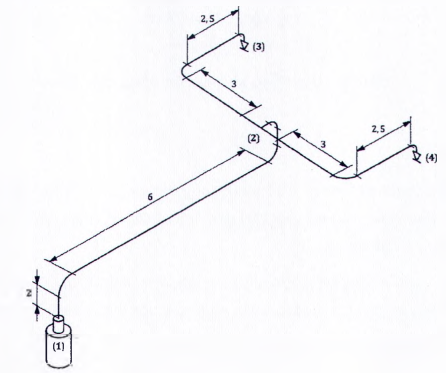
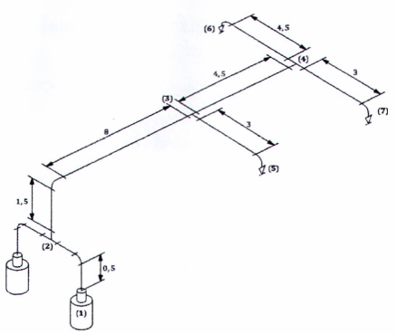
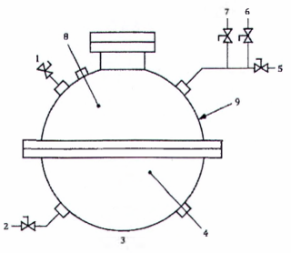

# TIÊU CHUẨN QUỐC GIA

**TCVN 7161-1 : 2022**

ISO 14520-1 : 2015

HỆ THỐNG CHỮA CHÁY BẰNG KHÍ - TÍNH CHẤT VẬT LÝ VÀ THIẾT KẾ HỆ THỐNG - PHẦN 1: YÊU CẦU CHUNG

Gaseous fire - extinguishing systems - Physical properties and system design - Part 1: General requirements

## Lời nói đầu

**TCVN 7161-1:2022 thay thế TCVN 7161-1:2009.**

**TCVN 7161-1:2022 hoàn toàn tương đương với ISO 14520-1:2015.**

**TCVN 7161-1:2022 do Cục Cảnh sát phòng cháy, chữa cháy và cứu nạn, cứu hộ biên soạn, Tổng cục Tiêu chuẩn Đo lường Chất lượng đề nghị, Bộ Khoa học và Công nghệ công bố.**

**TCVN 7161 (ISO 14520) Hệ thống chữa cháy bằng khí - Tính chất vật lý và thiết kế hệ thống bao gồm các phần sau:**

**TCVN 7161-1:2022 (ISO 14520-1:2015) - Phần 1: Yêu cầu chung.**

**TCVN 7161-5:2021 (ISO 14520-5:2020) - Phần 5: Khí chữa cháy FK-5-1-12.**

**TCVN 7161-9:2009 (ISO 14520-9:2006) - Phần 9: Khí chữa cháy HFC 227 ea.**

**TCVN 7161-13:2009 (ISO 14520-13:2005) - Phần 13: Khí chữa cháy IG-100.**

ISO 14520 Gaseous fire-extinguishing systems - Physical properties and system design còn có các phần sau:

- Part 2: CF3L extinguishant;

- Part 6: HCFC Blend A extinguishant;

- Part 8: HFC 125 extinguishant;

- Part 10: HFC 23 extinguishant;

- Part 11: HFC 235fa extinguishant;

- Part 12: IG-01 extinguishant;

- Part 14: IG-55 extinguishant;

- Part 15: IG-541 extinguishant.

Lời giới thiệu

Phần tiêu chuẩn này đề cấp đến thiết kế các hệ thống chữa cháy bằng khí để dập tắt đám cháy.

Một số phương pháp để cung cấp và xả khí tại vị trí yêu cầu để chữa cháy đã được phát triển trong những năm gần đây. Tiêu chuẩn này được biên soạn để phổ biến các thông tin về hệ thống và các phương pháp này.

Tiêu chuẩn này dựa trên những dữ liệu kỹ thuật tốt nhất được biết đến tại thời điểm biên soạn, tuy nhiên do phạm vi bao phủ rộng nên không thể xem xét đến tất cả yếu tố hay hoàn cảnh ảnh hưởng đến việc thực hiện các khuyến nghị.

Trong quá trình biên soạn các quy định của tiêu chuẩn đã giả định rằng những người áp dụng tiêu chuẩn là những người có trình độ và kinh nghiệm trong thiết kế, lắp đặt, thử nghiệm, kiểm tra, phê duyệt, vận hành và bảo dưỡng các hệ thống và thiết bị.

Các chất làm suy giảm tầng ôzôn đã được lưu ý đến Nghị định thư Montreal.

Hệ thống phòng cháy chữa cháy của nhà và công trình phải được xem xét một cách tổng thể. Hệ thống chữa cháy bằng khí là quan trọng nhưng chỉ là một phần của các giải pháp sẵn có, do vậy không thể bỏ qua các biện pháp bổ sung khác như trang bị bình chữa cháy xách tay, hoặc các trang bị ban đầu khác để đối phó với các mối nguy hiểm.

Hệ thống chữa cháy bằng khí trong nhiều năm qua đã là phương tiện chữa cháy có hiệu quả đối với các đám cháy chất lỏng và đám cháy liên quan đến thiết bị điện, cũng như đám cháy thông thường. Tuy nhiên cần nhớ rằng vẫn có thể có các tình huống bất trắc xảy ra khi sử dụng hệ thống chữa cháy bằng khí đối với các đám cháy này, do đó cần có các biện pháp phòng ngừa đặc biệt.

Có thể nhận được các thông tin, khuyến nghị từ các nhà sản xuất, cũng như các cơ quan về phòng cháy chữa cháy, y tế, an toàn, bảo hiểm. Ngoài ra cần tham khảo các tiêu chuẩn, pháp luật của từng quốc gia cụ thể.

Các thành phần của hệ thống chữa cháy bằng khí phải được bảo trì cẩn thận để bảo đảm luôn hoạt động khi có yêu cầu. Việc bảo trì có thể bị chủ sở hữu không chú trọng và bảo qua, việc làm này gây nguy hiểm đến tính mạng con người và nguy cơ thiệt hại tài sản. Việc lắp đặt và bảo trì phải được thực hiện bởi người có chuyên môn.

Việc kiểm tra nên được thực hiện bởi bên thứ 3, bao gồm việc đánh giá khả năng hệ thống tiếp tục hoạt động thích hợp với các mối nguy hiểm cháy.

HỆ THỐNG CHỮA CHÁY BẰNG KHÍ - TÍNH CHẤT VẬT LÝ VÀ THIẾT KẾ HỆ THỐNG - PHẦN 1: YÊU CẦU CHUNG

Gaseous fire - extinguishing systems - Physical properties and system design - Part 1: General requirements

---

## 1  PHẠM VI ÁP DỤNG

Tiêu chuẩn này quy định các yêu cầu và đưa ra các khuyến nghị về thiết kế, lắp đặt, thử nghiệm, bảo dưỡng và an toàn của các hệ thống chữa cháy bằng khí trong các tòa nhà, các nhà máy hoặc các công trình xây dựng khác, quy định đặc tính của các khí chữa cháy khác nhau và các loại đám cháy thích hợp với các khí chữa cháy này.

Tiêu chuẩn này áp dụng đối với hệ thống chữa cháy bằng khí theo thể tích cho các tòa nhà, nhà máy và các đối tượng khác khi sử dụng các chất khí chữa cháy không dẫn điện, không để lại cặn sau khi phun và có đủ các dữ liệu để một cơ quan độc lập có thẩm quyền có thể đánh giá được tính năng và đặc tính an toàn của chúng. Tiêu chuẩn này không áp dụng cho hệ thống phòng nổ.

Tiêu chuẩn này không hướng dẫn các cơ quan có thẩm quyền phê duyệt các khí chữa cháy được liệt kê dưới đây vì các khí chữa cháy khác cũng có thể được chấp nhận theo cách tương tự. Khí $CO_{2}$ không thuộc phạm vi của tiêu chuẩn này mà được quy định trong các tiêu chuẩn khác.

Tiêu chuẩn này áp dụng cho các chất khí chữa cháy được liệt kê trong Bảng 1 và cần được sử dụng cùng với các phần khác của TCVN 7161 (ISO 14520) cho các khí chữa cháy như đã nêu trong Bảng 1.

### Bảng 1 - Danh mục chất khí chữa cháy

| Khí chữa cháy | Tên hóa học | Công thức | CAS số | Tiêu chuẩn áp dụng |
| :--- | :--- | :--- | :---: | :--- |
| $CF_{3}$ I | Trifloiođometan | $CF_{3}$ I | 2314-97-8 | ISO 14520-2 |
| FK-5-1-12 | Đođecaflo-2-metylpen-tan-3-one | $CF_{3}CF_{2}$(O)CF($CF_{3}$)$_{2}$ | 756-13-8 | TCVN 7161-5 (ISO 14520-5) |
| HCFC hỗn hợp A |  |  |  |  |
| HCFC-123 | Điclotrifloetan | $CHCl_{2}CF_{3}$ | 306-83-2 |  |
| HCFC-22 | Clo điflometan | $CHClF_{2}$ | 75-45-6 | ISO 14520-6 |
| HCFC-124 | Clotetrafloetan | $CFClFCF_{3}$ | 2837-89-0 |  |
| HCFC-124 | lsopropenyl-1-metyl-cyclohexen | $C_{10}H_{16}$ | 5989-27-5 |  |
| HFC 125 | Pentafloetan | $CHF_{2}CF_{3}$ | 354-33-6 | ISO 14520-8 |
| HFC 227 ea | Heptaflopropan | $CF_{3}CHFCF_{3}$ | 2252-84-8 | TCVN 7161-9 (ISO 14520-9) |
| HFC 23 | Triflometan | $CHF_{3}$ | 75-46-7 | ISO 14520-10 |
| HFC 236 fa | Hexaflopropan | $CF_{3}CH_{2}CF_{3}$ | 27070-61-7 | ISO 14520-11 |
| IG-01 | Argon | Ar | 74040-37-1 | ISO 14520-12 |
| IG-100 | Nitơ | $N_{2}$ | 7727-37-9 | TCVN 7161-13 (ISO 14520-13) |
| IG-55 | Nitơ (50%) | $N_{2}$ | 7727-37-9 | ISO 14520-14 |
| IG-55 | Argon (50%) | Ar | 74040-37-1 | ISO 14520-14 |
| IG-541 | Nitơ (52%) | $N_{2}$ | 7727-37-9 | ISO 14520-15 |
| IG-541 | Argon (40%) | Ar | 74040-37-1 | ISO 14520-15 |
| IG-541 | Cacbon dioxit (8%) | $CO_{2}$ | 124-38-9 | ISO 14520-15 |

## 2  TÀI LIỆU VIỆN DẪN

Các tài liệu viện dẫn sau rất cần thiết cho việc áp dụng tiêu chuẩn này. Đối với các tài liệu viện dẫn ghi năm công bố thì áp dụng phiên bản được nêu. Đối với các tài liệu viện dẫn không ghi năm công bố thì áp dụng phiên bản mới nhất, bao gồm cả các sửa đổi bổ sung (nếu có).

TCVN 7161-5 (ISO 14520-5), Hệ thống chữa cháy bằng khí - Tính chất vật lý và thiết kế hệ thống - Phần 5: Khí chữa cháy FK-5-1-12.

TCVN 7161-9 (ISO 14520-9), Hệ thống chữa cháy bằng khí - Tính chất vật lý và thiết kế hệ thống - Phần 9: Khí chữa cháy HFC 227 ea.

TCVN 7161-13 (ISO 14520-13), Hệ thống chữa cháy bằng khí - Tính chất vật lý và thiết kế hệ thống - Phần 13: Khí chữa cháy IG-100.

ISO 14520-2, Gaseous fire-extinguishing systems - Physical properties and system design - Part 2: $CF_{3}$ I extinguishant (Hệ thống chữa cháy bằng khí - Tính chất vật lý và thiết kế hệ thống - Phần 2: Khí chữa cháy $CF_{3}$ I).

ISO 14520-6, Gaseous fire-extinguishing systems - Physical properties and system design - Part 6: HCFC Blend A extinguishant (Hệ thống chữa cháy bằng khí - Tính chất vật lý và thiết kế hệ thống - Phần 6: Khí chữa cháy HCFC hỗn hợp A).

ISO 14520-8, Gaseous fire-extinguishing systems - Physical properties and system design - Part 8: HFC 125 extinguishant (Hệ thống chữa cháy bằng khí - Tính chất vật lý và thiết kế hệ thống - Phần 8: Khí chữa cháy HFC 125).

ISO 14520-10, Gaseous fire-extinguishing systems - Physical properties and system design - Part 10: HFC 23 extinguishant (Hệ thống chữa cháy bằng khí - Tính chất vật lý và thiết kế hệ thống - Phần 10: Khí chữa cháy HFC 23).

ISO 14520-11, Gaseous fire-extinguishing systems - Physical properties and system design - Part 11: HFC 236fa extinguishant (Hệ thống chữa cháy bằng khí - Tính chất vật lý và thiết kế hệ thống - Phần 11: Khí chữa cháy HFC 236 fa).

ISO 14520-12, Gaseous fire-extinguishing systems - Physical properties and system design - Part 12: IG-01 extinguishant (Hệ thống chữa cháy bằng khí - Tính chất vật lý và thiết kế hệ thống - Phần 12: Khí chữa cháy IG-01).

ISO 14520-15, Gaseous fire-extinguishing systems - Physical properties and system design - Part 15: IG-541 extinguishant (Hệ thống chữa cháy bằng khí - Tính chất vật lý và thiết kế hệ thống - Phần 15: Khí chữa cháy IG-541).

ISO/IEC 17025, General requirements for the competence of testing and calibration laboratories (Yêu cầu chung về năng lực của các phòng thử nghiệm, hiệu chuẩn).

## 3  THUẬT NGỮ, ĐỊNH NGHĨA

Tiêu chuẩn này áp dụng các thuật ngữ và định nghĩa sau đây.

**CHÚ THÍCH:** Trong tiêu chuẩn này, “bar” được đo bởi “đồng hồ áp suất” nếu không có các chỉ định khác. Các nồng độ hoặc các đại lượng biểu thị bằng phần trăm (%) phải được lấy theo thể tích nếu không có quy định nào khác.

3.1

Được phê duyệt (approved)

Được cơ quan có thẩm quyền (xem 3.2) có liên quan chấp nhận.

**CHÚ THÍCH:** Khi xác định khả năng chấp nhận việc lắp đặt thiết bị hoặc các qui trình, thiết bị hoặc vật liệu, cơ quan có thẩm quyền có thể căn cứ vào việc tuân theo các tiêu chuẩn thích hợp.

3.2

Cơ quan có thẩm quyền (authority)

Tổ chức, cơ quan hoặc cá nhân có chức năng phê duyệt thiết bị, lắp đặt thiết bị hoặc các qui trình vận hành.

3.3

Bộ chuyển đổi tự động/bằng tay (automatic/manual switch)

Phương tiện chuyển đổi hệ thống từ vận hành tự động sang vận hành bằng tay.

**CHÚ THÍCH:** Bộ phận chuyển mạch này có thể có dạng một công tắc điều khiển tay trên bảng điều khiển hoặc các bộ phận khác, hoặc bằng khóa cửa có liên động của nhân viên. Trong mọi trường hợp bộ phận này làm thay đổi chế độ vận hành của hệ thống từ tự động và bằng tay sang chỉ bằng tay hoặc ngược lại.

3.4

Khí chữa cháy (extinguishant)

Chất chữa cháy thể khí không dẫn điện, khi bay hơi không để lại cặn (xem Bảng 1).

3.5

Khoảng hở (clearance)

Khoảng không giữa thiết bị, bao gồm cả đường ống và đầu phun cũng như dây điện trần hoặc các thành phần của các thiết bị điện không cách điện có điện áp khác với điện áp mặt đất (khác với điện áp trung tính).

3.6

Nồng độ (concentration)

3.6.1

Nồng độ thiết kế (design concentration)

Nồng độ khí chữa cháy bao gồm cả hệ số an toàn được dùng để thiết kế hệ thống.

3.6.2

Nồng độ lớn nhất (maximum concentration)

Nồng độ đạt được từ lượng khi chữa cháy thực tế ở nhiệt độ lớn nhất của môi trường xung quanh trong khu vực được bảo vệ.

3.6.3

Nồng độ dập tắt (extinguishing concentration)

Nồng độ nhỏ nhất của khí chữa cháy cần thiết để dập tắt một đám cháy liên quan đến một nhiên liệu riêng biệt trong các điều kiện thực nghiệm xác định không kể đến bất kỳ hệ số an toàn nào.

3.7

Hệ thống được thiết kế (engineered system)

Hệ thống trong đó nguồn cung cấp khí chữa cháy bảo quản tập trung được phun qua hệ thống ống và đầu phun mà kích thước của mỗi đoạn ống và lỗ đầu phun đã được tính theo các phần có liên quan của TCVN 7161 (ISO 14520).

3.8

Tỷ trọng nạp (fill density)

Khối lượng của khí chữa cháy trên một đơn vị thể tích của bình chứa.

3.9

Lượng khí chữa cháy (flooding quantity)

Khối lượng hoặc thể tích của khí chữa cháy cần thiết để đạt được nồng độ thiết kế trong thể tích được bảo vệ với thời gian phun quy định.

3.10

Thể tích thực (nett volume)

Thể tích được bao bọc bởi các thành phần của tòa nhà xung quanh không gian được bảo vệ trừ đi thể tích của bất kỳ thành phần cố định không thấm khí nào bên trong không gian đó.

3.11

Thời gian duy trì (hold time)

Khoảng thời gian trong đó tồn tại nồng độ khí chữa cháy cao hơn nồng độ cần để dập tắt đám cháy ở khu vực xảy ra cháy.

3.12

Kiểm tra (inspection)

Xem xét bằng mắt để đưa ra sự bảo đảm rằng hệ thống chữa cháy đã được nạp đầy và có thể hoạt động được.

**CHÚ THÍCH:** Công việc kiểm tra này được thực hiện để bảo đảm rằng hệ thống được lắp đặt vào vị trí, chưa được hoạt động hoặc chưa bị can thiệp và chưa có hư hỏng rõ rệt về vật lý hoặc không có tình trạng cản trở sự hoạt động.

3.13

Khí hóa lỏng (liquefied gas)

Khí hoặc hỗn hợp khí (thường là halo cacbon) ở thể lỏng tại mức áp suất ổn định trong bình chứa ở điều kiện nhiệt độ phòng (20 °C).

3.14

Cơ cấu khóa (lock-off device)

Van ngắt bằng tay được lắp trên đường ống xả từ bình chứa khí chữa cháy hoặc kiểu cơ cấu khác để ngăn chặn bằng cơ khí sự kích hoạt của bình chứa khí chữa cháy.

**CHÚ THÍCH 1:** Trạng thái của cơ cấu khóa ngắt phải được hiển thị để dễ nhận biết.

**CHÚ THÍCH 2:** Mục đích của cơ cấu khóa ngắt là ngăn cản sự phun khí chữa cháy vào vùng có sự cố cháy (bảo vệ) khi cơ cấu được vận hành.

3.15

Mức ảnh hưởng có hại thấp nhất quan sát được LOAEL (lowest observed adverse effect level)

Nồng độ thấp nhất tại đó đã quan sát được sự nhiễm độc hoặc sự tác động đến sinh lý.

3.16

Bảo dưỡng (main tenance)

Kiểm tra, xem xét tỉ mỉ để sửa chữa, thay thế cần thiết đối với các thành phần của hệ thống để bảo đảm tới mức tối đa rằng hệ thống chữa cháy sẽ hoạt động như dự định.

3.17

Áp suất làm việc lớn nhất (maximum working presure)

Áp suất cân bằng trong bình ở nhiệt độ làm việc lớn nhất.

**CHÚ THÍCH 1:** Đối với các khí hóa lỏng, áp suất làm việc lớn nhất là áp suất ở tỷ trọng nạp lớn nhất và có thể bao gồm áp suất nén tạo áp.

**CHÚ THÍCH 2:** Áp suất cân bằng đối với bình chứa khi vận chuyển trên đường có thể khác với áp suất cân bằng khi bảo quản trong tòa nhà.

3.18

Mức ảnh hưởng không có hại quan sát được NOAEL (no observed advese effect level)

Nồng độ cao nhất tại đó không quan sát được sự nhiễm độc hoặc sự tác động đến sinh lý.

3.19

Khí không hóa lỏng (non-liquefied gas)

Khí hoặc hỗn hợp khí (thường là khí trơ) mà trong các điều kiện áp suất sử dụng và nhiệt độ sử dụng cho phép luôn luôn ở thể khí.

3.20

Khu vực thường có người (normally occupied area)

Khu vực thường có người đi tới.

3.21

Khu vực thường không có người (normally unoccupied erea)

Khu vực thường không có người đi vào nhưng thỉnh thoảng có thể có người đi vào trong thời gian ngắn.

3.22

Hệ thống chế tạo sẵn (pre-engineered systems)

Hệ thống gồm có một nguồn cung cấp khí chữa cháy có dung tích quy định được nối với đường ống có bố trí một đầu phun cân bằng đạt tới mức thiết kế lớn nhất cho phép.

**CHÚ THÍCH:** Không cho phép có sai lệch so với các giới hạn do nhà sản xuất hoặc cơ quan có thẩm quyền quy định.

3.23

Hệ thống được điều tiết áp suất (regulated system)

Hệ thống khí không hóa lỏng trong đó áp suất ở đầu ra của thiết bị điều tiết áp suất được giới hạn khi phun cũng như khi không phun.

3.24

Hệ số an toàn (safety factor)

Số nhân với nồng độ dập tắt của khí để xác định nồng độ thiết kế nhỏ nhất của khí chữa cháy.

3.25

Đương lượng của khí chữa cháy ở mức nước biển (sea level equivalent of agent)

Nồng độ khí chữa cháy (phần trăm thể tích) ở mức nước biển mà ở đó áp suất riêng phần của khí chữa cháy bằng với áp suất riêng phần của khí chữa cháy tại độ cao đã cho.

3.26

Đương lượng của oxy ở mức nước biển (sea level equivalent of oxygen)

Nồng độ của oxy ở mức nước biển (tính theo phần trăm thể tích) mà ở đó áp suất riêng phần của nó bằng với áp suất riêng phần tại độ cao đã cho.

3.27

Van chọn vùng (selector valve)

Van được lắp trên ống phân phối từ bình chứa khí chữa cháy để xả khí chữa cháy tới khu vực được lựa chọn.

**CHÚ THÍCH:** Van chọn vùng được dùng khi bố trí một hoặc nhiều bình chứa khí chữa cháy để xả khí chữa cháy tới các khu vực bảo vệ được lựa chọn.

3.28

Sự nén tạo áp (Superpressurization)

Sự bổ sung thêm khí cho bình chứa khí chữa cháy khi cần thiết để đạt tới áp suất yêu cầu cho hệ thống vận hành tốt.

3.29

Hệ thống chữa cháy thể tích (total flooding system)

Hệ thống được bố trí để phun khí chữa cháy vào một không gian được bao kín để đạt được nồng độ thiết kế thích hợp.

3.30

Khu vực không thể có người (unoccupiable area)

Khu vực không thể có người do sự hạn chế về kích thước hoặc về các yếu tố vật lý khác.

VÍ DỤ: Các phòng và khoảng trống rất nhỏ hẹp.

## 4  ỨNG DỤNG VÀ CÁC HẠN CHẾ

### 4.1  Quy định chung

Trong tiêu chuẩn này từ “phải” chỉ ra yêu cầu bắt buộc; từ “nên” chỉ một khuyến nghị nhưng không phải là yêu cầu.

Việc thiết kế, lắp đặt, sử dụng và bảo dưỡng đối với hệ thống chữa cháy bằng khí phải do những người có năng lực và thẩm quyền về hệ thống chữa cháy thực hiện. Việc bảo dưỡng và lắp đặt chỉ được thực hiện bởi các nhân viên và công ty có đủ điều kiện.

Các đối tượng mà hệ thống này bảo vệ được và bất cứ các hạn chế nào trong việc sử dụng chúng phải được đề cập trong tài liệu hướng dẫn thiết kế hệ thống của nhà cung cấp.

Các hệ thống chữa cháy thể tích chủ yếu được dùng để chữa cháy trong khu vực được bao che kín hoặc các thiết bị có sẵn cấu kiện bao che vây quanh để có thể giữ được khí chữa cháy. Sau đây là các đối tượng điển hình như đã nêu trên nhưng chưa được liệt kê đầy đủ:

a) \- thiết bị điện và điện tử;

b) \- thiết bị thông tin viễn thông;

c) \- các chất lỏng và khí dễ cháy và dễ bắt lửa;

d) \- các tài sản có giá trị cao khác.

### 4.2  Khí chữa cháy

Bất cứ khí nào được tiêu chuẩn này thừa nhận hoặc đề nghị phải được đánh giá theo cách tương đương với phương pháp do chương trình SNAP của cơ quan bảo vệ môi trường (EPA) của Hoa Kỳ hoặc phương pháp đánh giá khác được cơ quan có thẩm quyền cho phép sử dụng.

Các khí chữa cháy được nêu trong tiêu chuẩn này là các khí không dẫn điện.

Các khí chữa cháy và các thông số của hệ thống đặc thù được đề cập riêng trong các phần của TCVN 7161 (ISO 14520) cho các khí chữa cháy riêng. Các phần đó phải được sử dụng cùng với tiêu chuẩn này.

Nếu chưa thực hiện thử nghiệm có liên quan theo yêu cầu của cơ quan có thẩm quyền, các khí chữa cháy được nêu trong tiêu chuẩn này không được sử dụng chữa các đám cháy có các chất sau:

a) \- các hóa chất tự chứa nguồn cung cấp oxy riêng, như xenluloza nitrat;

b) \- các hỗn hợp chứa các vật liệu oxy hóa, như natri clorat hoặc natri nitrat;

c) \- các hóa chất có khả năng tự phân hủy nhiệt, như một số peroxit hữu cơ;

d) \- các kim loại có hoạt tính hóa học (như natri, kali, manhê, titan và ziriconi), các hidrua có hoạt tính hóa học hoặc các amit kim loại, một số trong các kim loại này có thể có phản ứng rất mạnh với một số khí chữa cháy;

e) \- các khu vực mà phần lớn bề mặt có nhiệt độ (được gia nhiệt không phải từ nguồn nhiệt của đám cháy) lớn hơn nhiệt độ phá hủy của khí chữa cháy.

### 4.2.1  Tính chất môi trường

Chỉ số làm nóng lên toàn cầu (GWP) và chỉ số tác động phá hủy tầng ôzôn (ODP) áp dụng cho các chất chữa cháy dạng khí trong các phần ISO 14520-2 đến ISO 14520-15.

GWP là chỉ số đo lượng khí góp phần làm nóng lên toàn cầu. Thang đo là sự so sánh tương đối trên khối lượng cơ sở của một chất với cácbon điôxit (cácbon điôxit có GWP bằng 1). Chỉ số ODP là chỉ số liên quan đến khối lượng tương ứng của CFC-11 (CFC-11 có chỉ số ODP bằng 1). Ủy ban liên chính phủ về biến đổi khí hậu IPCC và các bên tham gia Nghị định thư Montreal đang cung cấp các thông tin cập nhật về môi trường đối với giải pháp thay thế khí sạch. Khi áp dụng tiêu chuẩn này phải xem xét các thông tin do các tổ chức cung cấp để hiểu rõ tầm quan trọng về ảnh hưởng đến môi trường của các chất chữa cháy trong tiêu chuẩn.

Danh sách các hợp chất và khả năng làm nóng lên toàn cầu được đăng tải trên website của IPCC tại địa chỉ http://www.ipcc.ch. Danh sách các hợp chất và khả năng làm phá hủy tầng ôzôn được đăng tải trên website của Nghị định thư Montreal tại địa chỉ http://montreal-protocol.org.

### 4.3  Phóng điện do tĩnh điện

Phải chú ý khi phun khí chữa cháy vào môi trường có khả năng gây nổ. Sự phóng điện do tĩnh điện của các vật dẫn điện không được nối đất có thể xảy ra trong quá trình phun khí chữa cháy. Các vật dẫn này có thể phóng điện sang các vật khác với năng lượng đủ lớn để có thể kích nổ. Khi hệ thống được sử dụng với khí trơ thì đường ống phải được liên kết với nhau và được nối đất.

### 4.4  Tính tương thích với các khí chữa cháy khác

Chỉ được phép trộn lẫn các khí chữa cháy trong cùng một bình chứa nếu hệ thống được chấp thuận cho sử dụng hỗn hợp khí này.

Không được phép sử dụng các hệ thống phun đồng thời các khí chữa cháy khác nhau để bảo vệ cùng một không gian được bao kín.

### 4.5  Giới hạn về nhiệt độ

Tất cả các thiết bị phải được thiết kế cho mục đích chữa cháy và không dễ dàng rơi vào trạng thái không hoạt động được hoặc hoạt động không như mong muốn. Các thiết bị thường phải được thiết kế để hoạt động tốt trong khoảng nhiệt độ từ -20 °C đến 50 °C, hoặc được ghi nhãn chỉ ra các giới hạn nhiệt độ, hoặc theo các thông số kỹ thuật của nhà sản xuất ghi trên biển nhãn hoặc ghi trong tài liệu hướng dẫn của nhà sản xuất (khi không có biển nhãn).

## 5  AN TOÀN

### 5.1  Nguy hiểm đối với con người

Mọi nguy hiểm cho con người do việc phun khí chữa cháy tạo ra phải được xem xét khi thiết kế hệ thống, nhất là các nguy hiểm do các khí chữa cháy đặc biệt nêu trong các phần bổ sung của TCVN 7161 (ISO 14520) gây ra. Tránh tiếp xúc không cần thiết với tất cả các khí chữa cháy.

Việc áp dụng TCVN 7161 (ISO 14520) không loại bỏ trách nhiệm về pháp lý của người sử dụng là phải tuân thủ các qui tắc an toàn thích hợp.

Các sản phẩm được tạo ra do sự phân hủy khí chữa cháy sạch ở nhiệt độ cao có thể nguy hiểm. Tất cả các khí chữa cháy halocacbon hiện đang sử dụng đều có flo. Sự kết hợp của flo và hidro (từ hơi nước hoặc bản thân quá trình cháy) tạo ra sản phẩm phân hủy là hiđro florua (HF).

Các sản phẩm phân hủy này có mùi rất hắc, cay mặc dù nồng độ chỉ là một vài phần triệu. Đặc tính này là dấu hiệu cảnh báo đối với khí chữa cháy, nhưng cũng là môi trường độc hại cho người cần đi vào vùng có sự cố chữa cháy sau khi chữa cháy.

Lượng khí chữa cháy sạch bị phân hủy trong khi dập tắt một đám cháy phụ thuộc vào sự mở rộng kích thước đám cháy, thành phần khí chữa cháy sạch, nồng độ của khí chữa cháy và khoảng thời gian mà khí chữa cháy tiếp xúc với ngọn lửa hoặc bề mặt được nung nóng. Nếu nồng độ tăng rất nhanh tới giá trị tới hạn thì đám cháy sẽ được dập tắt nhanh và sự phân hủy sẽ được hạn chế ở mức nhỏ nhất có thể đối với khí chữa cháy này. Nếu thành phần của khí chữa cháy có thể tạo ra số lượng lớn các sản phẩm phân hủy và thời gian để đạt tới giá trị tới hạn dài thì số lượng các sản phẩm phân hủy sẽ rất lớn. Nồng độ thực tế của các sản phẩm phân hủy lúc này phụ thuộc vào thể tích của căn phòng trong đó có đám cháy đang cháy, mức độ hòa trộn và sự thông gió.

Sự tiếp xúc của khí chữa cháy trong thời gian dài với nhiệt độ cao có thể tạo ra các nồng độ lớn hơn của các khí này. Nên chọn kiểu và độ nhạy của thiết bị phát hiện đám cháy kết hợp với tốc độ xả sao cho có thể giảm tới mức nhỏ nhất thời gian tiếp xúc của khí chữa cháy sạch với nhiệt độ cao nếu nồng độ của các sản phẩm bị phân hủy là nhỏ nhất.

Các khí chữa cháy không hóa lỏng không phân hủy một cách đáng kể trong quá trình dập tắt một đám cháy. Như vậy không tìm thấy các sản phẩm phân hủy độc hại hoặc ăn mòn. Tuy nhiên, bản thân đám cháy có thể tạo ra lượng sản phẩm cháy lớn, ảnh hưởng đến con người trong khu vực.

### 5.2  Các phòng ngừa về an toàn

### 5.2.1  Quy định chung

Khi lựa chọn các yêu cầu theo 5.2 và 5.3 thì có thể tuân theo các yêu cầu của Phụ lục G về hướng dẫn an toàn cho nhân viên phải tiếp xúc với nguy hiểm hoặc các yêu cầu quy định trong các tiêu chuẩn quốc gia thích hợp ngoài phạm vi của tiêu chuẩn này.

Các phòng ngừa về an toàn đưa ra trong tiêu chuẩn này không tính đến các ảnh hưởng độc hại hoặc sinh lý liên quan đến các sản phẩm cháy do đám cháy tạo ra. Thời gian tiếp xúc với nguy hiểm theo các phòng ngừa về an toàn trong tiêu chuẩn này tối đa là 5 min. Khi thời gian tiếp xúc lớn hơn 5 min có thể gây ra các ảnh hưởng độc hại và sinh lý.

### 5.2.2  Đối với các khu vực thường có người

Các phòng ngừa tối thiểu về an toàn phải phù hợp với Bảng 2.

### Bảng 2 - Các phòng ngừa tối thiểu về an toàn

| Nồng độ lớn nhất | Cơ cấu thời gian trễ | Bộ chuyển mạch tự động/bằng tay | Cơ cấu khóa ngắt |
| :--- | :--- | :--- | :--- |
| Nhỏ hơn và bằng NOAEL | Có yêu cầu | Không yêu cầu | Không yêu cầu |
| Lớn hơn NOAEL và nhỏ hơn LOAEL | Có yêu cầu | Có yêu cầu | Không yêu cầu |
| Lớn hơn và bằng LOAEL | Có yêu cầu | Có yêu cầu | Có yêu cầu |

> **CHÚ THÍCH:** Mục đích của Bảng này là tránh sự tiếp xúc của người với các khí chữa cháy được phun ra. Các yếu tố như thời gian thoát nhiệt và rủi ro đối với người đi vào vùng có sự cố cháy do đám cháy nên được xem xét khi xác định thời gian trễ cho việc phun khí chữa cháy của hệ thống.

Khi sử dụng chất chữa cháy là khí trơ, NOAEL và LOAEL là nồng độ chất chữa cháy mà kết quả nằm trong giới hạn dưới của áp suất oxy tương ứng với 12,1 kPa (91,0 mm Hg) và 10,2 kPa (76,6 mm Hg).

Nồng độ chất chữa cháy này phụ thuộc vào áp suất khí quyển tại độ cao của khu vực bảo vệ. Mối liên quan của độ cao với áp suất khí quyển trung bình như sau:

$$P_{ATM} = 101,325(1-0,0000225577 \times h) ^{5,25588} \qquad (1)$$
<!-- formula_id: "F_TCVN_7161_1_2022_FORMULA_1" -->

Trong đó:

&nbsp;&nbsp;&nbsp;&nbsp;\- h - độ cao, m;

&nbsp;&nbsp;&nbsp;&nbsp;\- p - áp suất khí quyển, Pa.

&nbsp;&nbsp;&nbsp;&nbsp;\- Nồng độ tối đa của chất chữa cháy khí trơ, $C_{MAX}$, mà làm giảm áp suất oxy đến giới hạn dưới, được tính theo công thức (2):

$$C_{MAX} = 476,2 x (0,21 P_{ATM} – P_{O2, LOW-LIMIT} )/ P_{ATM} \qquad (2)$$
<!-- formula_id: "F_TCVN_7161_1_2022_FORMULA_2" -->

Trong đó:

&nbsp;&nbsp;&nbsp;&nbsp;\- $C_{MAX}$ - nồng độ chất chữa cháy tối đa cho phép, %;

&nbsp;&nbsp;&nbsp;&nbsp;\- $P_{ATM}$ - áp suất khí quyển tại khu vực bảo vệ, Pa;

&nbsp;&nbsp;&nbsp;&nbsp;\- $P_{O2, LOW-LIMIT}$ - nồng độ oxy tối thiểu được cho phép trong hỗn hợp chất chữa cháy - không khí, Pa.

&nbsp;&nbsp;&nbsp;&nbsp;\- Kết quả khi sử dụng công thức tính $C_{MAX}$ là một hàm số của độ cao thể hiện trong Bảng 3

### Bảng 3 - Nồng độ phần trăm tối đa của khí trơ chữa cháy ở giới hạn NOAEL và LOAEL là một hàm số của độ cao

|  |  |  | NOAEL | LOAEL |
| :--- | :--- | :--- | :--- | :--- |
| $P_{O2, LOW-LIMIT}$, kPa → | $P_{O2, LOW-LIMIT}$, kPa → | $P_{O2, LOW-LIMIT}$, kPa → | 12,1 | 10,2 |
| h, m | P, Pa | $P_{O2, ATM}$, kPa | $C_{MAX}$, % | $C_{MAX}$, % |
| 0 | 101,325 | 21,28 | 43,1 | 52,1 |
| 250 | 98,358 | 20,66 | 41,4 | 50,6 |
| 500 | 95,461 | 20,05 | 39,6 | 49,1 |
| 750 | 92,634 | 19,45 | 37,8 | 47,6 |
| 1 000 | 89,875 | 18,87 | 35,9 | 46,0 |
| 1 250 | 87,182 | 18,31 | 33,9 | 44,3 |
| 1 500 | 84,556 | 17,76 | 31,9 | 42,6 |
| 1 750 | 81,994 | 17,22 | 29,7 | 40,8 |
| 2 000 | 79,495 | 16,69 | 27,5 | 38,9 |
| 2 250 | 77,058 | 16,18 | 25,2 | 37,0 |
| 2 500 | 74,683 | 15,68 | 22,8 | 35,0 |
| 2 750 | 72,366 | 15,20 | 20,4 | 32,9 |
| 3 000 | 70,109 | 14,72 | 17,8 | 30,7 |

### 5.2.3  Đối với các khu vực thường không có người

Nồng độ lớn nhất không được vượt quá LOAEL đối với khí chữa cháy được sử dụng nếu không có lắp một cơ cấu khóa ngắt.

Khi thiết kế hệ thống trong phòng có người với nồng độ vượt quá NOAEL thì hệ thống nên thiết kế ở chế độ không tự động.

CẢNH BÁO: Bất cứ sự thay đổi nào đối với thể tích khu vực được bảo vệ, hoặc bổ sung thêm hay loại bỏ các thành phần cố định không có trong thiết kế ban đầu sẽ ảnh hưởng tới nồng độ của khí chữa cháy. Trong những trường hợp này hệ thống phải được tính lại để bảo đảm đạt được nồng độ thiết kế yêu cầu và nồng độ lớn nhất phù hợp với Bảng 2.

### 5.2.4  Đối với các khu vực không thể có người

Nồng độ lớn nhất có thể vượt quá LOAEL đối với khí chữa cháy được sử dụng mà không cần phải lắp cơ cấu khóa ngắt.

### 5.3  Các khu vực có người

Trong các khu vực được bảo vệ bằng các hệ thống phun khí chữa cháy thể tích và có thể có người phải được trang bị như sau:

a) \- Cơ cấu làm trễ thời gian:

&nbsp;&nbsp;&nbsp;&nbsp;\- Đối với khu vực mà thời gian trễ không làm tăng nguy hiểm đáng kể đến con người và tài sản thì các hệ thống chữa cháy phải được trang bị tín hiệu báo động trước khi phun với độ trễ thời gian đủ để cho phép sơ tán người;

&nbsp;&nbsp;&nbsp;&nbsp;\- Cơ cấu làm trễ thời gian chỉ được sử dụng để sơ tán người hoặc để chuẩn bị cho việc phun khí chữa cháy.

b) \- Bộ chuyển đổi tự động/bằng tay và cơ cấu khóa ngắt nếu cần theo 5.2;

**CHÚ THÍCH:** Các cơ cấu khóa ngắt thường không được sử dụng, chứng chỉ được sử dụng trong một số trường hợp, đặc biệt là cho một số chức năng bảo dưỡng riêng.

c) \- Đường thoát nạn phải được giữ thông thoáng trong mọi lúc và phải trang bị đầy đủ đèn chiếu sáng sự cố và chỉ dẫn thoát nạn để giảm tới mức nhỏ nhất quãng đường phải đi;

d) \- Cửa mở ra ngoài có cơ cấu tự đóng có thể mở từ bên trong;

e) \- Các tín hiệu báo động liên tục bằng ánh sáng và âm thanh bên trong khu vực bảo vệ tại các cửa ra vào và các tín hiệu báo động liên tục bằng ánh sáng bên ngoài khu vực được bảo vệ, phải hoạt động cho tới khi khu vực được bảo vệ đã an toàn;

f) \- Các tín hiệu cảnh báo và hướng dẫn thích hợp;

g) \- Khi có yêu cầu, các tín hiệu cảnh báo trước khi phun khí chữa cháy phải hoạt động tức thời từ lúc bắt đầu của thời gian trễ. Các tín hiệu này phải có đặc điểm khác so với tất cả các tín hiệu báo động khác;

h) \- Các phương tiện thông gió tự nhiên hoặc cưỡng bức ở các khu vực này sau khi phun khí chữa cháy. Sự thông gió cưỡng bức thường rất cần thiết. Phải chú ý làm khuếch tán hoàn toàn các khí nguy hiểm và không để chúng lây lan sang các vị trí khác vì phần lớn các khí chữa cháy đều nặng hơn không khí;

i) \- Cần cung cấp hướng dẫn và tổ chức huấn luyện cho tất cả những người ở trong hoặc ở lân cận các khu vực được bảo vệ, bao gồm cả việc duy trì hoặc tổ chức nhân lực để đưa vào khu vực bảo vệ để bảo đảm những người này hành động đúng khi hệ thống chữa cháy hoạt động.

Ngoài các yêu cầu trên cần đáp ứng các vấn đề sau:

&nbsp;&nbsp;\- Nên cung cấp thiết bị hô hấp và các nhân viên được đào tạo để sử dụng thiết bị này;

&nbsp;&nbsp;\- Các nhân viên không đi vào trong khu vực được bảo vệ cho tới khi đã được kiểm tra là họ có đủ điều kiện đảm bảo an toàn để làm nhiệm vụ.

### 5.4  Nguy hiểm về điện

Khoảng cách an toàn từ các vật dẫn điện hở đến tất cả các chi tiết, bộ phận của hệ thống cần tiếp cận trong quá trình bảo dưỡng không được nhỏ hơn các giá trị cho trong Bảng 4. Khi không thể đạt được các khoảng hở này thì phải có biển cảnh báo và trang bị một hệ thống an toàn cho công việc bảo dưỡng.

### Bảng 4 - Khoảng cách an toàn để có thể vận hành, kiểm tra, làm sạch, sửa chữa, sơn và bảo dưỡng thông thường

| Điện áp danh định lớn nhất, kV | Khoảng hở nhỏ nhất từ bất kỳ điểm nào trên hoặc gần thiết bị cố định mà ở đó một người có thể đứng được $^{a)}$ — tới vật dẫn điện hở gần nhất (khoảng cách với bộ phận), m | Khoảng hở nhỏ nhất từ bất kỳ điểm nào trên hoặc gần thiết bị cố định mà ở đó một người có thể đứng được $^{a)}$ — tới phần gần nhất không nối đất của bộ phận cách điện $^{b)}$ đỡ dây dẫn có dòng điện chạy qua (khoảng cách tới đất), m |
| :--- | :---: | :---: |
| 15 | 2,6 | 2,5 |
| 33 | 2,75 | 2,5 |
| 44 | 2,90 | 2,5 |
| 66 | 3,10 | 2,5 |
| 88 | 3,20 | 2,5 |
| 110 | 3,35 | 2,5 |
| 132 | 3,50 | 2,5 |
| 165 | 3,80 | 2,5 |
| 220 | 4,30 | 2,5 |
| 275 | 4,60 | 2,5 |
| **$^{a)}$ được đo từ vị trí của bàn chân. $^{b)}$ thuật ngữ bộ phận cách điện bao gồm tất cả các dạng của bộ phận cách điện như sứ đỡ trên cột, sứ treo, ống cách điện, đầu bịt kín cáp và các bộ phận cách điện của một số kiểu cầu dao điện.** |  |  |

### 5.5  Nối đất

Các hệ thống trong trạm biến áp hoặc phòng điều khiển phải được đấu nối và nối đất có hiệu quả để ngăn ngừa các bộ phận kim loại bị tích điện.

### 5.6  Sự phóng điện do tĩnh điện

Hệ thống phải được đấu nối và được nối đất tốt để giảm tới mức thấp nhất sự cố phóng điện do tĩnh điện.

## 6  THIẾT KẾ HỆ THỐNG

### 6.1  Quy định chung

Điều này quy định các yêu cầu cho thiết kế hệ thống chữa cháy.

Tất cả các hệ thống phụ trợ và các phần cấu thành phải tuân theo các tiêu chuẩn quốc gia hoặc quốc tế có liên quan.

### 6.2  Cung cấp khí chữa cháy

### 6.2.1  Số lượng

### 6.2.1.1  Lượng khí chữa cháy trong hệ thống tối thiểu phải đủ cho một khu vực được bảo vệ lớn nhất hoặc một nhóm các khu vực được bảo vệ đồng thời.

### 6.2.1.2  Khi có yêu cầu, lượng dự trữ phải là bội số của lượng cung cấp chính theo quy định của cơ quan có thẩm quyền.

### 6.2.1.3  Khi cần bảo vệ liên tục, cả hai nguồn cấp chính và dự trữ phải được nối cố định với ống góp và phải được bố trí để dễ dàng chuyển đổi.

### 6.2.2  Chất lượng

Khí chữa cháy phải tuân theo các yêu cầu của các phần có liên quan trong TCVN 7161 (ISO 14520).

### 6.2.3  Bố trí bình chứa

### 6.2.3.1  Các bình chứa, cụm van và phụ kiện phải được sắp xếp sao cho có thể tiếp cận được để kiểm tra, thử nghiệm và bảo dưỡng khi cần thiết.

### 6.2.3.2  Các bình chứa phải được lắp đặt chắc chắn và gá đỡ phù hợp với tài liệu hướng dẫn lắp đặt các hệ thống chữa cháy để thuận tiện cho việc bảo dưỡng bình chứa và các thiết bị liên quan.

### 6.2.3.3  Các bình chứa phải được đặt càng gần với khu vực được bảo vệ càng tốt, nên ưu tiên đặt ngoài khu vực bảo vệ. Các bình chứa chỉ có thể được bố trí bên trong khu vực được bảo vệ nếu có thể giảm tới mức thấp nhất các nguy hiểm do cháy nổ gây ra.

### 6.2.3.4  Các bình chứa không được bố trí ở nơi chịu ảnh hưởng của thời tiết khắc nghiệt hoặc bị hư hỏng do tác động về cơ học, hóa học hoặc các nguyên nhân khác. Khi các bình chứa tiếp xúc với các nguy cơ dẫn đến hư hỏng hoặc có thể bị can thiệp trái phép thì phải có tường bao hoặc rào chắn thích hợp.

**CHÚ THÍCH:** Ánh sáng mặt trời chiếu trực tiếp có khả năng làm tăng nhiệt độ của bình chứa cao hơn nhiệt độ của môi trường không khí xung quanh.

### 6.2.4  Bình chứa khí chữa cháy

### 6.2.4.1  Quy định chung

Các bình chứa phải được thiết kế để chứa các khí chữa cháy chỉ định. Không được nạp các bình chứa đến tỷ trọng nạp cao hơn các quy định trong tiêu chuẩn này đối với khí chữa cháy chỉ định.

Các bình chứa sử dụng trong các hệ thống này phải được thiết kế để đáp ứng các yêu cầu của tiêu chuẩn quốc gia có liên quan và phải chịu được áp suất tối đa ở 50 °C.

Khi được yêu cầu, các bình chứa và cụm van phải có các thiết bị xả áp phù hợp với các tiêu chuẩn quốc gia.

### 6.2.4.2  Chỉ báo lượng khí chứa trong bình chứa

Phải có phương tiện để chỉ báo rằng từng bình chứa được nạp đúng quy định.

### 6.2.4.3  Ghi nhãn

Mỗi bình chứa khí halocacbon phải có biển nhãn cố định hoặc cách đánh dấu cố định khác chỉ rõ khí chữa cháy, khối lượng bình, khối lượng toàn bộ và mức nén tạo áp (khi được áp dụng). Mỗi bình chứa khí trơ phải có đánh dấu cố định chỉ định khí chữa cháy, mức nén của bình chứa và thể tích danh định.

### 6.2.4.4  Các bình chứa nối với một ống góp

Khi hai hay nhiều bình chứa được nối với một ống góp thì phải có phương tiện tự động (như van một chiều) để ngăn ngừa tổn thất của khí chữa cháy từ ống góp nếu hệ thống được vận hành khi các bình chứa bất kỳ được tháo ra để bảo dưỡng.

Các bình chứa được nối với một ống góp chung trong hệ thống phải:

a) \- có cùng một dạng và dung tích danh nghĩa,

b) \- được nạp với cùng một khối lượng danh nghĩa của khí chữa cháy, và

c) \- được nén tới cùng một áp suất làm việc danh nghĩa.

Các bình chứa có cỡ kích thước khác nhau được nối với một ống góp chung có thể được dùng cho các bình chứa khí không hóa lỏng với điều kiện là chúng đều được nén tới áp suất làm việc danh nghĩa.

### 6.2.4.5  Nhiệt độ làm việc

Nếu không có sự phê duyệt nào khác, nhiệt độ làm việc của bình chứa khí chữa cháy đang sử dụng đối với các hệ thống chữa cháy thể tích không được vượt quá 50 °C hoặc không nhỏ hơn -20 °C (xem 7.3.1).

Nên sử dụng việc gia nhiệt hoặc làm mát bên ngoài để giữ nhiệt độ của bình chứa khí trong khoảng được chỉ định trừ khi hệ thống được thiết kế để có thể hoạt động được với nhiệt độ làm việc ở ngoài khoảng này.

### 6.3  Thiết bị phân phối

### 6.3.1  Quy định chung

### 6.3.1.1  Đường ống và phụ tùng đường ống phải tuân theo các tiêu chuẩn quốc gia thích hợp, được chế tạo bằng vật liệu không cháy, có khả năng chịu được áp suất, nhiệt độ yêu cầu mà không bị hư hỏng.

### 6.3.1.2  Trước khi lắp ráp lần cuối cùng, ống và các phụ tùng đường ống phải được kiểm tra bằng mắt để bảo đảm rằng chúng sạch sẽ, không có bavia, gỉ, không có vật lạ ở bên trong và toàn bộ ống thông suốt. Sau khi lắp, hệ thống phải được thổi thông ống bằng không khí khô hoặc khí nén khác. Phải lắp đặt một bộ phận gom bụi bao gồm một ống chữ T có nắp đậy dài ít nhất 50 mm ở cuối mỗi đoạn ống. Bộ phận gom bụi phải được bảo vệ chống lại sự can thiệp trái phép và nên được lắp ở điểm thấp nhất nếu có khả năng tích tụ nước trong hệ thống đường ống.

### 6.3.1.3  Trong các hệ thống mà chỗ lắp van có các đoạn ống đóng kín thì các đoạn ống đó phải được trang bị như sau:

a) \- bộ phận báo về việc có khí chữa cháy bị giữ ở trong ống;

b) \- phương tiện để thông khí an toàn bằng tay (xem 6.3.1.4);

c) \- van tự động xả khí để giảm áp.

Van xả khí phải được thiết kế để hoạt động tại áp suất nhỏ hơn 63 % áp suất thử của ống hoặc 95 % áp suất làm việc tối đa hoặc theo yêu cầu của tiêu chuẩn quốc gia liên quan.

### 6.3.1.4  Các van xả khí, có thể bao gồm cả van chọn vùng phải được lắp sao cho khi phun, trong trường hợp vận hành, sẽ không gây ra thương tích hoặc nguy hiểm cho người và nếu cần thì phải phun theo đường ống tới khu vực không gây nguy hiểm cho người.

### 6.3.1.5  Trong hệ thống sử dụng các bình chứa có van hoạt động bằng áp suất, phải lắp các phương tiện tự động để thoát bất cứ khí rò rỉ nào của bình chứa có thể làm tăng áp suất trong bộ phận điều khiển và làm cho van bình chứa mở không như mong muốn. Phương tiện áp suất đó không được ngăn cản sự hoạt động của van bình chứa.

### 6.3.1.6  Tất cả các đoạn ống kín và đoạn ống trước van giảm áp phải được thử nghiệm thủy lực đến áp suất tối thiểu bằng 1,5 lần áp suất làm việc tối đa hoặc áp suất được điều tiết tối đa trong thời gian 2 min mà không bị rò rỉ. Kết thúc thử nghiệm, đường ống phải được làm sạch để loại bỏ hơi ẩm.

### 6.3.1.7  Phải có biện pháp bảo vệ thích hợp các ống, phụ tùng ống, giá đỡ và các vật liệu thép có thể bị ảnh hưởng bởi sự ăn mòn. Phải sử dụng các vật liệu chống ăn mòn hoặc lớp phủ bảo vệ đặc biệt trong các môi trường có tính ăn mòn cao.

### 6.3.2  Hệ thống đường ống

### 6.3.2.1  Hệ thống đường ống phải được chế tạo bằng vật liệu không cháy có các tính chất vật lý và hóa học sao cho có thể bảo đảm được tính toàn vẹn và độ tin cậy của vật liệu khi chịu tác dụng của ứng suất. Chiều dày của thành ống phải được tính theo tiêu chuẩn quốc gia có liên quan. Áp suất dùng trong tính toán này phải là áp suất được tạo ra ở nhiệt độ bảo quản lớn nhất không nhỏ hơn 50 °C. Nếu nhiệt độ làm việc của hệ thống được chấp nhận việc cao hơn cho hệ thống thì áp suất thiết kế phải được điều chỉnh tới áp suất tăng ở nhiệt độ lớn nhất. Khi thực hiện tính toán này phải tính đến tất cả các hệ số tác động của các mối nối, mối ghép ren, dung sai của các rãnh hàn hoặc dung sai hàn.

Khi sử dụng một van giảm áp suất tĩnh trong hệ thống khí không hóa lỏng thì phải dùng áp suất làm việc lớn nhất trong ống góp phía sau van trong tính toán chiều dày thành ống sau van.

### 6.3.2.2  Không được sử dụng ống gang và ống phi kim loại trừ khi được chấp thuận đạt thử nghiệm áp suất làm việc.

### 6.3.2.3  Các ống mềm (bao gồm cả các đầu nối) phải được làm bằng vật liệu đã được chấp nhận và phải thích hợp để làm việc ở áp suất cho trước của khí chữa cháy và ở các nhiệt độ lớn nhất và nhỏ nhất.

### 6.3.3  Phụ tùng đường ống

### 6.3.3.1  Các phụ tùng đường ống phải có áp suất làm việc danh nghĩa nhỏ nhất bằng hoặc lớn hơn áp suất lớn nhất trong bình chứa ở 50 °C hoặc ở nhiệt độ theo quy định của tiêu chuẩn quốc gia khi được nạp tới tỷ trọng nạp lớn nhất cho phép đối với khí chữa cháy được sử dụng. Đối với các hệ thống sử dụng một van giảm áp trong ống góp thì các phụ tùng đường ống ở sau van phải có áp suất làm việc danh nghĩa nhỏ nhất bằng hoặc lớn hơn áp suất lớn nhất cho trước trong đường ống sau van.

Không được dùng các phụ tùng đường ống bằng gang.

### 6.3.3.2  Các hợp kim hàn và hàn đồng phải có điểm nóng chảy trên 500 °C.

### 6.3.3.3  Công việc hàn phải được thực hiện theo các tiêu chuẩn quốc gia có liên quan.

### 6.3.3.4  Khi các ống đồng, thép không gỉ hoặc các ống thích hợp khác được nối với các phụ tùng đường ống bằng phương pháp ép thì các giá trị áp suất, nhiệt độ ép không được vượt quá các giá trị áp suất, nhiệt độ của nhà sản xuất đối với phụ tùng đường ống và phải chú ý bảo đảm tính toàn vẹn của cụm lắp.

### 6.3.4  Các giá đỡ ống và van

Các giá đỡ ống và van phải làm bằng vật liệu không cháy, phải thích hợp với nhiệt độ yêu cầu và phải có khả năng chịu được các lực động và tĩnh có liên quan. Phải có dung sai thích hợp đối với các ứng suất được tạo ra trong đường ống do sự thay đổi nhiệt độ. Phải có sự bảo vệ môi trường đầy đủ cho các giá đỡ và kết cấu thép liên hợp. Khoảng cách giữa các giá đỡ ống phải theo quy định trong Bảng 5.

Phải có giá đỡ thích hợp cho các đầu phun và các phản lực từ đầu phun sao cho khoảng cách đối với giá đỡ cuối cùng phải:

a) \- đối với ống có đường kính ≤ 25 mm : ≤ 100 mm;

b) \- đối với ống có đường kính > 25 mm : ≤ 250 mm.

Sự dịch chuyển của đường ống gây ra bởi các dao động do nhiệt độ môi trường tăng lên hoặc sự phun khí chữa cháy nên được xem xét, đặc biệt là trên các ống có chiều dài lớn, cũng như nên được tính đến khi quyết định các phương pháp cố định giá đỡ.

### Bảng 5 - Khoảng cách lớn nhất giữa các giá đỡ đường ống

| Đường kính danh nghĩa của ống, mm DN | Khoảng cách lớn nhất giữa các giá đỡ đường ống, m |
| :---: | :---: |
| 6 10 | 0,5 1,0 |
| 15 20 25 | 1,5 1,8 2,1 |
| 32 40 50 | 2,4 2,7 3,4 |
| 65 80 100 | 3,5 3,7 4,3 |
| 125 150 200 | 4,8 5,2 5,8 |

### 6.3.5  Các van

### 6.3.5.1  Tất cả các van, đệm kín, vòng đệm tròn (chữ O), vật liệu bịt kín và các chi tiết khác của van phải được thiết kế bằng vật liệu thích hợp với khí chữa cháy và phải thích hợp với các áp suất và nhiệt độ khi làm việc.

### 6.3.5.2  Các van phải được bảo vệ chống lại các hư hỏng cơ học, hóa học hoặc hư hỏng khác.

### 6.3.5.3  Phải sử dụng các vật liệu chống ăn mòn hoặc các lớp phủ trong môi trường có tính ăn mòn cao.

### 6.3.6  Đầu phun

### 6.3.6.1  Lựa chọn và bố trí đầu phun

Các đầu phun, bao gồm cả các đầu phun được gắn trực tiếp vào các bình chứa phải được phê duyệt và phải được định vị phù hợp với kích thước hình học của khu vực được bảo vệ đang được xem xét.

Loại đầu phun và việc bố trí các đầu phun phải sao cho:

a) \- Đạt được nồng độ thiết kế trong tất cả các phần của khu vực được bảo vệ (xem Phụ lục C);

b) \- Khi phun không được phun quá mức các chất lỏng cháy được hoặc tạo ra các đám mây bụi có thể mở rộng đám cháy, tạo ra tiếng nổ hoặc các ảnh hưởng có hại khác đối với những người đang có mặt;

c) \- Tốc độ phun không được ảnh hưởng có hại đến khu vực được bảo vệ hoặc các vật chứa bên trong.

Khi có thể bị tắc bởi các vật liệu lạ, các đầu phun phải được trang bị các đĩa hoặc các nắp nổ. Các bộ phận này phải có các khe hở cho hoạt động của hệ thống và phải được thiết kế và bố trí để không gây thương tích cho người.

Các đầu phun phải thích hợp cho sử dụng và phải được phê duyệt về đặc tính phun, bao gồm các giới hạn của diện tích bao phủ và chiều cao (xem Phụ lục C) hoặc phải được phê duyệt theo thủ tục quy định trong các tiêu chuẩn quốc gia về đầu phun.

Các đầu phun phải có độ bền thích hợp cho sử dụng với áp suất làm việc quy định, chúng phải có khả năng chịu được sự tác động quá mức về cơ tính danh nghĩa và phải được thiết kế để chịu được nhiệt độ quy định mà không biến dạng.

Các ống lót lỗ phun của đầu phun phải được làm bằng vật liệu chịu ăn mòn.

### 6.3.6.2  Đầu phun ở lớp trần nhẹ

Để giảm tới mức tối thiểu khả năng làm dịch chuyển các lớp trần nhẹ, phải thực hiện các biện pháp giữ chặt các lớp trần nhẹ cách tối thiểu 1.5 m tính từ mỗi đầu phun.

**CHÚ THÍCH:** Tốc độ phun được tạo ra bởi kết cấu của các đầu phun có thể là một yếu tố làm dịch chuyển các mái trần nhẹ.

### 6.3.6.3  Ghi nhãn

Các đầu phun phải được ghi nhãn bền vững để nhận diện nhà sản xuất và kích thước của lỗ phun.

### 6.3.6.4  Bộ lọc

Đầu vào của bất kỳ cụm đầu phun hoặc cụm giảm áp nào có lỗ phun với tiết diện nhỏ hơn 7 $mm^{2}$ phải được lắp một bộ lọc bên trong có khả năng ngăn ngừa việc làm tắc lỗ phun.

### 6.3.7  Cụm lỗ giảm áp

Các cụm lỗ giảm áp phải được ghi nhãn bền vững để nhận biết kích thước lỗ. Việc ghi nhãn này phải dễ nhìn thấy sau khi lắp đặt cụm.

### 6.4  Các hệ thống phát hiện, vận hành và điều khiển

### 6.4.1  Quy định chung

Các hệ thống phát hiện, vận hành và điều khiển có thể là hệ thống tự động hoặc bằng tay. Các hệ thống tự động cũng phải có khả năng vận hành bằng tay.

Các hệ thống phát hiện, vận hành, báo động và điều khiển phải được lắp đặt, thử nghiệm và bảo trì phù hợp với các tiêu chuẩn quốc gia thích hợp.

Nếu trong tiêu chuẩn quốc gia không có quy định nào khác, phải sử dụng các nguồn năng lượng dự phòng tối thiểu là trong 24 h để cung cấp cho các yêu cầu hoạt động về phát hiện, tín hiệu, điều khiển và vận hành của hệ thống.

### 6.4.2  Phát hiện tự động

Phát hiện tự động phải được thực hiện bằng một phương pháp hoặc thiết bị được cơ quan có thẩm quyền chấp nhận và phải có khả năng phát hiện sớm và chỉ báo mức độ tăng nhiệt, ngọn lửa, khói, các hơi cháy hoặc trạng thái không bình thường trong sự cố tạo ra đám cháy.

**CHÚ THÍCH:** Các thiết bị phát hiện, nếu lắp ở khoảng cách lớn nhất cho phép để phát hiện đám cháy có thể gây ra sự chậm trễ quá mức trong việc phun khí chữa cháy, đặc biệt là khi cần nhiều hơn một thiết bị trong trạng thái báo cháy để kích hoạt hệ thống phun.

### 6.4.3  Cơ cấu vận hành

### 6.4.3.1  Vận hành tự động

Các hệ thống tự động phải được điều khiển bởi sự phát hiện cháy tự động và kích hoạt các cơ cấu thích hợp cho hệ thống chữa cháy, sự cố cháy và cũng phải được trang bị các cơ cấu vận hành bằng tay.

Các hệ thống phát hiện đám cháy vận hành bằng điện phải tuân theo tiêu chuẩn quốc gia thích hợp. Nguồn năng lượng điện phải độc lập đối với nguồn điện cung cấp cho vùng có sự cố cháy và phải bao gồm một nguồn điện dự phòng khẩn cấp với bộ chuyển đổi tự động trong trường hợp nguồn điện chính bị hư hỏng.

Khi sử dụng hai hoặc nhiều bộ phát hiện, như là các đầu báo khói hoặc lửa thì hệ thống chỉ nên vận hành sau khi đã nhận được các tín hiệu từ hai bộ phát hiện.

### 6.4.3.2  Vận hành bằng tay

Phải có phương án vận hành bằng tay đối với hệ thống chữa cháy bằng một bộ điều khiển đặt ở bên ngoài khu vực được bảo vệ hoặc liền kề với lối ra chính từ khu vực này.

Ngoài cơ cấu vận hành tự động, hệ thống chữa cháy phải có các trang bị sau:

a) \- Một hoặc nhiều cơ cấu vận hành bằng tay đặt cách xa các bình chứa;

b) \- Một cơ cấu điều khiển bằng tay để điều khiển trực tiếp bằng cơ khí đối với hệ thống hoặc một thiết bị điều khiển bằng tay dùng điện, trong đó thiết bị giám sát tình trạng nguồn cung cấp điện và báo tín hiệu khi nguồn điện không đảm bảo.

Vận hành bằng tay phải làm cho các van kích hoạt tự động thích hợp hoạt động đồng thời để xả và phân phối khí chữa cháy.

**CHÚ THÍCH 1:** Các tiêu chuẩn quốc gia có thể không yêu cầu xả bằng tay hoặc có thể yêu cầu xả để vận hành thông qua các tín hiệu báo trước khi phun khí chữa cháy và thời gian trễ.

Cơ cấu vận hành bằng tay phải có các tác động kép hoặc bộ phận an toàn khác để hạn chế sự vận hành bất ngờ. Cơ cấu này phải có bộ phận để ngăn ngừa sự vận hành trong quá trình bảo dưỡng hệ thống chữa cháy.

**CHÚ THÍCH 2:** Việc lựa chọn các phương tiện vận hành sẽ phụ thuộc vào tính chất của khu vực được bảo vệ. Hệ thống vận hành bằng tay thường được trang bị hệ thống báo cháy và báo động.

### 6.4.4  Thiết bị điều khiển

### 6.4.4.1  Thiết bị điều khiển bằng điện

Thiết bị điều khiển bằng điện phải được sử dụng để giám sát các bộ phận phát hiện, bộ phận xả bằng tay và tự động, bộ phận phát tín hiệu, cơ cấu khởi động điện, đường dây dẫn và khi có yêu cầu thì để khởi động vận hành các bộ phận trên. Thiết bị điều khiển phải có khả năng hoạt động cùng với số lượng và kiểu cơ cấu kích hoạt được dùng.

### 6.4.4.2  Thiết bị điều khiển bằng khí nén

Khi sử dụng thiết bị điều khiển bằng khí nén, đường ống phải được bảo vệ chống bị uốn, gấp và hư hỏng cơ khí. Khi các thiết bị lắp đặt có thể bị phơi ra trong điều kiện dẫn đến tổn thất hoặc không bảo đảm tính toàn vẹn của đường ống khí nén, phải đặc biệt chú ý để bảo đảm không xảy ra tổn thất hoặc mất đi tính toàn vẹn của đường ống.

### 6.4.5  Bộ phận báo động và hiển thị

### 6.4.5.1  Các bộ phận báo động và hiển thị, hoặc cả hai phải được sử dụng để báo sự hoạt động của hệ thống chữa cháy, mối nguy hiểm đối với con người hoặc sự hư hỏng của cơ cấu giám sát. Kiểu (âm thanh, ánh sáng và khứu giác), số lượng và vị trí của các bộ phận này phải bảo đảm sao cho cùng hoàn thành được nhiệm vụ của mình. Mức độ báo động hoặc chỉ báo và kiểu bộ phận báo động hoặc chỉ báo hoặc cả hai phải được phê duyệt.

### 6.4.5.2  Các bộ phận báo động bằng âm thanh và ánh sáng trước khi phun khí chữa cháy phải được lắp đặt trong khu vực được bảo vệ để cảnh báo một cách chắc chắn cho việc sắp phun khí chữa cháy; hoạt động của bộ phận cảnh báo phải liên tục ngay từ đầu tới khi việc báo động đã được xác nhận và bắt đầu một hoạt động thích hợp.

### 6.4.5.3  Cơ cấu báo lỗi của thiết bị giám sát hoặc thiết bị khác phải nhanh chóng và chính xác các lỗi và phải khác với tín hiệu báo động tình trạng hoạt động hoặc nguy hiểm.

### 6.4.6  Công tắc tạm dừng

Khi trang bị công tắc tạm dừng, phải bố trí trong khu vực được bảo vệ và bố trí gần lối ra của khu vực. Công tắc tạm dừng phải là kiểu có lực điều khiển bằng tay không đổi để ngăn chặn sự vận hành của hệ thống. Hoạt động của chức năng tạm dừng phải được thể hiện bằng âm thanh và ánh sáng, khác biệt với tín hiệu báo hỏng của hệ thống. Công tắc tạm dừng hoạt động khi hệ thống ở trạng thái chờ thì tín hiệu nêu trên phải chuyển thành tín hiệu báo lỗi ở thiết bị điều khiển. Công tắc tạm dừng phải được nhận ra một cách rõ ràng để dễ sử dụng.

## 7  THIẾT KẾ HỆ THỐNG KHÍ CHỮA CHÁY

### 7.1  Quy định chung

Điều này quy định các yêu cầu đối với đặc tính kỹ thuật, tính toán lưu lượng của hệ thống và nồng độ khí chữa cháy. Từng nội dung của điều này có liên quan đến các phần thích hợp của TCVN 7161 (ISO 14520) đối với các khí chữa cháy riêng.

### 7.2  Đặc tính kỹ thuật, hồ sơ và thẩm duyệt

### 7.2.1  Đặc tính kỹ thuật

Đặc tính kỹ thuật của các hệ thống chữa cháy bằng khí phải được soạn thảo dưới sự giám sát của người có đầy đủ kinh nghiệm trong thiết kế các hệ thống chữa cháy bằng khí, và khi cần thiết phải có sự tư vấn của cơ quan có thẩm quyền. Yêu cầu kỹ thuật phải bao gồm tất cả các thông tin thích hợp cần thiết để thiết kế bảo đảm theo quy định của cơ quan có thẩm quyền, các thay đổi so với tiêu chuẩn phải được cơ quan có thẩm quyền cho phép như là các tiêu chí thiết kế, trình tự hoạt động của hệ thống, loại và qui mô thử để nghiệm thu sau khi lắp đặt hệ thống và các yêu cầu về đào tạo người chủ sở hữu. Yêu cầu kỹ thuật của khí chữa cháy được quy định trong các phần của TCVN 7161 (ISO 14520) cho các khí chữa cháy riêng.

### 7.2.2  Hồ sơ

Các tài liệu đề nghị và bản vẽ của hệ thống phải được trình cho cơ quan có thẩm quyền để phê duyệt trước khi lắp đặt hoặc bắt đầu có sự thay đổi. Loại tài liệu yêu cầu được quy định trong Phụ lục A.

### 7.3  Tính lưu lượng của hệ thống

### 7.3.1  Quy định chung

Phải tính toán lưu lượng của hệ thống ở nhiệt độ bảo quản danh nghĩa của khí chữa cháy là 20 °C và phải được cơ quan có thẩm quyền phê duyệt bằng các thử nghiệm thích hợp như đã quy định trong tiêu chuẩn này và phải được nhận biết một cách chính xác. Thiết kế hệ thống phải nằm trong giới hạn liệt kê của nhà sản xuất (xem Phụ lục H).

**CHÚ THÍCH 1:** Các thay đổi so với nhiệt độ bảo quản danh nghĩa 20 °C sẽ ảnh hưởng đến các điều kiện lưu lượng được sử dụng trong tính toán.

**CHÚ THÍCH 2:** Các hệ thống chế tạo sẵn không yêu cầu đến tính lưu lượng khi được sử dụng trong các giới hạn đã được phê duyệt.

### 7.3.2  Hệ thống cân bằng và không cân bằng

### 7.3.2.1  Hệ thống cân bằng phải là hệ thống trong đó:

a) \- Chiều dài thực tế hoặc chiều dài tương đương của ống từ bình chứa tới mỗi đầu phun chênh lệch với nhau không quá 10 %;

b) \- Lưu lượng phun của mỗi đầu phun đều bằng nhau (xem Hình 1).

**CHÚ THÍCH:** Các chữ số đậm nét trong ngoặc biểu thị các nút thiết kế cho tính toán. Kích thước tính bằng m

<strong>Hình 1 — Hệ thống cân bằng điển hình</strong>

### 7.3.2.2  Bất cứ hệ thống nào không đáp ứng được các yêu cầu này phải được xem là hệ thống không cân bằng (xem Hình 2).

**CHÚ THÍCH:** Các chữ số đậm nét trong ngoặc biểu thị các nút thiết kế để tính toán. Kích thước tính bằng m

<strong>Hình 2 — Hệ thống không cân bằng điển hình</strong>

### 7.3.3  Tổn thất do ma sát

Cho phép có tổn thất do ma sát trong các ống và trong các van bình chứa, các ống cổ bình, các đầu nối mềm, các van chọn vùng, các cơ cấu thời gian trễ và các thiết bị khác (ví dụ như cơ cấu giảm áp) trong đường ống có lưu lượng.

**CHÚ THÍCH:** Dòng khí hóa lỏng đã được chứng minh là có hiện tượng hai pha, pha lỏng gồm có hỗn hợp của chất lỏng và hơi mà tỷ lệ của chúng phụ thuộc vào áp suất và nhiệt độ. Tổn thất áp suất là không tuyến tính, áp suất giảm dần bởi ma sát trong ống.

### 7.3.4  Sự sụt áp

Phải tính sự sụt áp khi sử dụng các phương trình của dòng hai pha đối với các khí hóa lỏng và các phương trình của dòng một pha đối với khí không hóa lỏng.

**CHÚ THÍCH:** Các phương trình này sử dụng các hệ số ma sát và hằng số, phụ thuộc vào áp suất và mật độ đạt được theo kinh nghiệm. Vì các công thức không thể tính trực tiếp được, cho nên thường dùng một chương trình máy tính để trợ giúp với phép tính lặp nhiều lần, trong đó các kích thước của ống, đầu phun và kích thước của các cơ cấu giảm áp (nếu thích hợp) được lựa chọn với tổn thất áp suất quy định.

### 7.3.5  Van và phụ tùng đường ống

Các van, phụ tùng đường ống và van một chiều phải được đánh giá về hệ số cản tương đương với độ dài, kích thước đường ống được lắp các van và phụ tùng đường ống. Tương tự với các van bình chứa, van, đầu phun, đầu nối mềm, van kiểm tra và phải bao gồm ống xi phông (nếu được lắp đặt).

### 7.3.6  Chiều dài đường ống

Chiều dài đường ống, đầu phun và hướng lắp đặt phải theo tài liệu hướng dẫn của nhà sản xuất đã được phê duyệt để đảm bảo tính năng làm việc đúng của hệ thống chữa cháy.

### 7.3.7  Bản vẽ

Nếu việc lắp đặt lần cuối có sự thay đổi so với bản vẽ và tính toán đã được soạn thảo thì phải lập bản vẽ lắp đặt và các tính toán mới.

### 7.3.8  Khí hóa lỏng - Các yêu cầu riêng

### 7.3.8.1  Cho phép quy định cao hơn trong phần có liên quan của tiêu chuẩn này đối với mỗi loại khí chữa cháy riêng.

### 7.3.8.2  Tốc độ phun nhỏ nhất đối với các khí chữa cháy hóa lỏng phải đủ để duy trì vận tốc yêu cầu của dòng chảy rối để đề phòng tránh sự chia tách.

**CHÚ THÍCH:** Nếu không duy trì được dòng chảy rối sẽ xảy ra sự chia tách giữa pha lỏng và pha khí và dẫn đến các đặc tính không thể đoán trước được của dòng chảy.

### 7.4  Cấu kiện bao che

### 7.4.1  Cấu kiện bao che của khu vực được bảo vệ phải có đủ độ bền kết cấu và nguyên vẹn để giữ được dòng khí chữa cháy phun ra. Phải có sự thông khí để ngăn ngừa áp suất quá cao hoặc quá thấp của cấu kiện bao che.

### 7.4.2  Để ngăn ngừa tổn thất khí chữa cháy qua các khoảng hở đến các khu vực liền kề thì phải có các lỗ mở được đóng kín thường xuyên hoặc được trang bị các tấm chắn tự động. Khi không hạn chế được sự thất thoát của các khí chữa cháy thì khu vực được bảo vệ phải được tính toán mở rộng để bao gồm cả khu vực liền kề.

### 7.4.3  Các hệ thống thông gió cưỡng bức phải dừng hoặc ngắt tự động nếu hoạt động của chúng ảnh hưởng xấu đến hiệu suất của hệ thống chữa cháy hoặc làm cho đám cháy lan rộng. Các hệ thống thông gió cần thiết để đảm bảo sự an toàn cho phép không phải dừng lại khi hệ thống chữa cháy hoạt động, khi đó phải tính thêm lượng khí chữa cháy để duy trì nồng độ thiết kế đối với khoảng thời gian bảo vệ quy định. Thể tích của đường ống dẫn không khí thông gió và của đường ống hệ thống thông gió cưỡng bức phải được tính vào tổng thể tích khu vực được bảo vệ để xác định lượng khí chữa cháy.

Tất cả các trang bị phục vụ bên trong cấu kiện bao che được bảo vệ (ví dụ các nguồn cung cấp nhiên liệu và cung cấp điện, thiết bị sưởi, phun sơn) có thể làm giảm hiệu suất của hệ thống chữa cháy cần được ngắt trước hoặc đồng thời khi phun khí chữa cháy.

### 7.5  Yêu cầu nồng độ khí chữa cháy

### 7.5.1  Dập tắt ngọn lửa

### 7.5.1.1  Đối với việc phân loại đám cháy, xem TCVN 4878 (ISO 3941).

### 7.5.1.2  Nồng độ thiết kế nhỏ nhất cho đám cháy loại B đối với mỗi khí chữa cháy phải là nồng độ dập tắt đã được chứng minh đối với mỗi nhiên liệu loại B với hệ số an toàn 1,3. Nồng độ dập tắt được sử dụng phải là nồng độ được chứng minh bằng thử nghiệm chén nung được thực hiện theo phương pháp được nêu trong Phụ lục B, phương pháp này đã được kiểm tra xác minh với các thử nghiệm khay chứa heptan đã mô tả chi tiết trong C.6.2. Đối với khu vực có sự cố cháy liên quan đến nhiều loại nhiên liệu thì phải sử dụng giá trị cho nhiên liệu có yêu cầu nồng độ thiết kế lớn nhất. Nồng độ dập tắt phải được lấy theo giá trị thử chén nung hoặc giá trị thử chứa heptan (xem Phụ lục C) và lấy theo giá trị nào lớn hơn.

### 7.5.1.3  Nồng độ dập tắt đối với các đám cháy bề mặt loại A phải lớn hơn các giá trị được xác định bằng các thử nghiệm đám cháy củi gỗ và đám cháy tấm polime mỏng được nêu trong Phụ lục C. Nồng độ thiết kế tối thiểu đối với các đám cháy loại A phải là nồng độ dập tắt với hệ số an toàn 1,3. Đối với các nhiên liệu loại A không có xenlulô thì có thể cần đến nồng độ thiết kế cao hơn.

CHÚ Ý: Cần thừa nhận rằng các thử nghiệm đám cháy củi gỗ và đám cháy tấm polime mỏng loại A có thể không đủ để đưa ra nồng độ dập tắt thích hợp cho bảo vệ một số vùng có sự cố cháy do cháy nhiên liệu dẻo (ví dụ như đám cháy thiết bị điện và điện tử liên quan đến cáp điện lực hoặc cáp truyền dữ liệu được tập hợp lại thành bó như ở dưới sàn kỹ thuật phòng điều khiển, phòng liên lạc viễn thông v.v...). Trong một số điều kiện nên sử dụng nồng độ dập tắt không nhỏ hơn nồng độ được xác định theo 7.5.1.3 hoặc không nhỏ hơn 95 % nồng độ được xác định theo thử nghiệm đám cháy heptan được nêu trong B.7 và C.6.2 và lấy giá trị nào lớn hơn. Các điều kiện của đám cháy nguy hiểm cao loại A này có thể bao gồm:

a) \- Các bó cáp có đường kính lớn hơn 100 mm;

b) \- Các máng cáp có mật độ điền đầy lớn hơn 20% tiết diện ngang của máng;

c) \- Các bó cáp thẳng đứng hoặc nằm ngang của các máng cáp (gần nhau nhỏ hơn 250 mm);

d) \- Thiết bị hoạt động trong khoảng thời gian chữa cháy khí mà công suất tiêu thụ chung vượt quá 5 kW.

Nếu không có sẵn các dữ liệu của thử nghiệm đám cháy tám polime mỏng thì phải sử dụng nồng độ dập tắt bằng 95 % nồng độ được xác định từ thử nghiệm đám cháy heptan.

Hệ số an toàn 1,3 có liên quan đến việc tăng 30 % từ nồng độ dập tắt đến nồng độ thiết kế dẫn đến việc phải bổ sung khí chữa cháy. Trong các trường hợp mà hệ số an toàn này không đủ (mặc dù có thể được đáp ứng bằng các yêu cầu khác trong tiêu chuẩn này) thì cần bổ sung thêm khí chữa cháy (nghĩa là lớn hơn 30 %) nhưng không bị hạn chế cho các trường hợp sau:

a) \- Khi xảy ra sự rò rỉ do cấu kiện bao che không kín (Xác định với thử nghiệm tính toàn vẹn trong phòng và độ kín cấu kiện bao che để đạt được thời gian duy trì đã định);

b) \- Khi xảy ra rò rỉ do các cửa được mở trong quá trình phun hoặc sau khi phun. Trường hợp này nên được ghi vào biên bản vận hành cho các sự cố riêng;

c) \- Khi việc giảm thiểu số lượng các sản phẩm cháy độc hại hoặc ăn mòn từ đám cháy là quan trọng;

d) \- Khi phải giảm thiểu các sản phẩm cháy độc hại hoặc ăn mòn do bản thân khí chữa cháy phân hủy ra;

e) \- Khi xảy ra sự rò rỉ quá mức từ một cấu kiện bao che do sự giãn nở của khí chữa cháy;

f) \- Khi các bề mặt được đốt nóng bởi đám cháy hoặc phương tiện khác có thể gây ra sự suy giảm tính chất của khí chữa cháy và làm giảm hiệu quả của khí chữa cháy này;

g) \- Khi các bề mặt kim loại được đốt nóng bởi đám cháy có thể là nguồn đốt cháy nếu không được làm nguội đầy đủ trong quá trình phun khí chữa cháy và trong thời gian duy trì;

Trong thực tế, việc áp dụng tiêu chuẩn này có thể cho kết quả hệ số an toàn cao hơn, ví dụ khi tính với tổng thể tích và ở nhiệt độ thực tế sẽ cao hơn thể tích thực và ở nhiệt độ tối thiểu định trước.

CẢNH BÁO: Trong một số điều kiện, có thể xảy ra nguy hiểm khi dập tắt ngọn lửa phun của khí gas. Biện pháp đầu tiên là phải cắt nguồn cung cấp khí gas.

### 7.5.2  Làm trơ

Nồng độ làm trơ được sử dụng khi có thể xuất hiện các điều kiện bốc cháy trở lại hoặc nổ sau khi đám cháy được dập tắt. Các điều kiện này tồn tại khi có cả hai yêu cầu sau:

a) \- Lượng nhiên liệu được phép trong cấu kiện bao che đủ để phát triển nồng độ bằng hoặc lớn hơn một nửa giới hạn bốc cháy dưới trong toàn bộ cấu kiện bao che và

b) \- Sự bay hơi của nhiên liệu trước khi cháy đủ để đạt tới giới hạn bốc cháy dưới trong không khí (nhiệt độ lớn nhất của môi trường xung quanh hoặc nhiệt độ nhiên liệu vượt quá nhiệt độ bùng cháy được xác định bằng chén nung kín) hoặc độ nhạy của hệ thống không đủ nhạy để phát hiện và dập tắt đám cháy trước khi sự bay hơi của nhiên liệu tăng lên đến mức nguy hiểm do hậu quả của đám cháy.

Nồng độ thiết kế nhỏ nhất được dùng cho các môi trường trơ đòi hỏi các chất lỏng và khí dễ cháy phải được xác định bằng thử nghiệm được quy định trong Phụ lục D với hệ số an toàn 10%.

### 7.6  Tổng khối lượng khí chữa cháy

### 7.6.1  Quy định chung

Lượng khí chữa cháy quy định để đạt được nồng độ thiết kế phải được tính từ các công thức (3) hoặc (4) hoặc từ các số liệu trong Bảng 3 của ISO 14520-2; TCVN 7161-5 (ISO 14520-5); ISO 14520-8; TCVN 7161-9 (ISO 14520-9); ISO 14520-10; ISO 14520-11; ISO 14520-12; TCVN 7161-13 (ISO 14520-13); ISO 14520-15, và trong Bảng 4 của ISO 14520-6.

Ngoài các yêu cầu về nồng độ tính toán này các lượng khí chữa cháy bổ sung có thể được yêu cầu bởi các tiêu chuẩn quốc gia để bù trừ cho các điều kiện đặc biệt nào đó ảnh hưởng có hại đến hiệu suất chữa cháy (xem 7.5.1), hoặc nếu có yêu cầu bởi các đặc tính vật lý của khí chữa cháy (xem 7.9.1.2).

### 7.6.2  Khí hóa lỏng

<!-- FORMULA_IMAGE_PLACEHOLDER: f0af4308 -->

$$\dots \qquad (3)$$
<!-- formula_id: "F_TCVN_7161_1_2022_FORMULA_3" -->

### 7.6.3  Khí không hóa lỏng

<!-- FORMULA_IMAGE_PLACEHOLDER: 4e35b2d7 -->

$$\dots \qquad (4)$$
<!-- formula_id: "F_TCVN_7161_1_2022_FORMULA_4" -->

trong đó

&nbsp;&nbsp;&nbsp;&nbsp;\- Q là tổng khối lượng khí chữa cháy, tính bằng kilôgam;

&nbsp;&nbsp;&nbsp;&nbsp;\- C là nồng độ thiết kế, tính bằng phần trăm theo thể tích;

&nbsp;&nbsp;&nbsp;&nbsp;\- V là thể tích của khu vực có sự cố cháy, tính bằng mét khối (nghĩa là thể tích được bao quanh trừ đi các cấu trúc cố định không thấm khí chữa cháy);

&nbsp;&nbsp;&nbsp;&nbsp;\- v là thể tích riêng, tính bằng mét khối trên kilôgam: v = $k_{1}$ + $k_{2}$ x T

&nbsp;&nbsp;&nbsp;&nbsp;\- $k_{1}$, $k_{2}$ là các hằng số riêng cho khí chữa cháy được sử dụng, được cung cấp bởi nhà sản xuất khí chữa cháy;

&nbsp;&nbsp;&nbsp;&nbsp;\- T là nhiệt độ môi trường nhỏ nhất được định trước của thể tích được bảo vệ, tính bằng độ C (độ bách phân - nhiệt độ đo trên thang độ Celsius).

**CHÚ THÍCH:** Đối với một số mục đích (ví dụ nạp các bình chứa), có thể biểu thị lượng khí chữa cháy bằng thể tích ở các điều kiện chuẩn đã cho. Khi đó tổng lượng khí chữa cháy tương đương với:

$Q_{R}$ = Q x $V_{R}$

Trong đó:

&nbsp;&nbsp;&nbsp;&nbsp;\- $Q_{R}$ là tổng lượng khí chữa cháy, tính bằng mét khối, được biểu thị ở áp suất môi trường xung quanh (1,013 bar tuyệt đối) và $T_{R}$;

&nbsp;&nbsp;&nbsp;&nbsp;\- Q là tổng lượng khí chữa cháy, tính bằng kilôgam;

&nbsp;&nbsp;&nbsp;&nbsp;\- $V_{R}$ là thể tích riêng ở nhiệt độ chuẩn, tính bằng mét khối trên kilôgam: $V_{R}$ = $k_{1}$ + $k_{2}$ x $T_{R}$;

&nbsp;&nbsp;&nbsp;&nbsp;\- $k_{1}$, $k_{2}$ là các hằng số riêng cho khí chữa cháy được sử dụng, được cung cấp bởi nhà sản xuất khí chữa cháy;

&nbsp;&nbsp;&nbsp;&nbsp;\- $T_{R}$ là nhiệt độ chuẩn, tính bằng độ C.

### 7.7  Điều chỉnh theo độ cao

Lượng khí chữa cháy thiết kế phải được điều chỉnh chỉ để bù trừ cho các áp suất môi trường xung quanh thay đổi lớn hơn 11% (tương đương với thay đổi độ cao khoảng 1000 m) so với áp suất ở mực nước biển (1,013 bar tuyệt đối). Áp suất môi trường xung quanh chịu ảnh hưởng của sự thay đổi độ cao, sự tăng áp suất hoặc giảm áp suất của khu vực được bảo vệ và các thay đổi của áp suất theo khí áp kế có liên quan đến thời tiết. Lượng khí chữa cháy được xác định bằng cách nhân lượng khí chữa cháy được xác định trong 7.6 với tỷ số giữa áp suất trung bình của môi trường trong khu vực được bảo vệ và áp suất ở mức nước biển tiêu chuẩn. Các hệ số hiệu chỉnh đối với khí chữa cháy được nêu trong Bảng 6.

### Bảng 6 - Hệ số hiệu chỉnh

| Độ cao tương đương m | Hệ số hiệu chỉnh |
| :--- | :---: |
| &nbsp;&nbsp;\- 1 000 0 1 000 | 1,130 1,000 0,885 |
| 1 500 2 000 2 500 | 0,830 0,785 0,735 |
| 3 000 3 500 4 000 4 500 | 0,690 0,650 0,610 0,565 |

### 7.8  Thời gian duy trì trạng thái chữa cháy

### 7.8.1  Không chỉ đạt được nồng độ có hiệu quả của khí chữa cháy mà còn phải được duy trì trong một khoảng thời gian đủ để việc chữa cháy có hiệu quả. Điều này cũng quan trọng đối với tất cả các loại đám cháy do nguồn đốt cháy dai dẳng (ví dụ ngọn lửa hồ quang, nguồn tạo nhiệt, đèn hàn oxy-axetylen hoặc ngọn lửa âm ỉ) có thể dẫn đến sự cháy lại khi khí chữa cháy đã tiêu tan.

### 7.8.2  Phải xác định khoảng thời gian trong đó nồng độ dập tắt sẽ được duy trì bên trong khu vực được bảo vệ (thời gian duy trì). Thời gian duy trì đã định trước phải được xác định bằng thử nghiệm quạt ở cửa được quy định trong Phụ lục E hoặc thử nghiệm phun hoàn toàn dựa trên các chuẳn cứ sau:

a) \- Nồng độ trong khu vực bảo vệ phải đạt nồng độ thiết kế tại lúc bắt đầu của thời gian duy trì.

b) \- Nồng độ khí chữa cháy ở độ cao 10 %, 50 % và 90 % của khu vực bảo vệ không được nhỏ hơn 85 % nồng độ thiết kế tại lúc kết thúc thời gian duy trì.

c) \- Thời gian duy trì không được nhỏ hơn 10 min, nếu không có quy định khác của cơ quan có thẩm quyền.

### 7.9  Tính năng của hệ thống chữa cháy bằng khí

### 7.9.1  Thời gian phun khí chữa cháy

### 7.9.1.1  Khí chữa cháy hóa lỏng

Việc phun khí chữa cháy hóa lỏng phải được hoàn thành càng nhanh càng tốt để dập tắt đám cháy và hạn chế sự tạo thành các sản phẩm phân hủy. Không để xảy ra trường hợp mà thời gian phun quy định để đạt tới 95 % nồng độ thiết kế vượt quá 10 s ở 20 °C hoặc theo yêu cầu khác của cơ quan có thẩm quyền.

Khoảng thời gian phun khí chữa cháy được định nghĩa là thời gian cần thiết để đầu phun phun được 95 % khối lượng yêu cầu của khí chữa cháy để đạt tới nồng độ thiết kế ở 20 °C. Đối với các khí chữa cháy hóa lỏng, khoảng thời gian này có thể xấp xỉ với khoảng thời gian từ lúc bắt đầu xuất hiện của chất lỏng tại đầu phun cho đến khi chất được phun ra chủ yếu là khi. Các tính toán về lưu lượng được thực hiện theo 7.3 hoặc tài liệu hướng dẫn của các hệ thống được chế tạo sẵn đã được phê duyệt để chứng minh sự tuân thủ khoảng thời gian phun này.

### 7.9.1.2  Khí chữa cháy không hóa lỏng

Đối với khí trơ, thời gian phun chữa cháy là thời gian để đạt tới 95 % nồng độ thiết kế ở 20 °C không quá 60 s đối với đám cháy loại B, không quá 120 s đối với đám cháy loại A. Tính toán lưu lượng theo 7.3 hoặc theo tài liệu hướng dẫn đã được phê duyệt chứng minh sự tuân thủ thời gian phun này.

### 7.9.2  Phun bổ sung

Khi cần thiết phun bổ sung, tốc độ phun phải đủ để duy trì nồng độ mong muốn đối với thời gian duy trì yêu cầu.

## 8  ĐƯA VÀO VẬN HÀNH THỬ VÀ NGHIỆM THU

### 8.1  Quy định chung

Điều này quy định các yêu cầu về việc đưa vào vận hành thử và nghiệm thu hệ thống chữa cháy bằng khí.

### 8.2  Thử nghiệm

### 8.2.1  Quy định chung

Hệ thống chữa cháy đã lắp đặt hoàn chỉnh phải được người có đủ năng lực xem xét và thử nghiệm lại để đáp ứng sự phê duyệt của cơ quan có thẩm quyền. Chỉ có các thiết bị và cơ cấu được thiết kế theo tiêu chuẩn quốc gia mới được sử dụng trong hệ thống. Để xác định rằng hệ thống đã được lắp đặt đúng và sẽ vận hành theo quy định phải thực hiện các thử nghiệm quy định trong 8.2.2 hoặc 8.2.9

### 8.2.2  Kiểm tra không gian bảo vệ.

không gian bảo vệ phải phù hợp với hồ sơ bản vẽ thiết kế.

### 8.2.3  Xem xét lại các bộ phận cơ khí

### 8.2.3.1  Hệ thống ống góp được kiểm tra để xác định sự phù hợp của nó với các tài liệu thiết kế và lắp đặt.

### 8.2.3.2  Kích thước các đầu phun, đường ống và các thiết bị giảm áp phải phù hợp với các bản vẽ của hệ thống. Việc giảm kích thước đường ống và vị trí của ống chữ T phải được kiểm tra phù hợp với thiết kế.

### 8.2.3.3  Các mối nối của đường ống, đầu phun và giá đỡ đường ống phải được kẹp chặt cẩn thận để ngăn ngừa sự dịch chuyển không cho phép theo chiều ngang hoặc thẳng đứng trong quá trình phun. Các đầu phun phải được lắp đặt sao cho đường ống không bị bung ra trong quá trình phun.

### 8.2.3.4  Trong quá trình lắp ráp, hệ thống ống góp phải được kiểm tra bên trong để phát hiện khả năng tồn đọng của dầu nhờn hoặc các chất dạng hạt có thể làm bẩn vùng có sự cố cháy hoặc ảnh hưởng đến sự phân phối khí chữa cháy do diện tích hiệu dụng của lỗ đầu phun bị giảm đi.

### 8.2.3.5  Các đầu phun phải được định hướng sao cho có thể tối ưu sự phân tán của khí chữa cháy.

### 8.2.3.6  Nếu các bộ phận hướng dòng được lắp đặt vào đầu phun thì chúng phải được bố trí sao cho có hiệu quả nhất.

### 8.2.3.7  Các đầu phun, đường ống và các giá lắp phải được lắp đặt sao cho không có khả năng gây thương tích cho con người. Khí chữa cháy không được tác động trực tiếp vào các khu vực có người đang làm việc hoặc vào các đồ vật hoặc giá bị tháo lỏng, các tủ hoặc các bề mặt tương tự mà trên đó có các vật bị tháo lỏng vì chúng có thể sẽ bị văng ra trở thành các đạn lửa.

### 8.2.3.8  Tất cả các bình chứa khí chữa cháy phải được đặt đúng vị trí phù hợp với bản vẽ của hệ thống chữa cháy đã được phê duyệt về thiết kế.

### 8.2.3.9  Tất cả các bình chứa và giá lắp phải được kẹp chắc chắn theo yêu cầu của nhà sản xuất.

### 8.2.3.10  Thường không có yêu cầu phải thử phun khí chữa cháy. Tuy nhiên nếu tiến hành thử phun thì khối lượng của khí chữa cháy phải được xác định bằng cách cân hoặc các phương pháp khác đã được phê duyệt. Các số đo nồng độ nên được thực hiện tối thiểu là ở ba điểm, một ở mức nguy hiểm cao nhất.

Có thể sử dụng các phương pháp đánh giá khác để giảm sự phun không cần thiết vào môi trường, ví dụ thử nghiệm tăng áp ở cửa được quy định trong Phụ lục E. Tuy nhiên có thể tiến hành thử nghiệm phun nếu được cơ quan có thẩm quyền chấp nhận.

### 8.2.3.11  Phải cung cấp một lượng khí chữa cháy đủ để tạo ra nồng độ mong muốn theo quy định. Phải kiểm tra các thể tích thực của cấu kiện bao che so với các thể tích được chỉ ra trên các bản vẽ của hệ thống để bảo đảm lượng khí chữa cháy chính xác. Phải tính đến thời gian để quạt dừng lại và thời gian đóng của lá chắn gió.

### 8.2.3.12  Nếu toàn bộ đường ống có hơn một lần thay đổi về hướng lắp phụ tùng đường ống giữa bình chứa và đầu phun hoặc toàn bộ đường ống chưa được kiểm tra về độ kín, thì phải thực hiện các thử nghiệm sau:

a) \- Tất cả các đường ống có đầu cuối hở phải được thử khí nén trong một mạch khép kín trong thời gian 10 min ở áp suất 3 bar. Sau khi hết 10 min, sự sụt áp không được vượt quá 20 % áp suất thử.

b) \- Tất cả các đường ống kín và đường ống trước các cơ cấu giảm áp phải được thử thủy tĩnh tối thiểu bằng 1,5 lần áp suất làm việc lớn nhất trong thời gian 2 min, mà không có sự rò rỉ. Khi hoàn thành thử nghiệm, đường ống phải được làm sạch để khử hơi ẩm.

Thử thủy tĩnh nên được thực hiện tại xưởng của nhà sản xuất nếu có thể.

CẢNH BÁO: Thử áp lực bằng khí nén có khả năng gây thương tích cho nhân viên trong khu vực thử do không khí phụt ra nếu đường ống bị vỡ. Trước khi tiến hành thử nghiệm áp lực khí nén, khu vực được bảo vệ phải được sơ tán và phải có các phương tiện thích hợp để bảo vệ an toàn cho nhân viên thử nghiệm.

### 8.2.3.13  Phải tiến hành thử nghiệm sử dụng khí nitơ hoặc một khí thích hợp khác trên mạng lưới đường ống để kiểm tra đảm bảo rằng dòng chảy là liên tục và đường ống cũng như đầu phun không bị lắc.

### 8.2.4  Xem xét lại sự toàn vẹn của không gian được bảo vệ

Đối với hệ thống chữa cháy thể tích, các cấu kiện bao che khu vực được bảo vệ phải được kiểm tra để xác định và bịt kín các chỗ rò rỉ khí có thể làm cho cấu kiện bao che không giữ được nồng độ khí chữa cháy quy định đối với khoảng thời gian duy trì quy định (xem 7.4.1). Nếu không có yêu cầu khác của cơ quan có thẩm quyền, phải sử dụng thử nghiệm quy định trong Phụ lục E.

### 8.2.5  Xem xét lại các bộ phận điện

### 8.2.5.1  Tất cả các hệ thống dây dẫn điện phải được lắp đặt đúng theo yêu cầu của tiêu chuẩn quốc gia thích hợp và các bản vẽ của hệ thống. Các dây dẫn điện xoay chiều và một chiều không được lắp kết hợp trong một đường ống dẫn dây chung nếu không được che chắn bảo vệ và nối đất đúng quy định.

### 8.2.5.2  Tất cả mạch điện phải được thử về nối đất, sự rò rỉ và ngắn mạch. Khi thử sơ đồ lắp điện tại hiện trường, tất cả các bộ phận điện tử (như các bộ phát hiện khói và ngọn lửa hoặc thiết bị điện tử chuyên dùng cho các bộ phận phát hiện khác hoặc các đế để lắp ráp chúng) phải được tháo ra và các đoạn nối dây được lắp đặt đúng để ngăn ngừa khả năng hư hỏng trong các thiết bị này. Lắp đặt lại các bộ phận điện tử vào chỗ cũ sau khi thử mạch điện.

### 8.2.5.3  Phải sử dụng các nguồn điện dự phòng thích hợp và tin cậy để cung cấp cho hoạt động phát hiện, báo hiệu, điều khiển và khởi động hệ thống phù hợp theo 6.4.

### 8.2.5.4  Phải kiểm tra tất cả các chức năng phụ (như các cơ cấu báo động bằng âm thanh hoặc ánh sáng, các thiết bị báo hiệu từ xa, ngừng xử lý không khí, ngắt nguồn năng lượng v.v...) để vận hành đúng theo các yêu cầu của hệ thống chữa cháy và đặc tính kỹ thuật của thiết kế.

Các thiết bị báo động phải được lắp đặt sao cho có thể nghe và nhìn được trong điều kiện vận hành bình thường và điều kiện môi trường bình thường.

Nếu có thể, tất cả các bộ điều khiển để xử lý không khí và cắt nguồn năng lượng nên là loại khi ở trạng thái ngắt thì phải khởi động lại bằng tay để phục hồi năng lượng.

### 8.2.5.5  Kiểm tra các hệ thống có chức năng ngắt báo động để bảo đảm rằng chức năng này không ảnh hưởng đến các chức năng phụ khác như xử lý không khí hoặc cắt nguồn điện được quy định trong đặc tính kỹ thuật của thiết kế.

### 8.2.5.6  Kiểm tra các thiết bị phát hiện để bảo đảm rằng kiểu và vị trí của chúng phù hợp với các bản vẽ của hệ thống và các yêu cầu của nhà sản xuất.

### 8.2.5.7  Kiểm tra để đảm bảo rằng các cơ cấu ngắt bằng tay được lắp đặt đúng, tiếp cận được dễ dàng, nhận diện được một cách chính xác và được bảo vệ để ngăn ngừa hư hỏng.

### 8.2.5.8  Kiểm tra để bảo đảm rằng các cơ cấu điều khiển bằng tay dùng để mở các khí chữa cháy cần có hai thao tác vận hành riêng biệt và khác nhau. Chúng phải được nhận diện đúng. Phải đặc biệt chú ý tới các cơ cấu xả bằng tay dùng cho nhiều hơn một hệ thống được lắp đặt rất gần nhau và có thể gây ra nhầm lẫn hoặc điều khiển sai đối với hệ thống. Các cơ cấu xả bằng tay trong trường hợp này phải được nhận diện rõ ràng về khu vực kín cần bảo vệ.

### 8.2.5.9  Kiểm tra để bảo đảm rằng các hệ thống đường ống chính/dự phòng, công tắc đường chính/dự phòng được lắp đặt đúng, tiếp cận và được nhận diện rõ ràng.

### 8.2.5.10  Kiểm tra để bảo đảm rằng các hệ thống chữa cháy sử dụng các công tắc tạm dừng nhờ lực tay không đổi thì các công tắc này phải được lắp đặt đúng, dễ tiếp cận bên trong khu vực được bảo vệ và được nhận diện rõ ràng.

### 8.2.5.11  Kiểm tra để bảo đảm rằng bảng điều khiển được lắp đặt đúng và dễ tiếp cận.

### 8.2.6  Thử chức năng lần đầu

### 8.2.6.1  Khi hệ thống chữa cháy được nối với một trung tâm báo cháy từ xa, cần phải thông báo cho trung tâm về việc tiến hành thử hệ thống chữa cháy và không cần đến sự ứng cứu của đơn vị chữa cháy hoặc nhân viên của trung tâm báo cháy. Phải thông báo cho tất cả các nhân viên có liên quan tại công trình rằng việc thử được tiến hành và chỉ dẫn họ về trình tự vận hành.

### 8.2.6.2  Vô hiệu hóa hoặc tháo van kích hoạt bình chứa khí chữa cháy và van chọn vùng (nếu có), sao cho việc kích hoạt tín hiệu phun khí sẽ không làm phun khí chữa cháy. Nối mạch kích hoạt với một cơ cấu vận hành thay thế cho mỗi van kích hoạt bình chứa khí chữa cháy. Đối với các cơ cấu kích hoạt bằng điện, các cơ cấu này có thể thay bằng các đèn hiệu, các bóng đèn nháy hoặc công tắc mạch điện. Các cơ cấu kích hoạt bằng khí nén có thể sử dụng các áp kế. Các phương án này nên theo khuyến cáo của nhà sản xuất.

### 8.2.6.3  Kiểm tra sự hoạt động chính xác của từng đầu báo loại phục hồi được.

### 8.2.6.4  Kiểm tra để bảo đảm rằng đã quan sát được tính phân cực trên tất cả các thiết bị báo động có tính phân cực và các rơle phụ.

### 8.2.6.5  Kiểm tra để bảo đảm rằng tất cả các thiết bị đầu cuối đã được lắp đặt.

### 8.2.6.6  Kiểm tra tất cả các mạch giám sát về độ nhạy đối với lỗi sai sót.

### 8.2.7  Thử chức năng hoạt động của hệ thống

### 8.2.7.1  Vận hành thiết bị báo cháy. Tất cả các chức năng báo động phải diễn ra theo đặc tính kỹ thuật của thiết kế.

### 8.2.7.2  Vận hành để kích hoạt thiết bị báo cháy thứ hai nếu có. Kiểm tra để bảo đảm rằng tất cả các chức năng báo cháy thứ hai diễn ra theo đặc tính kỹ thuật của thiết kế.

### 8.2.7.3  Vận hành cơ cấu kích hoạt bằng tay. Kiểm tra để bảo đảm rằng các chức năng kích hoạt bằng tay diễn ra theo đúng đặc tính kỹ thuật của thiết kế.

### 8.2.7.4  Nếu thích hợp thì thử vận hành công tắc tạm dừng. Kiểm tra để đảm bảo rằng các chức năng diễn ra theo đặc tính kỹ thuật của thiết kế. Xác nhận việc thu được các tín hiệu giám sát bằng ánh sáng và âm thanh trên bảng điều khiển.

### 8.2.7.5  Kiểm tra chức năng của tất cả các van loại phục hồi được và các bộ kích hoạt, trừ khi việc thử van sẽ giải phóng khí chữa cháy.

Không nên thử nghiệm các van “dùng một lần” như các van được gắn liền vào đĩa nổ.

### 8.2.7.6  Kiểm tra thiết bị khí nén (nếu được lắp đặt) về tính toàn vẹn để bảo đảm vận hành đúng.

### 8.2.8  Hoạt động giám sát từ xa (nếu có)

### 8.2.8.1  Ngắt nguồn cung cấp điện chính, sau đó vận hành các thiết bị đầu vào trên nguồn điện dự phòng. Kiểm tra để đảm bảo rằng thu được tín hiệu báo động trên bảng điều khiển từ xa sau khi cơ cấu được vận hành. Nối lại nguồn cung cấp điện chính.

### 8.2.8.2  Vận hành từng trạng thái báo động và kiểm tra lỗi tiếp nhận tín hiệu tại trung tâm báo cháy từ xa.

### 8.2.9  Nguồn cung cấp điện chính của bảng điều khiển

### 8.2.9.1  Kiểm tra để đảm bảo rằng bảng điều khiển được nối với mạch chuyên dùng không có chuyển mạch và được dán nhãn đúng. Bảng điều khiển này phải dễ tiếp cận, nhưng sự tiếp cận chỉ hạn chế cho người có thẩm quyền.

### 8.2.9.2  Thử nghiệm sự hư hỏng của nguồn điện chính theo đặc tính kỹ thuật của nhà sản xuất được tiến hành với toàn bộ hệ thống vận hành trên nguồn điện dự phòng.

### 8.2.10  Hoàn thành các thử nghiệm chức năng

Khi tất cả các thử nghiệm chức năng được hoàn thành (8.2.6 đến 8.2.9), nối lại mỗi bình chứa khí chữa cháy sao cho khi kích hoạt mạch sẽ phun khí chữa cháy. Đưa hệ thống chữa cháy trở về điều kiện vận hành đầy đủ theo thiết kế của nó. Thông báo cho phòng trực điều khiển và tất cả các nhân viên có liên quan về thử nghiệm hệ thống chữa cháy đã hoàn thành và hệ thống đã trở về điều kiện sẵn sàng hoạt động theo đúng các quy định trong bản đặc tính kỹ thuật của nhà sản xuất.

### 8.3  Giấy chứng nhận hoàn thành lắp đặt và tài liệu

Người lắp đặt phải cung cấp cho người sử dụng giấy chứng nhận hoàn thành lắp đặt và một số tài liệu hướng dẫn, tính toán và các bản vẽ về hệ thống đã được lắp đặt, sự tuân thủ của toàn bộ hệ thống với các yêu cầu thích hợp của tiêu chuẩn này và nội dung của các kiến nghị tương ứng. Giấy chứng nhận phải đưa ra nồng độ thiết kế và các báo cáo về thử nghiệm bổ sung (nếu được thực hiện) kể cả thử nghiệm quạt ở cửa ra vào.

## 9  KIỂM TRA, BẢO DƯỠNG, THỬ NGHIỆM VÀ ĐÀO TẠO

### 9.1  Quy định chung

Điều này quy định các yêu cầu về kiểm tra, bảo dưỡng và thử nghiệm hệ thống chữa cháy bằng khí và đào tạo các nhân viên kiểm tra và bảo dưỡng.

### 9.2  Kiểm tra

### 9.2.1  Qui định chung

### 9.2.1.1  Hàng năm hoặc thường xuyên hơn theo yêu cầu của cơ quan có thẩm quyền, tất cả các hệ thống chữa cháy phải được các nhân viên có đủ năng lực kiểm tra và thử nghiệm toàn bộ về vận hành.

### 9.2.1.2  Báo cáo kiểm tra cùng với các kiến nghị phải được gửi cho người chủ sở hữu hệ thống chữa cháy.

### 9.2.1.3  Tối thiểu 6 tháng một lần phải kiểm tra các khí chứa trong bình chứa như sau:

a) \- Khí hóa lỏng: Đối với khí chữa cháy halocacbon, nếu bình chứa có lượng khí chữa cháy thất thoát lớn hơn 5 % hoặc tổn hao áp suất (được điều chỉnh theo nhiệt độ) lớn hơn 10 % thì phải được nạp lại hoặc thay thế.

b) \- Khí không hóa lỏng: Đối với khí chữa cháy dạng khí trơ không hóa hỏng thì áp suất là số chỉ báo về lượng khí chữa cháy. Nếu bình chứa khí trơ chữa cháy có tổn thất lượng chất chữa cháy hoặc áp suất (được điều chỉnh theo nhiệt độ) lớn hơn 5 % thì phải nạp hoặc thay thế bình chứa.

### 9.2.1.4  Tất cả các khí chữa cháy được tháo ra khỏi các bình chứa trong các qui trình phục vụ hoặc các qui trình bảo dưỡng phải được thu gom và tái chế hoặc được xử lý theo qui định về môi trường và phù hợp với pháp luật và qui định hiện hành.

Các hỗn hợp khí trơ dựa trên các loại khí thường thấy trong khí quyển trái đất được miễn trừ đối với yêu cầu này.

### 9.2.1.5  Số liệu kiểm tra và tên người thực hiện việc kiểm tra phải được ghi trên một tấm thẻ gắn vào bình chứa.

### 9.2.2  Bình chứa

Các bình chứa phải được kiểm tra định kỳ theo yêu cầu của tiêu chuẩn tương ứng.

### 9.2.3  Ống mềm

Hàng năm tất cả các ống mềm của hệ thống chữa cháy phải được kiểm tra về sự hư hỏng. Nếu việc kiểm tra bằng mắt phát hiện bất cứ khuyết tật nào thì ống mềm phải được thay thế.

### 9.2.4  Cấu kiện bao che

### 9.2.4.1  Tối thiểu là 12 tháng một lần phải xác định xem liệu có xảy ra hay không xảy ra sự xê dịch hoặc các thay đổi khác đối với cấu kiện bao che của khu vực được bảo vệ có thể ảnh hưởng tới sự rò rỉ và hiệu suất của khí chữa cháy. Nếu không thể xác định được bằng mắt thì phải lặp lại thử nghiệm về tính toàn vẹn của cấu kiện bao che theo Phụ lục E.

### 9.2.4.2  Khi thử nghiệm tính toàn vẹn của cấu kiện bao che phát hiện ra sự rò rỉ tăng lên có thể dẫn đến khả năng không thể giữ khí chữa cháy trong khoảng thời gian yêu cầu thì phải thực hiện công việc sửa chữa cần thiết.

### 9.2.4.3  Khi xác định được rằng đã xảy ra sự thay đổi về thể tích của cấu kiện bao che hoặc loại nguy hiểm cháy bên trong cấu kiện bao che hoặc cả hai thì phải thiết kế lại hệ thống để bảo đảm mức độ bảo vệ ban đầu.

Nên thường xuyên kiểm tra loại nguy hiểm cháy trong cấu kiện bao che và thể tích choáng chỗ của nó để bảo đảm rằng có thể đạt được và duy trì được nồng độ của khí chữa cháy.

### 9.3  Bảo dưỡng

### 9.3.1  Qui định chung

Người sử dụng phải thực hiện một chương trình kiểm tra, bố trí lịch bảo dưỡng và lưu các hồ sơ về kiểm tra và bảo dưỡng.

**CHÚ THÍCH:** Khả năng tiếp tục làm việc có hiệu quả của một hệ thống chữa cháy phụ thuộc các qui trình bảo dưỡng đầy đủ và kiểm tra định kỳ.

Người lắp đặt phải cung cấp cho người sử dụng hồ sơ trong đó ghi nội dung chi tiết về kiểm tra và bảo dưỡng.

### 9.3.2  Kế hoạch kiểm tra của người sử dụng

Người lắp đặt phải cung cấp cho người sử dụng một chương trình kiểm tra đối với hệ thống. Chương trình phải bao gồm các hướng dẫn về các hành động khắc phục các sai sót hư hỏng.

Chương trình kiểm tra của người sử dụng nhằm phát hiện sớm các sai sót để cho phép sửa chữa các sai sót trước khi hệ thống chữa cháy được vận hành. Sau đây là một chương trình thích hợp.

a) \- Hàng tuần: Kiểm tra bằng mắt sự cố và tính toàn vẹn của cấu kiện bao che đối với các thay đổi có thể làm giảm hiệu quả của hệ thống chữa cháy. Thực hiện kiểm tra bằng mắt để bảo đảm rằng không có hư hỏng rõ rệt đối với đường ống và tất cả các bộ phận và chi tiết điều khiển, vận hành được chỉnh đặt đúng và không bị hư hỏng. Kiểm tra các áp kế và dụng cụ cân (nếu được lắp) về sự chỉ thị đúng và chính xác và thực hiện các hành động thích hợp được qui định trong sách hướng dẫn cho người sử dụng;

b) \- Hàng tháng: Kiểm tra để bảo đảm rằng tất cả các nhân viên vận hành thiết bị hoặc hệ thống phải được đào tạo thích hợp và được phép làm công việc này, đặc biệt là các nhân viên mới phải được huấn luyện sử dụng thiết bị hoặc hệ thống.

### 9.3.3  Lịch trình bảo dưỡng

Lịch trình bảo dưỡng bao gồm các yêu cầu về kiểm tra và thử nghiệm định kỳ đối với toàn bộ hệ thống chữa cháy đã được lắp đặt hoàn chỉnh, bao gồm cả các bình chứa chịu áp lực như đã qui định trong các tiêu chuẩn quốc gia tương ứng.

Lịch trình bảo dưỡng phải do người có đủ năng lực thực hiện và người thực hiện lịch bảo dưỡng phải cung cấp cho người sử dụng một báo cáo kiểm tra có nội dung và ngày kiểm tra và chữ ký trong đó có các thông báo về các sửa chữa cần được thực hiện.

Trong quá trình bảo dưỡng phải thận trọng và đề phòng để tránh làm thoát khí chữa cháy. Phụ lục F giới thiệu một lịch trình bảo dưỡng thích hợp.

### 9.4  Đào tạo

Tất cả mọi người thực hiện nhiệm vụ kiểm tra, thử nghiệm, bảo dưỡng hoặc vận hành các hệ thống chữa cháy phải được đào tạo đầy đủ về các chức năng, nhiệm vụ mà họ phải thực hiện.

Các nhân viên làm việc bên trong khu vực kín được bảo vệ bằng khí chữa cháy phải được huấn luyện về cách vận hành và sử dụng hệ thống chữa cháy, đặc biệt là những vấn đề an toàn.

### D.2  Nguyên lý

Hỗn hợp nhiên liệu/khí chữa cháy/không khí ở áp suất 1 atm (1 bar hoặc 14,7 psi) được đốt cháy bằng tia lửa hồ quang và đo sự tăng lên của áp suất.

### D.3  Thiết bị

### D.3.1  Bình thử hình cầu, có dung tích 7,9 l ± 0,25 l, có lỗ khí vào và các lỗ thông hơi, cặp nhiệt điện và bộ chuyển đổi áp suất theo chỉ dẫn trên Hình D.1.

### D.3.2  Bộ đánh lửa, có điện trở danh định 1 Ω gồm bốn thanh graphit (bút chì “H”) được buộc với nhau bằng hai dây thép ở hai đầu, để lại khe hở giữa hai dây buộc khoảng 3 mm.

### D.3.3  Hai tụ điện 525 mF, 450 V được mắc nối tiếp với bộ đánh lửa.

### D.3.4  Quạt trộn bên trong, thích hợp để chịu được nhiệt độ và sự quá áp suất của vụ nổ.

### D.4  Qui trình

### D.4.1  Bình hình cầu (D.3.1) và các bộ phận nên để ở nhiệt độ tiêu chuẩn của phòng (22 °C ± 3 °C).

Ghi lại bất kỳ sự khác biệt về nhiệt độ nào ngoài phạm vi này.

### D.4.2  Nối bộ chuyển đổi áp suất với một cơ cấu ghi thích hợp để đo sự tăng áp suất trong bình thử tới giá trị gần nhất 70 Pa.

### D.4.3  Tạo chân không cho bình thử (D.3.1).

### D.4.4  Tiếp nhận khí chữa cháy đến nồng độ qui định bằng phương pháp áp suất riêng phần, và nếu là một chất lỏng thì cho phép có thời gian để bốc hơi.

### D.4.5  Tiếp nhận hơi nhiên liệu và không khí [độ ẩm tương đối (50 ± 5) %] có nồng độ tới mức yêu cầu bởi phương pháp áp suất riêng phần tới khi áp suất trong bình thử là 1 at (1 bar hoặc 14,7 psi).

### D.4.6  Bật quạt (D.3.4) và cho phép hòa trộn trong 1 min. Tắt quạt và đợi trong 1 min để hỗn hợp đạt tới các trạng thái yên tĩnh.

### D.4.7  Nạp các tụ điện (C.3.3) tới điện thế 720 V đến 740 V (một chiều), tạo ra năng lượng dự trữ từ 68 J đến 70 J.

### D.4.8  Đóng công tắc chuyển mạch và các tụ điện phóng điện.

**CHÚ THÍCH:** Tụ điện phóng điện dẫn đến sự ion hóa bề mặt thanh graphit tạo ra tia lửa điện phóng qua khe hở.

### D.4.9  Đo và ghi lại sự tăng áp suất, nếu có.

### D.4.10  Làm sạch bên trong bình thử bằng nước cất và khăn lau vải để tránh sự tích tụ của các chất tạo thành cặn.

### D.4.11  Giữ tỷ lệ nhiên liệu/không khí và lặp lại thử nghiệm khi sử dụng lượng khí chữa cháy thay đổi tới khi xác định được các điều kiện đạt được độ tăng áp suất bằng 0,07 lần áp suất ban đầu.

**CHÚ THÍCH:** Định nghĩa về ranh giới dễ cháy được hiểu là thành phần tạo ra độ tăng áp suất 0,07 lần áp suất ban đầu hoặc 1 psi khi áp suất ban đầu là 1 atm (1 bar hoặc 14,7 psi).

### D.4.12  Lặp lại thử nghiệm khi thay đổi tỷ số nhiên liệu/không khí và nồng độ khí chữa cháy để xác lập nồng độ cao nhất của khí chữa cháy cần thiết để hóa trơ hỗn hợp.

### D.5  Nồng độ trơ

Nồng độ trơ là nồng độ được tạo ra trong D.4.12.

<!-- DIAGRAM: word/media/image26.png -->

**CHÚ DẪN:**

| 1  Lỗ có vách ngăn 2  Lỗ nạp khí 3  Bình thử 7.9 l 4  Bộ phận đánh lửa 5  Lỗ thông hơi | 6  Chân không 7  Áp kế 8  Cặp nhiệt điện 9  Khoang thử |
| :--- | :--- |

<strong>Hình D.1 — Bình thử độ trơ hình cầu.</strong>

Không thể sử dụng phương pháp này để dự báo các nồng độ khí chữa cháy nào có thể phát triển trong các không gian nối tiếp.

Phương pháp này chỉ thích hợp khi có:

a) \- Một đường dẫn không khí trở về thích hợp (xem E.2.4.2 và E.2.7.1.3);

b) \- Thiết bị quạt có thể phát triển áp suất bên trong cấu kiện bao che 25 Pa (đây là một hàm số của kích thước cấu kiện bao che, tính toàn vẹn của nó, số lượng và công suất của các quạt (xem E.2.2.1 và E.2.7.4.3).

Các phương pháp tính được sử dụng thích hợp cho các khí chữa cháy nặng hơn không khí và các khí chữa cháy nhẹ hơn không khí. Các mẫu tính toán thời gian duy trì cho các cấu kiện bao che không có sự hòa trộn liên tục, thừa nhận cấu kiện bao che có thể là một cấu kiện bao che tiêu chuẩn hoặc một cấu kiện bao che không tiêu chuẩn. Cấu kiện bao che tiêu chuẩn là cấu kiện bao che có diện tích mặt cắt ngang nằm ngang đồng đều, có các đường ranh giới trên và dưới nằm ngang. Cấu kiện bao che không tiêu chuẩn là cấu kiện bao che có diện tích mặt cắt ngang nằm ngang không đồng đều và/hoặc đường ranh giới trên nghiêng và/hoặc đường ranh giới dưới nghiêng.

**CHÚ THÍCH:** Đối với các hỗn hợp khí/không khí nặng hơn không khí, các phương pháp tính toán được kiểm tra bằng cách so sánh các kết quả tính toán từ thí nghiệm quạt ở cửa với các thời gian duy trì từ các thử nghiệm phun đầy thể tích thực tế. Phép kiểm tra này không thực hiện đối với các hỗn hợp nhẹ hơn không khí.

### E.2  Thử để xác định thời gian duy trì dự báo

### E.2.1  Nguyên lý

Bố trí tạm thời một quạt ở một cửa vào để tăng áp và giảm áp suất của khu vực bảo vệ. Thực hiện một loạt các phép đo áp suất và lưu lượng không khí từ đó xác lập đặc tính rò rỉ của cấu kiện bao che.

Thời gian duy trì dự báo được tính toán khi sử dụng các đặc tính rò rỉ với các giả thiết sau:

a) \- Sự rò rỉ diễn ra trong các điều kiện xấu nhất, nghĩa là khi một nửa diện tích rò rỉ thực ở chiều cao lớn nhất của cấu kiện bao che và nửa kia (diện tích rò rỉ dưới thấp) là chỗ thấp nhất trong cấu kiện bao che;

b) \- Hướng dòng khí qua cấu kiện bao che trong thời gian duy trì là hướng xuống đối với các khí chữa cháy nặng hơn không khí, và là hướng lên đối với các khí chữa cháy nhẹ hơn không khí;

c) \- Tất cả dòng rò rỉ là theo một chiều, nghĩa là bỏ qua hàm số dòng khí;

d) \- Dòng đi qua diện tích rò rỉ riêng nào đó là dòng đi vào hoặc đi ra khỏi cấu kiện bao che và đi vào hoặc đi ra một không gian lớn vô hạn;

e) \- Cấu kiện bao che và môi trường xung quanh đều ở nhiệt độ 20 °C và áp suất tuyệt đối của khí quyển là 1,013 bar.

### E.2.2  Thiết bị

### E.2.2.1  Thiết bị quạt gồm một khung được lắp và che kín một lối vào của không gian được bao che, và một hoặc nhiều quạt có tốc độ thay đổi được, với các quạt có lưu lượng thấp phải có khả năng tạo ra độ chênh áp không nhỏ hơn 25 Pa qua ranh giới của cấu kiện bao che.

### E.2.2.2  Hai dụng cụ đo áp suất, một đo độ chênh áp của cấu kiện bao che và một đo áp suất của dòng khí quạt.

### E.2.2.3  Ống mềm để nối các dụng cụ đo áp suất.

### E.2.2.4  Thiết bị tạo khói than chì và/hoặc tạo khói bằng phương pháp hóa học.

### E.2.2.5  Hai nhiệt kế dùng để đo nhiệt độ môi trường xung quanh.

### E.2.2.6  Các tín hiệu, âm thanh và ánh sáng “KHÔNG ĐƯỢC MỞ - ĐANG THỬ ÁP LỰC” và “KHÔNG ĐƯỢC ĐÓNG KÍN - ĐANG THỬ ÁP LỰC” được hiển thị trong khi tiến hành thử.

**CHÚ THÍCH:** Có thể cần đến các trang bị bổ sung như thước dây, khí áp kế để đo áp suất khí quyển, đèn hàn, thang, dụng cụ để tháo các gạch lát sàn và lát trần, máy tính hoặc các cơ cấu tính toán khác, camera.

### E.2.3  Hiệu chuẩn và độ chính xác của thiết bị

### E.2.3.1  Thiết bị quạt

Thiết bị quạt (E.2.2.1) phải được hiệu chuẩn ở các khoảng thời gian và theo phương pháp do nhà sản xuất qui định. Phải lưu giữ các hồ sơ cũng như các bản sao của các giấy chứng nhận hiệu chuẩn thích hợp. Lưu lượng phải có độ chính xác ± 5 % giá trị đo được.

### E.2.3.2  Dụng cụ đo áp suất

Các dụng cụ đo áp suất (E.2.2.2) phải có độ chính xác đến ± 1 Pa và phải được hiệu chuẩn ở các khoảng thời gian đều nhau. Phải lưu giữ hồ sơ và khi cần thiết phải lưu giữ giấy chứng nhận hiệu chuẩn. Dụng cụ áp suất để đo áp suất dòng không khí của quạt có thể có độ chính xác khác với điều kiện là có các yêu cầu đối với độ chính xác của lưu lượng (xem E.2.3.1). Phép đo áp suất khí quyển phải có độ chính xác đến ± 100 Pa.

Nếu sử dụng các áp kế nghiêng thì phải thay chất lỏng theo qui định của nhà sản xuất. Trước mỗi thử nghiệm cần điều chỉnh mức thăng bằng và điều chỉnh điểm không (0) của các áp kế nghiêng.

### E.2.3.3  Cơ cấu đo nhiệt độ

Cơ cấu đo nhiệt độ phải có độ chính xác ± 1 °C.

### E.2.4  Chuẩn bị ban đầu

### E.2.4.1  Nhận từ người sử dụng bản mô tả về thiết bị xử lý không khí và hệ thống tách chiết khí chữa cháy, bảo dưỡng cấu kiện bao che và môi trường xung quanh.

### E.2.4.2  Kiểm tra các hạng mục sau:

a) \- Các sàn nâng và khoảng cách trần giả;

b) \- Các rò rỉ nhìn thấy rõ trong cấu kiện bao che;

c) \- Các đường quay ra thích hợp ở bên ngoài cấu kiện bao che giữa tất cả các chỗ rò rỉ và thiết bị quạt;

d) \- Các hoạt động trái ngược nhau bên trong và xung quanh cấu kiện bao che;

e) \- Các diện tích rò rỉ trong điều kiện thời gian duy trì được phát hiện thông qua kiểm tra bằng mắt khi đóng cửa hoặc lỗ hở khác được chọn để lắp ráp thiết bị quạt.

### E.2.4.3  Cung cấp thông tin sau đây cho người sử dụng:

a) \- Bản mô tả thử nghiệm;

b) \- Thời gian yêu cầu để hoàn thành thử nghiệm;

c) \- Yêu cầu về sự trợ giúp từ phía các nhân viên của người sử dụng;

d) \- Thông tin về bất kỳ sự xáo trộn nào đối với tòa nhà và các thiết bị phục vụ của nó trong quá trình thử, ví dụ, tháo gỡ gạch lát sàn hoặc trần, ngắt hệ thống xử lý không khí, giữ các cửa ở vị trí mở và/hoặc đóng.

### E.2.5  Đánh giá cấu kiện bao che

### E.2.5.1  Qui định chung

Nhận hoặc chuẩn bị bản thiết kế phác thảo chỉ rõ cấu kiện bao che và môi trường xung quanh cấu kiện bao che, vị trí cửa ra vào và các cửa khác mà dòng không khí sẽ đi qua trong quá trình thử, vị trí của các ống dẫn thâm nhập vào cấu kiện bao che và các van trong các đường ống dẫn. Chỉ ra tình trạng (được mở, đóng kín, bật, tắt trong thời gian duy trì) của mỗi cửa ra vào, cửa sập, van và các cơ cấu quan trọng khác (ví dụ các quạt) và sử dụng cửa vào nào cho thiết bị quạt. Chỉ ra vị trí của sàn và các cống thoát nước chìm.

### E.2.5.2  Hòa trộn trong thời gian duy trì

Các cấu kiện bao che có sự hòa trộn liên tục là các cấu kiện bao che trong đó sẽ có sự hòa trộn tốt, liên tục, ví dụ do các nguồn nhiệt mạnh hoặc có thiết bị xử lý tuần hoàn sao cho không tạo ra mặt phân cách và duy trì được nồng độ khí chữa cháy đồng đều trong khắp cấu kiện bao che trong thời gian duy trì.

Các cấu kiện bao che không có sự hòa trộn liên tục là các cấu kiện bao che trong đó sự hòa trộn từng phần hoặc không có sự hòa trộn trong thời gian duy trì khiến cho hình thành một mặt phân cách giữa hỗn hợp khí chữa cháy/không khí và không khí vào.

Nếu như không biết chắc chắn được cấu kiện bao che là loại có hoặc không có sự hòa trộn liên tục thì tiến hành các tính toán thời gian duy trì cho cả hai trường hợp. Sử dụng giá trị thấp hơn trong hai giá trị thời gian duy trì.

### E.2.6  Đo cấu kiện bao che

### E.2.6.1  Các cấu kiện bao che tiêu chuẩn không có sự hòa trộn liên tục

Các cấu kiện bao che tiêu chuẩn là các cấu kiện bao che có diện tích mặt cắt ngang nằm ngang đồng đều và các đường ranh giới trên và dưới nằm ngang. Khi cần thiết, đo cấu kiện bao che được bảo vệ và ghi lại các số liệu sau:

a) \- Chiều cao toàn bộ của cấu kiện bao che được bảo vệ, $H_{o}$;

b) \- Chiều cao yêu cầu được bảo vệ, H;

c) \- Thể tích bảo vệ thực trong cấu kiện bao che, V.

### E.2.6.2  Các cấu kiện bao che phi tiêu chuẩn, không có sự hòa trộn liên tục

Các cấu kiện bao che phi tiêu chuẩn là các cấu kiện bao che có diện tích mặt cắt ngang nằm ngang không đồng đều, là các cấu kiện bao che không có các ranh giới trên và/hoặc dưới nằm ngang. Khi cần thiết, đo cấu kiện bao che được bảo vệ và ghi lại các số liệu sau:

a) \- Chiều cao toàn bộ của cấu kiện bao che được bảo vệ từ điểm thấp nhất đến điểm cao nhất của nó, $H_{o}$;

b) \- Chiều cao yêu cầu được bảo vệ từ điểm thấp nhất trong cấu kiện bao che, H;

c) \- Thể tích bảo vệ thực trong cấu kiện bao che, V;

d) \- Diện tích tiết diện ngang nằm ngang, A, ở các chiều cao khác nhau đủ để xác định sự thay đổi của tiết diện này theo chiều cao có thể đánh giá được $V_{e}$ và $dV_{e}$ khi sử dụng các công thức (E.24) và E.25). Xem E.2.8.9.3.

### E.2.6.3  Các cấu kiện bao che có hình dạng bất kỳ, có sự hòa trộn liên tục

Đo cấu kiện bao che được bảo vệ khi cần thiết và ghi lại các số liệu sau:

a) \- Chiều cao toàn bộ của cấu kiện bao che được bảo vệ từ điểm thấp đến điểm cao nhất của nó, $H_{o}$;

b) \- Thể tích bảo vệ thực trong cấu kiện bao che, V.

### E.2.6.4  Lỗ lắp quạt

Nếu cửa ra vào hoặc tấm chắn khác được thay thế bằng quạt dùng cho mục đích thử có các lỗ rò rỉ đáng kể có thể đo được trong điều kiện của thời gian duy trì thì các lỗ rò rỉ này cần được đo và ghi lại.

### E.2.7  Qui trình thử

### E.2.7.1  Chuẩn bị thử

### E.2.7.1.1  Thông báo cho nhân viên giám sát trong khu vực thử.

### E.2.7.1.2  Tháo bỏ các giấy dán và các vật tương tự sẽ bị luồng gió từ quạt thổi tung lên.

### E.2.7.1.3  Chèn để mở đủ rộng các cửa bên ngoài cấu kiện bao che để tạo ra đường về thích hợp của không khí giữa thiết bị quạt và các đường ranh giới của cấu kiện bao che trong khi sửa chữa bất cứ vi phạm nào đối với các yêu cầu của phương tiện, bao gồm cả các yêu cầu về an toàn, bảo vệ chống cháy và các giới hạn về môi trường.

### E.2.7.1.4  Dùng bản vẽ phác thảo (xem E.2.5) chỉnh đặt thiết bị xử lý không khí của cấu kiện bao che và các hệ thống trích khí chữa cháy về trạng thái thích hợp với thời gian duy trì, trừ trường hợp:

a) \- Thiết bị xử lý không khí tuần hoàn khép kín không có sự bổ sung thêm không khí sạch hoặc không có đường phun sẽ không làm thay đổi áp suất qua ranh giới của cấu kiện bao che hoặc không ngăn cản sự thử nghiệm đạt độ chính xác, và thiết bị xử lý không khí này đã được ngắt khi phun khí chữa cháy có thể vẫn hoạt động trong quá trình thử nếu yêu cầu này là cần thiết để tránh sự tăng nhiệt độ trong thiết bị như máy tính, và

b) \- Thiết bị xử lý không khí có bổ sung không khí sạch hoặc hút liên tục hoạt động khi phun khí chữa cháy nên được ngắt vì có thể áp suất tăng lên quá mức trong quá trình thử tính toàn vẹn.

### E.2.7.1.5  Ghi các tín hiệu thích hợp trên cửa ra vào (xem E.2.2.6).

### E.2.7.1.6  Mở các cửa ra vào và tháo các gạch lát sàn hoặc trần nhẹ trong các phần vỏ cấu kiện bao che khu vực được bảo vệ bằng khí chữa cháy sao cho thể tích được bảo vệ bằng khí chữa cháy được xử lý như là một khoảng không gian rỗng. Không tháo các gạch lát của trần giả nếu thể tích phía trên trần giả không được bảo vệ bằng khí chữa cháy.

CHÚ Ý: Việc tháo gạch trên sàn dốc gây ra rủi ro nghiêm trọng đối với an toàn. Nên có sự đề phòng thích hợp.

### E.2.7.1.7  Đóng kín tất cả các cửa ra vào, cửa sổ và các lỗ hở khác trong vỏ cấu kiện bao che ở trạng thái phù hợp với thời gian duy trì.

### E.2.7.1.8  Kiểm tra để đảm bảo các bộ phận gom chất lỏng trên sàn và các máng xả chất lỏng được bịt kín bằng chất lỏng.

### E.2.7.1.9  Ghi lại các tình trạng (cấu kiện bao che, môi trường xung quanh, trang bị phục vụ) trong quá trình thử quạt.

### E.2.7.2  Đặt thiết bị quạt ở cửa

### E.2.7.2.1  Đặt thiết bị quạt ở một cửa vào dẫn từ cấu kiện bao che vào trong thể tích lớn nhất của không gian tòa nhà nơi sẽ được bổ sung dòng không khí từ quạt đi qua cấu kiện bao che, các lỗ rò rỉ và không gian của tòa nhà rồi trở về quạt.

### E.2.7.2.2  Thổi nhẹ vào hoặc hút ống mềm sao cho các số chỉ thị của các dụng cụ đo áp suất đi ngang qua toàn bộ thang đo. Giữ số chỉ thị lớn nhất trong thời gian không nhỏ hơn 10 s.

Cắt giảm áp suất và chỉnh các dụng cụ đo về số không (0).

### E.2.7.2.3  Nối dụng cụ đo độ chênh áp suất và dụng cụ đo áp suất của quạt. Bảo đảm rằng các đầu nút hở của ống mềm gần thiết bị quạt nên ở cách xa dòng không khí của quạt và bất cứ dòng không khí nào khác có thể ảnh hưởng đến các số chỉ thị.

### E.2.7.2.4  Sử dụng quạt để làm tăng hoặc giảm áp suất của cấu kiện bao che tới áp suất an toàn lớn nhất có thể đạt được. Kiểm tra tất cả các van với khói và bảo đảm chúng được đóng kín hoàn toàn. Kiểm tra tất cả các cửa và cửa sập và bảo đảm cho chúng được đóng kín hoàn toàn. Kiểm tra tất cả các cửa ra vào và cửa sập và đảm bảo rằng các cửa này được đóng kín hoàn toàn. Kiểm tra các chỗ rò rỉ xung quanh tường vách (phía trên và dưới của bất kỳ sàn giả nào) và lớp gạch sàn và ghi lại kích thước, vị trí của chúng.

### E.2.7.2.5  Kiểm tra để bảo đảm không có chênh áp giữa khu vực của quạt bên ngoài cấu kiện bao che và dọc theo đường không khí hồi lưu xung quanh ranh giới của cấu kiện bao che được thử. Việc kiểm tra này có thể được thực hiện bằng quan sát hoặc đo áp suất.

### E.2.7.3  Đo độ chênh áp trong quá trình thử quạt (Pbt)

### E.2.7.3.1  $P_{bt}$ được dùng để hiệu chỉnh áp suất chênh đo được giữa bên trong và bên ngoài cấu kiện bao che để tính đặc tính rò rỉ của cấu kiện bao che.

### E.2.7.3.2  Che kín thiết bị quạt và không có quạt nào hoạt động, cho phép số chỉ thị áp suất chênh của cấu kiện bao che ổn định nếu có thể được (có thể đạt được trong 30 s) và ghi lại áp suất chênh. $P_{bt}$ và chiều của nó. $P_{bt}$ là dương nếu áp suất bên trong cấu kiện bao che cao hơn áp suất bên ngoài cấu kiện bao che, và là âm nếu áp suất bên trong thấp hơn áp suất bên ngoài. Nếu độ lớn của $P_{bt}$ lớn hơn 3 Pa (nghĩa là |$P_{bt}$ | > 3 Pa) thì nó nên được giảm đi trước khi tiến hành thử nghiệm tính toàn vẹn.

### E.2.7.3.3  Cố gắng giảm áp suất tính $P_{bt}$ bằng cách ngắt thiết bị xử lý không khí cho dù nó có thể vận hành trong thời gian duy trì.

Nếu không thể ngắt được bộ xử lý không khí tăng áp của sàn lót cho thử nghiệm và xuất hiện các chỗ rò rỉ trong sàn lót thì không thể đo được một cách chính xác các rò rỉ này. Trong quá trình thử càng nhiều gạch lát sàn được nâng lên càng tốt để loại trừ ảnh hưởng của sự tăng áp của sàn lót, hoặc nếu cố gắng giảm các chỗ rò rỉ của sàn lót tới mức không đáng kể.

CẢNH BÁO: Việc tháo gạch lát sàn trên sàn có thể gây ra ảnh hưởng nghiêm trọng đối với an toàn, nên có sự đề phòng thích hợp.

### E.2.7.3.4  Nếu $P_{bt}$ có sự dao động (ví dụ do ảnh hưởng của gió) thì không thể đạt được độ chính xác tương quan cần thiết trong các kết quả thử quạt. Các dao động (thay đổi) cần được giảm đi trước khi thực hiện các thử nghiệm quạt chính xác bằng cách bịt kín các đường rò rỉ giữa cấu kiện bao che và nguồn áp lực gây ra dao động của $P_{bt}$.

### E.2.7.4  Đo tốc độ rò rỉ

### E.2.7.4.1  Đo nhiệt độ không khí bên trong cấu kiện bao che, $T_{e}$, và đo nhiệt độ không khí bên ngoài cấu kiện bao che, $T_{o}$, ở nhiều điểm. Nếu không biết được vị trí của các chỗ rò rỉ thì sử dụng giá trị trung bình; mặt khác, có thể sử dụng giá trị trung bình được cân theo vị trí đã biết của các chỗ rò rỉ. Kiểm tra nhiệt độ lúc kết thúc thử nghiệm.

### E.2.7.4.2  Không bịt kín đường vào hoặc ra của quạt và nối dụng cụ đo áp suất của quạt.

### E.2.7.4.3  Sử dụng thiết bị quạt để giảm áp suất cấu kiện bao che tới mức tối đa nhưng không lớn hơn 60 Pa vì đặc tính lưu lượng của các đường rò rỉ có thể thay đổi khi áp suất chênh cao hơn. Cho phép số chỉ thị đo áp suất chênh của cấu kiện bao che ổn định (chiếm khoảng thời gian 30 s) và ghi giá trị ($P_{t}$ + $P_{b}$), giá trị này sẽ là âm. Lặp lại không ít hơn bốn giá trị lưu lượng của thiết bị quạt để có năm áp suất chênh, đo lưu lượng và áp suất chênh của không khí ngang qua ranh giới của cấu kiện bao che/quạt. Sau khi quạt và thiết bị đo kiểm tra đã ổn định, nên sử dụng giá trị trung bình trong một khoảng thời gian hoặc lớn hơn 10 s nếu quan sát được các dao động. Nếu không thể có được các số chỉ thị ổn định ở độ chênh lệch áp suất nhỏ nhất (10 Pa hoặc 10 |$P_{bt}$ |) thì chỉ quan tâm đến áp suất thấp nhất tại đó có thể nhận được các số chỉ thị ổn định.

### E.2.7.4.4  Sử dụng thiết bị quạt để tăng áp bên trong cấu kiện bao che và lặp lại qui trình E.2.7.4.3. Lại ghi lại các giá trị ($P_{t}$ + $P_{bt}$), các giá trị này sẽ là dương.

### E.2.7.4.5  Lặp lại phép đo độ chênh lệch áp suất (đo chênh áp $P_{bt}$) với lưu lượng bằng không (0).

Nếu số chỉ thị khác biệt so với chỉ thị độ chênh áp của lưu lượng bằng không (0) ban đầu lớn hơn 1 Pa, thì phải lặp lại thử nghiệm.

### E.2.7.5  Kiểm tra hiệu chuẩn cấu kiện bao che.

### E.2.7.5.1  Tính diện tích rò rỉ tương đương của cấu kiện bao che (giá trị trung bình đối với tăng áp và giảm áp) ở một áp suất chênh lệch 10 Pa khi sử dụng các công thức (E.30) và (E.31). Xem E.3.2.

### E.2.7.5.2  Trên một tấm vật liệu cứng và kín có chiều dày nhỏ hơn 3 mm, tạo một lỗ tròn để kiểm tra sự hiệu chuẩn. Diện tích của lỗ phải đủ lớn để dễ dàng tạo ra độ tăng lên có thể đo được của tốc độ rò rỉ của cấu kiện bao che nhưng không lớn quá để sử dụng một quạt khác để đo lưu lượng tăng lên. Một diện tích hình học khoảng 50 % diện tích rò rỉ tương đương của cấu kiện bao che là thích hợp. Đặt tấm vật liệu vào lỗ không sử dụng quạt nếu có thể đặt được. Mặt khác, đặt tấm vật liệu vào một số lỗ thích hợp khác của cấu kiện bao che nhưng coi việc đặt này sẽ đổi đặc tính rò rỉ của cấu kiện bao che và giảm độ chính xác của việc kiểm tra sự hiệu chuẩn khu vực cấu kiện bao che.

### E.2.7.5.3  Bịt kín thiết bị quạt và lỗ, lặp lại phép đo độ chênh áp trong quá trình thử quạt (xem E.2.7.3) và ghi lại giá trị $P_{bt}$.

Mở lỗ kiểm tra hiệu chuẩn và lặp lại phép đo tốc độ rò rỉ (xem E.2.7.4).

### E.2.7.5.4  Tính diện tích rò rỉ tương đương (giá trị trung bình của sự tăng áp và giảm áp) của cấu kiện bao che với lỗ ở áp suất chênh chuẩn (10 Pa).

### E.2.7.5.5  Diện tích rò rỉ tương đương đo được của lỗ hiệu chuẩn là diện tích rò rỉ tương đương của cấu kiện bao che có lỗ trừ đi diện tích rò rỉ tương đương của chỉ riêng cấu kiện bao che.

### E.2.7.5.6  Việc kiểm tra hiệu chuẩn cấu kiện bao che là chấp nhận được nếu diện tích rò rỉ tương đương đo được của lỗ trong khoảng ± 15 % diện tích hình học của nó. Nếu độ chênh lệch lớn hơn 15 % thì thiết bị quạt nên được hiệu chuẩn lại.

### E.2.7.6  Đo độ chênh áp trong điều kiện thời gian duy trì ($P_{bt}$)

### E.2.7.6.1  $P_{bt}$ là độ chênh áp trong các điều kiện thời gian duy trì được sử dụng trong tính thời gian duy trì.

### E.2.7.6.2  Chỉnh đặt cấu kiện bao che, môi trường xung quanh cấu kiện bao che và các trang bị phục vụ ở các điều kiện đã được áp dụng trong thời gian duy trì khi sử dụng thông tin từ E.2.5.

### E.2.7.6.3  Bịt kín thiết bị quạt để không có quạt nào hoạt động, nối một áp kế để đo áp suất chênh $P_{bt}$ và hướng của nó. Đo giữa một điểm chuẩn cố định trong cấu kiện bao che và

a) \- Một điểm ngay bên ngoài điểm rò rỉ trên và

b) \- Một điểm ngay bên ngoài điểm rò rỉ dưới.

Cho phép trị số chênh áp của cấu kiện bao che ổn định nếu có thể được (có thể mất 30 s) và ghi lại áp suất chênh $P_{bh}$ và hướng của cả hai vị trí. $P_{bh}$ là dương nếu áp suất bên trong cao hơn áp suất bên ngoài, và là âm nếu áp suất bên trong thấp hơn áp suất bên ngoài.

Nếu cấu kiện bao che lớn, lặp lại một cặp các số đo tại nhiều điểm để xác định giá trị trung bình $P_{bh}$ nhưng cần lưu ý rằng nếu $P_{bh}$ thay đổi đáng kể từ vị trí nọ sang vị trí kia thì có thể gây ra lưu lượng không đồng đều qua các diện tích rò rỉ, làm cho các phương trình về thời gian duy trì không có giá trị.

&nbsp;&nbsp;\- Đối với các khí chữa cháy nặng hơn không khí ($\rho_{a}$ < $\rho_{e}$), $P_{bh}$ = $P_{bh (dưới)}$ - $P_{bh (trên)}$;

&nbsp;&nbsp;\- Đối với các khí chữa cháy nhẹ hơn không khí ($\rho_{a}$ > $\rho_{e}$), $P_{bh}$ = $P_{bh (trên)}$ - $P_{bh (dưới)}$.

Ống dùng để nối áp kế với các điểm bên ngoài các chỗ rò rỉ trên và dưới cần được nạp đầy không khí ở nhiệt độ môi trường xung quanh sao cho các giá trị đo được của $P_{bh}$ sẽ không chịu ảnh hưởng của trọng trường tác động lên không khí giữa điểm rò rỉ trên và dưới.

### E.2.7.6.4  Nếu $P_{bh}$ dao động (ví dụ, do ảnh hưởng của gió) thì thời gian duy trì được dự báo trước sẽ không xác định. Trong trường hợp này, sử dụng giá trị âm lớn nhất của $P_{bh}$ khi kiểm tra xem dòng khí có đảo chiều hay không (xem E.2.8.4) và giá trị dương lớn nhất khi tính thời gian duy trì được dự báo trước (xem E.2.8.6, E.2.8.7, E.2.8.8 và E.2.8.9).

### E.2.7.6.5  Nếu độ chênh áp $P_{bh}$ có giá trị bằng số lớn hơn 25% áp suất của cột khí chữa cháy ban đầu/cột không khí [xem công thức (E.6) trong E.2.8.4] nghĩa là |$P_{bh}$| > 0,25 $P_{mi}$ thì thời gian duy trì có thể thấp và cấu kiện bao che có thể không giữ được nồng độ dập tắt qui định. Nếu nhận biết nguồn của độ chênh áp quá mức (và được truy tìm khi sử dụng khói trơ) và nếu có thể, cần được giảm đi một cách lâu dài. Nếu không thể giảm đi được một cách lâu dài thì phải thừa nhận rằng thời gian duy trì có thể chịu ảnh hưởng bất lợi.

### E.2.8  Tính toán

### E.2.8.1  Lựa chọn phương trình thời gian duy trì thích hợp

Đối với các cấu kiện bao che không có sự hòa trộn liên tục, phương trình thời gian duy trì của cấu kiện bao che tiêu chuẩn dễ giải hơn so với phương trình của cấu kiện bao che phi tiêu chuẩn. Trong một số trường hợp có thể chấp nhận sử dụng phương trình của cấu kiện bao che tiêu chuẩn để tính thời gian duy trì đối với cấu kiện bao che phi tiêu chuẩn sẽ chính xác hơn.

Đối với các cấu kiện bao che có diện tích mặt cắt ngang nằm ngang giảm đi từ đỉnh của cấu kiện bao che xuống đáy (ví dụ, vỏ tàu hoặc phòng có trần phẳng và không có tường thẳng đứng có rãnh), phương trình của cấu kiện bao che tiêu chuẩn sẽ ước tính thấp hơn về thời gian duy trì (ở phần trên của cấu kiện bao che) đối với các khí chữa cháy nặng hơn không khí và ước tính cao hơn về thời gian duy trì (ở phần dưới của cấu kiện bao che) đối với các khí chữa cháy nhẹ hơn không khí.

Đối với các cấu kiện bao che có diện tích mặt cắt ngang nằm ngang tăng lên từ đỉnh của cấu kiện bao che xuống đáy (ví dụ, các cấu kiện bao che có mái dốc) phương trình của cấu kiện bao che tiêu chuẩn sẽ ước tính cao hơn về thời gian duy trì (ở phần trên của cấu kiện bao che) đối với các khí chữa cháy nặng hơn không khí và ước tính thấp hơn về thời gian duy trì (ở phần dưới của cấu kiện bao che) đối với các khí chữa cháy nhẹ hơn không khí.

Sử dụng phương trình cấu kiện bao che phi tiêu chuẩn là cần thiết khi phương trình của cấu kiện bao che tiêu chuẩn sẽ ước tính cao hơn về thời gian duy trì, bởi vì phương trình của cấu kiện bao che tiêu chuẩn có thể dự báo trước một đường thông qua cấu kiện bao che nhưng trên thực tế không thực hiện được.

Sử dụng phương trình cấu kiện bao che phi tiêu chuẩn là không cần thiết lắm khi phương trình của cấu kiện bao che tiêu chuẩn sẽ ước tính thấp hơn về thời gian duy trì, mặc dù phương trình của cấu kiện bao che tiêu chuẩn có thể dự báo trước có sự hư hỏng đối với cấu kiện bao che như trên thực tế vẫn có đường thông qua cấu kiện bao che.

Nên tham khảo ý kiến của chuyên gia trong trường hợp có nghi ngờ.

### E.2.8.2  Ký hiệu

Các ký hiệu của các đại lượng và đơn vị của chúng dùng trong tính toán được cho trong Bảng E.1.

### Bảng E.1 - Các ký hiệu, đại lượng và đơn vị

| Ký hiệu | Đại lượng | Đơn vị |
| :--- | :--- | :--- |
| A | Diện tích tiết diện ngang nằm ngang ở chiều cao h | $m^{2}$ |
| $A_{e}$ | Diện tích rò rỉ có hiệu quả | $m^{2}$ |
| C | Nồng độ khí chữa cháy ở chiều cao h | % thể tích |
| $C_{i}$ | Nồng độ ban đầu của khí chữa cháy trong không khí đối với cấu kiện bao che tại lúc ban đầu thời gian duy trì | % thể tích |
| $C_{min}$ | Nồng độ nhỏ nhất của khí chữa cháy trong không khí ở chiều cao H trong cấu kiện bao che lúc kết thúc thời gian duy trì - không nhỏ hơn nồng độ dập tắt | % thể tích |
| ELA | Diện tích rò rỉ tương đương | $m^{2}$ |
| F | Tỷ phần rò rỉ dưới thấp, diện tích rò rỉ có hiệu quả (thực) của các chỗ rò rỉ dưới chia cho diện tích rò rỉ có hiệu quả (thực) của tất cả các chỗ rò rỉ | Không thứ nguyên |
| $g_{n}$ | Gia tốc trọng trường | m/$s^{2}$ |
| H | Chiều cao từ điểm thấp nhất trong cấu kiện bao che | m |
| $H_{e}$ | Chiều cao mặt phân cách tương đương | m |
| $H_{o}$ | Chiều cao toàn bộ của cấu kiện bao che | m |
| $H_{p}$ | Chiều cao yêu cầu được bảo vệ - chiều cao yêu cầu $C_{min}$ tại lúc kết thúc thời gian duy trì | m |
| $k_{0}$ | Đặc tính rò rỉ [xem công thức (E.1)] | $m^{3}$/(s.Pan) |
| $k_{1}$ | Đặc tính rò rỉ [xem công thức (E.13)] | $m^{3}$/(s.Pan) |
| $k_{2}$ | Hằng số tương quan [xem công thức (E.14)] | [$kg^{n}m^{3(1-n)}$]/(s.Pan) |
| $k_{3}$ | Hằng số đơn giản hóa [xem các công thức (E.15) và (E.16)] | m/$s^{2}$ |
| $k_{4}$ | Hằng số đơn giản hóa [xem các công thức (E.17) và (E.18)] | Pa.$m^{3}$/kg |
| n | Đặc tính rò rỉ [xem công thức (E.11)] | 1 |
| $P_{bh}$ | Độ chênh áp trong thời gian duy trì | Pa |
| $P_{bt}$ | Độ chênh áp trong thời gian thử quạt | Pa |
| $P_{c}$ | Áp suất khí quyển trong quá trình hiệu chuẩn quạt | bar |
| $P_{f}$ | Áp suất chênh do quạt tạo ra | Pa |
| $P_{mi}$ | Áp suất cột khí chữa cháy/không khí ban đầu | Pa |
| $P_{mf}$ | Áp suất cột khí chữa cháy/không khí lần cuối | Pa |
| $P_{ref}$ | Chênh lệch áp suất chuẩn đối với diện tích rò rỉ tương đương | Pa |
| $P_{t}$ | Áp suất khí quyển lúc thử quạt | bar |
| Q | Lưu lượng thể tích vào các chỗ rò rỉ trên và ra qua các chỗ rò rỉ dưới | $m^{3}$/s |
| $Q_{f}$ | Lưu lượng không khí đo được qua quạt | $m^{3}$/s |
| $Q_{l}$ | Lưu lượng không khí, nhiệt độ và áp suất được hiệu chỉnh về điều kiện chuẩn (20°C, 1,013 bar áp suất khí quyển) | $m^{3}$/s |
| $Q_{ref}$ | Tốc độ rò rỉ không khí của cấu kiện bao che ở chênh lệch áp suất chuẩn $P_{ref}$ | $m^{3}$/s |
| t | Thời gian duy trì dự báo trước [xem các công thức (E.19) đến (E.23)] | s |
| $T_{c}$ | Nhiệt độ khí quyển trong quá trình hiệu chuẩn thiết bị quạt | °C |
| $T_{e}$ | Nhiệt độ không khí bên trong cấu kiện bao che | °C |
| $T_{o}$ | Nhiệt độ không khí bên ngoài cấu kiện bao che | °C |
| V | Thể tích của cấu kiện bao che | $m^{3}$ |
| $V_{e}$ | Thể tích khí chữa cháy trong cấu kiện bao che [xem công thức (E.24)] | $m^{3}$ |
| $V_{ef}$ | Giá trị cuối cùng của $V_{e}$ | $m^{3}$ |
| $V_{ei}$ | Giá trị ban đầu của $V_{e}$ | $m^{3}$ |
| $\rho_{a}$ | Mật độ không khí (1,205 ở 20°C và 1,013 bar) | kg/$m^{3}$ |
| $\rho_{e}$ | Mật độ khí chữa cháy ở 20°C và 1,013 bar áp suất khí quyển | kg/$m^{3}$ |
| $\rho_{m}$ | Mật độ hỗn hợp khí chữa cháy/không khí ở 20°C và 1,013 bar áp suất khí quyển | kg/$m^{3}$ |
| $\rho_{mf}$ | Mật độ hỗn hợp khí chữa cháy/không khí ở nồng độ $C_{min}$; 20°C và 1,013 bar | kg/$m^{3}$ |
| $\rho_{mi}$ | Mật độ hỗn hợp khí chữa cháy/không khí ở nồng độ ban đầu $C_{i}$; 20°C và 1,013 bar áp suất khí quyển. | kg/$m^{3}$ |

### E.2.8.3  Các đặc tính rò rỉ giảm áp và tăng áp

Từ các giá trị đo được ($P_{f}$ + $P_{bt}$) và $P_{bt}$, tính các giá trị $P_{f}$ và, khi sử dụng các số liệu hiệu chuẩn quạt (xem E.2.3.1), các lưu lượng không khí tương ứng $Q_{f}$ qua quạt.

Đối với mỗi bộ số liệu kết quả (tăng áp và giảm áp) có thể biểu thị các kết quả thử dưới dạng:

$$| Q_{r} | = k_{o} | P_{f} | ^{n} \qquad (E.1)$$
<!-- formula_id: "F_TCVN_7161_1_2022_FORMULA_E_1" -->

Xác định $k_{o}$, n và hệ số tương quan (r hoặc $r^{2}$) khi sử dụng phép hồi qui bình thường tối thiểu thông thường để thay:

vào các dữ liệu. Kiểm tra để bảo đảm hệ số tương quan của mỗi bộ số liệu không nhỏ hơn r = 0,99 hoặc $r^{2}$ = 0,98. Hai bộ số liệu hầu như luôn có các giá trị khác nhau $k_{o}$ và n.

Nếu hệ số tương quan quá thấp:

&nbsp;&nbsp;\- Lặp lại thử nghiệm;

&nbsp;&nbsp;\- Kiểm tra dao động của độ chênh áp;

&nbsp;&nbsp;\- Kiểm tra sự di chuyển của lá chắn gió/thông hơi trong quá trình thử.

Tính các giá trị hiệu chỉnh $k_{o}$ khi sử dụng các phương trình (E.2) và (E.3) và gọi chúng là $K_{1}$:

Đối với trường hợp giảm áp

<!-- FORMULA_IMAGE_PLACEHOLDER: 165d8de3 -->

$$\dots \qquad (E.2)$$
<!-- formula_id: "F_TCVN_7161_1_2022_FORMULA_E_2" -->

Đối với trường hợp tăng áp

<!-- FORMULA_IMAGE_PLACEHOLDER: 00118256 -->

$$\dots \qquad (E.3)$$
<!-- formula_id: "F_TCVN_7161_1_2022_FORMULA_E_3" -->

**CHÚ THÍCH:** Các phương trình (E.2) và (E.3) hiệu chỉnh các lưu lượng đối với các tác động của nhiệt độ và chênh lệch áp suất đến mật độ không khí, khi giả thiết rằng:

&nbsp;&nbsp;\- Lưu lượng kế là loại thông thường cung cấp tín hiệu áp suất tỷ lệ với mật độ không khí và bình phương của lưu lượng thể tích;

&nbsp;&nbsp;\- Đối với chênh lệch áp suất đã cho giữa bên trong và bên ngoài cấu kiện bao che, lưu lượng thể tích qua chỗ rò rỉ của cấu kiện bao che tỷ lệ nghịch với mật độ không khí với bậc lũy thừa n.

Sự hiệu chỉnh là gần đúng vì giả thiết thứ hai là gần đúng và bỏ qua ảnh hưởng của độ ẩm và độ nhớt.

### E.2.8.4  Áp suất của cột khí chữa cháy/không khí

Tính mật độ của hỗn hợp khí chữa cháy/không khí ở 20 °C và ở nồng độ ban đầu khi sử dụng công thức:

<!-- FORMULA_IMAGE_PLACEHOLDER: 7a8bd0ac -->

$$\dots \qquad (E.4)$$
<!-- formula_id: "F_TCVN_7161_1_2022_FORMULA_E_4" -->

Đối với các cấu kiện bao che có sự hòa trộn liên tục, tính mật độ của hỗn hợp khí chữa cháy/không khí ở 20°C và ở nồng độ $C_{min}$ khi sử dụng công thức:

<!-- FORMULA_IMAGE_PLACEHOLDER: ddcd1fc7 -->

$$\dots \qquad (E.5)$$
<!-- formula_id: "F_TCVN_7161_1_2022_FORMULA_E_5" -->

Tính áp suất của cột hỗn hợp khí chữa cháy/không khí ban đầu $P_{mi}$ khi sử dụng công thức sau:

<!-- FORMULA_IMAGE_PLACEHOLDER: 788c7a71 -->

$$\dots \qquad (E.6)$$
<!-- formula_id: "F_TCVN_7161_1_2022_FORMULA_E_6" -->

Đối với các cấu kiện bao che không có sự hòa trộn liên tục, nếu $c_{min}$ nhỏ hơn 0,5$c_{i}$ thì lấy chiều cao của mặt phân cách tương đương $H_{e}$ bằng H.

Mặt khác tính $H_{e}$ như sau:

<!-- FORMULA_IMAGE_PLACEHOLDER: e5760ffb -->

$$\dots \qquad (E.7)$$
<!-- formula_id: "F_TCVN_7161_1_2022_FORMULA_E_7" -->

Nếu $H_{e}$ ≥ $H_{0}$ - $I_{p}$*$I_{t}$ thì thông số chưa rõ, khi đó sử dụng công thức (E.8)

<!-- FORMULA_IMAGE_PLACEHOLDER: 682a108a -->

$$\dots \qquad (E.8)$$
<!-- formula_id: "F_TCVN_7161_1_2022_FORMULA_E_8" -->

Đối với các khí chữa cháy nặng hơn không khí và $c_{min}$ ≥ 0,5$c_{i}$ thì giá trị $H_{e}$ phải ở trong phạm vi 0,5 $H_{o}$ ≤ $H_{e}$ ≤ $H_{o}$; Trường hợp khác, công thức đối với $H_{e}$ và trời gian duy trì là không có giá trị (vì không có hỗn hợp khí chữa cháy/không khí ở nồng độ ban đầu còn lại trong cấu kiện bao che).

Đối với tất cả các cấu kiện bao che, tính áp suất của cột hỗn hợp khí chữa cháy/không khí cuối cùng $P_{mf}$.

Đối với các khí chữa cháy trong các cấu kiện bao che không có sự hòa trộn liên tục:

<!-- FORMULA_IMAGE_PLACEHOLDER: 8bc37989 -->

$$\dots \qquad (E.9)$$
<!-- formula_id: "F_TCVN_7161_1_2022_FORMULA_E_9" -->

Đối với các khí chữa cháy trong các cấu kiện bao che có sự hòa trộn liên tục:

<!-- FORMULA_IMAGE_PLACEHOLDER: 0a16abc2 -->

$$\dots \qquad (E.10)$$
<!-- formula_id: "F_TCVN_7161_1_2022_FORMULA_E_10" -->

Đối với tất cả các cấu kiện bao che, nếu $P_{bh}$ là âm, phải kiểm tra để bảo đảm rằng $P_{mf}$ lớn hơn giá trị tuyệt đối của $P_{bh}$. Nếu trường hợp khác thì các công thức của thời gian duy trì là không có giá trị (vì độ chênh áp sẽ gây ra sự ngược dòng).

Thông số độ dày ($I_{t}$) và thông số vị trí ($I_{p}$) được trình bày ở Bảng E.2

### Bảng E.2 - Giá trị thông số độ dày ($I_{t}$) và thông số vị trí ($I_{p}$)

| Chất chữa cháy | $I_{t}$ | $I_{p}$ |
| :--- | :--- | :--- |
| Các khí trơ | 0,63 | 1,30 |
| Cácbon đioxit | 0,63 | 1,30 |
| FK-5-1-2-12 | 0,52 | 0,45 |
| HFC-227ea | 0,68 | 0,80 |
| HFC-125 | 0,61 | 1,10 |
| HFC-23 | 0,58 | 0,85 |
| Khí FC khác | 0,52 | 1,10 |
| IG-100 | Không có giá trị | Không có giá trị |

### E.2.8.5  Đặc tính rò rỉ trung bình

Xác định các giá trị trung bình của các đặc tính rò rỉ $k_{1}$ và n như sau.

Tính các giá trị trung bình (nghĩa là các số liệu khi tăng áp và giảm áp) của  đối với giá trị $P_{f}$ bằng $P_{mi}$ và đối với các giá trị $P_{f}$ bằng 0,5 $P_{mi}$. Đây là $Q_{lm}$ và $Q_{lm/2}$ tương ứng;

<!-- FORMULA_IMAGE_PLACEHOLDER: 91a4b781 -->

$$\dots \qquad (E.11)$$
<!-- formula_id: "F_TCVN_7161_1_2022_FORMULA_E_11" -->

<!-- FORMULA_IMAGE_PLACEHOLDER: a602e453 -->

$$\dots \qquad (E.12)$$
<!-- formula_id: "F_TCVN_7161_1_2022_FORMULA_E_12" -->

Nếu diện tích lỗ rò rỉ đã được ghi lại trong E.2.6.4 thì đối với các tính toán tiếp sau nên nhân $k_{1}$ với:

<!-- FORMULA_IMAGE_PLACEHOLDER: 1c8d7e5e -->

Trong đó ELA là ELA đo được của cấu kiện bao che từ E.2.7 khi sử dụng công thức (E.25) và (E.27) và diện tích lỗ hở rò rỉ được xác định theo E.2.6.4.

### E.2.8.6  Hằng số tương quan và hằng số đơn giản hóa

Tính hằng số tương quan $k_{2}$ khi sử dụng công thức (E.13):

<!-- FORMULA_IMAGE_PLACEHOLDER: efb25974 -->

$$\dots \qquad (E.13)$$
<!-- formula_id: "F_TCVN_7161_1_2022_FORMULA_E_13" -->

Tính hằng số đơn giản hóa $k_{3}$ khi sử dụng công thức (E.14):

<!-- FORMULA_IMAGE_PLACEHOLDER: 6ce40005 -->

$$\dots \qquad (E.14)$$
<!-- formula_id: "F_TCVN_7161_1_2022_FORMULA_E_14" -->

Tính hằng số đơn giản hóa $k_{4}$ sử dụng công thức (E.15)

Đối với các khí chữa cháy nặng hơn không khí ($\rho_{a}$ < $\rho_{e}$)

<!-- FORMULA_IMAGE_PLACEHOLDER: b56ac376 -->

$$\dots \qquad (E.15)$$
<!-- formula_id: "F_TCVN_7161_1_2022_FORMULA_E_15" -->

### E.2.8.7  Thời gian duy trì dự báo trước: Các cấu kiện bao che tiêu chuẩn không có sự hòa trộn liên tục

Đối với các cấu kiện bao che tiêu chuẩn không có sự hòa trộn liên tục, có thể tính thời gian duy trì dự báo t cho nồng độ khí chữa cháy ở chiều cao H để giảm từ nồng độ $C_{i}$ đến $C_{min}$ bằng cách thừa nhận sự phân bố khí chữa cháy trong cấu kiện bao che và tính thời gian duy trì cho một mặt phân cách tương đương có cùng một áp suất cột khí chữa cháy và mức tổn thất khí chữa cháy như sự phân bố thực của khí chữa cháy.

Trong phương pháp tính này cấu kiện bao che được cho là một cấu kiện bao che tiêu chuẩn;

Đối với các khí chữa cháy nặng hơn không khí, nồng độ của khí chữa cháy tại bất cứ lúc nào cũng bằng nồng độ ban đầu $C_{i}$, từ đường ranh giới dưới của cấu kiện bao che tới một chiều cao xác định và trên chiều cao này nồng độ sẽ giảm đi một cách tuyến tính theo sự tăng lên của chiều cao, tới không (0) tại đường ranh giới trên của cấu kiện bao che hoặc thông số độ dày nào nhỏ hơn;

Giả sử F = 0,5 và tính thời gian duy trì dự báo trước như sau:

<!-- FORMULA_IMAGE_PLACEHOLDER: 7c0f60f7 -->

$$\dots \qquad (E.16)$$
<!-- formula_id: "F_TCVN_7161_1_2022_FORMULA_E_16" -->

### E.2.8.8  Thời gian duy trì dự báo trước: Các cấu kiện bao che có hình dạng bất kỳ và có sự hòa trộn liên tục

Đối với các cấu kiện bao che có hình dạng bất kỳ với sự hòa trộn liên tục, giả sử F = 0,5 và tính thời gian duy trì dự báo trước t, đối với nồng độ khí chữa cháy trong cấu kiện bao che để giảm từ nồng độ ban đầu $C_{i}$, tới nồng độ $C_{min}$ (xem 7.8) khi sử dụng công thức E.17:

Đối với các khí chữa cháy nặng hơn không khí ($\rho_{a}$ < $\rho_{e}$)

<!-- FORMULA_IMAGE_PLACEHOLDER: a469fea8 -->

$$\dots \qquad (E.17)$$
<!-- formula_id: "F_TCVN_7161_1_2022_FORMULA_E_17" -->

Đối với các khí chữa cháy nhẹ hơn không khí ($\rho_{a}$ > $\rho_{e}$)

<!-- FORMULA_IMAGE_PLACEHOLDER: 8c52611b -->

$$\dots \qquad (E.18)$$
<!-- formula_id: "F_TCVN_7161_1_2022_FORMULA_E_18" -->

Giải phương trình bằng phương pháp gần đúng, ví dụ như bằng cách sử dụng qui tắc Simpson với các khoảng số chẵn (không nhỏ hơn 20).

### E.2.8.9  Thời gian duy trì dự báo trước cho các cấu kiện bao che phi tiêu chuẩn không có sự hòa trộn liên tục.

### E.2.8.9.1  Xác định sự biến đổi của diện tích tiết diện ngang nằm ngang của cấu kiện bao che theo chiều cao.

### E.2.8.9.2  Trong phương pháp tính này, giả sử đối với các khí chữa cháy nặng hơn không khí, nồng độ khí chữa cháy tại một lúc nào đó bằng nồng độ ban đầu $c_{i}$, từ đường ranh giới dưới của cấu kiện bao che tới một chiều cao xác định và trên chiều cao này nồng độ sẽ giảm đi một cách tuyến tính theo sự tăng lên của chiều cao tới không (0) tại đường ranh giới trên của cấu kiện bao che hoặc thông số độ dày nào nhỏ hơn.

### E.2.8.9.3  Giả sử F = 0,5 và giải phương trình sau bằng phương pháp giải tích hoặc phương pháp số để tính thời gian duy trì dự báo trước, t:

<!-- FORMULA_IMAGE_PLACEHOLDER: 352f3788 -->

$$\dots \qquad (E.19)$$
<!-- formula_id: "F_TCVN_7161_1_2022_FORMULA_E_19" -->

Với các thay thế sau

<!-- FORMULA_IMAGE_PLACEHOLDER: b0b3a4e9 -->

$$\dots \qquad (E.20)$$
<!-- formula_id: "F_TCVN_7161_1_2022_FORMULA_E_20" -->

<!-- FORMULA_IMAGE_PLACEHOLDER: 2848bdb2 -->

$$\dots \qquad (E.21)$$
<!-- formula_id: "F_TCVN_7161_1_2022_FORMULA_E_21" -->

**CHÚ THÍCH:** “a” phụ thuộc vào “h”; “c” phụ thuộc vào “h” và chiều cao của mặt phân cách.

<!-- FORMULA_IMAGE_PLACEHOLDER: 69f7abcd -->

$$\dots \qquad (E.22)$$
<!-- formula_id: "F_TCVN_7161_1_2022_FORMULA_E_22" -->

<!-- FORMULA_IMAGE_PLACEHOLDER: 1bd61e9b -->

$$\dots \qquad (E.23)$$
<!-- formula_id: "F_TCVN_7161_1_2022_FORMULA_E_23" -->

Có thể xác định được giá trị gần đúng của thời gian duy trì bằng một giả thiết đơn giản hóa khi giải phương trình (E.19). Giá trị gần đúng này sẽ nhỏ hơn hoặc bằng nghiệm chính xác. Để nhận được giá trị gần đúng của thời gian duy trì, giả sử $P_{m}$ là cố định tại giá trị ban đầu của nó (khi C = $C_{i}$ trong toàn bộ cấu kiện bao che) và tính giá trị của Q.

Thay giá trị cố định này của Q trong phương trình (E.19) ta có:

<!-- FORMULA_IMAGE_PLACEHOLDER: ecfc4ca7 -->

$$\dots \qquad (E.24)$$
<!-- formula_id: "F_TCVN_7161_1_2022_FORMULA_E_24" -->

### E.3  Xử lý các cấu kiện bao che có các thời gian duy trì dự báo trước nhỏ hơn giá trị giới thiệu

### E.3.1  Qui định chung

Nếu thời gian duy trì dự báo trước được tính theo E.2. nhỏ hơn giá trị giới thiệu trong 7.8.2 c) thì có thể thực hiện các yêu cầu của E.3.2 đến E.3.4 khi cần thiết đối với khí chữa cháy nặng hơn không khí.

### E.3.2  Diện tích rò rỉ

Để xác định số lượng qui mô của bài toán cần tính diện tích rò rỉ có hiệu quả, $A_{e}$, từ công thức (E.25):

<!-- FORMULA_IMAGE_PLACEHOLDER: 62cae47e -->

$$\dots \qquad (E.25)$$
<!-- formula_id: "F_TCVN_7161_1_2022_FORMULA_E_25" -->

Ở 20°C và 1,013 bar, công thức (E.25) được rút gọn:

<!-- FORMULA_IMAGE_PLACEHOLDER: fc5f2c44 -->

$$\dots \qquad (E.26)$$
<!-- formula_id: "F_TCVN_7161_1_2022_FORMULA_E_26" -->

Diện tích rò rỉ tương đương ELA có thể được tính như sau:

<!-- FORMULA_IMAGE_PLACEHOLDER: c71021ab -->

$$\dots \qquad (E.27)$$
<!-- formula_id: "F_TCVN_7161_1_2022_FORMULA_E_27" -->

ELA được sử dụng để kiểm tra sự hiệu chuẩn quạt và để nhận biết các chỗ rò rỉ thực. Đây là diện tích của lỗ tròn có cạnh sắc có cùng một giá trị $A_{e}$ như diện tích rò rỉ thực ở áp suất chênh chuẩn.

### E.3.3  Làm kín cấu kiện bao che

Nên quan tâm đến việc làm kín đối với cấu kiện bao che. Nếu việc làm kín được cải thiện và thời gian duy trì dự báo trước mới nhỏ hơn giá trị nhỏ nhất được giới thiệu sau khi các phép đo thử quạt mới phù hợp với E.2.7.4 thì không cần thiết phải có sự tác động thêm nữa.

### E.3.4  Xác định số lượng và vị trí của các chỗ rò rỉ

### E.3.4.1  Qui định chung

Đối với các khí chữa cháy nặng hơn không khí, hỗn hợp khí chữa cháy/không khí sẽ thoát qua các chỗ rò rỉ dưới và không khí sẽ thoát qua các chỗ rò rỉ trên; Trong cấu kiện bao che không có độ chênh áp, “mặt phẳng trung hòa” (giữa dòng khí vào và dòng khí ra) có thể ở giữa chiều cao của cấu kiện bao che. Đối với sự đánh giá này các chỗ rò rỉ dưới được giả thiết là ở bên dưới mặt phẳng trung hòa và các chỗ rò rỉ trên ở phía trên mặt phẳng trung hòa.

Thử nghiệm quạt không chỉ ra vị trí của các chỗ rò rỉ hoặc giá trị của tỷ phần rò rỉ dưới F. Trong E.2.8.7 đến E.2.8.9 giả thiết rằng F là 0,5, tất cả các chỗ rò rỉ dưới đế của cấu kiện bao che và tất cả chỗ rò rỉ trên ở trên đỉnh của cấu kiện bao che. Đây là trường hợp xấu nhất và cho giá trị nhỏ nhất của thời gian duy trì.

Nếu một số chỗ rò rỉ dưới ở bên trên đế của cấu kiện bao che hoặc một số chỗ rò rỉ trên ở bên dưới đỉnh của cấu kiện bao che thì thời gian duy trì sẽ được đánh giá thấp nhưng không thể có sự xử lý toán học đơn giản cho trường hợp này.

Thời gian duy trì sẽ được đánh giá thấp nếu F không bằng 0,5 và có thể tính được ảnh hưởng của trường hợp này.

### E.3.4.2  Tính lần hai đối với thời gian duy trì

Thực hiện tính lần hai đối với thời gian duy trì, t, khi giả thiết F = 0,15. Nếu giá trị này lớn hơn giá trị nhỏ nhất đã giới thiệu [xem 7.8.2 c)] thì tiến hành đánh giá giá trị của F khi sử dụng phương pháp mô tả trong E.3.4.3.

### E.3.4.3  Phương pháp đánh giá F

### E.3.4.3.1  Tính lượng khí qua lỗ rò rỉ dưới

Bịt kín tạm thời các chỗ rò rỉ trên bằng các lá chắn gió và/hoặc làm trung hòa áp suất. Lặp lại thử nghiệm quạt và tính giá trị giảm diện tích rò rỉ tương đương $ELA_{2}$ khi sử dụng các công thức (E.25) đến (E.27). $ELA_{2}$ sẽ bao gồm giá trị rò rỉ dưới và giá trị rò rỉ trên chưa đóng kín hoặc chưa cân bằng. Diện tích rò rỉ tương đương của lỗ rò rỉ trên được đóng khí hoặc được cân bằng sẽ bằng (ELA-$ELA_{2}$).

Nếu $ELA_{2}$ ≥ 0,5ELA thì tiến hành theo E.3.4.3.2.

Nếu $ELA_{2}$ < 0,5ELA thì tính giá trị mới của F theo công thức (E.28)

<!-- FORMULA_IMAGE_PLACEHOLDER: 84052a2d -->

$$\dots \qquad (E.28)$$
<!-- formula_id: "F_TCVN_7161_1_2022_FORMULA_E_28" -->

Và tính toán thời gian duy trì dự kiến mới theo E.3.4.4.

Nếu thời gian duy trì dự kiến mới không nhỏ hơn giá trị tối thiểu được khuyến cáo thì không cần thực hiện công việc khác. Ngược lại thì tiến hành theo E.3.4.3.2.

### E.3.4.3.2  Tính lượng khí qua lỗ rò rỉ trên

Không bịt kín các chỗ rò rỉ trên và bịt kín tạm thời các chỗ rò rỉ dưới bằng các lá chắn gió và/hoặc làm trung hòa áp suất. Lặp lại thử nghiệm quạt và tính giá trị giảm diện tích rò rỉ tương đương $ELA_{3}$ khi sử dụng các công thức (E.25) đến (E.27). $ELA_{3}$ sẽ bao gồm giá trị rò rỉ trên và giá trị rò rỉ dưới chưa đóng kín hoặc chưa cân bằng. Diện tích rò rỉ tương đương của lỗ rò rỉ dưới được đóng khí hoặc được cân bằng sẽ bằng (ELA- $ELA_{3}$).

Diện tích của các chỗ rò rỉ trên và các chỗ rò rỉ dưới được bịt tạm thời có thể được lượng hóa và diện tích hở còn lại được xử lý bằng 50 % chỗ rò rỉ trên và 50 % chỗ rò rỉ dưới theo công thức (E.29). Tính giá trị mới của F theo công thức (E.29):

<!-- FORMULA_IMAGE_PLACEHOLDER: 5a5f1078 -->

$$\dots \qquad (E.29)$$
<!-- formula_id: "F_TCVN_7161_1_2022_FORMULA_E_29" -->

### E.3.4.4  Tính lần cuối đối với thời gian duy trì

Dùng giá trị F theo E.3.4.3 để tính lại thời gian duy trì, t. F không nên lớn hơn 0,5 hoặc nhỏ hơn 0,15. Nếu F nhỏ hơn 0,15, dùng F = 0,15. Nếu F lớn hơn 0,5, dùng F = 0,5.

Nếu thời gian duy trì dự kiến tính toán theo E.2 nhỏ hơn khuyến cáo trong 7.8.2 c) thì tăng độ kín của phòng thử theo E.3.3.

Các giá trị cực hạn của F gần với 0 hoặc 1 có thể tạo ra các thời gian duy trì dự báo trước dài không thực tế. Nếu diện tích rò rỉ ở lối ra lớn thì dòng không khí vào cũng như dòng hỗn hợp ra có thể xảy ra ở lối ra - làm cho các phương trình thời gian duy trì không có hiệu lực.

Giá trị của F lớn hơn 0,5 có thể chỉ dùng khi xác định bằng thử nghiệm và kết quả của nó được ghi lại trong báo cáo của thử nghiệm quạt.

### E.4  Báo cáo

Soạn thảo báo cáo gồm các thông tin sau:

a) \- Các đặc tính dòng rò rỉ của cấu kiện bao che (nghĩa là các giá trị trung bình của $k_{1}$ và n);

b) \- Nồng độ ban đầu của khí chữa cháy, nồng độ nhỏ nhất và khí chữa cháy được sử dụng;

c) \- Số lượng khí chữa cháy được cung cấp;

d) \- Thể tích thực của cấu kiện bao che;

e) \- Chiều cao của cấu kiện bao che và các kích thước thích hợp đối với cấu kiện bao che phi tiêu chuẩn;

f) \- Chiều cao yêu cầu được bảo vệ đối với cấu kiện bao che không có sự hòa trộn liên tục,;

g) \- Thời gian duy trì dự báo và giá trị tuân theo hoặc không tuân theo yêu cầu của 7.8.2 e), nghĩa là giá trị nhỏ hơn 10 min hoặc dài hơn khi cần;

h) \- Thông tin về sự bố trí và tình trạng của cấu kiện bao che, môi trường xung quanh và trang bị phục vụ như đã qui định trong E.25 và E.2.7.1.4;

i) \- Dữ liệu về sự hiệu chuẩn hiện hành đối với thiết bị quạt và các cơ cấu đo áp suất, các chứng chỉ tương ứng nếu có và các kết quả kiểm tra sự hiệu chuẩn khu vực cấu kiện bao che;

j) \- Các kết quả thử bao gồm cả hồ sơ của các phép đo kiểm tra và các tính thích hợp;

k) \- Kích thước và vị trí của các chỗ rò rỉ.

Sự an toàn theo yêu cầu của tiêu chuẩn này không nhằm vào các ảnh hưởng độc hại hoặc các ảnh hưởng về mặt sinh lý liên quan đến các sản phẩm cháy do đám cháy gây ra. Sự an toàn theo tiêu chuẩn này chấp nhận thời gian tiếp xúc tối đa là 5 min. Thời gian tiếp xúc dài hơn 5 min có thể chịu ảnh hưởng về mặt sinh lý hoặc độc hại và không được qui định trong tiêu chuẩn này. Các yêu cầu trong 4.2 và 4.3 của tiêu chuẩn này đối với việc lắp đặt và sử dụng các cơ cấu làm trễ thời gian, các bộ phận chuyển mạch tự động/bằng tay, cơ cấu khóa ngắt phải được áp dụng cho phụ lục này.

### G.2  An toàn

Bất cứ khí chữa cháy nào được tiêu chuẩn này thừa nhận hoặc được đề nghị đưa vào tiêu chuẩn này trước tiên nên được đánh giá theo phương pháp tương đương với phương pháp được sử dụng trong chương trình SNAP của cơ quan bảo vệ môi trường (EPA) của Hoa Kỳ hoặc được các viện phê duyệt khí chữa cháy quốc tế/quốc gia khác sử dụng.

### G.3  Các nguy cơ đối với nhân viên - Các nguy cơ tiềm tàng

### G.3.1  Khí chữa cháy

Sự phun các khí của hệ thống chữa cháy bằng khí để dập tắt một đám cháy có thể gây ra nguy hiểm cho nhân viên do dạng tự nhiên của bản thân khí chữa cháy hoặc do các sản phẩm của sự phân hủy do khí chữa cháy tiếp xúc với ngọn lửa hoặc các bề mặt nóng. Nên tránh sự tiếp xúc không cần thiết của các nhân viên với khí chữa cháy tự nhiên hoặc với các sản phẩm phân hủy của nó.

### G.3.2  Tiếng ồn

Sự phun của hệ thống chữa cháy có thể gây ra tiếng ồn đủ để bắt đầu nhưng thường không đủ để gây ra tổn thương về mặt tinh thần.

### G.3.3  Dòng chuyển động nhiễu loạn (rối)

Sự phun với vận tốc cao từ các đầu phun có thể đủ để đánh bật trực tiếp các vật nằm trong đường đi của dòng khí chữa cháy. Sự phun của hệ thống chữa cháy có thể gây ra chuyển động rối của khí chữa cháy trong các cấu kiện bao che đủ để làm di chuyển giấy và các đồ vật nhẹ không được giữ chặt.

### G.3.4  Nhiệt độ thấp

Sự tiếp xúc trực tiếp với các khí chữa cháy hóa lỏng được phun ra từ một hệ thống chữa cháy sẽ có tác dụng làm lạnh mạnh đối với các đồ vật và có thể gây ra các vết bỏng lạnh cho da. Pha lỏng bay hơi nhanh khi được hòa trộn với không khí và vì thế hạn chế sự gây nguy hiểm cho khu vực lân cận gần nhất với điểm phun. Tầm nhìn có thể giảm một chút trong môi trường ẩm trong một thời gian ngắn do sự ngưng tụ của hơi nước.

### G.4  Khí chữa cháy halocacbon

### G.4.1  Tính độc hại halocacbon (khí hóa lỏng)

### G.4.1.1  Bảng G.1 cung cấp thông tin về các tác dụng độc hại của các khí halocacbon được nêu trong tiêu chuẩn này. NOAEL là nồng độ cao nhất tại đó không quan sát thấy tác dụng có hại đối với sinh lý hoặc tính độc hại. LOAEL là nồng độ thấp nhất tại đó quan sát thấy tác dụng có hại đối với sinh lý hoặc tính độc hại.

### G.4.1.2  Cần có biên bản thích hợp đo ảnh hưởng theo từng nấc một sao cho khoảng cách giữa LOAEL và NOAEL đủ nhỏ để được cơ quan có thẩm quyền chấp nhận. Chương trình SNAP của cơ quan bảo vệ môi trường (EPA) có nội dung đánh giá khía cạnh này của biên bản thử.

### Bảng G.1 - Thông tin về tính độc hại của các khí chữa cháy halocacbon

| Khí chữa cháy | LC50 hoặc ALC % | NOAEL % | LOAEL % |
| :--- | :--- | :---: | :--- |
| $CF_{3}$ I | > 12,8 | 0,2 | 0,4 |
| FK - 5 - 1 - 12 | > 10 | 10 | > 10 |
| HCFC hỗn hợp A | 64 | 10,0 | > 10,0 |
| HFC - 125 | > 70 | 7,5 | 10 |
| HFC - 227ea | > 80 | 9 | 10,5 |
| HFC - 23 | > 65 | 50 | > 50 |
| HFC - 236fa | > 18,9 | 10 | 15 |

> CHÚ THÍCH 2: Các mức nhạy cảm của tim dựa trên sự tuân thủ hoặc không tuân thủ nhịp tim nghiêm trọng của một con chó. Biên bản thông thường là 5 min tiếp xúc theo sau là một thử thách với epinephrin.
>
> CHÚ THÍCH 3: Các giá trị nồng độ cao được xác định với sự bổ sung thêm oxy để ngăn ngừa sự ngạt thở.
>
> _CHÚ THÍCH:_

**CHÚ THÍCH 1:** ** LC50 là nồng độ gây chết đến 50 % đám chuột trong thời gian tiếp xúc 4h. ALC là nồng độ xấp xỉ gây chết.

### G.4.1.3  Đối với các halocacbon được nêu trong tiêu chuẩn này NOAEL và LOAEL dựa trên ảnh hưởng độc hại đã biết là sự nhạy cảm của tim. Sự nhạy cảm của tim xảy ra khi một hóa chất gây ra sự nhạy cảm tăng lên của tim đến adrenaline (hóc môn làm tăng nhịp đập của tim gây hưng phấn và kích thích thần kinh), một chất tự nhiên do cơ thể sinh ra trong thời gian bị stress làm cho tim đột ngột đập không đều, cấp tập và có thể gây ra đau tim. Sự nhạy cảm của tim được đo ở các con chó sau khi cho chúng tiếp xúc với khí halocacbon trong 5 min. Ở khoảng thời gian 5 min, cấp cho chó một liều adrenaline (epinephrin) và ghi lại tác dụng của nó nếu chó có sự nhạy cảm của tim. Tiềm năng nhạy cảm của tim được đo ở các con chó là biểu thị được bảo toàn cao của tiềm năng trong con người. Tính bảo toàn của thử nghiệm nhạy cảm của tim bắt nguồn từ nhiều yếu tố, hai yếu tố thích hợp nhất là:

a) \- Các liều adrenaline rất cao được cấp cho các con chó trong quá trình thử (các liều lớn hơn 10 lần cao hơn các mức cao nhất được tiết ra bởi người bị stress ở mức tối đa);

b) \- Yêu cầu 4 đến 10 lần nhiều hơn lượng halocacbon để gây ra sự nhạy cảm của tim trong trường hợp không cấp adrenaline ngay cả trong các tình huống stress hoặc hoảng sợ được tạo ra một cách nhân tạo trong thử nghiệm đối với chó.

### G.4.1.4  Từ tiềm năng nhạy cảm của tim được đo ở các con chó đưa ra được một phương tiện dùng cho con người liên quan đến nồng độ tại đó xảy ra sự nhạy cảm của tim thông qua việc sử dụng mô hình sinh lý học dựa trên cơ sở dược động học (PBPK).

### G.4.2  Mô hình PBPK

### G.4.2.1  Mô hình PBPK là một thiết bị được trang bị máy tính dùng để mô tả các khía cạnh liên quan đến thời gian phân bố của một hóa chất, trong hệ thống sinh học. Mô hình PBPK mô tả về mặt toán học sự hấp thụ halocacbon trong cơ thể và sự phân bố tiếp sau của halocacbon cho các khu vực của cơ thể ở đó có thể xảy ra các tác động có hại, ví dụ, mô hình mô tả tốc độ (nhịp) thở và sự hấp thụ halocacbon từ môi trường phơi nhiễm vào phổi. Từ đây mô hình sử dụng lưu lượng máu đến phổi để mô tả chuyển động của halocacbon từ không gian của phổi vào máu động mạch cung cấp cho tim và các bộ phận quan trọng của cơ thể.

### G.4.2.2  Khả năng của mô hình để mô tả nồng độ halocacbon trong máu động mạch của con người là tạo ra chương trình tiện ích liên quan giữa các kết quả thử sự nhạy cảm của tim chó với con người không có ý định tiếp xúc với halocacbon. Nồng độ halocacbon trong máu động mạch của chó tại thời điểm xảy ra sự kiện nhạy cảm của tim (tiếp xúc (phơi) trong 5 min) là nồng độ tới hạn của máu trong động mạch và thông số này của máu là liên kết với hệ thống của con người. Khi đã đo được nồng độ tới hạn này của máu động mạch của chó thì mô hình PBPK được EPA phê duyệt sẽ tái hiện được thời gian để nồng độ máu động mạch của con người đạt tới nồng độ máu động mạch tới hạn (như đã xác định trong thử nghiệm đối với chó) trong khi con người chỉ hít vào một nồng độ riêng nào đó của halocacbon. Khi nồng độ trong máu động mạch mô phỏng ở dưới nồng độ máu động mạch tới hạn thì sự tiếp xúc được xem là an toàn. Nồng độ halocacbon hít vào tạo ra nồng độ trong máu động mạch của con người bằng hoặc lớn hơn nồng độ trong máu động mạch tới hạn được xem là không an toàn bởi vì nồng độ này đặc trưng cho nồng độ halocacbon hít vào sẽ tạo ra nồng độ máu động mạch gây ra sự nhạy cảm của tim trong thử nghiệm đối với chó. Khi sử dụng các nồng độ halocacbon tới hạn này trong máu động mạch làm giá trị trần cho nồng độ máu động mạch cho phép của con người thì có thể đánh giá bất kỳ tình huống tiếp xúc nào với halocacbon bằng phương pháp gần đúng với mô hình PBPK.

### G.4.2.3  Trong thử nghiệm sự nhạy cảm của tim đối với chó khi dùng halon 1301, nồng độ máu động mạch đo được của chó 25,7 mg/l được đo ở nồng độ ảnh hưởng (LOAEL) 7,5 % sau 5 min tiếp xúc (phơi) với halon 1301, và tiêm adrenaline vào tĩnh mạch ngoài. Mô hình PBPK dự báo thời gian tại đó nồng độ máu động mạch của con người đạt tới 25,7 mg/h đối với các nồng độ halon 1301 hít vào đã cho. Khi sử dụng phương pháp gần đúng này mô hình cũng dự báo rằng ở một số nồng độ halocacbon được hít vào sẽ không bao giờ đạt được nồng độ máu động mạch tới hạn, và như vậy sẽ không xảy ra sự nhạy cảm của tim. Vì vậy trong các Bảng G.2 đến G.5 thời gian được giảm đi ở 5 min vì các con chó đã được tiếp xúc (phơi) trong 5 min trong các biên bản thử độ nhạy cảm của tim lúc ban đầu.

### G.4.2.4  Giá trị thời gian được đánh giá bởi mô hình PBPK đã được kiểm tra lại kỹ và EPA phê duyệt hoặc giá trị tương đương của nó là thời gian yêu cầu về mức máu động mạch của con người đối với halocacbon đã cho bằng mức máu động mạch của một con chó tiếp xúc (phơi) với LOAEL trong 5 min. Ví dụ, nếu một hệ thống được thiết kế để đạt tới nồng độ lớn nhất của HFC-125 là 12 % thì sự tiếp xúc (phơi) của nhân viên có thể không lâu hơn 1,67 min. Các ví dụ về trang bị hạn chế sự tiếp xúc (phơi) bao gồm máy thở và các đường sơ tán đã được thiết kế và diễn tập.

### G.4.2.5  Các yêu cầu đối với các tín hiệu báo động trước khi phun và thời gian trễ được dùng để ngăn ngừa sự tiếp xúc của con người với khí chữa cháy trong quá trình chữa cháy. Tuy nhiên trong trường hợp không đủ điều kiện, sự phun bất ngờ khi chữa cháy vẫn có thể xảy ra, các hạn chế về sử dụng một số khí chữa cháy nêu trong tiêu chuẩn này dựa trên cơ sở thông tin thu được từ mô hình PBPK. Đối với các khí halocacbon này thường sẵn có thông tin từ mô hình, sự tiếp xúc với các nồng độ của các khí halocacbon này được giới hạn bởi thời gian qui định trong các bảng G.2 đến Bảng G.5 và không có trường hợp nào được vượt quá 5 min. Các nồng độ và thời gian này là các nồng độ và thời gian đã được dự báo trước để giới hạn nồng độ máu động mạch của con người thấp hơn nồng độ máu động mạch tới hạn liên quan đến sự nhạy cảm của tim. Đối với các khí halocacbon không có các dữ liệu cần thiết thì chúng được hạn chế dựa trên không gian được bảo vệ thường có người hoặc không có người và thoát ra nhanh khỏi khu vực có thể bị ảnh hưởng như thế nào. Các khu vực thường có người là các khu vực có sự hiện diện của con người. Các khu vực thường không có người là các khu vực thỉnh thoảng có sự hiện diện của các nhân viên. Do đó sự so sánh các giá trị về sự nhạy cảm của tim đối với nồng độ thiết kế được dùng sẽ xác định sự thích hợp của một halocacbon sử dụng trong các khu vực thường có người hoặc thường không có người [để giữ nồng độ oxy trên 16 % (đương lượng ở mức nước biển), thì điểm tại đó hoạt động của nhân viên bị suy yếu nên được sử dụng với các khí chữa cháy không chứa halogen được nêu trong tiêu chuẩn này ở nồng độ lớn hơn 24 % trong khu vực thường có người.]

### G.4.3  Hướng dẫn tiếp xúc an toàn với halocacbon

### G.4.3.1  Phải tránh sự tiếp xúc không cần thiết với các khí chữa cháy halocacbon, ngay ở các nồng độ NOAEL, và với các sản phẩm phân hủy của halocacbon. Các yêu cầu đối với các tín hiệu báo động trước khi phun và thời gian trễ được dùng để ngăn ngừa sự tiếp xúc của con người với các khí này. Phải áp dụng các điều khoản bổ sung sau đây trong trường hợp các phương tiện bảo đảm an toàn trên không hoạt động.

### G.4.3.2  Các hệ thống halocacbon cho các không gian thường có người và được thiết kế đến nồng độ NOAEL (xem Bảng G.1) có thể được phép sử dụng với điều kiện là thời gian tiếp xúc tối đa không được vượt quá 5 min (nghĩa là phải đạt được việc sơ tán các nhân viên trong 5 min).

### G.4.3.3  Các hệ thống halocacbon cho các không gian thường có người và được thiết kế đến nồng độ trên nồng độ NOAEL và đến nồng độ LOAEL (xem Bảng G.1 và ISO 14520-2, ISO 14520-5, ISO 14520-6 và ISO 14520-8 đến ISO 14520-14) sẽ được phép sử dụng với điều kiện là thời gian tiếp xúc không lâu hơn thời gian qui định trong các Bảng G.2 đến Bảng G.5 tương ứng với nồng độ thiết kế đã cho.

### G.4.3.4  Trong không gian thường không có người và được bảo vệ bởi hệ thống halocacbon có các nồng độ trên nồng độ LOAEL (xem Bảng G.1) và ở đó có thể có sự hiện diện của nhân viên thì thời gian tiếp xúc (phơi) được hạn chế bởi thời gian cho trong các Bảng G.2 đến Bảng G.5.

### G.4.3.5  Khi không có các thông tin cần thiết đáp ứng các điều kiện trong G.4.3.3 và G.4.3.4 thì nên áp dụng các điều khoản sau đây cho các khu vực thường không có người:

a) \- Khi thời gian thoát nạn lâu hơn 30 s nhưng nhỏ hơn 1 min thì không được dùng halocacbon có nồng độ vượt quá nồng độ LOAEL của nó;

b) \- Chỉ được phép dùng các nồng độ vượt quá nồng độ LOAEL trong các khu vực thường không có người bởi các nhân viên với điều kiện là bất kỳ nhân viên nào trong khu vực cũng có thể thoát ra ngoài trong 30 s, không có nhân viên nào không được bảo vệ nên đi vào khu vực trong khi phun khí chữa cháy.

c) \- Bảng G.2 đến G.5 cung cấp thời gian tiếp xúc an toàn cho con người với HFC-125, HFC-227ea, HFC-236fa và $CF_{3}$ I.

### Bảng G.2 - Thời gian tiếp xúc an toàn của con người ở các nồng độ đã cho của HFC -125

| Nồng độ của HFC - 125 — % thể tích | Nồng độ của HFC - 125 — ppm | Thời gian tiếp xúc của con người, min |
| :---: | :---: | :---: |
| 7,5 | 75 000 | 5,00 |
| 8,0 | 80 000 | 5,00 |
| 8,5 | 85 000 | 5,00 |
| 9,0 | 90 000 | 5,00 |
| 9,5 | 95 000 | 5,00 |
| 10,0 | 100 000 | 5,00 |
| 10,5 | 105 000 | 5,00 |
| 11,0 | 110 000 | 5,00 |
| 11,5 | 115 000 | 5,00 |
| 12,0 | 120 000 | 1,67 |
| 12,5 | 125 000 | 0,59 |
| 13,0 | 130 000 | 0,54 |
| 13,5 | 135 000 | 0,49 |

> CHÚ THÍCH 2: Dựa trên LOAEL 10% cho các con chó.
>
> _CHÚ THÍCH:_

**CHÚ THÍCH 1:** ** Số liệu được rút ra từ mô hình PBPK đã được kiểm tra kỹ về mặt sinh lý và được EPA phê duyệt dựa trên cơ sở dược động học và các giá trị tương đương của nó.

### Bảng G.3 - Thời gian tiếp xúc an toàn của con người ở các nồng độ đã cho của HFC-127ea

| Nồng độ của HFC - 127 ea — % thể tích | Nồng độ của HFC - 127 ea — ppm | Thời gian tiếp xúc của con người, min |
| :---: | :---: | :---: |
| 9,0 | 90 000 | 5,00 |
| 9,5 | 95 000 | 5,00 |
| 10,0 | 100 000 | 5,00 |
| 10,5 | 105 000 | 5,00 |
| 11,0 | 110 000 | 1,13 |
| 11,5 | 115 000 | 0,60 |
| 12,0 | 120 000 | 0,49 |

> CHÚ THÍCH 2: Dựa trên LOAEL 10,5% cho các con chó.
>
> _CHÚ THÍCH:_

**CHÚ THÍCH 1:** ** Số liệu được rút ra từ mô hình PBPK đã được kiểm tra kỹ về mặt sinh lý và được EPA phê duyệt hoặc giá trị tương đương của nó.

### Bảng G.4 - Thời gian tiếp xúc an toàn của con người ở các nồng độ đã cho của HFC-236 fa

| Nồng độ của HFC - 236 fa — % thể tích | Nồng độ của HFC - 236 fa — ppm | Thời gian tiếp xúc của con người, min |
| :---: | :---: | :---: |
| 10,0 | 100 000 | 5,00 |
| 10,5 | 105 000 | 5,00 |
| 11,0 | 110 000 | 5,00 |
| 11,5 | 115 000 | 5,00 |
| 12,0 | 120 000 | 5,00 |
| 12,5 | 125 000 | 5,00 |
| 13,0 | 130 000 | 1,65 |
| 13,5 | 135 000 | 0,92 |
| 14,0 | 140 000 | 0,79 |
| 14,5 | 145 000 | 0,64 |
| 15,0 | 150 000 | 0,49 |

> CHÚ THÍCH 2: Dựa trên LOAEL 15% cho các con chó.
>
> _CHÚ THÍCH:_

**CHÚ THÍCH 1:** ** Số liệu được rút ra từ mô hình PBPK đã được kiểm tra kỹ về mặt sinh lý và được EPA phê duyệt hoặc giá trị tương đương của nó.

### Bảng G.5 - Thời gian tiếp xúc an toàn của con người ở các nồng độ đã cho của $CF_{3}$ I

| Nồng độ của $CF_{3}$ I — % thể tích | Nồng độ của $CF_{3}$ I — ppm | Thời gian tiếp xúc của con người, min |
| :---: | :---: | :---: |
| 0,20 | 2 000 | 5,00 |
| 0,25 | 2 500 | 5,00 |
| 0,30 | 3 000 | 5,00 |
| 0,35 | 3 500 | 4,30 |
| 0,40 | 4 000 | 0,85 |
| 0,45 | 4 500 | 0,49 |
| 0,50 | 5 000 | 0,35 |

> CHÚ THÍCH 2: Dựa trên LOAEL 0,4% cho các con chó.
>
> _CHÚ THÍCH:_

**CHÚ THÍCH 1:** ** Số liệu được rút ra từ mô hình PBPK đã được kiểm tra kỹ về mặt sinh lý và được EPA phê duyệt hoặc giá trị tương đương của nó.

### G.5  Khí trơ (khí không hóa lỏng)

### G.5.1  Ảnh hưởng sinh lý học của khí trơ chữa cháy

### G.5.1.1  Bảng G.6 cung cấp thông tin về các ảnh hưởng sinh lý của khí chữa cháy được nêu trong tiêu chuẩn này, sức khỏe liên quan đến khí trơ chữa cháy được là tác dụng làm nghẹt thở và thiếu oxy trong máu do mức oxy giảm thấp. Đối với các khí trơ chữa cháy, nồng độ oxy yêu cầu cho các khu vực thường có người không được nhỏ hơn 12 % (đương lượng ở mức nước biển). Yêu cầu này tương đương với nồng độ khí chữa cháy không lớn hơn 43 %.

### Bảng G.6 - Ảnh hưởng sinh lý học của khí trơ chữa cháy

| Khí chữa cháy | Mức không bị ảnh hưởng $^{a}$ ,% | Mức thấp ảnh hưởng thấp $^{a}$ ,% |
| :--- | :---: | :---: |
| IG - 01 | 43 | 52 |
| IG - 100 | 43 | 52 |
| IG - 55 | 43 | 52 |
| IG - 541 | 43 | 52 |
| **$^{a}$ Dựa trên các ảnh hưởng sinh lý học đối với con người trong môi trường thiếu oxy. Các giá trị này đương lượng của các giá trị NOAEL và LOAEL và tương đương với nồng độ tối thiểu của oxy là 12 % đối với mức không bị ảnh hưởng và nồng độ tối thiểu oxy là 10 % đối với mức bị ảnh hưởng thấp.** |  |  |

### G.5.1.2  IG-541 sử dụng cacbon dioxit để thúc đẩy đặc tính thông gió nhằm mục đích giữ vững sự sống trong môi trường thiếu oxy để bảo vệ cho các nhân viên. Nên chú ý để không thiết kế các hệ thống kiểu khí trơ cho các khu vực thường có người khi sử dụng nồng độ thiết kế cao hơn nồng độ qui định trong hướng dẫn thiết kế của nhà sản xuất hệ thống chữa cháy cho khu vực được bảo vệ.

### G.5.1.3  Các khí trơ chữa cháy không phân hủy một cách đáng kể trong quá trình dập tắt đám cháy. Không tìm thấy các sản phẩm phân hủy độc hại hoặc ăn mòn. Tuy nhiên các sản phẩm bị đốt nóng và bị phá hủy của bản thân đám cháy có thể còn khá nhiều và làm cho khu vực không bảo đảm cho sự có mặt của con người.

### G.5.2  Hướng dẫn tiếp xúc an toàn với các khí trơ chữa cháy

### G.5.2.1  Cần tránh sự tiếp xúc không cần thiết với các hệ thống khí trơ chữa cháy làm cho môi trường có nồng độ oxy thấp. Các yêu cầu đối với các tín hiệu báo động trước khi phun và thời gian trễ được dùng cho mục đích ngăn cản sự tiếp xúc của con người với các khí chữa cháy. Nên áp dụng các điều khoản bổ sung trong G.5.2.2 và G.5.2.5 để tính đến sự không hoạt động của các phương tiện bảo vệ này.

### G.5.2.2  Các hệ thống khí trơ chữa cháy được thiết kế đến các nồng độ dưới 43 % (tương đương với nồng độ oxy 12 %, đương lượng ở mức nước biển của oxy) có thể được phép sử dụng khi xét đến các yêu cầu sau:

a) \- Không gian thường có người;

b) \- Có phương tiện để hạn chế sự tiếp xúc không lâu hơn 5 min.

### G.5.2.3  Các hệ thống khí trơ chữa cháy được thiết kế đến các nồng độ từ 43 % đến 52 % (tương đương với nồng độ oxy 12 % đến 10 %, đương lượng ở mức nước biển của oxy) có thể được phép sử dụng khi xét đến các yêu cầu sau:

a) \- Không gian thường có người;

b) \- Có phương tiện để hạn chế sự tiếp xúc không lâu hơn 3 min.

### G.5.2.4  Các hệ thống khí trơ chữa cháy được thiết kế đến nồng độ từ 52 % đến 62 % (tương đương với nồng độ oxy 10 % đến 8 %, đương lượng ở mức nước biển của oxy) có thể được phép sử dụng khi xét đến các yêu cầu sau:

a) \- Không gian thường có người;

b) \- Khi nhân viên có thể phải tiếp xúc thì phải có phương tiện để hạn chế sự tiếp xúc ít hơn 30 s.

### G.5.2.5  Các hệ thống khí trơ chữa cháy được thiết kế đến các nồng độ trên 62 % (tương đương với nồng độ oxy đến 8 % hoặc thấp hơn, đương lượng ở mức nước biển của oxy) chỉ được sử dụng trong các khu vực thường không có người, ở đó các nhân viên không tiếp xúc với môi trường thiếu oxy này. (Xem điều 7, Bảng 6 đối với các hệ số hiệu chỉnh khí quyển).

### H.2  Thực hiện phương pháp tính

Nên xem xét các thông số sau đây khi triển khai phương pháp tính lưu lượng (bằng phần mềm):

a) \- Phần trăm của khí chữa cháy trong ống;

b) \- Khoảng cách nhỏ nhất từ vị trí bảo quản khí chữa cháy;

c) \- Thời gian phun tối thiểu và tối đa;

d) \- Lưu lượng nhỏ nhất và lớn nhất của khí chữa cháy trong đường ống;

e) \- Vận tốc nhỏ nhất và lớn nhất của khí chữa cháy trong đường ống;

f) \- Sự khác nhau của thể tích ống đến mỗi đầu phun;

g) \- Sự thay đổi các áp suất lớn nhất của đầu phun trong gá đặt ống;

h) \- Diện tích nhỏ nhất và lớn nhất của các lỗ giảm áp của đầu phun so với diện tích ống vào;

i) \- Thời gian đến mất cân đối nhất của khí chữa cháy và thời gian mất cân đối nhất của sự phun hết khí chữa cháy giữa các đầu phun;

j) \- Các loại phân dòng ống chữ T và các chiều dài tới hạn có liên quan;

k) \- Hướng của ống chữ T;

l) \- Sự phân dòng tối thiểu và tối đa;

m) \- Ống và các loại phụ tùng đường ống;

n) \- Các thay đổi về độ cao;

o) \- Nhiệt độ thiết kế của hệ thống;

p) \- Nhiệt độ làm việc của hệ thống.

### H.3  Khuyến nghị độ chính xác thấp nhất

### H.3.1  Các giới hạn thiết kế trong phương pháp tính lưu lượng (bằng phần mềm)

Các giới hạn thiết kế sau đây nên được bao gồm trong phương pháp tính lưu lượng và được kiểm tra bằng thử nghiệm:

a) \- Thể tích bình chứa, tỷ trọng nạp, áp suất bảo quản;

b) \- Tỷ số diện tích của đầu phun (các kiểu và cỡ kích thước của đầu phun được xem xét);

c) \- Áp suất đầu phun;

d) \- Thời gian phun của hệ thống;

e) \- Các tỷ số phân dòng của ống chữ T (ống chữ T thông thường và ống chữ T bên cạnh);

f) \- Hướng của ống chữ T;

g) \- Khoảng cách tới hạn của đường ống quanh các ống chữ T;

h) \- Mức độ mất cân đối giữa các đầu phun;

**CHÚ THÍCH:** Mức độ mất cân đối được biểu thị bằng sự mất cân đối của thời gian chất lỏng tới đầu phun và thời gian phun hết chất lỏng do sự mất cân đối của thể tích ống hoặc của các phương pháp khác dùng để điều chỉnh sự mất cân đối trong sơ đồ bố trí ống.

i) \- Vận tốc/lưu lượng nhỏ nhất và lớn nhất của khí chữa cháy;

j) \- Thể tích ống của hệ thống;

k) \- Các loại ống và phụ tùng đường ống và danh mục;

l) \- Nhiệt độ của hệ thống.

### H.4  Trình tự thử đối với phương pháp tính lưu lượng của hệ thống (bằng phần mềm)

### H.4.1  Qui định chung

### H.4.1.1  Phương pháp 1

Phương pháp này bao gồm các bước sau:

a) \- Năm hệ thống có 3 hoặc 4 đầu phun (đó là các thử nghiệm hệ thống do nhà sản xuất đệ trình) được thiết kế, chế tạo và thử phun.

b) \- Một báo cáo về các số liệu kết quả thử và tính toán dự báo được gửi cho cơ quan phê duyệt để xem xét.

c) \- Khi xem xét các báo cáo thử nghiệm, cơ quan phê duyệt tiến hành thử nghiệm.

d) \- Hai thử nghiệm hệ thống do nhà sản xuất đệ trình được thực hiện và thử phun để khẳng định các kết quả thử đã được đệ trình cho cơ quan phê duyệt.

e) \- Cơ quan phê duyệt có thể hỏi về thiết kế đối với ít nhất là trên ba thử nghiệm gồm một bộ các thông số giới hạn (phù hợp với điều 4) mà nhà sản xuất đã công bố.

f) \- Các thử nghiệm được thiết kế, xây dựng (chế tạo) và thử phun sự hiện diện của cơ quan phê duyệt;

g) \- Tất cả các thử nghiệm này phải đáp ứng các yêu cầu với điều 7;

h) \- Hệ thống để thử nghiệm nên duy trì và thử nghiệm ở nhiệt độ thiết kế (thường là 21 °C); mặc dù thử nghiệm có thể được tiến hành ở nhiệt độ khác với tính toán hiệu chỉnh nhiệt độ thích hợp;

i) \- Khi phần mềm tính lưu lượng có khả năng tính dự báo ở các nhiệt độ khác với nhiệt độ thiết kế chuẩn (thường là 21°C); thì nên tiến hành các thử nghiệm kiểm tra toàn bộ phạm vi nhiệt độ đã qui định.

### H.4.1.1  Phương pháp 2 - Môđun để xác định quy trình cho tính toán phần mềm

Bước 1: Xác định quy trình bắt đầu với thử nghiệm của các thành phần được dùng trong hệ thống khí chữa cháy trơ. Trước đó cần phải xác định yếu tố ma sát của các thành phần và lưu lượng theo khối lượng ở đầu phun.

Bước 2: Việc kết hợp các giá trị được xác định vào thuật toán và cơ sở vật lý cho tín h toán lưu lượng được kiểm tra bởi cơ quan phê duyệt. Trước đó người thiết kế phần mềm cần phải ghi lại mô hình toán học của phần mềm.

Bước 3: Tiến hành các thử nghiệm xác định. Trước đó cần thử nghiệm ít nhất năm hệ thống khác nhau; các giới hạn thiết kế phải theo Điều 4. Tất cả các thử nghiệm này phải đảm bảo yêu cầu trong Điều 7.

### H.4.2  Thiết kế hệ thống cho thử nghiệm

Nên thiết kế hệ thống cho thử nghiệm ở các thông số giới hạn của phần mềm về phương pháp tính lưu lượng và nên quan tâm đến các giới hạn của phần cứng.

Các thông số giới hạn cho thiết kế phương pháp tính lưu lượng trong sơ đồ bố trí đường ống hệ thống được thử nên bao gồm:

a) \- Thể tích bình chứa, áp suất và nhiệt độ ở tỷ trọng nạp;

b) \- Tỷ số diện tích của đầu phun (các kiểu và cỡ kích thước của đầu phun được xem xét);

c) \- Tỷ số diện tích của lỗ giảm áp suất;

d) \- Áp suất phun ra tối đa của lỗ giảm áp suất;

e) \- Áp suất đầu phun đối với các khí hóa lỏng;

f) \- Thời gian phun của hệ thống;

g) \- Các tỷ số phân dòng của ống chữ T (ống chữ T thông thường và ống chữ T bên cạnh);

h) \- Hướng của ống chữ T đối với các khí hóa lỏng;

i) \- Khoảng cách tới hạn của đường ống quanh các ống chữ T;

j) \- Mức độ mất cân đối giữa các đầu phun;

**CHÚ THÍCH:** Mức độ mất cân đối này được biểu thị bằng sự mất cân đối của thời gian chất lỏng tới đầu phun và thời gian phun hết chất lỏng do sự mất cân đối của thể tích ống hoặc của các phương pháp khác dùng để điều chỉnh sự mất cân đối trong sơ đồ bố trí đường ống.

k) \- Vận tốc/lưu lượng nhỏ nhất và lớn nhất của khí chữa cháy;

l) \- Phần trăm thể tích của khí chữa cháy trong đường ống hoặc hệ đường ống;

m) \- Các loại ống, kiểu nối, sơ đồ và khoảng cách đối với các khí hóa lỏng;

### H.5  Các chuẩn cứ đạt / không đạt

Đo thời gian phun của hệ thống, áp suất của đầu phun và lượng khí chữa cháy được cung cấp từ mỗi đầu phun trong các thử nghiệm phun.

Các số đo này được so sánh với giá trị dự báo trước từ phần mềm/phương pháp học với các chuẩn cứ đạt / không đạt sau:

a) \- Thời gian phun của hệ thống: ±1 s hoặc ±10 % của thời gian phun liên quan đến giá trị được chỉ định nếu vượt quá 10 s;

b) \- Áp suất trung bình của đầu phun: ±10 % liên quan đến giá trị được xác định;

c) \- Lượng khí chữa cháy được phun: ±10 % liên quan đến giá trị dự kiến;

d) \- Áp suất tối đa phun ra của lỗ giảm áp: ±20 % liên quan đến giá trị dự kiến.

Các chuẩn cứ đạt / không đạt này cần được đánh giá theo mục đích của phương pháp tính toán để thiết kế hệ thống tin cậy liên quan đến khối lượng chất chữa cháy dự kiến, thời gian phun, sự phân bổ, áp suất tối đa trong hệ đường ống (đối với các khí chữa cháy không hóa lỏng) và áp suất tối thiểu ở đầu phun (đối với khí chữa cháy hóa lỏng).

THƯ MỤC TÀI LIỆU THAM KHẢO

[1] TCVN 4878 (ISO 3941), Phân loại cháy.

[2] ISO 5660-1, Reaction to fire tests - Heat release, smoke production and mass loss rate - Part 1: Heat release rate (cone calorimeter method) and smoke production rate (dynamic measurement).

[3] ISO 14520-14, Gaseous fire-extinguishing systems - Physical properties and system design - Part 14: IG-55 extinguishant.

MỤC LỤC

Lời nói đầu

Lời giới thiệu

## 1  PHẠM VI ÁP DỤNG

## 2  TÀI LIỆU VIỆN DẪN

## 3  THUẬT NGỮ VÀ ĐỊNH NGHĨA

## 4  ỨNG DỤNG VÀ CÁC HẠN CHẾ

## 5  AN TOÀN

## 6  THIẾT KẾ HỆ THỐNG

## 7  THIẾT KẾ HỆ THỐNG KHÍ CHỮA CHÁY

## 8  ĐƯA VÀO VẬN HÀNH THỬ VÀ NGHIỆM THU

## 9  KIỂM TRA, BẢO DƯỠNG, THỬ NGHIỆM VÀ ĐÀO TẠO

Thư mục tài liệu tham khảo

---

## 📑 DANH MỤC PHỤ LỤC KỸ THUẬT CHUYÊN ĐỀ (MODULAR ANNEXES)

Toàn bộ 9 Phụ lục kỹ thuật chuyên đề đã được module hóa thành các tệp độc lập nhằm tối ưu hóa tra cứu và thẩm tra thiết kế (ADR 0021 & ADR 0030):

| Ký hiệu | Tên Phụ Lục | Tính chất | Liên kết Tập tin |
| :---: | :--- | :---: | :---: |
| **Phụ lục A** | Hồ sơ | Qui định | [📑 **Xem Phụ lục**](annexes/phu_luc_a_ho_so.md#phu-luc-a) |
| **Phụ lục B** | Xác định nồng độ dập tắt ngọn lửa của khí chữa cháy bằng phương pháp chén nung | Qui định | [📑 **Xem Phụ lục**](annexes/phu_luc_b_xac_dinh_nong_do_dap_tat_ngon_lua_cua_khi_chu.md#phu-luc-b) |
| **Phụ lục 1** | này qui định các yêu cầu tối thiểu để xác định nồng độ dập tắt ngọn lửa của khí chữa cháy trong không khí đối với các chất lỏng và khí cháy khi sử dụng thiết bị chén nung. | Quy định | [📑 **Xem Phụ lục**](annexes/phu_luc_1_nay_qui_dinh_cac_yeu_cau_toi_thieu_de_xac_din.md#phu-luc-1) |
| **Phụ lục C** | Qui trình thử khả năng dập tắt cháy/ diện tích bảo vệ của hệ thống thiết kế và hệ thống chế tạo sẵn | Qui định | [📑 **Xem Phụ lục**](annexes/phu_luc_c_qui_trinh_thu_kha_nang_dap_tat_chay_dien_tich.md#phu-luc-c) |
| **Phụ lục D** | Phương pháp đánh giá nồng độ trơ của khí chữa cháy | Qui định | [📑 **Xem Phụ lục**](annexes/phu_luc_d_phuong_phap_danh_gia_nong_do_tro_cua_khi_chua.md#phu-luc-d) |
| **Phụ lục E** | Thử quạt ở cửa để xác định thời gian duy trì nhỏ nhất | Qui định | [📑 **Xem Phụ lục**](annexes/phu_luc_e_thu_quat_o_cua_de_xac_dinh_thoi_gian_duy_tri.md#phu-luc-e) |
| **Phụ lục F** | Kiểm tra tính năng của hệ thống chữa cháy | Tham khảo | [📑 **Xem Phụ lục**](annexes/phu_luc_f_kiem_tra_tinh_nang_cua_he_thong_chua_chay.md#phu-luc-f) |
| **Phụ lục G** | Hướng dẫn an toàn cho các nhân viên tiếp xúc với các khí chữa cháy | Tham khảo | [📑 **Xem Phụ lục**](annexes/phu_luc_g_huong_dan_an_toan_cho_cac_nhan_vien_tiep_xuc.md#phu-luc-g) |
| **Phụ lục H** | Phương pháp tính lưu lượng, kiểm tra việc tính lưu lượng và thử nghiệm cho phê duyệt | Tham khảo | [📑 **Xem Phụ lục**](annexes/phu_luc_h_phuong_phap_tinh_luu_luong_kiem_tra_viec_tinh.md#phu-luc-h) |

---

## 📊 HỆ THỐNG TRA CỨU BẢNG & SƠ ĐỒ KỸ THUẬT

- **Tra cứu 18 Bảng Số Liệu:** Tra cứu chi tiết dạng CSV/JSON tại [Thư mục Bảng Số Liệu](tables/README.md).
- **Tra cứu Sơ Đồ Hình Vẽ:** Tra cứu ảnh nét cao và đặc tả phân vùng tại [Danh Mục Sơ Đồ Khí Động](figures/figures_catalog.yaml).