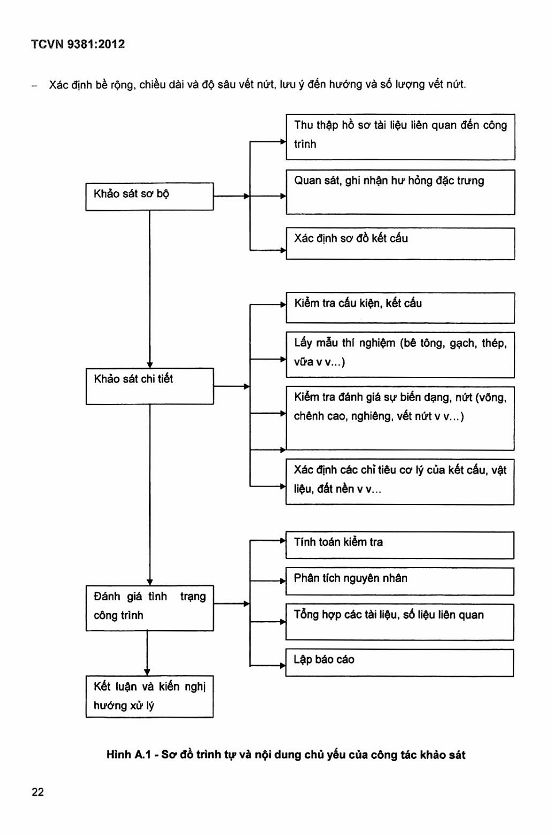

## PHỤ LỤC A (Tham khảo) — Trình tự và nội dung khảo sát kỹ thuật nhà

### A.1  Trình tự khảo sát kỹ thuật

### A.1.1  Mục đích khảo sát là xác định tình trạng kỹ thuật của các điều kiện, kết cấu và của nhà, đánh giá định lượng các đặc trưng hiện trạng của cấu kiện, kết cấu có kể đến sự thay đổi của chúng theo thời gian.

### A.1.2  Khảo sát kỹ thuật bao gồm các giai đoạn: khảo sát sơ bộ, khảo sát chi tiết, lập báo cáo, trên cơ sở đó xác định tính nguy hiểm của nhà hoặc bộ phận của nó.

### A.1.3  Trong giai đoạn khảo sát sơ bộ cần tiến hành nghiên cứu các tài liệu lưu trữ, tiêu chuẩn đã dùng để thiết kế, thu thập các tài liệu liên quan, bao gồm:

&nbsp;&nbsp;\- Hồ sơ thiết kế (kiến trúc, kết cấu);

&nbsp;&nbsp;\- Tài liệu khảo sát hiện trạng nhà đợt gần nhất;

&nbsp;&nbsp;\- Các thông tin về khu vực xây dựng;

&nbsp;&nbsp;\- Tài liệu khảo sát địa chất.

Trong giai đoạn khảo sát sơ bộ còn cần phải tiến hành các công việc sau:

&nbsp;&nbsp;\- Xác định sơ đồ kết cấu của nhà, các kết cấu chịu lực và vị trí của chúng;

&nbsp;&nbsp;\- Phân tích sự bố trí qui hoạch kết hợp với sơ đồ kết cấu;

&nbsp;&nbsp;\- Quan sát, chụp ảnh kết cấu mái, cửa đi, cửa sổ, cầu thang, kết cấu chịu lực, mặt ngoài nhà;

&nbsp;&nbsp;\- Xác định những vị trí và vùng cần khảo sát;

&nbsp;&nbsp;\- Nghiên cứu những đặc điểm của vùng đất lân cận, hiện trạng qui hoạch vùng đất khảo sát;

### A.1.4  Khảo sát chi tiết nhằm mục đích xác định lại sơ đồ kết cấu, kích thước cấu kiện, tình trạng của vật liệu và kết cấu tổng thể. Khi khảo sát chi tiết, bằng những dụng cụ và thiết bị chuyên dụng, cần tiến hành các công việc sau:

&nbsp;&nbsp;\- Kiểm tra kết cấu (để xác định thép, lớp bê tông bảo vệ, các lớp cấu tạo v.v...)

&nbsp;&nbsp;\- Lấy mẫu để thí nghiệm;

&nbsp;&nbsp;\- Kiểm tra và đánh giá sự biến dạng;

&nbsp;&nbsp;\- Xác định các chỉ tiêu cơ lý của kết cấu, vật liệu, nền ...

### A.1.5  Báo cáo khảo sát chi tiết bao gồm:

&nbsp;&nbsp;\- Danh mục những tài liệu cần thiết để lập báo cáo;

&nbsp;&nbsp;\- Lịch sử công trình;

&nbsp;&nbsp;\- Mô tả vùng lân cận;

&nbsp;&nbsp;\- Mô tả tình trạng tổng quát của công trình theo các dấu hiệu bên ngoài;

&nbsp;&nbsp;\- Mô tả kết cấu nhà, các đặc trưng và tình trạng của nó;

&nbsp;&nbsp;\- Các bản vẽ kết cấu với đầy đủ chi tiết và kích thước đo được (bản vẽ hiện trạng);

&nbsp;&nbsp;\- Xác định tải trọng tác dụng và tính toán kiểm tra kết cấu chịu lực và nền móng;

&nbsp;&nbsp;\- Các chỉ tiêu cơ, lý, hóa được xác định của vật liệu, cấu kiện, kết cấu, đất nền qua thí nghiệm, quan trắc;

&nbsp;&nbsp;\- Các bản vẽ mặt bằng và mặt cắt nhà, mặt bằng và mặt cắt các hố khoan, các bản vẽ thể hiện quá trình khảo sát kết cấu;

&nbsp;&nbsp;\- Báo cáo khảo sát địa chất công trình và địa chất thủy văn của khu đất đó, đặc trưng của đất nền (nếu cần);

&nbsp;&nbsp;\- Điều kiện sử dụng công trình;

&nbsp;&nbsp;\- Phân tích nguyên nhân gây nguy hiểm cho nhà nấu có;

&nbsp;&nbsp;\- Ảnh chụp toàn cảnh của nhà, những cấu kiện kết cấu bị hư hỏng và các bộ phận liên quan;

&nbsp;&nbsp;\- Kết luận và kiến nghị.

### A.2  Nội dung khảo sát chi tiết các kết cấu nhà

### A.2.1  Khảo sát nền móng

Khi khảo sát nền móng cần thực hiện các công việc sau:

&nbsp;&nbsp;\- Khảo sát hiện trạng các công trình lân cận;

&nbsp;&nbsp;\- Khảo sát hiện trạng móng công trình;

&nbsp;&nbsp;\- Khảo sát địa chất công trình;

&nbsp;&nbsp;\- Quan trắc lún, nghiêng của công trình (nếu cần);

### A.2.1.1  Khảo sát hiện trạng các công trình lân cận

Mục đích: là thu thập thêm thông tin để đánh giá sự hư hỏng và mức độ ảnh hưởng đến công trình đang khảo sát. Các thông tin đó là:

&nbsp;&nbsp;\- Qui mô đặc điểm công trình;

&nbsp;&nbsp;\- Hiện trạng kết cấu của công trình;

&nbsp;&nbsp;\- Khoảng cách đến công trình đang khảo sát;

&nbsp;&nbsp;\- Lịch sử xây dựng và khai thác sử dụng;

&nbsp;&nbsp;\- Những dấu hiệu thể hiện bên ngoài (nứt, lún, nghiêng v.v...)

### A.2.1.2  Khảo sát hiện trạng móng công trình

Thông thường là làm lộ móng ở các vị trí đặc trưng (dưới các kết cấu chịu lực chủ yếu, tại các vị trí có dấu hiệu hư hỏng nặng v.v...), thông tin cần xác định là:

&nbsp;&nbsp;\- Loại móng, các kích thước chủ yếu, độ sâu đế móng;

&nbsp;&nbsp;\- Vật liệu làm móng (cường độ vật liệu, hiện trạng v.v...);

&nbsp;&nbsp;\- Tình trạng cốt thép, các dấu hiệu hư hỏng như nứt, gãy v.v...

### A.2.1.3  Khảo sát địa chất công trình

Khoan lấy mẫu đất để thí nghiệm xác định các chỉ tiêu của đất.

Có thể thí nghiệm xuyên tĩnh CPT hoặc xuyên tiêu chuẩn SPT.

Độ sâu khảo sát được xác định phụ thuộc vào kích thước và tải trọng tác dụng, chiều dày của lớp đất yếu dưới công trình. Thông thường phải khảo sát qua các lớp đất yếu (nếu đã có tài liệu khảo sát địa chất dùng khi thiết kế thì có thể chỉ tiến hành khảo sát bổ sung).

### A.2.1.4  Quan trắc lún, nghiêng của công trình (nếu cần)

Quan trắc lún nhằm xác định độ lún và tốc độ phát triển lún của công trình theo thời gian phụ thuộc vào yêu cầu của công tác khảo sát và thực trạng của công trình để tiến hành quan trắc lún, nghiêng trong một quãng thời gian hợp lý và thực hiện theo tiêu chuẩn đo lún hiện hành.

### A.2.2  Khảo sát kết cấu phần thân

### A.2.2.1  Khảo sát kết cấu chung

Cần tiến hành xem xét và đo đạc, kiểm tra kết cấu khung với các nội dung sau:

&nbsp;&nbsp;\- Kích thước hình học, độ thẳng đứng của cột, độ võng của dầm;

&nbsp;&nbsp;\- Xác định cường độ vật liệu khung;

&nbsp;&nbsp;\- Quan trắc ghi nhận vết nứt, độ sâu vết nứt, sự phát triển vết nứt theo thời gian;

&nbsp;&nbsp;\- Kiểm tra chiều dày lớp bê tông bảo vệ, đường kính và bố trí cốt thép trong khung.

### A.2.2.2  Khảo sát kết cấu sàn

Tiến hành kiểm tra trực quan tất cả các cấu kiện, kết cấu sàn bao gồm: gối tựa, nhịp sàn, dầm đỡ sàn. Khi xem xét phải chú ý tới độ võng của sàn, trạng thái lớp bảo vệ trần, vết nứt và đặc điểm của vết nứt: mật độ, hướng và sự thay đổi bề rộng vết nứt để có nhận định về mức độ hư hỏng và quyết định các bước khảo sát tiếp theo như: xác định độ sâu vết nứt, cường độ bê tông, loại cốt thép và phân bố cốt thép trong dầm sàn.

Vẽ mặt phẳng, mặt cắt sàn, ghi các kết quả đo đạc và những hư hỏng hiện trạng của sàn.

### A.2.2.3  Khảo sát ban công, lôgia

Khi xem xét cần làm rõ liên kết ban công với tường và sàn, tình trạng và biến dạng các bộ phận của ban công, lôgia.

Tùy thuộc vào sơ đồ tính toán của ban công, cần xem xét:

&nbsp;&nbsp;\- Với sơ đồ công xôn: tình trạng liên kết với tường.

&nbsp;&nbsp;\- Với sơ đồ công xôn có thanh chống xiên: tình trạng của thanh chống xiên, liên kết của nó với công xôn, liên kết công xôn với tường, trạng thái của công xôn tại giữa nhịp, liên kết của thanh chống xiên với tường;

&nbsp;&nbsp;\- Với sơ đồ dầm trên hai gối tựa: tình trạng dầm tại gối tựa và giữa nhịp.

### A.2.2.4  Khảo sát mái

Khi khảo sát các kết cấu chịu lực mái cần tiến hành:

&nbsp;&nbsp;\- Quan sát, đo vẽ kết cấu và lập bản vẽ mặt bằng;

&nbsp;&nbsp;\- Làm rõ loại kết cấu chịu lực (vì kèo, panel v.v...)

&nbsp;&nbsp;\- Xác định các lớp cấu tạo mái, lưu ý tới độ dốc và các lớp vật liệu mái, tình trạng đường thoát nước (sênô, đường ống, các khe tiếp giáp);

&nbsp;&nbsp;\- Đánh giá biến dạng của các cấu kiện chịu lực mái.

Trường hợp mái có kết cấu thép thì cần xác định mức độ ăn mòn và độ võng của cấu kiện, kết cấu. Đối với mái bằng panel bê tông cốt thép cần chú ý tới vết nứt, sự hư hỏng của lớp bê tông bảo vệ.

### A.2.2.5  Khảo sát cầu thang

Khảo sát cầu thang nhằm mục đích xác định:

&nbsp;&nbsp;\- Loại vật liệu và đặc tính của kết cấu cầu thang;

&nbsp;&nbsp;\- Liên kết các cấu kiện cầu thang;

&nbsp;&nbsp;\- Tình trạng và độ bền các cấu kiện cầu thang;

Đối với cầu thang bê tông cốt thép lắp ghép, cần xác định:

&nbsp;&nbsp;\- Tình trạng liên kết giữa bản thanh và tường;

&nbsp;&nbsp;\- Tình trạng gối tựa của chiếu nghỉ (tới) và các chi tiết liên kết bằng mối hàn;

&nbsp;&nbsp;\- Sự phân bố vết nứt và những hư hỏng trên bản thang.

Đối với cầu thang gạch tựa trên cốn bằng thép cần xác định:

&nbsp;&nbsp;\- Tình trạng của liên kết các bản thang vào tường;

&nbsp;&nbsp;\- Sự ăn mòn của các liên kết bằng thép;

&nbsp;&nbsp;\- Trạng thái thể xây tại những vị trí liên kết dầm và bản thang.

Đối với cầu thang gỗ tựa trên cốt thép và các dầm ngang bằng gỗ cần xác định:

&nbsp;&nbsp;\- Tình trạng và độ bền của liên kết các dầm chiếu nghỉ (tới) với tường;

&nbsp;&nbsp;\- Tình trạng liên kết xà ngang với dầm;

&nbsp;&nbsp;\- Tình trạng của gỗ làm xà ngang, bậc, dầm.

### A.2.2.6  Khảo sát tường

Khảo sát tường nhằm mục đích xác định:

&nbsp;&nbsp;\- Tình trạng kết cấu và vật liệu tường;

&nbsp;&nbsp;\- Vết nứt, sự sai lệch về kích thước hình học;

&nbsp;&nbsp;\- Sự có mặt của cốt thép hay các chi tiết liên kết bằng thép;

&nbsp;&nbsp;\- Xác định các đặc trưng cơ, lý của tường, nếu là tường gạch thì xác định cường độ khối thể xây, cường độ của gạch, vữa xây, vữa trát, độ hút nước của gạch;

&nbsp;&nbsp;\- Xác định bê tông, chiều dài và độ sâu vết nứt, lưu ý đến hướng và số lượng vết nứt.

<strong>Hình A.1 — Sơ đồ trình tự và nội dung chủ yếu của công tác khảo sát</strong>
