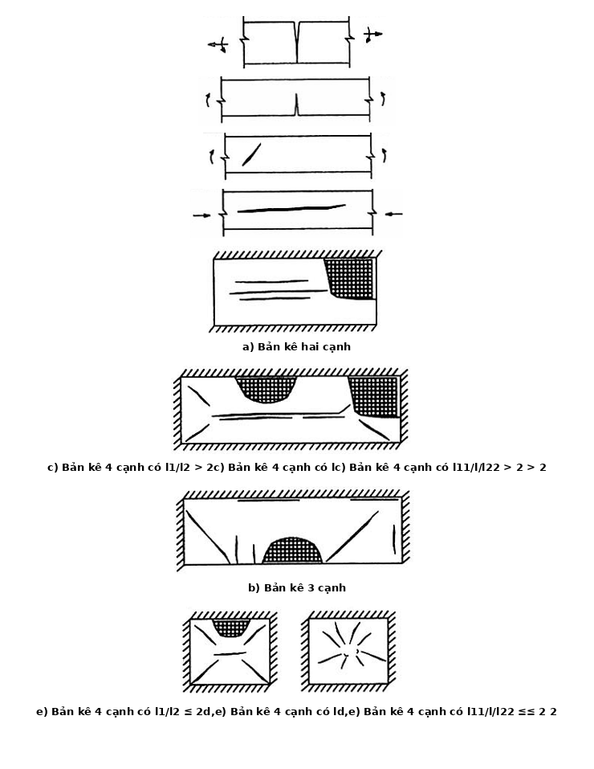
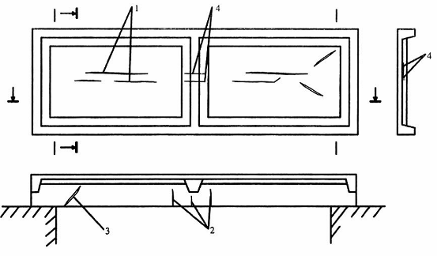
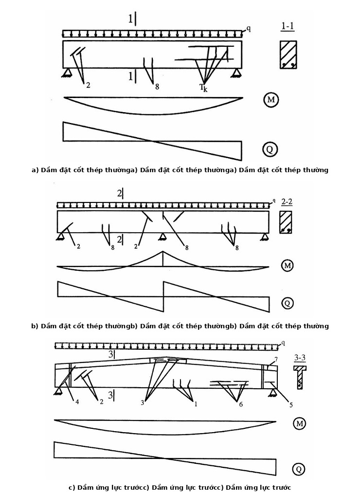
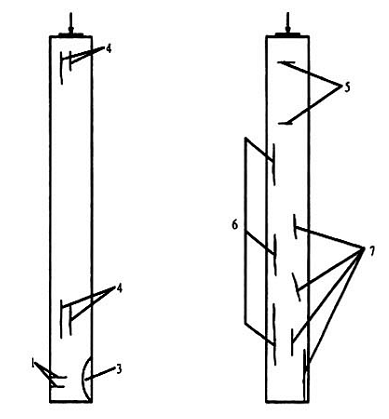

## PHỤ LỤC B (Tham khảo) — Vết nứt trong kết cấu bê tông cốt thép

### B.1  Phân loại vết nứt

### B.1.1  Vết nứt trong kết cấu bê tông cốt thép do nhiều nguyên nhân gây nên như do tác động của lực hoặc do ứng suất nhiệt và ứng suất co ngót. Thông thường phân loại vết nứt như sau:

a) \- Theo nguyên nhân xuất hiện:

&nbsp;&nbsp;&nbsp;&nbsp;\- Vết nứt do tác động của ngoại lực trong quá trình sử dụng;

&nbsp;&nbsp;&nbsp;&nbsp;\- Vết nứt do tác động của cốt thép ứng lực trước lên bê tông;

&nbsp;&nbsp;&nbsp;&nbsp;\- Vết nứt công nghệ do co ngót bê tông, do mức độ đầm vữa bê tông kém, chưng hấp bê tông không đều, do chế độ nhiệt-ẩm;

&nbsp;&nbsp;&nbsp;&nbsp;\- Vết nứt hình thành do cốt thép bị ăn mòn.

b) \- Theo mức độ nguy hiểm:

&nbsp;&nbsp;&nbsp;&nbsp;\- Vết nứt chứng tỏ tình trạng nguy hiểm của kết cấu;

&nbsp;&nbsp;&nbsp;&nbsp;\- Vết nứt làm tăng độ thấm nước của bê tông (ở tường tầng hầm);

&nbsp;&nbsp;&nbsp;&nbsp;\- Vết nứt làm giảm tuổi thọ kết cấu do cốt thép hoặc bê tông bị ăn mòn mạnh;

&nbsp;&nbsp;&nbsp;&nbsp;\- “Vết nứt thường” không gây nguy hiểm cho kết cấu (bề rộng vết nứt thường không vượt quá giá trị giới hạn cho phép của tiêu chuẩn).

### B.1.2  Nghiên cứu đặc điểm của vết nứt và sự mở rộng của chúng trong phần lớn trường hợp có thể xác định được nguyên nhân hình thành vết nứt cũng như đánh giá được mức độ nguy hiểm của kết cấu.

Các vết nứt do tác động của lực thường xuất hiện theo phương vuông góc với ứng suất kéo chính. Các loại vết nứt do tác động của lực cho trong Bảng B.1.

Vết nứt do co ngót bê tông trong các kết cấu phẳng thường phân bố theo thể tích, còn trong các kết cấu có hình dạng phức tạp thường tập trung ở những chỗ giáp nhau (như ở chỗ tiếp giáp giữa sườn và cánh trong bản sàn, trong dầm chữ T...). Vết nứt do ăn mòn dọc theo cốt thép bị ăn mòn.

### B.2  Vết nứt trong bản sàn toàn khối

### B.2.1  Vết nứt trong bản sàn do tác động của lực gây nên phụ thuộc vào sơ đồ tính của bản: loại và đặc trưng của tác động, cách đặt cốt thép và tỉ lệ giữa các nhịp. Khi đó, vết nứt xuất hiện theo phương vuông góc với ứng suất kéo chính (xem Hình B.1)

### Bảng B.1 - Vết nứt do tác động của lực trong kết cấu bê tông cốt thép

| Loại vết nứt | Hình dáng vết nứt | Cấu kiện bê tông cốt thép |
| :--- | :--- | :--- |
| Vết nứt xuyên suốt. |  | Cấu kiện chịu kéo lệch tâm |
| Vết nứt không xuên suốt |  | Cấu kiện chịu uốn và cấu kiện chịu nén lệch tâm |
| Vết nứt có dạng đường khép kín |  | Vùng gối tựa của cấu kiện chịu uốn |
| Vết nứt dọc không xuyên suốt |  | Cấu kiện chịu nén. |

### Bảng Phụ lục B

| a) Bản kê hai cạnh | c) Bản kê 4 cạnh có $l_{1}$/$l_{2}$ > 2 |
| :--- | :--- |
| b) Bản kê 3 cạnh | d,e) Bản kê 4 cạnh có $l_{1}$/$l_{2}$ ≤ 2 |

**CHÚ DẪN: a, b, c, e - Chịu tải trọng phân bố đều; d - Chịu tải trọng tập trung.**

<strong>Hình B.1 — Vết nứt do tác động của lực trong bản sàn</strong>

### B.2.2  Những nguyên nhân gây nên sự mở rộng vết nứt do tác động của lực thường là do bản sàn bị quá tải, không đủ cốt thép chịu lực hoặc bố trí thép không đúng (lưới thép bị dịch xuống gần trục trung hòa).

### B.3  Vết nứt trong sàn panel lắp ghép

### B.3.1  Các panel sườn lắp ghép loại chữ vẽ và 2T là kết cấu tổ chức hợp từ dầm (sườn) và bản. Vì vậy, đặc trưng hình thành vết nứt trong loại kết cấu này do tải trọng sử dụng không khác trong dầm và bản sàn (Hình B.2). Mặt khác, do hình dáng phức tạp, đặt cốt thép dầy nên khi sản xuất panel thường có những khuyết tật công nghệ dưới dạng vết vỡ và vết nứt do co ngót như: các vết nứt dọc theo cốt thép , do bê tông được đầm không liên tục; vết nứt do biến dạng khuôn, tỉ lệ xi măng : nước (X : N) lớn.

<strong>Hình B.2 — Các vết nứt trong sàn panel lắp ghép (1 ÷ 4) do tác động của lực.</strong>

### B.4  Vết nứt trong dầm có đặt cốt thép thường.

### B.4.1  Trong dầm thường xuất hiện những vết nứt thẳng góc hoặc vết nứt xiên với trục dọc cấu kiện. Những vết nứt thẳng góc thường xuất hiện ở vùng chịu mô men uốn lớn nhất, còn những vết nứt xiên  - ở vùng chịu ứng suất tiếp lớn nhất, gần gối tựa.

### B.4.2  Sự hình thành vết nứt trong dầm chủ yếu phụ thuộc vào sơ đồ tính của dầm, tiết diện ngang và trạng thái ứng suất trong dầm. Trên Hình B.3 thể hiện các vết nứt do tác động của lực trong dầm đơn giản và liên tục có tiết diện chữ nhật. Đặc điểm điển hình  là những vết nứt thẳng góc có bề rộng lớn nhất ở biên chịu kéo, trong khi những vết nứt xiên - ở gần trọng tâm tiết diện.

### B.4.3  Những vết nứt thẳng góc có bề rộng lớn hơn 0,5 mm thường chứng tỏ dầm bị quá tải hoặc không bố trí đủ cốt thép chịu lực.

### B.4.4  Những vết nứt xiên, đặc biệt ở vùng neo cốt thép dọc chịu lực, được cho là nguy hiểm vì chúng có thể làm cho dầm gãy bất ngờ. Nguyên nhân gây nên sự hình thành và mở rộng vết nứt xiên thường là chất lượng bê tông kém, bước cốt đai thưa, chất lượng hàn cốt thép dọc và cốt đai kém.

### B.5  Vết nứt trong dầm ứng lực trước.

### B.5.1  Các dầm ứng lực trước thường phải tuân theo yêu cầu cao về khả năng chống nứt. Vì vậy, sự xuất hiện các vết nứt có bề rộng lớn thường chứng tỏ dầm bị quá tải, hoặc sai sót nghiêm trọng trong công nghệ chế tạo dầm.

### B.5.2  Trên hình B.2 thể hiện những vết nứt đặc trưng trong dầm ứng lực trước. Trong Bảng B.2 thể hiện những nguyên nhân có thể gây nên những vết nứt có bề rộng đáng kể.

<!-- DIAGRAM: word/media/image47.png -->

a) \- Dầm đặt cốt thép thường

<!-- DIAGRAM: word/media/image48.png -->

b) \- Dầm đặt cốt thép thường

<!-- DIAGRAM: word/media/image49.png -->

c) \- Dầm ứng lực trước

**CHÚ DẪN: Từ 1 đến 8 là các vết nứt công nghệ và các vết nứt do tác động của ngoại lực (xem Bảng B.2)**

<strong>Hình B.3 — Vết nứt trong dầm</strong>

### B.6  Vết nứt trong cột bê tông cốt thép

### B.6.1  Những vết nứt trong cột phụ thuộc chủ yếu vào trạng thái nén lệch tâm và đặc trưng của tải trọng tác dụng. Ngoài ra, còn do ảnh hưởng của cường độ bê tông, bố trí cốt thép, điều kiện đông cứng của bê tông... Khi tải trọng lệch tâm lớn, trong vùng kéo có thể hình thành các vết nứt ngang có bề rộng lớn (số 1, Hình B.4) chứng tỏ cột bị quá tải hoặc đặt cốt thép không đủ. Khi độ lệch tâm nhỏ xuất hiện những vết nứt thẳng đứng (số 2) chứng tỏ thân cột bị quá tải hoặc cường độ bê tông thấp.

### B.6.2  Chất lượng hàn cốt thép dọc và cốt đai kém hoặc bước cốt đai lớn dẫn đến sự mất ổn định của cốt thép dọc chịu nén và xuất hiện các vết nứt số 3. Khi không có cốt gián tiếp ở vùng tập trung ứng suất ở đỉnh cột thường gây nên vết nứt thẳng đứng số 4.

Vết nứt số 5 xuất hiện do xếp đặt, vận chuyển và cẩu lắp không đúng quy định; vết nứt số 6 - do ăn mòn cốt thép; vết nứt số 7 - vết nứt công nghệ.

Các vết nứt được thể hiện trên Hình B.4 chưa nêu được hết các trường hợp thường gặp trong thực tế. Các vết nứt có thể xuất hiện do tác động động lực, tác động mạnh của lực cục bộ, hiện tượng lún nền móng. Vì vậy, cần phải phân tích cẩn thận trước khi đưa ra kết luận về mức độ nguy hiểm do các vết nứt gây nên.

### Bảng B.2 - Vết nứt trong dầm bê tông cốt thép

| Số TT vết nứt (Hình B.3) | Nguyên nhân có thể gây nên sự hình thành vết nứt |
| :--- | :--- |
| 1 | Không đủ ứng  suất trong dầm: lực căng cốt thép nhỏ, hao tổn ứng suất trước lớn. Dầm bị quá tải ở tiết diện thẳng góc. |
| 2 | Bị hỏng khi sản xuất: cường độ bê tông thấp, bước cốt đai lớn, chất lượng hàn cốt thép dọc và cốt thép kém. Dầm bị quá tải ở tiết diện nghiêng. |
| 3 | Cường độ bê tông thấp. Dầm bị quá tải ở tiết diện nghiêng. |
| 4 | Phá hoại neo cốt thép ứng lực trước: cường độ bê tông thấp, không đủ cường độ bê tông tại thời điểm trước khi nén trước bê tông. |
| 5;6 | Không có cốt xoắn trong vùng neo cốt thép ứng lực trước. |
| 7 | Không đủ cốt xoắn. Liên kết hàn các chi tiết đặt sẵn nối các dầm liền kề làm thay đổi sơ đồ tính toán của chúng. |
| 8 | Dầm bị quá tải ở tiết diện thẳng góc. Không bố trí đủ cốt thép chịu lực. |

<strong>Hình B.4 — Vết nứt trong cột bê tông cốt thép.</strong>
