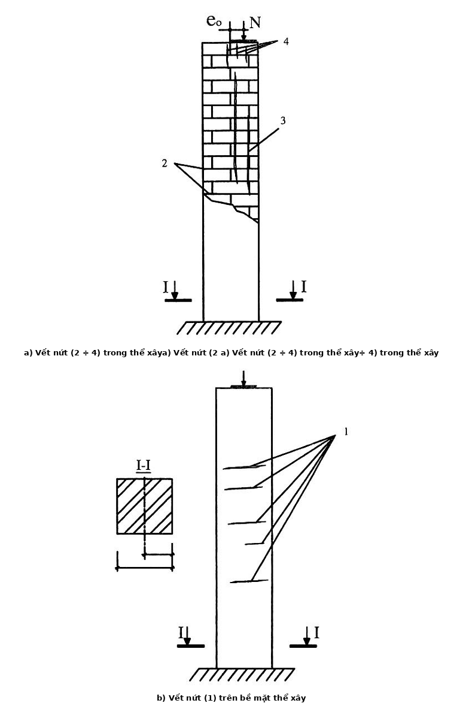
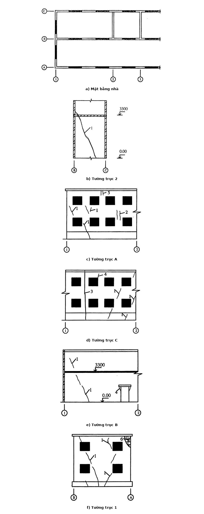

## PHỤ LỤC C (Tham khảo) — Vết nứt trong két cấu xây gạch

### C.1  Những yếu tố gây nên vết nứt

### C.1.1  Kết cấu xây gạch (sau đây gọi tắt là thể xây) có khả năng chịu nén lớn hơn nhiều so với khả năng chịu kéo. Vì vậy, ở bên mặt chịu kéo của thể xây, thường xuất hiện nhiều vết nứt khi thể xây bị phá hoại. Những yếu tố có khả năng gây nên vết nứt thường là:

&nbsp;&nbsp;\- Chất lượng thể xây kém (mạch vữa to, không bố trí gạch so le v.v...);

&nbsp;&nbsp;\- Cường độ gạch và vữa không đủ (gạch vừa cong vừa có sẵn vết nứt, vữa xây có độ sụt lớn);

&nbsp;&nbsp;\- Trong thể xây có nhiều loại gạch có độ biến dạng khác nhau (như gạch đất sét nung với gạch silicát và gạch xỉ);

&nbsp;&nbsp;\- Sử dụng không đúng chủng loại gạch theo chỉ định (như dùng gạch silicát trong điều kiện độ ẩm lớn);

&nbsp;&nbsp;\- Không có khe co giãn nhiệt hoặc khoảng cách giữa các khe co giãn lớn;

&nbsp;&nbsp;\- Tác động của môi trường xâm thực;

&nbsp;&nbsp;\- Móng bị lún lệch.

### C.1.2  Khi phân tích hiện tượng nứt trong thể xây, cần chú ý khi có vết nứt trong gạch chứng tỏ thể xây bị quá tải. Nếu vết nứt vẫn phát triển chứng tỏ thể xây bị quá tải nhiều và cần được giảm tải ngay hoặc gia cường.

### C.2  Vết nứt trong cột gạch chịu nén lệch tâm

### C.2.1  Đặc trưng hình thành vết nứt trong cột gạch tùy thuộc vào độ lệch tâm của lực tác dụng.

Khi độ lệch tâm lớn, trong vùng chịu kéo của cột theo các mạch vữa hình thành những vết nứt ngang. Khi tải trọng sử dụng tăng, vết nứt mở rộng và kéo dài thêm làm cho cột mất khả năng chịu lực hoặc bị phá hoại vùng chịu nén của cột.

Khi độ lệch tâm nhỏ, có thể không xuất hiện vết nứt. Nhưng, nếu cột bị quá tải thì xuất hiện những vết nứt dọc theo phương thẳng đứng (xem Hình C.1).

### C.2.2  Cột gạch chịu nén lệch tâm có những vết nứt dọc và ngang với bề rộng trên 0,5 mm cần phải gia cường.

### C.3  Vết nứt trong tường gạch

### C.3.1  Nguyên nhân làm cho tường bị nứt có thể là ngoại lực hoặc nội lực do ảnh hưởng của môi trường xung quanh và do các quá trình lý-hóa xảy ra trong vật liệu thể xây. Trong những nhà có sàn bê tông làm việc cùng với tường, nguyên nhân gây xuất hiện vết nứt có thể là do chênh lệch hệ số giãn nở nhiệt của bê tông và tường gạch.

### Bảng Phụ lục C

| a) Vết nứt (2 ÷ 4) trong thể xây | b) Vết nứt (1) trên bề mặt thể xây |
| :--- | :--- |

<strong>Hình C.1 — Vết nứt trong tường, trụ gạch</strong>

### C.3.2  Các vết nứt trong tường có hướng và độ sâu khác nhau. Khi tường chịu nén đúng tâm, trong vùng bị quá tải xuất hiện những vết nứt thẳng đứng song song với hướng tác dụng của lực và xuyên suốt chiều rộng tường. Khi tường chịu nén lệch tâm, có thể hình thành những vết nứt ngang không sâu, đồng thời tường bị cong phình. Nếu không có đệm dưới đầu dầm bê tông cốt thép hoặc dầm thép thì tại gối tựa thường xuất hiện những vết nứt thẳng đứng không sâu chứng tỏ ứng suất nén trong thể xây là rất lớn.

### C.3.3  Trong số những tác động gây ra vết nứt, tác động do móng dưới tường bị lún lệch là rất nguy hiểm. Ví dụ, trong nhà không có tầng hầm, nguyên nhân gây lún lệch có thể là do đào hố dưới mức đế móng hoặc đào hố móng của nhà bên cạnh. Đóng cọc bên cạnh nhà cũng gây nên sự hình thành vết nứt.

### C.3.4  Hình C.2 minh họa hư hỏng nguy hiểm của tường. Nguyên nhân có thể gây nên vết nứt cho trong Bảng C.1.

### Bảng Phụ lục C (Phần 2)

| a) Mặt bằng nhà | b) Tường trục 2 |
| :--- | :--- |
| c) Tường trục A | d) Tường trục C |
| e) Tường trục B | f) Tường trục 1; |

**CHÚ DẪN: Từ 1 đến 6 là các vết nứt trong tường**

<strong>Hình C.2 — Vết nứt trong tường</strong>

### Bảng C.1 - Nguyên nhân gây nứt trong tường

| Số TT vết nứt (Hình C.1) | Nguyên nhân có thể gây nứt |
| :---: | :--- |
| 1 | Móng bị lún lệch: độ ẩm trong đất nền thay đổi, móng bị trồi do đào hố móng cho nhà liền kề sâu hơn nhà cũ. |
| 2 | Tường bị quá tải. Cường độ thể xây thấp. |
| 3 | Chiều dài khối nhà lớn hơn giá trị cho phép (không có khe co giãn nhiệt) |
| 4 | Cường độ thể xây thấp. Không đủ diện tích gối tựa cho lanh tô. Lanh tô có biến dạng lớn do nhiệt. |
| 5 | Không có khe hở giữa đầu xà gồ và tường. |
| 6 | Thể xây bị ẩm quá. Cường độ gạch và vữa thấp. |